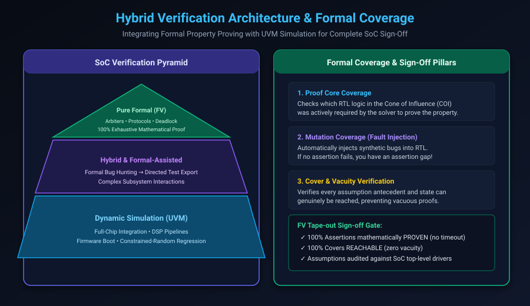

# Formal Coverage, Sign-off & Hybrid Verification Flow

## Introduction: The Tape-Out Sign-Off Dilemma

In dynamic simulation, verification sign-off is tracked through concrete numerical metrics: 100% line coverage, toggle coverage, branch coverage, and functional covergroups. 

In formal verification, engineers frequently encounter a vexing dilemma: **"If all my assertions prove with a green checkmark, how do I know I wrote enough assertions?"**

A design with a single trivial assertion (`assert property (1 == 1);`) will return 100% `PROVEN`, yet provides zero verification coverage. Even worse, subtle over-constraining in an `assume` statement can silently mask dozens of critical design defects.

To achieve **Tape-Out Sign-off Confidence**, the semiconductor industry has developed rigorous **Formal Coverage Metrics** and **Hybrid Verification Methodologies** that combine the mathematical precision of formal proof engines with the scale of UVM constrained-random simulation.

This chapter covers:
1. **The Modern SoC Verification Pyramid**.
2. **Formal Coverage Metrics: Proof Core, Mutation & Reachability**.
3. **Hybrid Verification: Bridging Formal and UVM Testbenches**.
4. **Assumption Auditing (Hierarchical Assumption Proving)**.
5. **The Formal Verification Tape-Out Sign-Off Gate**.
6. **Hands-On Exercises & Review Questions**.

---

## The Modern SoC Verification Pyramid

Neither formal verification nor dynamic simulation can solve the entire verification challenge alone. High-assurance silicon engineering balances both techniques across the verification hierarchy:



### Strategic Allocation of Verification Methodology

| Verification Tier | Primary Methodology | Target Blocks & Functionality |
| :--- | :--- | :--- |
| **Top Tier: Unit / Block** | Pure Formal Verification (FV) | Control logic, arbiters, FIFOs, protocol adapters, cache controllers, security registers, power/reset controllers |
| **Middle Tier: Subsystem** | Hybrid Verification (Formal + Directed) | Memory sub-systems, interconnect crossbars, DMA engines, formal-to-simulation trace export |
| **Base Tier: Full Chip / SoC** | Dynamic Simulation (UVM) & Emulation | Full-chip boot, software/firmware bring-up, PCIe/DDR controller physical layers, neural network pipelines |

---

## Measuring Completeness: Formal Coverage Metrics

To prove that a formal testbench is thorough and free of coverage holes, EDA tools provide three foundational coverage pillars:

### 1. Proof Core Coverage (COI Analysis)
When a SAT/SMT solver proves that a property is UNSAT (no violation exists), it generates an **Unsatisfiable Core (UNSAT Core)**—the minimal set of clauses and RTL statements required to establish the proof.
- **How It Works**: The tool maps the UNSAT core back to the original RTL source code.
- **The Metric**: Any RTL statement or multiplexer inside the design that was **not** part of the proof core indicates an **unverified design path**!
- If an entire state machine branch was never analyzed by the solver, you are missing assertions governing that branch.

### 2. Mutation Coverage (Fault Injection)
Mutation coverage is the gold standard for measuring formal testbench completeness:
1. The tool automatically injects synthetic bugs (**mutations**) into the RTL source:
   - Forcing a bit stuck-at-0 or stuck-at-1.
   - Inverting conditional branches (`if (valid)` $\rightarrow$ `if (!valid)`).
   - Deleting assignments.
2. The formal solver runs against each mutated circuit.
3. If at least one assertion **fails**, the mutant is marked **KILLED** (verification success).
4. If all assertions still pass, the mutant is marked **ALIVE** (assertion gap! Your testbench failed to catch a deliberate bug in that code line).

### 3. Reachability & Cover Coverage
Every formal testbench must contain functional `cover property` directives to verify that:
- Every FSM state is reachable.
- Every protocol transaction type can complete.
- Every assumption antecedent can be triggered.
- If a cover statement reports **UNREACHABLE**, you have identified an **Over-Constraining Bug** or **Dead Code**.

---

## Hybrid Formal-to-Simulation Workflows

Formal verification and dynamic simulation are deeply complementary:

```text
       +-----------------------+
       | Formal Bug Hunting    |
       +-----------------------+
                   |
                   v (Falsification Counterexample)
       +-----------------------+
       | Export Trace (.vcd)   |
       +-----------------------+
                   |
                   v (Translate to SystemVerilog)
       +-----------------------+
       | Directed UVM Sequence |
       +-----------------------+
                   |
                   v
       +-----------------------+
       | Nightly Regression CI |
       +-----------------------+
```

### 1. Counterexample Trace to UVM Test Conversion
When formal verification discovers a complex, 40-cycle corner-case bug, the tool can automatically export the counterexample trace as a **directed SystemVerilog UVM test sequence**. This test is added to the nightly regression suite to ensure the bug never regresses.

### 2. Formal-Assisted Coverage Closure
In UVM simulation, achieving 100% functional coverage often stalls at 98%: the last 2% of coverage bins represent extremely rare multi-condition corner cases that randomized stimulus generators fail to hit. 

Verification engineers feed these unreached coverage bins into a formal tool as `cover property` targets. The formal solver synthesizes the exact input vectors required to reach them, closing the final coverage gap.

---

## Assumption Auditing: Hierarchical Assumption Proving

One of the greatest hazards in formal verification is the **Unverified Assumption Trap**:

```text
[Subsystem Top]  --> Drives signal A
       |
       v
[Block Level DUT] --> Assume signal A is always valid
```

If an engineer verifying an APB peripheral writes:
```systemverilog
assume property (@(posedge clk) paddr < 32'h0000_1000);
```
They have proven the peripheral is correct **only under the condition that the master never addresses beyond 4KB**.

If the top-level SoC software accidentally drives address `0x2000`, the system will crash!

### The Hierarchical Audit Rule
Every block-level assumption MUST be promoted to an assertion when verifying the parent subsystem:

$$\text{Block Assumption: } \text{assume property }(P) \implies \text{Parent System Assertion: } \text{assert property }(P)$$

If the parent system fails to prove $P$, your block-level formal proof was invalid.

---

## Formal Verification Tape-Out Sign-Off Gate

Before declaring an ASIC block formally signed off for silicon tape-out, it must pass the following five gates:

```text
================================================================================
                    FORMAL VERIFICATION SIGN-OFF CHECKLIST
================================================================================
 [✓] GATE 1: 100% Assertions mathematically PROVEN (Unbounded via k-induction
             or bounded up to full architectural latency).
 [✓] GATE 2: ZERO Vacuous Proofs. Every assertion antecedent validated by an
             active, reachable cover property.
 [✓] GATE 3: 100% Functional Covers REACHABLE.
 [✓] GATE 4: Assumption Audit Complete. Every assume property validated against
             parent SoC interconnect specs or proven at the next hierarchical level.
 [✓] GATE 5: Formal Mutation Coverage exceeds project sign-off threshold (>90%
             mutants killed).
================================================================================
```

---

## Hands-On Exercise

### The Problem
You are reviewing a formal testbench for an interrupt controller. The testbench reports 100% of assertions `PROVEN`.
However, an audit reveals the following assumption:
```systemverilog
assume_irq_single: assume property (@(posedge clk)
    $onehot0(irq_inputs)
);
```
1. Identify the catastrophic flaw in this assumption for an interrupt controller designed to arbitrate multiple simultaneous interrupts.
2. Formulate the mutation check that would expose this flaw.
3. Fix the assumption and write the correct formal contract.

### The Solution

#### 1. Flaw Analysis:
The assumption `$onehot0(irq_inputs)` commands the solver to assume that **at most one interrupt input can ever be active at a time**. 
This over-constraining bug eliminates all simultaneous interrupt scenarios! The multi-line priority arbitration logic inside the controller is **never tested**, allowing priority inversion bugs to escape to silicon.

#### 2. Mutation Check:
If a mutation is injected that breaks the priority encoder (e.g. `gnt = 0` whenever `irq[0] && irq[1]`), the existing assertions will still pass because the solver is forbidden from asserting both bits simultaneously. The mutation remains **ALIVE**, exposing the testbench gap.

#### 3. Correct Formal Contract:
Allow unconstrained simultaneous interrupts, but ensure inputs are not driven during reset:

```systemverilog
// REMOVE the one-hot assumption completely!
// Inputs are freely driven by the solver to test all 2^N combinations.

// Correct Assumption: IRQ lines must be well-defined (no 'X values)
assume_known_irqs: assume property (@(posedge clk) disable iff (!rst_n)
    !$isunknown(irq_inputs)
);

// Companion Cover: Prove simultaneous multi-interrupt handling is exercised
cover_simultaneous_interrupts: cover property (@(posedge clk) disable iff (!rst_n)
    $countones(irq_inputs) >= 2
);
```

---

## Review Questions & Self-Assessment

1. **What is Proof Core Coverage, and how does it detect over-constrained formal setups?**
   *Answer:* Proof Core Coverage identifies the subset of RTL logic and registers used by the SAT solver to construct the formal proof. If critical control paths or registers are missing from the proof core, it indicates that those paths were not required for the proof, revealing an over-constrained environment or insufficient assertions.
2. **How does Mutation Coverage measure the quality of a formal testbench?**
   *Answer:* Mutation coverage automatically injects synthetic faults (stuck-at bits, logic inversions) into the RTL. If an assertion detects the fault and fails, the mutant is killed. If all assertions continue to pass despite the injected fault, an assertion gap exists in the testbench.
3. **What is the Unverified Assumption Trap, and how is it resolved?**
   *Answer:* It occurs when a block-level formal testbench relies on an assumption that is violated by the top-level system environment in real operation. It is resolved by hierarchical assumption auditing: converting every block-level assumption into a verification assertion at the parent subsystem level.
4. **What are the five mandatory criteria for formal verification tape-out sign-off?**
   *Answer:* (1) 100% assertions proven; (2) Zero vacuous proofs; (3) 100% functional covers reached; (4) Complete hierarchical assumption audit; (5) Mutation coverage exceeding target threshold (>90%).

---

##### Copyright (c) 2026 squared-studio
