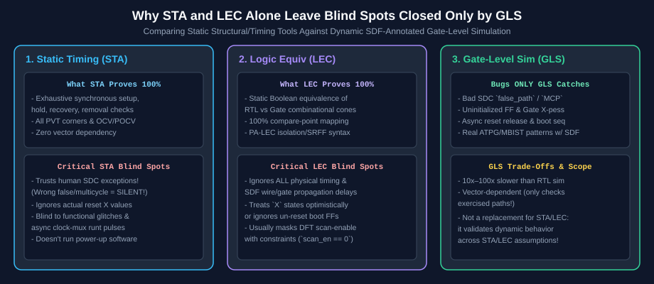
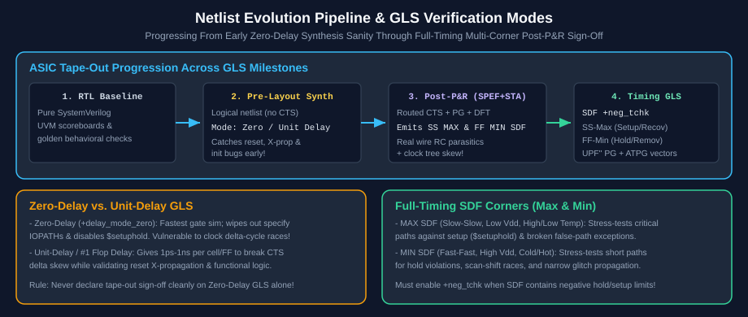

# Gate-Level Simulation Foundations and Why STA and LEC Are Not Enough

With modern Static Timing Analysis (STA) checking 100% of timing paths across dozens of corners and Logic Equivalence Checking (LEC) mathematically proving RTL-to-Gate Boolean equivalence, engineers often ask: *"Why do tape-out schedules still reserve weeks for computationally slow Gate-Level Simulation (GLS)?"* The answer lies in the fatal gap between **static assumptions** and **dynamic silicon reality**. Whenever an SDC false-path is wrong, an uninitialized register escapes reset, or a power/clock switch glitches mid-transition, STA and LEC pass with 100% green logs—while real silicon hangs on the lab bench.

---

## Learning Goals

After completing this chapter, you should be able to:

- Articulate the exact verification blind spots of **Static Timing Analysis (STA)** and **Logic Equivalence Checking (LEC)** that only dynamic GLS uncovers.
- Trace how digital designs progress from RTL through **Pre-Layout Logical Netlists (Zero/Unit-Delay GLS)** to **Post-P&R PG Netlists with Sign-Off SDF (Max/Min Timing GLS)**.
- Compare **Zero-Delay**, **Unit-Delay**, and **Full-Timing SDF** simulation modes across runtime cost, accuracy, and bug-detection power.
- Identify the five most common real-world silicon failure classes caught exclusively in Gate-Level Simulation.

---

## Why STA and LEC Leave Critical Sign-Off Gaps

No single verification engine covers every hardware failure mode. Static tools (`PrimeTime`, `Tempus`, `Formality`, `Conformal`) operate under user-supplied constraints and abstract away dynamic time-domain switching behavior:

| Verification Gap | Why STA Misses It | Why LEC Misses It | How GLS Exposes It |
| :--- | :--- | :--- | :--- |
| **Erroneous `set_false_path` / `MCP` Constraints** | STA blindly obeys SDC exceptions and skips timing checks on those paths! | LEC completely ignores gate/wire propagation delays! | Full-timing SDF GLS clocks real wire delays; `$setuphold` violates and injects `'X'`! |
| **Uninitialized State & Reset Sequences** | STA checks recovery/removal *timing*, not whether reset covers every register | Static compare maps FFs one-to-one without simulating cold power-on `'X'` loops | Behavioral `'X'` at $t=0$ propagates through gate logic to expose missing resets & lockups |
| **Gate-Level `'X'` Pessimism & Optimism** | Timing-only tool (doesn't track 4-state `0/1/X/Z` functional values) | Maps Boolean equations identically on `0`/`1`, often ignoring subtle `'X'` races | Real gate netlist primitives expose `'X'` avalanches hidden by RTL `if/case` optimism |
| **Async Reset, Clock Mux & Power Sequences** | Sees static mode mux constraints (`set_case_analysis`), missing dynamic switchover | Proves combinational cones separately under constrained modes | Runs live PLL lock, glitch-free clock switch, and UPF sleep/wake cycles dynamically |
| **ATPG Scan Chain & MBIST Pattern Timing** | Checks functional/shift modes structurally via SDC constraints | Normally disables scan paths via `scan_en = 0` constraints | Simulates actual vendor ATE STIL/WGL scan vectors with full SDF & OCC pulses! |

> [!IMPORTANT]
> **GLS Is a Complement, Never a Replacement for STA/LEC!** Because dynamic simulation only exercises paths triggered by stimulus vectors, GLS cannot achieve 100% path coverage like STA. Conversely, GLS **audits** the exact human assumptions (`SDC`, `reset`, `UPF`, `ATPG`) upon which STA and LEC blindly rely!

---

## Netlist Evolution and GLS Verification Milestones

Gate-level verification is never run as a single monolithic push on tape-out eve. Teams run progressively detailed GLS phases aligned to physical implementation drops:

### Stage 1 Pre-Layout Synthesis GLS (Zero / Unit Delay)

Right after RTL synthesis (`Design Compiler` / `Genus`) produces a logical mapped netlist (`synth.v`) *before* clock-tree synthesis (CTS) or metal routing completes:
- **Zero-Delay / Unit-Delay Simulation:** Runs $2\times$–$5\times$ faster than full SDF. Validates that synthesis did not break testbench hierarchy, exposes missing resets (`'X'` propagation), checks initial gate netlist simulation bring-up, and shakes out UVM RAL/scoreboard mismatches early.

### Stage 2 Post-P&R Sign-Off GLS (Max and Min SDF Corners)

Once Place-and-Route (`ICC2` / `Innovus`) finishes CTS, routing, and StarRC/Quantus parasitic extraction (`SPEF`), STA exports corner-specific Standard Delay Format (**SDF**) files:
1. **Slow Corner (`MAX` SDF — Slow-Slow process, $V_{\min}$, worst temperature):** Stretches every gate `IOPATH` and `INTERCONNECT` RC delay to maximum. Exposes **setup violations (`$setuphold`)**, **recovery timing failures (`$recrem`)**, slow wakeup ack handshakes, and wrong multi-cycle paths!
2. **Fast Corner (`MIN` SDF — Fast-Fast process, $V_{\max}$, extreme cold/hot):** Shrinks gate and wire delays to minimum. Exposes **hold violations**, **removal timing races**, short scan-shift `Q -> SI` chains, and narrow combinational glitches!

---

## Best Practices and Common Pitfalls

- **Never Sign Off on Zero-Delay GLS Alone:** Zero-delay runs hide real setup/hold timing failures caused by broken SDC `false_path` exceptions and frequently trigger artificial clock-tree delta-cycle races on post-CTS netlists (Chapter 4).
- **Start Early with Pre-Layout Netlists:** Waiting until final Post-P&R `SPEF + SDF` is ready compresses debug into the final week before tape-out; adapt testbench hierarchy, clocking blocks, and reset scripts on early synthesized netlists weeks beforehand!
- **Run Both `MAX` and `MIN` SDF Corners Separately:** Many teams test only Slow `MAX` SDF and miss fatal Hold/Removal races hidden inside Fast `MIN` silicon corners.

---

## Practical Exercises with Solutions

### Exercise 1 Why Bad SDC Constraints Fool Both STA and LEC

**Problem:**
An engineer puts `set_false_path -from [get_clocks clk_a] -to [get_clocks clk_a_div2]` in SDC by mistake because paths were failing setup timing. Both `PrimeTime` STA and `Formality` LEC subsequently pass with 0 errors! Why did neither static tool complain, and which verification run catches this before tape-out?

**Solution:**
- **STA** treats `set_false_path` as an explicit designer directive and skips checking setup/hold on every path between `clk_a` and `clk_a_div2`—reporting 100% clean slack!
- **LEC** checks pure Boolean function (`RTL == Gate`), completely ignoring SDC and gate delays.
- **Full-Timing `MAX` SDF GLS** executes live data transfers between `clk_a` and `clk_a_div2` using real routed wire + gate delays; as soon as a slow path misses the capture edge, the capturing flop's `$setuphold` fires, toggles `notifier`, injects `'X'`, and fails the UVM scoreboard immediately!

### Exercise 2 Choosing Zero-Delay vs. MAX SDF vs. MIN SDF

**Problem:**
For each target failure risk below, state which GLS simulation mode (`Zero-Delay`, `MAX SDF`, or `MIN SDF`) is required to catch it:
1. Checking whether a forgotten reset on a new FSM register poisons boot in a freshly synthesized pre-layout netlist.
2. Detecting a hold-time failure along a short `2-gate` path inside an ATPG scan shift chain (`SE=1`).
3. Exposing an over-optimistic `set_multicycle_path 2` constraint on a 32-bit multiplier datapath.

**Solution:**
1. **Zero-Delay (or Unit-Delay) GLS** on the pre-layout netlist—catches un-reset `'X'` propagation immediately with fast turnaround.
2. **`MIN` SDF GLS** (Fast-Fast corner)—minimizes launch `CK->Q` and data wire delay to stress hold margins.
3. **`MAX` SDF GLS** (Slow-Slow corner)—maximizes launch datapath propagation delay against the single-cycle capture edge.

### Exercise 3 Why GLS Cannot Replace Static Timing Analysis

**Problem:**
Your `MAX` SDF GLS regression runs 50 directed tests covering CPU boot, DMA, and PCIe traffic cleanly with zero timing violations. Why can you still *not* waive remaining failing setup paths in `PrimeTime` STA?

**Solution:**
GLS only checks the exact circuit paths and exact data/clock corner conditions actively toggled during those 50 tests (which might miss rare worst-case 64-bit carry-chain combinations or OCV/crosstalk margins modeled pessimistically in STA). Static Timing Analysis exhaustively verifies **100% of topological arcs** simultaneously.

##### Copyright (c) 2026 squared-studio
