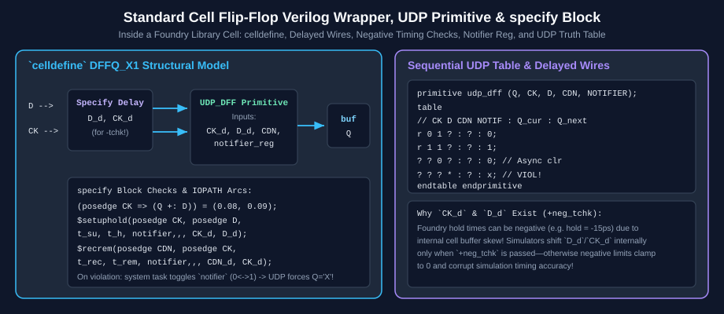
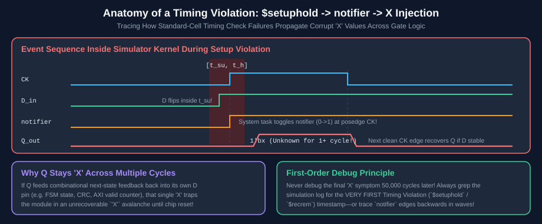

# Standard Cell Verilog Models, Specify Blocks, and Timing Checks

Unlike behavioral RTL where flip-flops execute instantaneous assignments (`q <= d;`), gate-level netlists instantiate hundreds of thousands of foundry-supplied standard cell Verilog simulation models (`AND2_X1`, `DFFQ_X2`, `ISOLO_X1`). Every timing delay, setup/hold check, and `'X'`-corruption mechanism during GLS originates directly inside the IEEE 1364/1800 **`specify` block**, **User-Defined Primitives (UDPs)**, and **`notifier` registers** embedded inside those library files. Reading and understanding standard-cell models unlocks root-cause GLS debugging.

---

## Learning Goals

After completing this chapter, you should be able to:

- Dissect a complete foundry standard-cell Verilog D-flip-flop model including `` `celldefine ``, `specify` path arcs (`IOPATH`), timing system tasks, delayed internal wires (`CLK_d`, `D_d`), `notifier`, and sequential UDP tables.
- Trace step-by-step how a `$setuphold` or `$recrem` timing violation toggles `notifier` and drives `Q` to `'X'` via the UDP table.
- Explain why foundry models require **`+neg_tchk`** (delayed internal pins) when library hold or setup checks contain negative values.
- Distinguish timing check system tasks: `$setuphold`, `$recrem`, `$width`, `$period`, and `$nochange`.

---

## Anatomy of a Standard-Cell Flip-Flop Verilog Model

Every standard-cell library ships with a Verilog simulation file (often called `stdcells.v`). Below is a complete structural dissection of a typical foundry positive-edge flip-flop with active-low asynchronous clear (`CDN`):



### Annotated Standard-Cell Model Example

```systemverilog
`celldefine
module DFFQ_ASYNCRST_X1 (
    input  logic D,
    input  logic CK,
    input  logic CDN,  // Active-low async clear
    output logic Q
);
    // Internal wires delayed ONLY when +neg_tchk is active!
    logic D_d, CK_d, CDN_d;
    logic Q_int;
    reg   notifier;    // Toggled automatically by simulator on timing check violation!

    // Behavioral core implemented via sequential UDP truth table
    udp_dff_clr u_core (Q_int, CK_d, D_d, CDN_d, notifier);
    buf (Q, Q_int);

    specify
        // 1. Default IOPATH propagation delays (overridden cleanly by SDF!)
        if (CDN == 1'b1)
            (posedge CK => (Q +: D)) = (0.050, 0.055);
        (negedge CDN => (Q +: 1'b0)) = (0.040);

        // 2. Synchronous & Async Timing Checks (drive notifier + delayed pins)
        $setuphold(posedge CK, posedge D, 0.030, -0.005, notifier,,, CK_d, D_d);
        $setuphold(posedge CK, negedge D, 0.032, -0.004, notifier,,, CK_d, D_d);
        $recrem   (posedge CDN, posedge CK, 0.025, 0.015, notifier,,, CDN_d, CK_d);
        $width    (negedge CDN, 0.045, 0, notifier);
        $width    (posedge CK,  0.060, 0, notifier);
    endspecify
endmodule
`endcelldefine
```

### Understanding Each Building Block

- **`` `celldefine `` / `` `endcelldefine ``:** Instructs simulators and PLI tools to classify this module as a leaf cell—reducing memory footprint, hiding messy internals during default RTL dumps unless requested, and enabling `+delay_mode_*` control cleanly.
- **Sequential UDP Table (`udp_dff_clr`):** Built-in Verilog truth-table state machine handling exact `0`/`1`/`X` behavior:
  - Normal edge: `r 0 1 ? : ? : 0;` (rising `CK`, `D=0`, `CDN=1` $\to$ `Q_next = 0`)
  - Async reset: `? ? 0 ? : ? : 0;` (active `CDN=0` clears `Q` regardless of clock!)
  - Violation wild-card: `? ? ? * : ? : x;` (`*` matches **any transition** on `notifier` (`0->1` or `1->0`) $\to$ forces **`Q_next = 'x'`**!).

---

## How $setuphold Violations Inject 'X' via notifier

When data transitions inside the timing window, the simulator kernel does *not* force output `'X'` magically out of nowhere—it executes a deterministic sequence through `notifier`:



1. **`D` toggles at `t = 9.985ns`** while `posedge CK` occurs at `t = 10.000ns` (`15ps` slack vs required `30ps` SDF setup limit).
2. **`$setuphold` Fires:** At `t = 10.000ns`, the timing engine prints a violation warning naming the exact hierarchical cell instance (`tb.dut.u_core.U_REG`), timestamp, limit (`30ps`), and observed violation (`15ps`).
3. **`notifier` Toggles:** The simulator flips `notifier` (`0 -> 1` or `1 -> 0`).
4. **UDP Row Fires:** The UDP table evaluates row `? ? ? * : ? : x;`, forcing `Q_int <= 1'bx` after `CK => Q` `IOPATH` delay!
5. **`Q` Recovers or Avalanches:** On the *next* clean rising `CK` edge where `D` is stable, `r 0 1 ? : ? : 0;` overwrites `1'bx` back cleanly—**unless** `Q` looped back combinational `'X'` into its own `D` pin first!

---

## Delayed Wires and the Critical +neg_tchk Flag

Look closely at the optional arguments at the end of `$setuphold(..., notifier,,, CK_d, D_d)`. Why do modern standard-cell models generate two delayed internal copies `CK_d` and `D_d` instead of wiring `CK` and `D` straight into the UDP?

In sub-28nm standard cells, internal clock buffers vs. data transmission gates create **asymmetric internal delays**—resulting in **negative hold times** (e.g., `hold = -5ps`, meaning `D` can legally change $5\text{ps}$ *before* the outer `CK` pin rises!) or negative setup times!
- Physically, an event scheduler cannot go *backward* in simulation time to evaluate a negative hold limit relative to `CK`!
- Therefore, when you enable **`+neg_tchk`** (VCS/Questa) or **`-neg_tchk`** (Xcelium), the simulator calculates an internal positive time shift on `CK_d` and `D_d` so both timing margins stay positive relative to the shifted internal UDP clock!
- **Fatal Mistake:** Forgetting `+neg_tchk` silently clamps all negative SDF hold/setup limits to `0.000` (truncating timing checks incorrectly and creating false pass/fail mismatches against STA)!

---

## Essential Timing Check System Tasks

| Timing Task | Purpose & Signals Monitored | Equivalent STA Check |
| :--- | :--- | :--- |
| `$setuphold(ref, data, t_su, t_h, notifier, ...)` | Combined synchronous data window around clock edge (supports negative limits!) | Setup (`Max`) & Hold (`Min`) |
| `$recrem(ref_rst, clk, t_rec, t_rem, notifier, ...)` | Asynchronous clear/preset deassertion relative to active clock edge | Recovery (`Max`) & Removal (`Min`) |
| `$width(edge, min_pw, thresh, notifier)` | Minimum HIGH or LOW pulse width on clock (`CK`) or async clear (`CDN`) | Minimum Pulse Width |
| `$period(edge, min_period, notifier)` | Minimum full cycle period between consecutive identical clock edges | Max Frequency (`F_max`) |

---

## Best Practices and Common Pitfalls

- **Always Compile With `+neg_tchk` Whenever Running Timing GLS:** Verify `sdf.log` reports zero clamped negative timing check warnings.
- **Keep Standard-Cell Library Models Identical to `.lib` Revision:** Never simulate a TSMC `3nm` netlist using mismatched older Verilog behavioral cell models—every UDP polarity, `notifier` row, and `specify` arc name (`(posedge CK => Q)`) must match the `write_sdf` `.lib` version verbatim!
- **Watch `CDN` / `SDN` Simultaneous Reset Assertion Traps:** If both asynchronous `CDN=0` (clear) and `SDN=0` (preset) assert simultaneously on a dual-set-clear flop (`DFFSR`), check the UDP row order—some foundry cells output `'X'`, while others prioritize `CDN` over `SDN`!

---

## Practical Exercises with Solutions

### Exercise 1 Dissecting a Negative Hold Violation

**Problem:**
A flip-flop has `t_setup = +40ps` and `t_hold = -10ps` in `soc_min.sdf`.
1. At `posedge CK` (`t = 10.000ns`), `D` transitions at `t = 9.995ns` ($5\text{ps}$ before clock). Does this violate hold, setup, or both?
2. What happens if the verification team accidentally compiles VCS *without* `+neg_tchk`?

**Solution:**
1. The valid data-change-forbidden window is `[t_clk - t_su, t_clk + t_h] = [9.960ns, 9.990ns]`! Because `9.995ns` is **after** `9.990ns`, in real silicon (and with `+neg_tchk`), **neither** setup nor hold is violated! (Hold only requires stability until `10.000 - 0.010 = 9.990ns`).
2. **Without `+neg_tchk`:** The simulator clamps `-10ps` to `0ps`, moving the forbidden window edge to `10.000ns`—falsely firing a `$setuphold` violation at `9.995ns` and crashing GLS with bogus `'X'` errors!

### Exercise 2 Tracing a `notifier` Edge in Waveforms

**Problem:**
You open Verdi/SimVision on a failing GLS run and see `u_cpu.u_alu.acc_reg[7].Q` turn to `'X'` at `t = 252.12ns`, right after a rising `CK` edge at `t = 252.00ns`. You suspect a hold violation, yet in the wave viewer `D` visually changed *before* `CK`! How do you confirm definitively whether a timing check fired, and why might `D` look shifted visually?

**Solution:**
Plot **`u_cpu.u_alu.acc_reg[7].notifier`** and **`D_d` / `CK_d`** in the waveform!
1. If `notifier` toggled at `252.00ns`, a `$setuphold`/`$recrem`/`$width` check definitely fired!
2. Because `+neg_tchk` delays internal wires `D_d` vs `CK_d` relative to outer pins `D` and `CK`, the outer `D` pin timing vs `CK` can visually look shifted relative to the internal sampling point—always inspect the violation log timestamp and `notifier` toggle!

### Exercise 3 Comparing `$setuphold` and `$recrem`

**Problem:**
Which `specify` check task protects an asynchronous reset `CDN` transitioning `0 -> 1` (release) near `posedge CK`, and why does it NOT fire when `CDN` drops `1 -> 0` (assertion)?

**Solution:**
**`$recrem(posedge CDN, posedge CK, ...)`** monitors the rising `0 -> 1` deassertion of active-low `CDN` against `posedge CK`. When `CDN` asserts (`1 -> 0`), it clears the flip-flop asynchronously immediately via UDP row `? ? 0 ? : ? : 0;` (checked only for minimum reset pulse width by `$width(negedge CDN, ...)`).

##### Copyright (c) 2026 squared-studio
