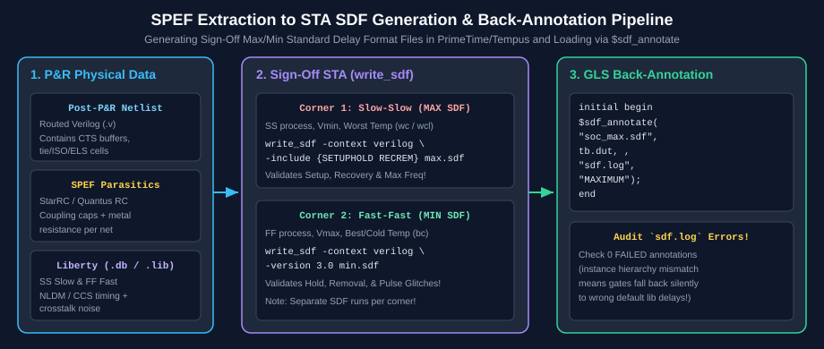
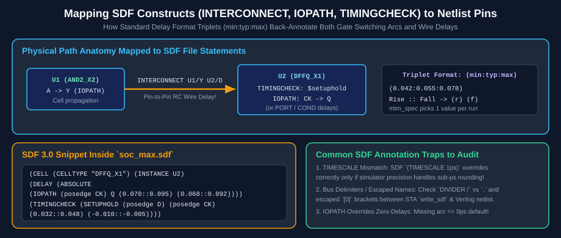

# Standard Delay Format (SDF) Anatomy, Back-Annotation, and Corners

Every standard-cell Verilog file ships with generic placeholder delays inside its `specify` block (e.g., `(0.050, 0.055)`). Real silicon delays, however, depend heavily on exact post-layout wire lengths, coupling capacitances between neighboring metal tracks, transistor fanout loads, and PVT voltage/temperature corners. **Standard Delay Format (SDF, IEEE 1497)** bridges physical P&R sign-off STA directly into dynamic Verilog simulation by overwriting placeholder delays with exact corner-extracted timing numbers.

---

## Learning Goals

After completing this chapter, you should be able to:

- Explain the end-to-end **SPEF $\to$ STA $\to$ SDF** generation pipeline (`write_sdf`) across Slow Max and Fast Min operating corners.
- Read and decode SDF file syntax: `HEADER`, `TIMESCALE`, `CELL`, `IOPATH`, `INTERCONNECT`, `PORT`, `COND`, and `TIMINGCHECK`.
- Interpret `(min:typ:max)` delay triplets alongside `$sdf_annotate` `mtm_spec` (`"MINIMUM"`, `"TYPICAL"`, `"MAXIMUM"`) and scaling arguments.
- Audit `sdf.log` cleanly to catch zero/partial annotation failures, hierarchy mismatches, and scale-rounding traps.

---

## The SPEF to STA to SDF Generation Flow

Simulators never read raw StarRC/Quantus parasitic `SPEF` RC networks directly because solving multi-million-node Elmore/Arnoldi differential equations dynamically per clock edge would take months. Instead, **Static Timing Analysis** (`PrimeTime` / `Tempus`) solves all effective cell delays (Slew/Load tables in `.lib`) and wire RC delays (`SPEF` + crosstalk $\Delta$delay) **once**, then flattens them into pin-to-pin delays inside an **SDF** file:



### Why You Must Export Separate MAX and MIN SDF Files

A common misconception is thinking one SDF file contains `(min:typ:max)` triplets covering both Fast (`FF`) and Slow (`SS`) silicon corners simultaneously!
- In reality, **P&R physical resistance/capacitance varies with metal corners (`RC_worst` vs `RC_best`), while transistor speed varies with PVT (`SS_0.72V_125C` vs `FF_0.88V_-40C`)**, and **on-chip variation (OCV/POCV) derating** differs dramatically between setup launch/capture vs hold launch/capture!
- Therefore, STA (`write_sdf`) exports **separate sign-off SDF files** per corner:
  - `soc_ss_max.sdf` (generated under worst-case Setup/Recovery Slow corner $\to$ annotate with `"MAXIMUM"`).
  - `soc_ff_min.sdf` (generated under best-case Hold/Removal Fast corner $\to$ annotate with `"MINIMUM"`).

---

## Anatomy of an SDF File

An SDF 3.0/4.0 file begins with global metadata (`TIMESCALE`, `DIVIDER`) followed by per-instance `(CELL ...)` blocks mapping exact timing arcs onto standard cells and wires:



### Dissecting Core SDF Statements

```lisp
(DELAYFILE
  (SDFVERSION "3.0")
  (DESIGN "soc_top")
  (VENDOR "Synopsys")
  (PROGRAM "PrimeTime")
  (DIVIDER /)
  (TIMESCALE 1ps)

  ;; Top-level wire interconnects connecting cell instances
  (CELL
    (CELLTYPE "soc_top")
    (INSTANCE)
    (DELAY
      (ABSOLUTE
        ;; Wire delay from U1 output pin Y to U2 input pin D: (rise) (fall)
        (INTERCONNECT u_alu/U1/Y u_alu/U2/D (14.2:14.2:18.6) (13.8:13.8:17.9))
      )
    )
  )

  ;; Standard-Cell Instance IOPATH & TIMINGCHECK overrides
  (CELL
    (CELLTYPE "DFFQ_X1")
    (INSTANCE u_alu/U2)
    (DELAY
      (ABSOLUTE
        (IOPATH (posedge CK) Q (62.0:62.0:88.4) (59.5:59.5:85.1))
      )
    )
    (TIMINGCHECK
      ;; $setuphold limits: (setup_triplet) (hold_triplet)
      (SETUPHOLD (posedge D) (posedge CK) (28.1:28.1:35.4) (-6.5:-6.5:-4.2))
      (WIDTH (posedge CK) (45.0:45.0:60.0))
    )
  )
)
```

### Key SDF Elements Explained

| Construct | Target Inside Verilog | Behavioral Effect When Back-Annotated |
| :--- | :--- | :--- |
| `(INTERCONNECT src dst ...)` | Point-to-point wire inside module | Injects exact net RC flight delay onto the destination `MIPD` (Module Input Port Delay) |
| `(PORT pin ...)` | Input port on leaf cell | Models lumped wire delay entering a cell input (rare when `INTERCONNECT` is present) |
| `(IOPATH in out ...)` | Matches `specify` `(in => out)` | Replaces cell's generic `(0.050)` specify delay with exact loaded `(rise) (fall)` numbers |
| `(COND expr (IOPATH ...))` | Conditional state-dependent path | Overrides conditional `if (S==1) (A => Y)` arcs cleanly |
| `(SETUPHOLD ...)` / `(RECREM ...)` | Matches `$setuphold` / `$recrem` | Overwrites setup/hold/recovery/removal limits with STA-calculated slew-adjusted bounds |

---

## Invoking $sdf_annotate and Auditing sdf.log

SDF files can be applied either inside testbench Verilog using **`$sdf_annotate`** or via simulator command-line flags (e.g., VCS `-sdf max:tb.dut:soc_max.sdf`).

```systemverilog
`ifdef GLS_TIMING
initial begin
    `ifdef SDF_MIN
        $sdf_annotate("sdf/soc_ff_min.sdf", tb_top.u_dut, , "logs/sdf_min.log", "MINIMUM");
    `else
        $sdf_annotate("sdf/soc_ss_max.sdf", tb_top.u_dut, , "logs/sdf_max.log", "MAXIMUM");
    `endif
end
`endif
```

### Signature Parameters of `$sdf_annotate`

`$sdf_annotate("sdf_file", scope_instance, "config_file", "log_file", "mtm_spec", "scale_factors", "scale_type")`
- **`scope_instance`:** **Critical!** Points exactly to the DUT instance matching `(DESIGN "soc_top")`, **not** the outer testbench `tb_top`! Pointing at `tb_top` triggers 100% failed hierarchy lookups!
- **`mtm_spec`:** Selects `"MINIMUM"`, `"TYPICAL"`, or `"MAXIMUM"` from `(min:typ:max)` triplets.
- **`scale_factors`:** Optional multipliers like `"1.0:1.0:1.0"` (never arbitrarily down-scale SDF numbers to cheat failures!).

> [!CAUTION]
> **Audit `sdf.log` Religiously Before Trusting Any Passing GLS Run!** If `sdf.log` reports missing instances, missing `IOPATH` arcs (`Failed to find specify path`), or dropped `INTERCONNECT` lines, those cells quietly keep their generic `50ps` placeholder delays (or `0ps` wire delay!), making a passing simulation completely worthless! Enforce automated CI failure whenever `sdf.log` error counts $> 0$!

---

## Best Practices and Common Pitfalls

- **Match Simulator `timescale` Precision to SDF `(TIMESCALE 1ps)`:** If your top testbench specifies `` `timescale 1ns / 1ns `` (`1ns` resolution!), a `35.4ps` SDF value rounds straight to `0ns`! Always compile GLS with **`-timescale=1ns/1ps`** (or `100fs` precision in sub-3nm nodes!).
- **Avoid Escaped-Identifier / Bus Delimiter Mismatches:** Verify STA `write_sdf -bus_splitting` matches the Verilog netlist's escaped array naming (`\bus[0] ` vs `bus[0]`) and hierarchy `(DIVIDER /)` vs `(DIVIDER .)`.
- **Keep Multi-Block SDF Hierarchical Scopes Distinct:** If loading separate block SDFs (`u_cpu.sdf`, `u_gpu.sdf`) on a hybrid chip, pass each block's exact hierarchical scope (`tb_top.u_dut.u_cpu`) cleanly to `$sdf_annotate`.

---

## Practical Exercises with Solutions

### Exercise 1 Fixing a Precision Rounding Disaster

**Problem:**
A verification team annotates `soc_ss_max.sdf` (whose internal delays range from `12ps` to `95ps`) onto a netlist compiled with default `` `timescale 1ns / 100ps ``. During simulation, every single standard cell appears to switch in `0.0ns` or `0.1ns`! Why did this happen, and what fixes it?

**Solution:**
With `100ps` simulation time precision, any delay $< 50\text{ps}$ rounds straight down to **`0.0ns`** (`0ps`), wiping out fine-grained hold/setup cell delays and wire `INTERCONNECT` skews!
**Fix:** Override/compile with `1ps` (or `100fs`) precision (`-timescale=1ns/1ps` or `-override_timescale 1ns/1ps` in VCS/Xcelium/Questa) matching `(TIMESCALE 1ps)` in the SDF header.

### Exercise 2 Diagnosing an `sdf.log` Scope Mismatch

**Problem:**
Your `$sdf_annotate("chip_max.sdf", tb_soc, , "sdf.log", "MAXIMUM");` call outputs 450,000 errors in `sdf.log`:
`Warning: Cannot find instance tb_soc/u_alu/U12 in SDF annotation.`
Meanwhile, inside `chip_max.sdf`, `(CELL (CELLTYPE "NAND2") (INSTANCE u_alu/U12) ...)` is valid, and in RTL/testbench `chip_top` is instantiated as `tb_soc.u_dut`. What single argument fix solves all 450,000 warnings?

**Solution:**
Pass **`tb_soc.u_dut`** (the actual `chip_top` DUT instance!) as the 2nd `scope_instance` argument rather than `tb_soc` (`tb_top`):
`$sdf_annotate("chip_max.sdf", tb_soc.u_dut, , "sdf.log", "MAXIMUM");`

### Exercise 3 Why One `min:typ:max` File Cannot Replace Dual-Corner Runs

**Problem:**
Why does an STA script export `(14.2:14.2:18.6)` inside `soc_ss_max.sdf` instead of putting Fast-Fast minimum delays in slot 1 and Slow-Slow maximum delays in slot 3 of the same SDF file?

**Solution:**
Because **Setup checks (`SS` corner)** and **Hold checks (`FF` corner)** use completely different physical metal RC models (`RC_worst` vs `RC_best`), different OCV derating multipliers on launch vs. capture clock paths, and opposite temperatures ($125^\circ\text{C}$ vs $-40^\circ\text{C}$). Putting un-derated `MIN` vs `MAX` numbers into one static file distorts on-chip variation relationships; sign-off requires running separate `soc_ss_max.sdf` (`"MAXIMUM"`) and `soc_ff_min.sdf` (`"MINIMUM"`) regressions!

##### Copyright (c) 2026 squared-studio
