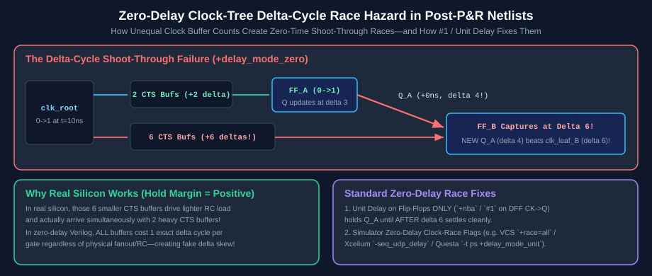
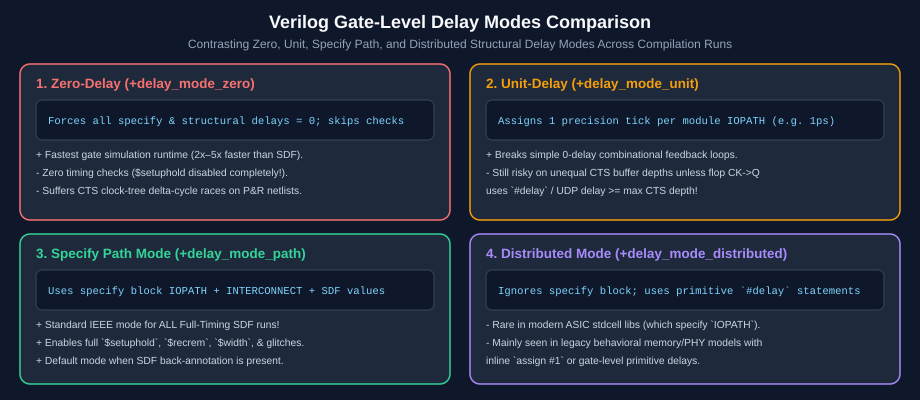

# Zero-Delay Gate-Level Simulation and Delta-Cycle Race Debugging

Before physical routing and `SPEF` extraction exist—or when running fast functional sanity checks across a synthesized netlist—engineers launch **Zero-Delay Gate-Level Simulation** (`+delay_mode_zero`). Intuitively, removing all gate and wire delays should make a synchronous digital circuit behave identically to zero-delay RTL! In practice, however, Zero-Delay GLS frequently crashes on the very first clock edge due to **Clock-Tree Delta-Cycle Shoot-Through Races**. Understanding Verilog's Active/NBA event queue and delta-cycle skew makes debugging zero-delay netlists effortless.

---

## Learning Goals

After completing this chapter, you should be able to:

- Explain how **unbalanced Clock Tree Synthesis (CTS) buffer counts** cause zero-time shoot-through hold races in Zero-Delay GLS even when real silicon timing passes easily.
- Compare the four IEEE Verilog delay compilation modes: **Zero-Delay**, **Unit-Delay**, **Specify Path**, and **Distributed** delay modes.
- Fix delta-cycle races cleanly using **sequential UDP/flop `#1` delays**, simulator zero-delay race flags (`+race=all` / `-seq_udp_delay` / `+nba`), or unit-delay mode.
- Recognize why Zero-Delay GLS still misses timing bugs while catching uninitialized `'X'` resets and synthesis synthesis-mismatch bugs early.

---

## Clock-Tree Delta-Cycle Races in Zero-Delay Simulation

Suppose `PrimeTime` STA and post-P&R hold closure both confirm clean positive hold margin between `FF_A` and `FF_B` on `sys_clk`. Yet when you simulate that exact post-P&R netlist under `+delay_mode_zero`, **`FF_B` captures `FF_A`'s *NEW* data on the *SAME* rising clock edge (one cycle too early!)**:

### Tracing Exact Delta Cycles Inside the Verilog Event Queue

1. In physical silicon, CTS inserts different buffer sizes and depths along different clock branches to equalize RC arrival skew:
   - **Branch A (`clk_leaf_a`):** Passes through **2** large heavy-load buffers $\implies$ arrives at `t = 10.000ns + 2 delta cycles`.
   - **Branch B (`clk_leaf_b`):** Passes through **6** smaller low-load buffers $\implies$ arrives at `t = 10.000ns + 6 delta cycles`.
2. In real silicon (or full-timing SDF), `clk_leaf_a` and `clk_leaf_b` both reach `FF_A` and `FF_B` around `11.20ns`, and `FF_A` `CK->Q` takes `70ps`, so `FF_B` cleanly samples `FF_A`'s *OLD* value!
3. Under **`+delay_mode_zero`**, EVERY buffer (whether `BUF_X1` or `BUF_X16`) costs **0ns + 1 delta cycle** of continuous/gate propagation!
   - `clk_leaf_a` rises at **Delta 2**; `FF_A.Q` immediately updates via zero-delay continuous output at **Delta 3**; short wire drives `FF_B.D` at **Delta 4**!
   - Meanwhile `clk_leaf_b` does not rise until **Delta 6**!
   - At **Delta 6**, `FF_B` clocks **Delta 4's NEW value** instead of the old value—corrupting pipelines, shift registers, and counters simultaneously!

---

## Verilog Delay Modes Compared

Simulators support four distinct delay evaluation modes across standard-cell libraries (`celldefine` modules):

| Mode | Simulator Flag (VCS / Xcelium / Questa) | Specify `IOPATH`? | `$setuphold` Active? | Best Application |
| :--- | :--- | :---: | :---: | :--- |
| **Zero-Delay** | `+delay_mode_zero` / `-delay_mode zero` | Overridden to `0` | **Disabled** | Pre-CTS logical synthesized netlist (`No CTS trees yet!`) |
| **Unit-Delay** | `+delay_mode_unit` / `-delay_mode unit` | Overridden to `1` tick | **Disabled** | Breaking combinational 0-delay oscillation loops cleanly |
| **Specify Path** | `+delay_mode_path` (Default with SDF) | **Active (`SDF` / `.lib`)** | **Enabled** | **Mandatory for ALL Post-P&R Sign-Off SDF Runs** |
| **Distributed** | `+delay_mode_distributed` | Ignored (`#delay` only) | Disabled | Legacy inline primitive `#delay` behavioral netlists |

---

## Standard Fixes for Zero-Delay Delta Races

If your team runs fast zero-delay regressions on a post-CTS netlist (`pnr.v` without SDF) for quick functional regression speed, deploy one of three clean fixes:

### Fix 1 Nonblocking / Unit Delay Strictly on Sequential Flip-Flops

Give every flip-flop UDP / `CK->Q` output a tiny non-zero delay (`1ps`–`10ps`, e.g., Xcelium `-seq_udp_delay 1ps`, Questa `vopt +delay_mode_zero` + `#1` UDP override, or VCS `+nba` / conditional `` `define SEQ_DLY #1 `` in library cells) while keeping combinational gates at `0ns`!
- Because ALL combinational gates evaluate in delta cycles at **exact time `t = 10.000ns`**, even **60 CTS buffers** finish long before `t = 10.001ns` (`#1ps`) when `FF_A`'s `Q` updates!
- Every `FF_B` clocks cleanly before `FF_A.Q` changes—**100% eliminating CTS delta shoot-through!**

### Fix 2 Run Zero-Delay Strictly on Pre-CTS Synthesized Netlists

Before CTS runs, all registers share the single flat RTL clock net directly (0 buffer delta skew!). Reserve post-CTS simulation for **Full-Timing SDF** (where real `SDF` clock tree delays neutralize delta skew automatically!).

### Fix 3 Watch Out for `+delay_mode_unit` Side Effects on CTS

Notice why plain **`+delay_mode_unit`** (putting `1ps` on *every* gate) does **NOT** always fix CTS delta shoot-through! If Branch B has **6 buffers** ($6 \times 1\text{ps} = 6\text{ps}$ delay) while `FF_A` has **2 clock buffers + 1ps `CK->Q`** ($2 + 1 = 3\text{ps}$), `FF_A.Q` updates at `3ps`—**still beating `clk_leaf_b` at `6ps`!** Always put delay **larger than max CTS depth differential** exclusively on sequential `Q` outputs, or use `-seq_udp_delay`!

---

## Best Practices and Common Pitfalls

- **Never Hack P&R Netlists to Delete CTS Buffers for Zero-Delay Sim:** Modifying netlists creates divergence from tape-out silicon—fix the simulation timing schedule (`-seq_udp_delay` or full SDF) cleanly instead!
- **Watch Out for Async Zero-Delay Combinational Feedback Loops:** Ring oscillators, C-elements, or badly constrained latch loops oscillate infinitely at $t = t_0$ under `+delay_mode_zero`, freezing simulator progress in an infinite zero-time loop (`0ns` hang!). Add `+delay_mode_unit` or exclude analog/oscillator macros via behavioral wrappers!
- **Disable Zero-Delay Simulation on Clock/Reset Glitch Checks:** Because `+delay_mode_zero` eliminates all `$setuphold` and `$recrem` checks, pass every boot, clock mux, and reset-sequencing test through **SDF Timing GLS** before sign-off.

---

## Practical Exercises with Solutions

### Exercise 1 Calculating Delta Shoot-Through Failure

**Problem:**
In a post-P&R netlist running under `+delay_mode_unit` (`1ps` per gate/buffer), `FF1` shifts data straight into `FF2` (`Q1 -> D2` direct wire, 0 combinational gates). `FF1.CK` passes through **3** CTS buffers, while `FF2.CK` passes through **5** CTS buffers. At `t = 100.000ns`, `clk_root` rises `0 -> 1`. At what exact picoseconds do `FF1.CK`, `FF1.Q`, and `FF2.CK` transition, and what value does `FF2` capture?

**Solution:**
- `FF1.CK` rises at: $100.000\text{ns} + 3\text{ps} = 100.003\text{ns}$.
- `FF1.Q` (1 unit-delay `CK->Q`) updates at: $100.003\text{ns} + 1\text{ps} = 100.004\text{ns}$.
- `FF2.CK` rises at: $100.000\text{ns} + 5\text{ps} = 100.005\text{ns}$!
Because `100.004ns < 100.005ns`, `FF2` captures `FF1`'s **NEW** data on the same cycle (shift register skips 1 entire stage)! That proves why plain `+delay_mode_unit` fails when CTS depth delta ($\Delta = 2$) exceeds `1ps`!

### Exercise 2 Why `-seq_udp_delay 10ps` Solves It While Keeping Zero Combinational Delay

**Problem:**
Repeat Exercise 1 with combinational buffers at `0ps` (delta-only) and flip-flop UDP outputs delayed by `#10ps` (`-seq_udp_delay 10ps`). Why does `FF2` now capture cleanly?

**Solution:**
All combinational clock buffers resolve within delta cycles strictly at `t = 100.000ns`, so **both** `FF1.CK` (delta 3) and `FF2.CK` (delta 5) finish rising at **`t = 100.000ns`** long before `FF1.Q` updates `10ps` later at **`t = 100.010ns`**! Zero shoot-through occurs regardless of CTS buffer counts!

### Exercise 3 Diagnosing an Infinite Zero-Time Hang

**Problem:**
Launching Zero-Delay GLS on a chip containing a standard-cell Ring Oscillator (`5` chained inverters feeding back on itself) hangs immediately at `t = 50ns` with 100% CPU usage and simulation time frozen at `50ns`. Why, and what fixes it cleanly?

**Solution:**
In `+delay_mode_zero`, a 5-inverter loop has `0ns` loop period, executing $1 \to 0 \to 1 \to 0 \dots$ infinitely inside delta cycles at `t = 50ns` without advancing simulation time!
**Fix:** Exclude/swap the analog/oscillator macro cell (`config`) with a behavioral clock model (e.g., `always #5ns osc_clk = ~osc_clk;`), or avoid running zero-delay on physical delay-line macros!

##### Copyright (c) 2026 squared-studio
