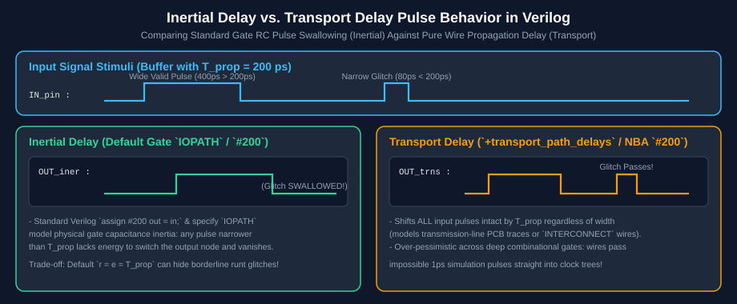
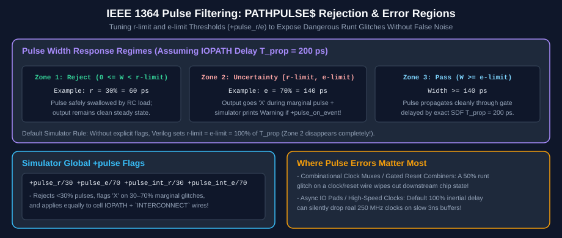

# Inertial vs Transport Delays, Pulse Filtering, and Glitch Suppression

Real silicon gates do not pass arbitrarily thin voltage blips untouched, nor do they silently erase borderline $50\%$ runt pulses on clock and reset trees without electrical risk. In Gate-Level Simulation, every `IOPATH` propagation arc and `INTERCONNECT` wire uses **Inertial**, **Transport**, or **Two-Threshold Pulse Filtering (`PATHPULSE$`)** semantics to model how narrow combinational glitches propagate, swallow, or turn into `'X'`. Misconfiguring pulse filtering can either flood logs with false clock `'X'` drops or silently mask real glitch bugs!

---

## Learning Goals

After completing this chapter, you should be able to:

- Contrast **Inertial Delay** (standard `assign #d` / `IOPATH` model) against **Transport Delay** (`+transport_path_delays` / `<= #d`) on pulses narrower than propagation delay $T_{\text{prop}}$.
- Explain the two-threshold IEEE 1364 pulse model (`r-limit` **Rejection** vs. `e-limit` **Error** limits in `PATHPULSE$`) and trace all three output width regimes.
- Configure `+pulse_r/X`, `+pulse_e/Y`, `+pulse_int_r`, and `+pulse_int_e` flags cleanly across high-speed clocks, reset combiners, and long interconnect wires.
- Diagnose two opposing real-world GLS failures: **swallowed legitimate high-frequency clocks** vs. **un-detected 40% runt glitches**.

---

## Inertial vs. Transport Delay Behavior

Consider a buffer cell whose annotated SDF `IOPATH` propagation delay is $T_{\text{prop}} = 200\text{ps}$, receiving both a normal wide $400\text{ps}$ pulse and a narrow $80\text{ps}$ combinational glitch:



### Comparing the Two Models

| Feature | Inertial Delay (Verilog Default) | Transport Delay (`+transport_path_delays`) |
| :--- | :--- | :--- |
| **Physical Analogy** | Capacitive CMOS standard cell switching inertia (internal RC charging node) | Pure metal interconnect / PCB transmission line wave propagation |
| **Pulse Width $W < T_{\text{prop}}$** | **Swallowed!** Input changes back before output switches, canceling scheduled event | **Propagates intact**, shifted forward by exact $T_{\text{prop}}$ |
| **Clock Tree Hazard** | **Drops real clocks!** A $500\text{ps}$ clock pulse (`1 GHz`) passing through a slow `600ps` pad buffer disappears completely! | Preserves high-speed clocks on long RC wire `INTERCONNECT` paths |
| **Glitch Hazard** | **Over-optimistic:** Masks dangerous `160ps` glitches entering clock/async reset gates on a `200ps` buffer | **Over-pessimistic:** Passes impossible `2ps` delta glitches cleanly through 20 gates to FFs |

> [!CAUTION]
> **Watch Out for Disappearing High-Frequency Clocks in I/O Pads!** Suppose a `1.0 GHz` differential PLL clock (`500ps` half-period!) passes through an I/O buffer or long RC clock spine whose single `IOPATH` or `INTERCONNECT` delay in slow `MAX` SDF is **`550ps` ($> 500\text{ps}$)!** Under default 100% inertial delay, the clock stops completely (`flat 0`!) with zero warning! Use **`+transport_int_delays`** (`INTERCONNECT`) and tuned `+pulse_r` on clock/pad paths!

---

## Two-Threshold Pulse Filtering with Rejection and Error Limits

To resolve both over-optimism and over-pessimism simultaneously, IEEE 1364 defines **`PATHPULSE$`** with two independent threshold percentages of $T_{\text{prop}}$:



1. **Rejection Limit (`r-limit`, e.g., `30%` of $T_{\text{prop}}$):** Any input pulse strictly narrower than `r-limit` ($0 \le W < 60\text{ps}$ on a $200\text{ps}$ gate) is **safely swallowed** by gate inertia—modeling real RC filtering cleanly.
2. **Error / Uncertainty Window (`[r-limit, e-limit)`, e.g., `30%` to `70%`):** A borderline pulse (`60ps`–`140ps`) has uncertain electrical energy: on silicon it might attenuate or fire half-rail! When `+pulse_on_event` (or `+pulse_e/70`) is enabled, the simulator immediately **drives `'X'` onto the gate output** for the duration of the pulse (exposing dangerous clock/reset glitches immediately!).
3. **Pass Region (`W >= e-limit`):** Any pulse wider than `e-limit` (`>= 140ps`) propagates intact cleanly!

### Specify and Command-Line Pulse Control

You can set percentages globally on the simulator command line or per-module inside `specify`:

```systemverilog
// Per-cell custom specify thresholds (Reject < 20ps, X-Error between 20ps and 50ps)
specify
    (A => Y) = (0.200);
    specparam PATHPULSE$A$Y = (0.020, 0.050);
endspecify
```

```bash
# VCS Production Timing Flags:
# Apply r=30% / e=70% to module paths AND interconnect wires cleanly!
vcs ... +neg_tchk +transport_int_delays +pulse_r/30 +pulse_e/70 \
    +pulse_int_r/30 +pulse_int_e/70 +pulse_on_detect
```

- Notice **`+pulse_int_r/30 +pulse_int_e/70`**: Controls `INTERCONNECT` wire pulse filtering independently from standard cell `IOPATH` delays!
- Notice **`+transport_int_delays`**: Switches wire `INTERCONNECT` delays specifically to transport mode (recommended so long metal clock routes never accidentally filter valid GHz clock half-cycles!).

---

## Best Practices and Common Pitfalls

- **Never Use `+pulse_r/0 +pulse_e/0` Globally Without Testing Runtime Noise:** Passing `0%` limits turns every gate into pure transport mode—passing sub-picosecond arithmetic mux races straight out as `'X'` alerts in datapath trees where they settle safely before the flip-flop clock edge!
- **Distinguish `+pulse_on_event` vs `+pulse_on_detect`:**
  - `+pulse_on_detect` drives `'X'` immediately at the trailing input edge *before* `T_prop` finishes, flagging the exact glitch root time instantaneously!
  - `+pulse_on_event` waits until scheduled output `T_prop` time—cleaner when downstream flops filter brief `'X'` before setup, though harder to trace the origin!
- **Always Check Clock & Reset Trees Under Both `MIN` and `MAX` SDF With Strict Pulse Limits:** While datapath glitches settle harmlessly before `posedge clk`, a `35%` glitch on a gated clock or async `CDN` pin directly flips silicon state! Use tight pulse error thresholds (`+pulse_r/20 +pulse_e/40`) on reset/clock wrapper cells!

---

## Practical Exercises with Solutions

### Exercise 1 Debugging a Disappeared High-Speed Clock

**Problem:**
In `MAX` SDF GLS, a `1.25 GHz` SERDES clock (`400ps` HIGH, `400ps` LOW) enters an output pad buffer `U_CLK_PAD` whose annotated SDF `IOPATH` delay is `440ps` (`r=440ps, f=440ps`). When you inspect `U_CLK_PAD/PAD_OUT` in Verdi/SimVision, the net sits permanently flat at `1'b0`! Why did the clock die completely, and how do you fix simulator flags cleanly?

**Solution:**
Under default 100% inertial delay, `r-limit = e-limit = 100% * 440ps = 440ps`! Since the `1.25 GHz` clock half-period (`400ps`) is narrower than `440ps`, the inertial buffer swallows every single rising/falling edge—turning the output completely flat `0`!
**Fix:** Reduce the rejection limit strictly below `400ps / 440ps = 90%` (e.g., `+pulse_r/30 +pulse_e/70` $\implies$ $r = 132\text{ps}, e = 308\text{ps} < 400\text{ps}$), or enable transport/per-cell `PATHPULSE$` override on high-speed clock buffers/pads (`+transport_int_delays` for interconnects)!

### Exercise 2 Tracing a Zone-2 Uncertainty `'X'` Glitch

**Problem:**
You run GLS with `+pulse_r/25 +pulse_e/60 +pulse_on_detect`. A 2-input `OR2_X1` gate (`IOPATH = 100ps`) feeding an asynchronous clear pin `CDN` receives a $45\text{ps}$ active-low glitch (`1 -> 0 -> 1`). What does the `OR2_X1` output emit, and why?

**Solution:**
Calculate thresholds for `T_prop = 100ps`:
- `r-limit` = $25\% \times 100\text{ps} = 25\text{ps}$.
- `e-limit` = $60\% \times 100\text{ps} = 60\text{ps}$.
Because $45\text{ps} \in [25\text{ps}, 60\text{ps})$, the pulse falls straight into **Zone 2 (Uncertainty Window)**! With `+pulse_on_detect`, the simulator emits a **pulse error warning** and drives **`'X'`** onto the output (`CDN`), immediately trapping the dangerous reset glitch before silicon!

### Exercise 3 Why Datapath Glitches Are Benign While Reset Glitches Are Fatal

**Problem:**
A multiplier adder tree exhibits thousands of Zone-2 `'X'` glitch blips mid-cycle on intermediate `XOR` gates when `+pulse_e/60` is enabled—yet zero flip-flops turn `'X'`. Should you panic and rewrite the adder?

**Solution:**
**No!** In synchronous datapath logic, inputs settle well before `posedge clk` setup time, so intermediate `'X'` glitch blips clear back to valid `0`/`1` cleanly *before* the capture flip-flop samples! Only when a pulse error feeds **asynchronous clear/preset (`CDN`/`SDN`), clock gates (`CLK`), or violates `$setuphold`** does it poison silicon state. Keep datapath pulse limits realistic (`+pulse_r/40 +pulse_e/80` or filter false datapath noise cleanly while keeping tight thresholds on clock/reset trees).

##### Copyright (c) 2026 squared-studio
