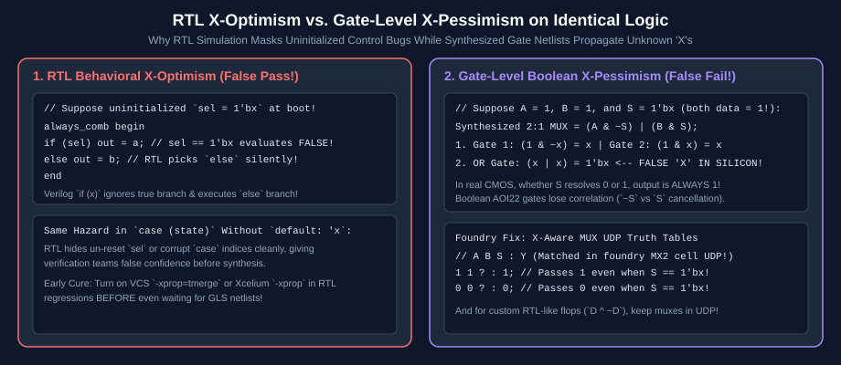
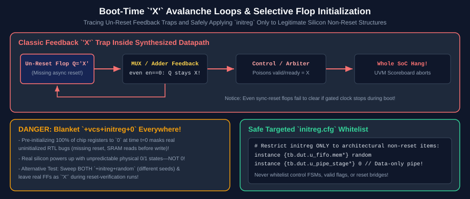

# Uninitialized State, X-Optimism, X-Pessimism, and Reset Bring-Up

The very first shock most verification teams experience when moving a passing UVM RTL regression onto a synthesized Gate-Level Netlist is an immediate boot failure caused by `'X'` corruption (`"Everything goes X at 120ns!"`). Real silicon powers up with unpredictable random physical states—never clean zeros! Bridging RTL-to-Gate requires understanding why RTL masks `'X'` via **X-Optimism**, why gate netlists create false `'X'`s via **X-Pessimism**, and how to initialize un-reset memories/datapaths safely without hiding real missing-reset bugs.

---

## Learning Goals

After completing this chapter, you should be able to:

- Explain how Verilog `if/else` and `case` **X-Optimism** silently masks uninitialized bugs during RTL simulation (`-xprop=tmerge` fixes it early!).
- Trace gate-level **Boolean X-Pessimism** on synthesized 2:1 MUXes (`(A & ~S) | (B & S)`) and explain how **X-tolerant UDP primitives** cancel correlated unknowns.
- Identify genuine missing-reset `'X'` avalanche feedback loops (`FSM`, `CRC`, `accumulator`, `arbiter`) during chip boot.
- Configure targeted, surgical initialization files (`initreg`) strictly for legitimate non-reset pipeline/SRAM arrays without masking control bugs.

---

## RTL X-Optimism vs. Gate-Level X-Pessimism

Synthesizing RTL replaces behavioral control statements (`if`, `case`) with physical Boolean standard cells—flipping how unknown `'X'` states behave dramatically!



### 1. RTL Behavioral X-Optimism (Dangerous False Pass!)

In IEEE SystemVerilog:
```systemverilog
always_comb begin
    if (sel) out = a;
    else     out = b; // If sel == 1'bx, `if (1'bx)` is FALSE -> executes `else`!
end
```
Notice the bug: even when `sel == 1'bx` (because a configuration flip-flop lacked reset!) and `a = 1`, `b = 0`, RTL cheerfully forwards `out = b = 0` as if `sel` were strictly `0`! Similarly, `case (sel)` skips matching `'X'` and jumps straight to `default:`. Your RTL regression passes 100% cleanly!

### 2. Gate-Level Boolean X-Pessimism (False Fail Hazard!)

Now synthesize that exact `if/else` MUX into decomposed standard-cell gates (`NAND`/`NOR`/`AOI22`):
`out = (a & ~sel) | (b & sel)`
Suppose `sel == 1'bx` during early boot while **BOTH inputs are equal (`a = 1'b1, b = 1'b1`)**:
- Gate 1 computes `1 & ~x = x`.
- Gate 2 computes `1 & x = x`.
- Output OR computes `x | x = 1'bx`!
Even though physically `out` **must unconditionally equal `1` regardless of `sel` (`0` or `1`)**, decomposed gate models lose algebraic correlation between `~sel` and `sel` and hallucinate a bogus **`'X'`**!

**Foundry Cure:** Standard-cell libraries solve MUX X-pessimism by shipping dedicated **UDP-based MUX cells (`MX2_X1`, `AO22`)** whose truth tables explicitly encode rows like:
`1 1 ? : 1;` and `0 0 ? : 0;` (passing identical data values cleanly even when `S == 'x`)! Furthermore, modern RTL **X-Propagation (`+vcs+xprop=tmerge` / Xcelium `-xprop`)** forces RTL `if`/`case` statements to compute true union-merge semantics *before* synthesis so RTL catches X-bugs months earlier!

---

## Uninitialized 'X' Feedback Loops and Selective initreg

Not every gate-level `'X'` is pessimistic noise! Most boot-time `'X'` floods come from real missing resets inside feedback loops or unread SRAM banks:



### Where Missing Resets Hide Until GLS

1. **Datapath Accumulators & Pipelined Valid-Gated Flops:** A register written only `if (en) q <= d;` has no reset (`q = 'x` at boot). If downstream logic combines `q` with active status/parity flags *even when `en == 0`*, `'X'` leaks out!
2. **Synchronous-Reset Flops Driven by Gated Clocks (`ICG`):** If `clk` is disabled (`clk_gate_en = 0`) at boot while `sync_rst` pulses, sync-reset flops **never receive a clock edge** to clear `'X'`!
3. **Read-Before-Write RAMs / FIFOs:** Reading speculative cache lines or FIFO entries initialized to `'X'` poisons ECC/parity checkers immediately!

### Why Blanket `+vcs+initreg+0` Is Dangerous—And What to Do Instead

Never pass global zero initialization (`+vcs+initreg+0` / `-initreg 0`) blindly across the whole chip! Silicon flip-flops do **not** wake up to all zeros (`0`)—they settle randomly to unpredictable `0`s and `1`s! Global zeroing silently hides catastrophic boot-reset bugs that crash silicon on 50% of cold boots!

**Gold-Standard Dual-Pronged Boot Sign-Off Strategy:**
1. **Un-Initialized Boot Check:** Run Reset + Boot tests **with NO blanket `initreg`** (only surgical whitelisting inside a dedicated `initreg.cfg` file for true architectural non-reset memory arrays or verified `u_pipe_stage` datapath pipes!). Prove every FSM, valid bit, bus interface, and control flag clears to known `0`/`1` cleanly from `'X'`!
2. **Random Power-Up Seed Check (`+vcs+initreg+random +seed=...`):** Run 5–10 random initialization seeds across cold boot regressions! If Seed `1` passes and Seed `4` hangs in an illegal FSM lockup, you just caught a fatal non-reset state machine bug *before* tape-out!

---

## Best Practices and Common Pitfalls

- **Run RTL X-Propagation (`-xprop`) Months Before Synthesis Netlists Arrive:** Catch `if/else` and `case` X-optimism directly in fast RTL simulation instead of discovering missing resets in slow GLS!
- **Check Asynchronous Preset vs Clear Ambiguity (`SDN` & `CDN`):** Verify every dual-set/clear flop never receives `SDN = 0` and `CDN = 0` concurrently at boot.
- **Audit Gate-Level `'X'` Pessimism Fixes Carefully:** If a verified circuit suffers genuine false gate X-pessimism (e.g., `d ^ d == 0` canceled across split gates like `clk_div` reset latches), fix the RTL cleanly (`always_ff` with explicit reset) or swap the cell to a single X-aware UDP MUX rather than forcing `initreg` blindly!

---

## Practical Exercises with Solutions

### Exercise 1 Why RTL Passed While Zero-Delay GLS Crashed at `t = 50ns`

**Problem:**
In RTL, an AXI slave contains:

```systemverilog
always_comb begin
    if (rd_valid_reg) rdata = mem_word; // rd_valid_reg was NOT reset!
    else              rdata = 32'h0;
end
```

At `t = 50ns` during boot (before `rd_valid_reg` is ever written), RTL simulation reports `rdata = 32'h0`, whereas Zero-Delay GLS outputs `rdata = 32'hXXXX_XXXX` and fails the bus checker! Explain why both behaved differently.

**Solution:**
Because `rd_valid_reg` lacked a reset, it powers up at `1'bx` at `t = 0`:
- **RTL** evaluated `if (1'bx)` **optimistically** as `false` and jumped cleanly to `else rdata = 32'h0;`.
- **Gate Netlist** synthesized `rdata[i] = mem_word[i] & rd_valid_reg` (`AND2` cell): whenever `mem_word[i] != 0`, `1 & x = x`! Thus GLS immediately caught the missing reset on `rd_valid_reg`!

### Exercise 2 Fixing a Correlated MUX False `'X'`

**Problem:**
An engineer writes `assign out = sel ? in_a : in_b;`. During synthesis, the compiler chooses a `2-input NAND` decomposition (`NAND(NAND(in_a, sel), NAND(in_b, ~sel))`) instead of a library `MX2_X1` UDP cell. During boot, `in_a = 1`, `in_b = 1`, and `sel = 1'bx`, yet `out` becomes `1'bx`. Why, and how is this fixed?

**Solution:**
In decomposed NAND gates: `NAND(1, x) = x`, `NAND(1, ~x) = x`, and `NAND(x, x) = x`—losing correlation between `sel` and `~sel` (Gate-Level X-pessimism!).
**Fix:** Map the mux onto a **foundry UDP 2:1 MUX cell (`MX2`)** whose UDP truth table contains `1 1 ? : 1;`, or cleanly reset `sel` before `out` is ever observed!

### Exercise 3 Auditing `initreg` Configuration Safety

**Problem:**
To make boot pass quickly, an engineer puts `tree {tb_top.dut} 0 random` globally in `initreg.cfg` (`+vcs+initreg+0`). Give one critical scenario where setting all flops to `0` (`initreg+0`) fails catastrophically on real silicon, and explain how `+initreg+random` exposes it.

**Solution:**
Suppose a critical bus arbiter uses an **active-low stall** (`stall_n_q`) whose reset was forgotten (`0` = stalled, `1` = ready—or vice versa: `valid_q = 1` triggers phantom DMA on `initreg+1`!). Under `+initreg+0`, `valid_q` wakes up silently at `0` (`idle`) and hides the bug completely. On real silicon, 50% of cold boots wake `valid_q` at `1`, launching corrupt DMA transactions immediately! Running multiple seeds of **`+initreg+random`** catches the bug cleanly (`50%` fail rate!).

##### Copyright (c) 2026 squared-studio
