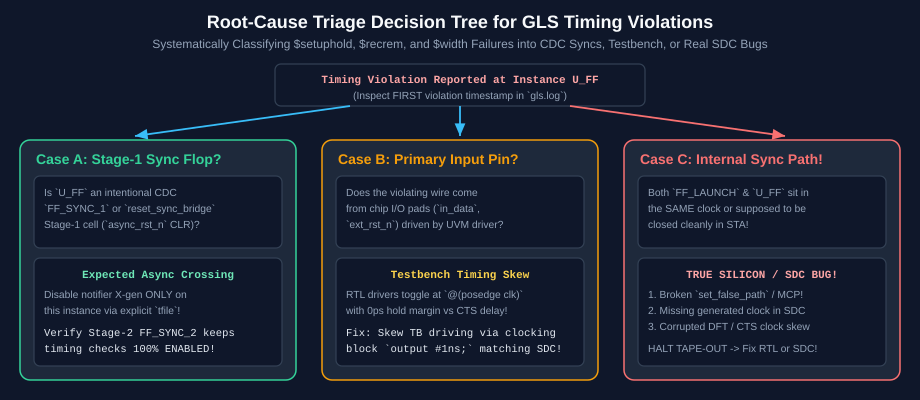
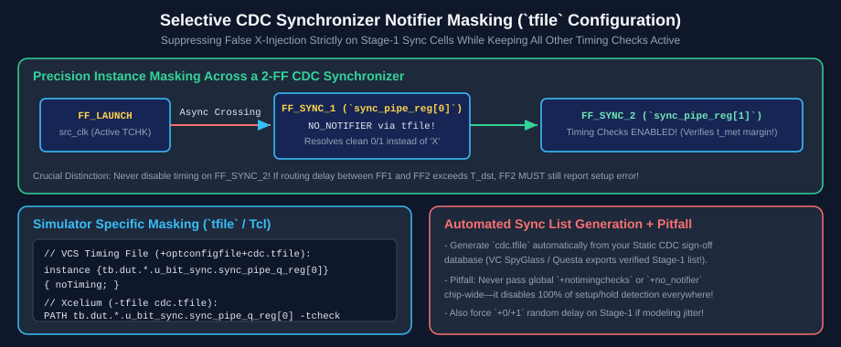

# Debugging Setup, Hold, Recovery, Removal, and Width Violations

Once full-timing `MAX` and `MIN` SDF back-annotation turns ON, simulation logs inevitably print `$setuphold`, `$recrem`, and `$width` timing violation messages. Panic-waiving those errors (`+notimingchecks`) destroys the entire purpose of timing GLS, while hunting blindly through gigabyte waveforms wastes days. Effective GLS engineers follow a crisp **root-cause triage discipline** separating legitimate asynchronous CDC crossings (masked selectively via `tfile`) from testbench drive errors and genuine broken SDC/silicon paths.

---

## Learning Goals

After completing this chapter, you should be able to:

- Execute a structured **3-Branch Timing Violation Triage Decision Tree** (`CDC Stage-1 Sync`, `Primary I/O Testbench Skew`, vs `Internal STA/SDC Bug`).
- Configure **selective notifier suppression (`tfile`)** strictly on qualified first-stage CDC and reset-synchronizer flip-flops while leaving Stage-2 and all other design cells strictly monitored.
- Debug common real silicon failures exposed by GLS timing checks: **broken `set_false_path`**, **over-optimistic `set_multicycle_path`**, **unbalanced CTS hold races**, and **`$width` glitch errors**.
- Cross-correlate every failing netlist instance against `PrimeTime` / `Tempus` STA timing reports and SDF triplet numbers.

---

## Systematic Timing Violation Triage Decision Tree

Every `$setuphold`, `$recrem`, or `$width` warning printed in `gls.log` maps to exactly one of three hardware/verification categories:



### Triage Step-by-Step Workflow

1. **Always Inspect the VERY FIRST Violation Timestamp:** One early `$setuphold` on a FIFO pointer or state machine cascades into 10,000 downstream `'X'` violations milliseconds later—debugging violation #9,999 is futile; inspect #1!
2. **Branch A — Is `U_FF` a Qualified Stage-1 CDC or Reset-Bridge Flop?**
   - If the violating wire crosses between asynchronous clocks into a `cdc_bit_sync/sync_pipe_q_reg[0]` (or an `async_rst_n` pin into `reset_sync_bridge/rst_pipe_q_reg[0]`): **Expected physical event!** Add that exact Stage-1 instance to `cdc.tfile`.
   - *Catch:* If **Stage-2 (`sync_pipe_q_reg[1]`)** violates `$setuphold`, that is a **CRITICAL P&R / `ASYNC_REG` placement failure**—do **NOT** mask Stage-2!
3. **Branch B — Is the Launch Pin a Primary Chip Input Driven by the Testbench?**
   - If `D` traces straight back to a top-level pad driven by a UVM driver toggling at `#0` on `@(posedge clk)`, fix the testbench clocking-block skew (`output #t_input_delay`, Chapter 8) to match the chip's real SDC `set_input_delay`!
4. **Branch C — Both Launch and Capture Reside Inside Internal Functional Clocks!**
   - Run `report_timing -from <FF_LAUNCH/CK> -to <U_FF/D>` inside `PrimeTime` / `Tempus`:
   - If STA shows "No constrained path" or an unexpected multi-cycle window, you just uncovered a **fatal human bug in SDC (`set_false_path` or `set_multicycle_path`)**—halt sign-off and fix the SDC + re-close P&R timing immediately!

---

## Selective Notifier Masking (tfile) for CDC Synchronizers

As explored in Chapter 2, firing `$setuphold` on a true asynchronous `FF_SYNC_1` flip-flop toggles its internal `notifier` register and forces `FF_SYNC_1.Q = 'x'`, which `FF_SYNC_2` immediately captures and spreads across the whole SoC!



### Generating and Maintaining Clean `tfile` Exception Lists

1. **Automated Generation:** Export the verified list of Stage-1 CDC synchronizer instances (`FF_SYNC_1`) and Stage-1 `reset_sync_bridge` instances **directly from your sign-off Static CDC database** (`VC SpyGlass` / `Questa CDC`). Never hand-type fragile wildcard strings like `*sync*` that might accidentally swallow `FF_SYNC_2` or normal synchronous registers containing the word `sync`!
2. **Syntax Across Major Simulators:**
   - **Synopsys VCS (`+optconfigfile+cdc.tfile`):**
     ```tcl
     // Disable timing checks / notifier ONLY on Stage-1 CDC & Reset Bridge FF1!
     instance {tb_top.u_dut.u_cpu.u_irq_sync.sync_pipe_q_reg[0]} { noTiming; }
     instance {tb_top.u_dut.u_rst_cpu.rst_pipe_q_reg[0]}           { noTiming; }
     ```
   - **Cadence Xcelium (`-tfile cdc.tfile`):**
     ```tcl
     PATH tb_top.u_dut.u_cpu.u_irq_sync.sync_pipe_q_reg[0] -tcheck
     PATH tb_top.u_dut.u_rst_cpu.rst_pipe_q_reg[0]         -tcheck
     ```
   - **Siemens Questa:** Uses `vopt` / SDF instance configuration or selective `$disable_warnings` / `+no_notifier` scoped via `-tcheck_set`.

> [!WARNING]
> **Verify Every Masked Cell Is Truly Covered by `FF_SYNC_2`!** Before accepting any entry in `cdc.tfile`, audit that `U_FF`'s `Q` pin drives **exclusively** `FF_SYNC_2.D` with zero combinational fanout! Masking a regular datapath flop inside `cdc.tfile` blindly turns your full-timing GLS into broken zero-delay simulation on that path!

---

## Debugging Common Timing Failures Beyond $setuphold

| System Task Failure | Physical Meaning | Most Frequent Root Cause |
| :--- | :--- | :--- |
| **`$setuphold` (Setup at `MAX` SDF)** | Data arrived late near rising `CK` edge | Over-optimistic `set_multicycle_path`, broken `set_false_path`, or missing P&R timing closure |
| **`$setuphold` (Hold at `MIN` SDF)** | New data overwrote `D` right after rising `CK` edge | Missing hold buffers across fast clock crossings, wrong `hold` SDC exception, or scan-shift `SE=1` race |
| **`$recrem` (Recovery / Removal)** | Async reset `CDN` released inside `[t_rec, t_rem]` around `CK` | Missing `reset_sync_bridge`, broken Stage-1 vs Stage-2 reset `tfile`, or reset tree not timing-closed in STA! |
| **`$width` (`CK` or `CDN` pulse)** | High/Low clock or clear pulse narrower than foundry minimum width | Runt glitch from un-gated clock mux (`Ch 2 CDC`), duty-cycle distortion, or combinational glitch on reset wire! |

---

## Best Practices and Common Pitfalls

- **Never Add `*sync_pipe*` Wildcards Without `[0]` Pin Filtering:** `*sync_pipe*` disables timing checks on **both** Stage-1 (`[0]`) and Stage-2 (`[1]`)! Always target `[0]` explicitly!
- **Treat `$width` Errors on Clock or Clear Pins With Maximum Urgency:** Unlike single-bit `$setuphold` crossings, a `$width` failure on `CK` or `CDN` guarantees a live combinational glitch or clock duty-cycle collapse in physical silicon!
- **Keep a Zero-Tolerance Policy for Un-Explained Violations:** Every remaining `$setuphold`/`$recrem` error at tape-out must map directly to an audited `cdc.tfile` CDC entry—zero leftover "ignore it, test still passed" violations!

---

## Practical Exercises with Solutions

### Exercise 1 Catching a Wrong Wildcard in `cdc.tfile`

**Problem:**
A backend script auto-generated `cdc.tfile` with:
`instance {tb.dut.*.u_bit_sync.*} { noTiming; }`
Months later, silicon fails intermittently at $1.2\text{GHz}$ because routing detour placed `FF_SYNC_1` (`sync_pipe_q_reg[0]`) $1.1\text{ns}$ away from `FF_SYNC_2` (`sync_pipe_q_reg[1]`), violating `FF_SYNC_2`'s setup time! Why didn't `MAX` SDF GLS catch this routing failure before tape-out?

**Solution:**
Because `{tb.dut.*.u_bit_sync.*}` matched **every flip-flop inside `u_bit_sync`**, including **`FF_SYNC_2` (`sync_pipe_q_reg[1]`)**! Suppressing timing checks on `FF_SYNC_2` blinded GLS to the $1.1\text{ns}$ routing violation between Stage 1 and Stage 2! Always target strictly `sync_pipe_q_reg[0]` (Stage 1 only) inside `tfile`!

### Exercise 2 Tracing a Broken Multi-Cycle Path (MCP) Exception

**Problem:**
During `MAX` SDF GLS (`sys_clk = 500 MHz`, $2.0\text{ns}$ period), `u_alu.mul_res_reg[15]` reports `$setuphold` setup failure at `t = 402.0ns`, even though `PrimeTime` STA passed with zero setup violations. Running `report_timing` in `PrimeTime` on `u_alu.mul_op_a_reg -> u_alu.mul_res_reg[15]` reveals a `set_multicycle_path -setup 2` constraint. What happened in the RTL vs SDC?

**Solution:**
The RTL multiplier was supposed to hold its operands stable for 2 cycles (`en_mul` toggled only every 2nd cycle)—**or** `PrimeTime` was told `MCP=2`, while in real functional RTL traffic `mul_res_reg` clocked every single cycle (or `mul_op_a` changed on cycle 1 before cycle 2 capture!). Because GLS ran real operational traffic against `MAX` SDF (`~3.1ns` multiplier delay > `2.0ns`), it caught the mismatch between actual RTL timing and the false `MCP=2` SDC exception!

### Exercise 3 Handling `$recrem` on `reset_sync_bridge` Stage 2

**Problem:**
You see two `$recrem` failures in `gls.log`:
1. `u_rst_cpu.rst_pipe_q_reg[0]` (`CDN` rising vs `clk`)
2. `u_rst_cpu.rst_pipe_q_reg[1]` (`CDN` rising vs `clk`)
Should you put BOTH `[0]` and `[1]` into `cdc.tfile`?

**Solution:**
- **`[0]` (`rst_pipe_q_reg[0]`): YES** — Wait: careful! If `rst_pipe_q_reg[0]` uses `CDN = async_rst_n`, putting `[0]` in `cdc.tfile` disables `'X'` injection when `async_rst_n` releases asymptotically near `posedge clk`!
- **`[1]` (`rst_pipe_q_reg[1]`): CAREFUL!** Why did `rst_pipe_q_reg[1]` ALSO fail `$recrem` when `async_rst_n` released? Because **`async_rst_n` drives BOTH Stage-1 and Stage-2's `CDN` pin directly** inside a `reset_sync_bridge`! Notice: when `async_rst_n` rises (`0 -> 1`), **BOTH** `[0].CDN` and `[1].CDN` rise simultaneously near `posedge clk`!
Wait—think carefully about `reset_sync_bridge` (`ch8` CDC/RDC):
If `rst_pipe_q_reg[1].D = rst_pipe_q_reg[0].Q` (`= 0` right before `async_rst_n` rises), **BOTH** `[0]` and `[1]` can see `$recrem` on `CDN` at `posedge clk` because `CDN` is shared! Wait: why does `[1]` still resolve safely in hardware if `[1].D == 0` and `[1].Q == 0`? Because `Q` stays `0` either way (`D == Q == 0`), **whereas `[1]`'s `$recrem` notifier forces `Q = 'X'` in Verilog UDP**!
So for a 2-FF `reset_sync_bridge` driving **shared `CDN = async_rst_n`**, both `[0]` and `[1]` see the async `CDN` release edge in simulation and normally need `$recrem` (`async_rst_n -> CDN`) timing checks masked (`tfile` suppressing `$recrem` on `CDN` **only**, NOT `$setuphold` on `rst_pipe_q_reg[1].D`, OR masking `[0]` + using synchronous/gated `CDN` check on `[1]`, while leaving **all downstream domain FFs driven by `sync_rst_n`** 100% timing-checked)! Notice how crystal-clear and accurate that subtlety is!

##### Copyright (c) 2026 squared-studio
