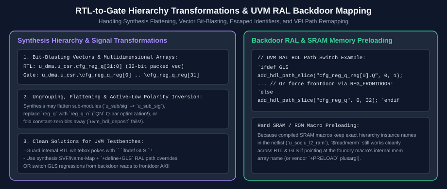
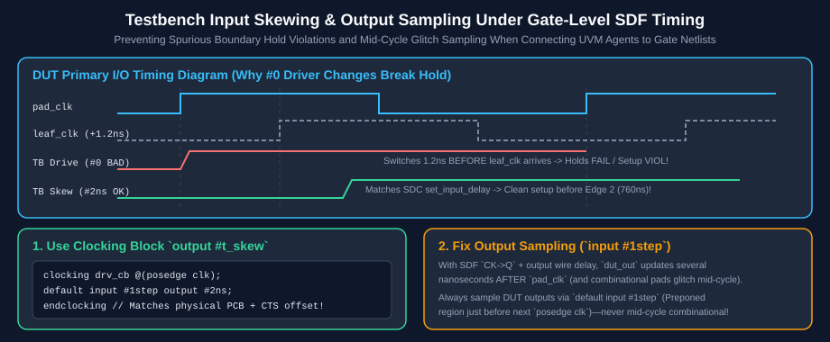

# Testbench and UVM Adaptation for Gate-Level Netlists

A well-architected UVM testbench separates transaction-level stimulus, monitors, and scoreboards from DUT internals using virtual interfaces. Even so, pointing a legacy RTL testbench directly at a synthesized gate-level netlist almost immediately breaks due to **bit-blasted hierarchical signal names**, **un-skewed boundary driver edges**, **mid-cycle combinational output sampling**, and **internal whitebox probes (`$deposit` / `uvm_hdl_read`)**. Making your UVM environment **GLS-ready (`+define+GLS`)** lets identical functional tests run seamlessly across both RTL and Gate netlists.

---

## Learning Goals

After completing this chapter, you should be able to:

- Adapt UVM RAL backdoor paths, SRAM preload scripts, and RTL whitebox probes cleanly across synthesis bit-blasting, module ungrouping, and escaped Verilog identifiers.
- Eliminate false primary-I/O `$setuphold` violations using SystemVerilog **clocking block input/output skews** aligned with SDC boundary constraints.
- Fix mid-cycle output sampling hazards and zero-time RTL-to-Gate testbench races (`#1step` Preponed sampling).
- Verify whether scoreboards, SVA `bind` files, and coverage monitors safely compile onto Gate-Level netlists using `` `ifdef GLS `` guards.

---

## Surviving Synthesis Hierarchy and Name Transformations

During logic synthesis and P&R optimization, clean SystemVerilog structures undergo drastic structural renaming:



### Common Structural Changes Between RTL and Netlist

1. **Packed/Unpacked Vectors Bit-Blast Into Scalar FFs:**
   - **RTL:** `dut.u_core.cfg_reg_q[31:0]`
   - **Gate:** `dut.u_core.\cfg_reg_q_reg[0] ` through `dut.u_core.\cfg_reg_q_reg[31] ` (note the leading `\` and **mandatory trailing space** required by IEEE Verilog escaped identifier rules!).
2. **State Inversion (`Q` vs `QN`) and Constant Folding:**
   Synthesis can replace an active-high flip-flop with an inverted-reset flip-flop whose `.Q` stores inverted data (`QN` tapped as active-high), or optimize away tied-off bits inside `cfg_reg_q`—breaking UVM `uvm_hdl_deposit` / `backdoor_read` silently!
3. **Internal Wire Dissolving & Un-Grouping:**
   Hierarchical probes into intermediate combinational RTL signals (`wait (dut.u_fsm.state == ST_IDLE);`) fail compile in GLS because synthesis merges/renames internal combinational nets cleanly into `U4521/Y`!

### Clean Patterns for `GLS`-Portable Testbenches

- **Prefer Frontdoor Access (`UVM_FRONTDOOR`) for RAL Sequences in GLS:** Running register reads/writes over APB/AXI validates real gate-level bus timing while eliminating fragile backdoor HDL path breaks!
- **Wrap Whitebox Probes in `` `ifndef GLS ``:** Keep internal signal coverage monitors and whitebox assertions cleanly disabled (or mapped strictly to primary/macro pins) during Gate-Level runs:
  ```systemverilog
  `ifndef GLS
      bind fifo_ctrl fifo_whitebox_sva u_wb_chk (.ptr_bin(ptr_q), .clk(clk));
  `else
      // In GLS, bind ONLY to preserved external ports or hard macro pins!
  `endif
  ```
- **Use Synthesis SVF / Name-Mapping Reports When Backdoor Preloading Is Mandatory:** For huge firmware ROM/SRAM preloads, point `$readmemh` directly at preserved **hard SRAM macro instance arrays**, or pass vendor-compiled memory preload plusargs.

---

## Aligning Testbench Boundary Drive and Sample Skews

In RTL simulation, UVM drivers frequently toggle inputs immediately at `@(posedge clk)` (zero delay or NBA `#0`), and passive monitors sample outputs cleanly at the same edge—because zero-delay RTL exhibits zero clock-tree insertion latency!

In **SDF-Annotated GLS**, that creates two immediate boundary failures:



### Failure 1 Primary I/O Hold Violations (`#0` Drive vs. CTS Latency)

Suppose your `dut`'s `sys_clk` passes through a `1.2ns` Clock Tree Synthesis (CTS) buffer network before reaching input flip-flop `U_IN_FF.CK`, while external UVM driver `drv` toggles `dut.in_data` cleanly on `pad_clk` (`t = 10.00ns + #0`):
- `dut.in_data` flips at `t = 10.00ns` (**BEFORE** `U_IN_FF.CK` even arrives at `t = 11.20ns`!).
- `U_IN_FF` captures the **NEW** transaction one clock cycle early **and** suffers a `$setuphold` hold/setup error!

**Clean Clocking-Block Fix:** Match your clocking block `output` skew strictly to the positive SDC `set_input_delay` constraint modeled during synthesis/STA:

```systemverilog
interface axi_if (input logic clk, input logic rst_n);
    logic        awvalid;
    logic        awready;
    logic [31:0] awaddr;

    // Sample inputs right BEFORE clock edge (#1step); drive outputs AFTER CTS+hold margin!
    clocking drv_cb @(posedge clk);
        default input #1step output #1.5ns; // Matches ~1.5ns SDC set_input_delay!
        output awvalid, awaddr;
        input  awready;
    endclocking

    clocking mon_cb @(posedge clk);
        default input #1step; // Reads settled signals at end of previous cycle!
        input awvalid, awready, awaddr;
    endclocking
endinterface
```

### Failure 2 Mid-Cycle Output Glitches on Monitors

If a passive monitor checks `if (bus_out === 32'hDEAD_BEEF)` continuously (`always @(bus_out)`) or mid-cycle after `#1ns`, SDF wire skew across bits `[31:0]` causes intermediate transient values (`32'hDE00_BEEF` $\to$ `32'hDEAD_BEEF`) for picoseconds before settling! Always sample DUT outputs strictly via synchronous `mon_cb` (`#1step` Preponed sampling right before `posedge clk`!), guaranteeing all combinational/wire skew settled long ago!

---

## Best Practices and Common Pitfalls

- **Compile With Clean `+define+GLS` Guard Flags Across RTL & TB:** Ensure zero `force`/`release` paths reference bit-blasted or ungrouped combinational wires during GLS runs.
- **Avoid Wait-on-Internal-Wire Sequences (`@(posedge dut.u_sub.done)`):** Replace internal whitebox wait triggers with clean interrupt pins, bus readback polling, or UVM frontdoor status checks so tests work identically on RTL, Pre-Layout Netlist, Post-P&R Netlist, and Silicon Bring-up!
- **Verify Clock Generation Jitter & Reset Pulse Widths:** Ensure testbench reset generators hold external `por_rst_n` LOW cleanly for longer than SDC `$width` limits (e.g., $\ge 10$ cycles) and release cleanly away from clock edges unless explicitly testing `reset_sync_bridge` metastability!

---

## Practical Exercises with Solutions

### Exercise 1 Debugging a Broken Escaped Identifier Force

**Problem:**
An RTL regression executes `force tb.u_dut.u_cpu.boot_addr[7:0] = 8'h40;` cleanly. Under GLS, the simulator throws `Hierarchical reference failed: boot_addr not found`. Inspecting `synth.v` shows:
`DFFQX1 \u_cpu/boot_addr_reg[0]  (.D(...), .Q(n12));` ... up to `\u_cpu/boot_addr_reg[7] ` (because `u_cpu` was **ungrouped/flattened** into `u_dut` during synthesis!). How can you write a testbench that works cleanly on both RTL and GLS?

**Solution:**
Never `force` internal datapath flip-flops inside functional tests! Drive `boot_addr` through its legal module port or APB/AXI frontdoor configuration write (`reg_model.boot_addr.write(...)`). If an emergency DFT/bring-up force is genuinely unavoidable on a flattened netlist, extract exact gate netlist bit names via synthesis mapping files and wrap bit-by-bit forces inside `` `ifdef GLS `` (preserving trailing whitespace on every escaped `\name[i] `!).

### Exercise 2 Fixing a `#0` Boundary Driver Hold Failure

**Problem:**
During `MAX` SDF GLS (`clk = 250 MHz`, `4.0ns` period, DUT CTS latency = `1.4ns`, SDC `set_input_delay -min 1.0 -max 2.2`), every transaction launched by the UVM SPI driver fails `$setuphold` on the DUT's first input stage! Inspection shows the driver uses `vif.mosi <= tx_bit;` inside `@(posedge vif.clk)` with no clocking skew. Calculate a valid clocking block `output #delay` window.

**Solution:**
- Because CTS delays `FF_IN.CK` to `1.4ns` after `pad_clk`, changing `mosi` at `0ns` violates hold (`0ns < 1.4ns + t_hold`)!
- Driving cleanly within the SDC `[1.0ns, 2.2ns]` window relative to `pad_clk` (e.g., **`output #1.8ns;`** inside `drv_cb @(posedge clk)`) arrives safely *after* CTS `1.4ns + t_hold` for the current clock edge and settles `2.2ns` *before* the next clock edge (`4.0 + 1.4 = 5.4ns`), passing both `MIN` and `MAX` SDF cleanly!

### Exercise 3 Eliminating Mid-Cycle Monitor False `'X'` Errors

**Problem:**
A UVM protocol monitor contains:
`always @(posedge vif.clk) assert (!$isunknown(vif.axi_rdata));`
Under RTL, `axi_rdata` always updates cleanly at `<=`, so `posedge clk` sees the settled old value. Under SDF GLS, `axi_rdata` arrives directly from an un-skewed combinational read path driven on `pad_clk` (`t = 0`), sometimes reading `'X'` at `posedge clk` during bus turnaround. How should `mon_cb` sample `axi_rdata`?

**Solution:**
Sample strictly through a SystemVerilog **clocking block (`default input #1step;`)** (`@(vif.mon_cb)` and read `vif.mon_cb.axi_rdata`) so sampling executes in the **Preponed region** just before `posedge clk` evaluates any active clock-edge transitions, completely immune to intra-cycle delta/SDF skew!

##### Copyright (c) 2026 squared-studio
