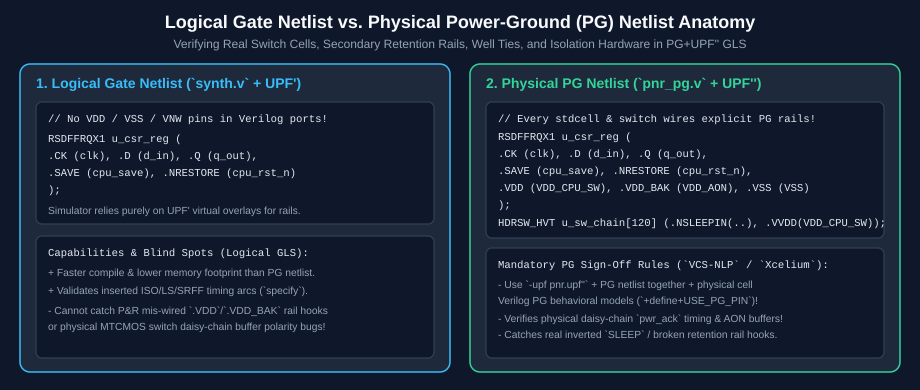
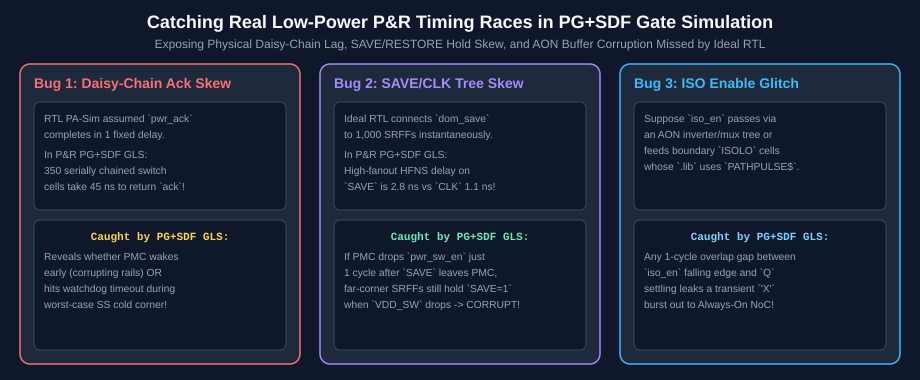

# Low-Power and Power-Ground (PG) Netlist Gate-Level Simulation

Low-power SoCs rely on multiple voltage domains, power-gated islands, retention flip-flops, level shifters, and isolation clamps to meet aggressive leakage and dynamic power budgets. While UPF-driven RTL simulation validates architectural power intent early in the design cycle, it relies on idealized behavioral supply networks and inferred power-management cells that may not match the final physical implementation. Post-Place-and-Route **Power-Ground (PG) netlist Gate-Level Simulation (GLS)** closes this gap by simulating the exact physical transistors/cells with explicit `VDD`, `VSS`, switched rail (`VDD_SW`), backup rail (`VDD_AO`), and well-bias ports wired directly into the Verilog netlist.

---

## Learning Goals

- Distinguish between **logical-only UPF GLS** (signal ports only, implicit supplies via UPF) and **physical PG-netlist GLS** (explicit power/ground ports synthesized and routed by P&R).
- Verify power-switch daisy chains, acknowledge handshake signals, and power-up ramp stabilization using timing-annotated PG cell models.
- Validate physical **isolation cells**, **level shifters**, and **state-retention registers (SRPG/retention flops)** under realistic reset, clock-gating, and supply-collapse events.
- Detect physical low-power bugs that bypass UPF RTL checks—including missing always-on (`AON`) buffers, misconnected backup rails, premature isolation release, and floating inputs driving crowbar current.
- Configure Synopsys VCS MVSIM / NLP, Cadence Xcelium LPS / IEEE 1801, and Siemens Questa Power-Aware (PA) flows for PG-netlist GLS without double-driving supply states.

---

## Why Standard Logical Netlists Are Blind to Power Intent

Standard logical Verilog netlists generated immediately after RTL synthesis omit power and ground pins (`VDD`, `VSS`, `VBP`, `VBN`) for readability and simulation speed. A standard cell like an inverter or flip-flop appears in the logical netlist with only functional pins (`A`, `Y`, `D`, `CK`, `Q`).

However, inside the physical silicon layout implemented by the Place-and-Route (P&R) tool:

- An **Always-On (AON) buffer** sits physically inside a switchable power domain (`PD_CPU`) yet connects its `VDD` pin to the unswitched always-on supply (`VDD_AO`), allowing wake-up control signals or retention control signals (`SAVE`/`RESTORE`) to traverse across a powered-down island without dropping out.
- A **dual-rail level shifter** bridges a `0.65 V` core domain (`VDDL`) and a `0.90 V` I/O or SRAM peripheral domain (`VDDH`), requiring both `VDDL` and `VDDH` pins wired to distinct supply nets.
- A **State-Retention Power-Gating (SRPG) flip-flop** has both a switchable main supply (`VDD_SW`) for its master/slave combinational logic and an always-on backup rail (`VDD_BKUP` or `VDD_AO`) for its balloon latch.

If a P&R ECO accidentally connects an AON buffer's `VDD` pin to `VDD_SW` instead of `VDD_AO`, a logical-only netlist (which hides `VDD`/`VSS` pins entirely) cannot see the wiring error directly unless UPF overlays supply associations cleanly—and even then, PG-aware P&R optimizations like tie-cell insertion, spare-cell tie-offs, and clock-tree buffer placement inside nested domains must be checked on the **true PG netlist** exported alongside SPEF and SDF.

> [!IMPORTANT]
> Power-intent bugs discovered in silicon—such as a missing clamp causing X-propagation into an always-on bus, or a retention save/restore clock toggling while `VDD_SW` is collapsed—typically cannot be fixed via metal-only ECO if power-switch cells or dedicated AON supply stripes are absent. PG-netlist GLS is the final pre-tapeout functional proof that physical supply routing matches IEEE 1801 (UPF) intent.

---

## Logical-Only UPF GLS vs Power-Ground (PG) Netlist GLS

Low-power gate-level flows fall into two distinct stages across the implementation timeline:

1. **Post-Synthesis Logical Netlist + UPF (`UPF-driven GLS`)**: Uses the non-PG netlist plus the golden or post-synthesis `UPF'` file (`load_upf`). The simulator instruments standard cells via UPF supply sets and inserts behavioral corruption/isolation semantics dynamically.
2. **Post-P&R PG Netlist (`PG GLS`)**: Uses the Verilog PG netlist exported from Innovus or Fusion Compiler (`write_verilog -pg`), along with PG-aware standard cell Verilog models (`-v stdcell_pg.v` compiled with `` `define UPF_PG `` or library power macros).



| Dimension | Logical-Only UPF GLS | Physical PG-Netlist GLS |
| :--- | :--- | :--- |
| **Netlist Pinout** | Functional pins only (`A`, `Y`, `D`, `CK`, `Q`) | Explicit supply pins (`VDD`, `VSS`, `VDDG`, `VPP`, `VBB`) |
| **How Supply State Propagates** | Simulator UPF engine overlays virtual supply state onto cells | Actual PG ports drive internal `1'b1`/`1'b0`/`1'bx` supply switches inside UDP/behavioral cell models |
| **Detects Wrong Rail Tie-Offs** | Only if reflected in `UPF'` (`connect_supply_net` mismatch) | Directly detects physical P&R wiring errors on every single instance |
| **Handles Macro / Analog PG Pins** | Requires UPF macro models or liberty attributes | Directly tests analog IP, PLL, DDR PHY, and SRAM dual/triple rail connectivity |
| **SDF Back-Annotation Compatibility** | Standard `IOPATH` and timing checks | Requires careful separation: UPF/PG supply checks vs SDF `IOPATH` without double instrumentation |
| **Compile & Runtime Overhead** | Moderate (~1.3x–1.8x baseline GLS) | Higher (~2x–4x baseline GLS due to PG net fanout across millions of gates) |

### Anatomy of a Physical PG Netlist Snippet

In a PG netlist emitted by P&R (`write_verilog -pg`), every leaf cell explicitly instantiates its power rails using named port connections:

```verilog
// Post-P&R PG Netlist fragment for power domain PD_AUDIO (switchable VDD_AUD_SW)
module audio_subsystem (
    input  logic clk_sys,
    input  logic rst_n,
    input  logic iso_en_n,
    input  logic pwr_req_n,
    output logic pwr_ack_n,
    output logic [7:0] aud_bus,
    inout  wire  VDD_AO,      // Always-On 0.8V rail
    inout  wire  VDD_AUD_SW,  // Switched 0.8V rail driven by header switches
    inout  wire  VSS          // Common Ground
);

    // Coarse-grain Header Power Switch Cell (Mother/Daughter daisy chain)
    HDR_SW_X4 u_hdr_sw_0 (
        .NSLEEPIN1  (pwr_req_n),
        .NSLEEPIN2  (pwr_req_n),
        .NSLEEPOUT1 (daisy_req_1),
        .NSLEEPOUT2 (daisy_req_2),
        .TVDD       (VDD_AO),       // Unswitched input supply
        .VDD        (VDD_AUD_SW),   // Switched output supply net
        .VSS        (VSS)
    );

    // State Retention Flip-Flop inside PD_AUDIO (requires BOTH rails!)
    SRPG_DFFQX2 u_cfg_ret_0 (
        .D          (nxt_cfg),
        .CK         (clk_gated),
        .RT         (ret_save_restore), // Active-high retention control
        .Q          (cfg_bit),
        .VDD        (VDD_AUD_SW),       // Main switched logic supply
        .VDDG       (VDD_AO),           // Always-on retention balloon latch supply
        .VSS        (VSS)
    );

    // Clamp-to-0 Isolation AND Gate placed at PD_AUDIO output boundary
    ISO_AND_X4 u_iso_aud_0 (
        .A          (raw_aud_bit),
        .ISO_EN_N   (iso_en_n),         // Driven by Always-On PMU
        .Y          (aud_bus[0]),
        .VDD        (VDD_AO),           // Must sit on VDD_AO (or output domain) rail!
        .VSS        (VSS)
    );

endmodule
```

> [!WARNING]
> Notice `.VDD(VDD_AO)` on `u_iso_aud_0`. If an engineer accidentally passes `-pg` netlist into a non-PG compile or forgets the supply driver on `VDD_AO`, every gate connected to `VDD_AO` loses its supply and evaluates to `'x`. Conversely, if `.VDD` on `u_iso_aud_0` were mistakenly wired to `VDD_AUD_SW` during P&R, PG GLS immediately exposes the bug because `u_iso_aud_0` output `Y` turns `X` when `VDD_AUD_SW` powers down—even while `iso_en_n` is asserted!

---

## Power Switch Modeling, Rush Current Sequencing, and Supply Nets

Unlike RTL UPF simulation where `create_power_switch` instantly toggles an abstract supply state variable (`OFF` <-> `FULL_ON`), physical power distribution uses hundreds or thousands of **header switches** (PMOS switches interrupting `VDD`) or **footer switches** (NMOS switches interrupting `VSS`) chained together to limit peak **inrush current** ($I = C \frac{dV}{dt}$) and supply droop on adjacent active domains.

### Modeling Daisy-Chained Power Switches

In a physical layout:
1. A small bank of **trickle/weak switches** turns on first via `NSLEEPIN1`, slowly pre-charging the switched rail capacitance.
2. Control propagates down a buffered daisy chain (`NSLEEPIN1 -> NSLEEPOUT1 -> ...`) with real SDF gate + interconnect delays.
3. Once the trickle chain completes, the final switch returns `NSLEEPOUT1` back to the PMU as `pwr_ack_n` (or enables the **strong/all-on switch** stage `NSLEEPIN2`).

Inside the PG Verilog model of `HDR_SW_X4`, supply resolution typically operates via Verilog **`supply1`/`supply0`** or **bidirectional `tranif1` / `pmos` / strength-resolved `trireg` / UDP** logic:

```verilog
// Simplified behavioral/UDP PG model for a physical Header Power Switch
`celldefine
module HDR_SW_X4 (
    input  NSLEEPIN1,
    input  NSLEEPIN2,
    output NSLEEPOUT1,
    output NSLEEPOUT2,
    input  TVDD,      // Always-on feed
    output VDD,       // Switched virtual rail (can be multi-driven by parallel switches!)
    input  VSS
);
    wire pg_ok_in = (TVDD === 1'b1) && (VSS === 1'b0);

    // Real SDF-annotatable buffer delays on daisy-chain sleep control
    buf (NSLEEPOUT1, NSLEEPIN1);
    buf (NSLEEPOUT2, NSLEEPIN2);

    // Multi-driver strength resolution: multiple switches drive VDD cleanly when active
    // When both sleep inputs are high (sleep=1, nsleep=0? check active polarity!), rail floats (Z)
    wire switch_on = pg_ok_in && (~NSLEEPIN1 | ~NSLEEPIN2);

    // Use supply/strong/weak strength or custom resolution UDP to avoid Z->X issues
    assign (strong1, highz0) VDD = switch_on ? 1'b1 : 1'bz;

    specify
        (NSLEEPIN1 => NSLEEPOUT1) = (0.12, 0.12);
        (NSLEEPIN2 => NSLEEPOUT2) = (0.08, 0.08);
    endspecify
endmodule
`endcelldefine
```

> [!CAUTION]
> **Multi-Driver Supply Contention & Tri-State Collapse**: A domain with 400 parallel header switches drives the same single net `VDD_AUD_SW`. During a staged turn-on, some switches turn ON (`1'b1`) slightly before others (`1'bz`). Using standard `assign VDD = sw ? 1'b1 : 1'bx;` creates destructive `1 + X -> X` contention across the entire power grid! Correct PG header models MUST drive `1'bz` (high impedance) when OFF, or use a dedicated simulator power-switch resolution primitive so `1'b1 + 1'bz` resolves cleanly to `1'b1`, and all-OFF resolves cleanly to `1'bz` (or decayed `1'bx` after a capacitive decay delay).

### Preventing Double Instrumentation (UPF + PG Netlist Conflict)

A classic pitfall when running **both** the post-P&R PG netlist AND the original UPF file simultaneously is **double corruption / supply collision**:

- The UPF engine injects virtual corruption onto cells in `PD_AUDIO`.
- Meanwhile, the PG cell Verilog models explicitly see `VDD_AUD_SW === 1'bz` and also try to corrupt registers/gates internally.
- Worse, in some simulators, UPF `connect_supply_net` overrides Verilog `supply1`/`VDD` pins, or complains about port mismatches if top-level testbench doesn't drive `VDD_AO` and `VSS` explicitly.

Best-practice flows resolve this cleanly using one of two sanctioned strategies:
1. **Pure PG-Verilog Simulation (No Runtime UPF Corruption)**: Top-level harness binds `supply1 VDD_AO;` and `supply0 VSS;`, PG standard cell libraries handle power-down X-corruption natively inside the UDP/PG models, and a lightweight **UPF structural / SVA protocol checker** verifies sequence ordering without injecting conflicting X's.
2. **PG-Aware UPF Mode (`-upf_pg` / `-pa_pg`)**: Simulator flags (`-power_top`, `-lps_pg`, `-pa_enable=pg`) instruct the simulator's power-aware kernel to read supply connectivity from the PG pins rather than inferring implicit UPF supply sets, suppressing redundant UPF drivers while retaining UPF isolation/retention assertions and coverage.

---

## Physical Isolation, Level Shifter, and Retention Cell Verification

PG-netlist GLS allows direct transistor-pin verification of all three critical boundary cell families.

### 1. Isolation Cells (`ISO_AND`, `ISO_OR`, `ISO_LATCH`)

Every signal crossing from a switchable domain (`VDD_SW`) to an active or always-on domain (`VDD_AO`) requires isolation clamping (`0`, `1`, or `latch-hold`).

In PG GLS, the Verilog model of an clamp-0 `ISO_AND_X4` cell implements explicit supply qualification:

```verilog
// Physical PG model of an active-low enable Isolation AND cell (clamp to 0 when ISO_EN_N==0)
module ISO_AND_X4 (
    input  A,
    input  ISO_EN_N,
    output Y,
    input  VDD,
    input  VSS
);
    wire supply_valid = (VDD === 1'b1) && (VSS === 1'b0);

    // When ISO_EN_N == 0, A is masked BEFORE it can corrupt Y—even if A == 1'bx!
    // Crucially, in Verilog, (1'bx & 1'b0) evaluates strictly to 1'b0!
    wire clamped_val = A & ISO_EN_N;

    // However, if ISO_EN_N itself is X or supply_valid is FALSE (rail dead), output collapses to X
    assign Y = supply_valid ? clamped_val : 1'bx;

    specify
        if (ISO_EN_N == 1'b1) (A => Y) = (0.05, 0.05);
        (ISO_EN_N => Y) = (0.06, 0.06);
    endspecify
endmodule
```

Notice the subtle Verilog truth-table requirement: `1'bx & 1'b0 === 1'b0` in standard IEEE 1800 four-state logic, whereas an naive `if (ISO_EN_N == 1'b0) Y = 0; else Y = A;` or `mux2` written carelessly with `assign Y = ISO_EN_N ? A : 1'b0;` actually produces `1'b0` ONLY if `ISO_EN_N === 1'b0` (`?` operator in Verilog resolves `1'b0 ? 1'bx : 1'b0` as `1'b0`, though `1'bx ? 1'bx : 1'b0` returns `1'bx`!). Furthermore, P&R tools sometimes invert isolation polarity or place a regular `AND2` instead of a certified `ISO_AND` cell—PG GLS checks that no un-isolated combinational gate upstream of the clamp ever leaks `X`, and verifies that `ISO_AND`'s own `VDD` pin sits on the always-on rail (`VDD_AO`) or sink domain rail (`VDD_SINK`), not the dying source rail (`VDD_SRC`).

### 2. Level Shifters (`LVL_HL`, `LVL_LH`, and Combo `ELS`)

In digital Verilog (`1'b0`, `1'b1`), voltage amplitude (`0.65 V` vs `0.90 V`) does not naturally show up in boolean logic! Consequently, **PG cell models for level shifters must explicitly verify voltage/supply-domain presence and signal validity**, and simulators using **UPF-linked voltage attributes** or custom **Real Number Modeling (`wreal` / `real`)** on `VDDL`/`VDDH` verify level shifting behavior:

- **Single-rail missing `VDDL` or `VDDH`**: If the input domain (`VDDL`) collapses while an active-high **Enable Level Shifter (`ELS`)** is disabled, `ELS` behaves like a combined isolator + level shifter. If P&R placed a plain `LVL` cell without isolation on a power-gated source boundary, `A == 1'bx` propagates directly through `LVL` into `VDDH`!
- **Pass-through timing and supply skew**: When `VDDL` ramps up slightly *after* `VDDH`, the `LVL` output must remain cleanly clamped or predictable until both supplies cross valid thresholds.

### 3. State-Retention Power-Gating (SRPG) Cells

An SRPG cell preserves architectural state while `VDD` is OFF using `VDDG` (`VDD_AO`). PG GLS directly exercises the golden retention handshakes:

```verilog
// Behavioral core inside a PG-aware SRPG Retention Flip-Flop
// Polarity assumed: SAVE = posedge of RET, RESTORE = negedge of RET (single-pin RET style)
always @(posedge CK or negedge RST_N) begin
    if (VDD !== 1'b1 || VSS !== 1'b0) begin
        q_main <= 1'bx; // Main switched storage dies when VDD drops!
    end else if (!RST_N) begin
        q_main <= 1'b0;
    end else if (RET === 1'b0) begin
        q_main <= D;
    end
end

// Always-on Balloon Latch powered strictly by VDDG (VDD_AO)
always @(*) begin
    if (VDDG !== 1'b1 || VSS !== 1'b0) begin
        q_balloon = 1'bx; // Retention lost if backup rail dies!
    end else if (RET === 1'b1 && VDD === 1'b1) begin
        // Wait: Save phase occurs BEFORE VDD collapses!
        q_balloon = q_main;
    end
end
```

Notice what this PG cell model exposes immediately if control timing fails:
- If the PMU turns OFF `VDD` (`VDD_SW` goes `1'bz` or `1'bx`) **before** asserting `RET = 1'b1` (violating `SAVE` setup time before power collapse), `q_main` turns `1'bx` and latches `1'bx` into `q_balloon`—permanently corrupting the retained value!
- If `RET` deasserts (`1 -> 0`) **before** `VDD` stabilizes (`VDD === 1'b1`) during wake-up (`RESTORE`), `q_main` misses the restore window and boots as `1'bx`!
- If `CK` toggles while `RET === 1'b1` (clock not gated during save/sleep/restore), timing checks inside the SRPG `specify` block fire `$setuphold` / `$width` errors and corrupt `q_balloon`.

---

## Catching Wake-Up Sequences, Floating Nodes, and Clamp Bugs

Real silicon low-power failures almost never happen during steady-state ON or steady-state OFF operation; they happen during **dynamic power state transitions**—specifically power-down entry and wake-up exit.



Four high-severity bugs caught uniquely by **timing-annotated PG GLS** include:

1. **Clock-Gate Race Before Isolation (Glitch Injection During Shutdown)**:
   - PMU asserts `iso_en` too close to the last active clock edge, OR clock gating (`ICG`) turns OFF one cycle *after* `iso_en` enables on an asynchronous path. A toggle on `raw_signal` races with `iso_en` across physical interconnect skew, injecting a runt pulse or `X` past the isolation cell before clamping settles.
2. **Premature Isolation Release on Wake-Up (X-Flush Bug)**:
   - On wake-up, header switches assert `pwr_ack` indicating `VDD_SW` is up. However, sequential elements inside the newly awakened domain still hold **unknown (`X`) internal state** until either:
     - Reset (`rst_n`) pulses cleanly for synchronous/asynchronous reset flops, **OR**
     - Retention `RESTORE` finishes restoring SRPG flops, **AND**
     - Non-retention datapath flops receive deterministic values or clock edges.
   - If the PMU deasserts `iso_en` immediately upon `pwr_ack == 1` *before* reset/restore propagates through the SDF-annotated reset tree, `X` pours out onto system buses and corrupts active CPU/NoC domains!
3. **Floating Input / Crowbar Current Paths on Always-On Logic**:
   - Even when an isolation clamp protects primary outputs, internal AON buffers or feedthrough paths whose inputs come from switched logic can sit at floating `Z` or `X` while powered up. SVA PG-monitoring assertions check that every active input pin (`VDD_AO`-powered) remains driven to known `0` or `1` whenever powered ON.
4. **Reset-Assertion Missing After Non-Retention Wake-Up**:
   - In RTL UPF simulation, resetting a domain on wake-up might work effortlessly because all flops reset in `0 ns`. In SDF PG GLS, if `rst_n` pulse width is shorter than the worst-case slow-corner reset buffer chain + recovery time, deep pipeline registers miss reset and retain `X` from power-off corruption!

### Writing SVA Low-Power Protocol Monitors for PG GLS

Adding SystemVerilog Assertions (`bind` onto the PG top module) turns implicit silent corruptions into pinpoint timestamped failures:

```systemverilog
// Bound onto PG netlist boundary to enforce clean power sequencing in SDF GLS
module lp_pg_protocol_sva (
    input logic clk_ao,
    input logic iso_en_n,    // 0 = isolated, 1 = transparent
    input logic pwr_req_n,   // 0 = power ON requested
    input logic pwr_ack_n,   // 0 = power switches ON
    input logic rst_sw_n,    // 0 = switched domain in reset
    input logic ret_en,      // 1 = retain state
    input wire  vdd_sw,      // Physical switched supply net
    input logic [31:0] bus_out
);

    // 1. No X on domain boundary outputs whenever isolation is supposed to be active
    property p_iso_clean_output;
        @(posedge clk_ao) disable iff (vdd_sw === 1'bx && iso_en_n === 1'b1)
        (!iso_en_n) |-> !$isunknown(bus_out);
    endproperty
    assert property (p_iso_clean_output)
        else $error("LP_PG_ERR: Outgoing bus contains X while isolated (iso_en_n=0)!");

    // 2. Domain MUST already be isolated BEFORE switched rail is turned OFF
    property p_iso_before_power_off;
        @(posedge clk_ao)
        $rose(pwr_req_n) |-> (!iso_en_n);
    endproperty
    assert property (p_iso_before_power_off)
        else $error("LP_PG_ERR: Power-off requested while domain is NOT isolated!");

    // 3. Isolation MUST NOT release while switched supply is collapsed or reset/restore unstable
    property p_no_uniso_while_dead;
        @(posedge clk_ao)
        $rose(iso_en_n) |-> ((vdd_sw === 1'b1) && !ret_en);
    endproperty
    assert property (p_no_uniso_while_dead)
        else $error("LP_PG_ERR: Isolation released while VDD_SW not stable or retention active!");

endmodule
```

> [!TIP]
> Notice rule #1 (`p_iso_clean_output`) checks `!$isunknown(bus_out)` using **exact clock sampling** rather than continuous combinatorial checking. Wait: what about asynchronous glitches between clock edges? To catch async clamps dropping during clock-stopped windows, pair synchronous assertions with an immediate `always @(bus_out) if (iso_en_n === 1'b0 && $isunknown(bus_out)) ...` check gated past $t = 0$ initialization!

---

## Simulator Setup for PG Netlists and UPF Correlation

Enabling PG-netlist GLS cleanly across major EDA simulators requires matching library macro defines, explicit top-level supply binding, and clean exclusion of false supply-net X propagation at time 0.

### Top-Level Testbench Supply Harness

In PG GLS, top-level `inout` power ports (`VDD_AO`, `VDD_IO`, `VSS`) on the DUT must be explicitly driven from the testbench harness using Verilog `supply1` / `supply0` nets (or switchable `reg` if testing brownout / external PMIC power sequencing):

```systemverilog
module tb_soc_pg_top;
    // Fixed always-on external supplies driven by board/PMIC
    supply1 tb_vdd_ao;
    supply1 tb_vdd_io;
    supply0 tb_vss;

    // Optional external switchable board rail controlled by testbench PMIC model
    reg     tb_vdd_ddr_en = 1'b1;
    wire    tb_vdd_ddr = tb_vdd_ddr_en ? 1'b1 : 1'bz;

    soc_top u_dut (
        .clk_ref   (clk_ref),
        .rst_por_n (rst_por_n),
        // Explicit physical PG connections
        .VDD_AO    (tb_vdd_ao),
        .VDD_IO    (tb_vdd_io),
        .VDD_DDR   (tb_vdd_ddr),
        .VSS       (tb_vss)
    );
endmodule
```

### Cross-Simulator PG GLS Flags

| Feature | Synopsys VCS (`vcs`) | Cadence Xcelium (`xrun`) | Siemens Questa (`vsim`) |
| :--- | :--- | :--- | :--- |
| **PG Netlist Library Macro** | `+define+UPF_PG` or `+define+PG_PIN` | `+define+PG_PIN` | `+define+UPF_PG` |
| **PG-Aware UPF Mode** | `-upf design.upf -power_top tb/u_dut -mv_pg` | `-upf design.upf -lps_pg -lps_top tb.u_dut` | `-pa_upf design.upf -pa_pg -pa_top /tb/u_dut` |
| **Pure PG Without Double UPF** | `-v stdcell_pg.v` (omit `-upf` corruption, bind SVA monitors) | `-v stdcell_pg.v` (use `-lps_verify` checkers only if needed) | `-v stdcell_pg.v` (omit `-pa_upf`, check PG UDP connectivity) |
| **Bypass False Z-to-X on Unloaded Rails** | Check vendor `HDR` `assign (strong1, highz0)` vs `trireg` decay | `-lps_vdd_decay` / `-timescale` tuning for `trireg` | `-pa_z2x_delay` or library capacitor parameter |
| **SDF Annotation** | `-sdf max:tb.u_dut:soc_max.sdf` + `+neg_tchk` | `-sdf_cmd_file sdf.cmd` + `-negdelay` | `-sdfmax /tb/u_dut=soc_max.sdf` + `+multisource_int_delays` |

> [!NOTE]
> Always check your foundry standard cell Verilog datasheet before adding `+define+UPF_PG` vs `+define+FUNCTIONAL` vs `+define+USE_PG_PIN`. Many foundry cell kits wrap supply-sensitive behavior inside `` `ifdef USE_PG_PIN ``; if you forget that define, the simulator maps the PG ports to dummy empty `inout` wires, rendering PG GLS completely blind to supply disconnects!

---

## Best Practices and Common Pitfalls

1. **Never Skip Defining Foundry PG Macros (`USE_PG_PIN` / `UPF_PG`)**: Before claiming PG GLS "passed," verify in waveforms or simulator reports that forcefully floating an internal test net or disconnecting a power switch actually corrupts downstream flops to `1'bx`. Do a quick **fault-injection sanity check** on every project bring-up!
2. **Beware `trireg` Charge Decay vs Instant Collapse**: If power rails use `trireg` to model parasitic board/on-die capacitance, verify the charge-decay constant (`#(decay_time)`). Too short a decay collapses a live rail during transient switch handoffs; infinite decay prevents dead rails from ever corrupting un-retained flops, masking reset bugs!
3. **Avoid Double Instrumentation (UPF + PG Cell Models)**: Never run behavioral UPF corruption simultaneously with PG supply-corrupting UDP models unless using the simulator's explicit unified `-lps_pg` / `-mv_pg` / `-pa_pg` reconciliation switch. Double corruption often falsely blocks isolation/retention handshakes or fails SDF `$sdf_annotate` cell path matching.
4. **Test Both Fast-Wake and Slow-Wake (Min/Max) SDF Corners**: Slow corners stress daisy-chain power switch ack latency (`pwr_req` to `pwr_ack`) and reset-tree propagation time; fast corners stress hold-time glitches on `ISO_EN` and `RET` boundary signals crossing voltage domains.
5. **Verify SRAM Dual-Rail Power Modes (Deep Sleep, Shut-Down, Light Sleep)**: Memory macros often support Light Sleep (periphery gated, array retained), Deep Sleep (periphery off, array retained at low `VDDCE`), and Shutdown (all off). Verify every SRAM control sequence (`LS`, `DS`, `SD`) against actual PG port connections (`VDDCE` vs `VDDPE`).
6. **Check Tie-High / Tie-Low Cells Inside Switchable Domains**: Never wire `TIEHI` or `TIELO` cells belonging to an always-on domain (`VDD_AO`) to logic inside a switchable domain (`VDD_SW`)—or vice versa! PG GLS detects tie-cell supply mismatches when the switched rail drops while an AON tie-off stays high.

---

## Practical Exercises with Solutions

### Exercise 1 Detecting a Miswired Isolation Cell Power Pin in PG GLS

Consider the following post-P&R PG netlist snippet where `PD_GPU` (`VDD_GPU_SW`) sends `gpu_irq` to the Always-On Interrupt Controller (`VDD_AO`):

```verilog
ISO_OR_X2 u_iso_gpu_irq (
    .A        (gpu_irq_raw),
    .ISO_EN   (pmu_iso_gpu),  // Active-high clamp-to-1 isolation
    .Y        (gpu_irq_ao),
    .VDD      (VDD_GPU_SW),   // <-- Look closely at this physical pin connection!
    .VSS      (VSS)
);
```

When `PD_GPU` powers down (`VDD_GPU_SW` floats to `1'bz`), `pmu_iso_gpu` is asserted to `1'b1` (`VDD_AO` powered).

1. What happens in **RTL UPF simulation** if the UPF `set_isolation` rule specified `-isolation_power_net VDD_AO`?
2. What happens in **PG-netlist GLS** on the exact snippet above, and how does it catch the bug?

#### Solution

1. **In RTL UPF simulation**, the behavioral UPF engine reads the UPF file (`set_isolation ... -isolation_power_net VDD_AO`) and assumes the physical isolation cell sits on `VDD_AO`. Therefore, RTL UPF simulation passes cleanly—masking the P&R layout mistake completely!
2. **In PG-netlist GLS**, `u_iso_gpu_irq` explicitly connects `.VDD(VDD_GPU_SW)`. When `PD_GPU` switches off, `VDD_GPU_SW` becomes `1'bz` (or `1'bx`). Inside the PG model of `ISO_OR_X2`, `supply_valid = (VDD === 1'b1) && (VSS === 1'b0)` becomes `FALSE`, forcing `.Y(gpu_irq_ao)` to **`1'bx`** even though `pmu_iso_gpu == 1'b1`. The downstream Always-On Interrupt Controller immediately ingests `X`, firing SVA check `p_iso_clean_output` and revealing the P&R supply-pin routing error!

---

### Exercise 2 Fixing Power Switch Multi-Driver `X` Contention

An engineer creates a behavioral PG model for a physical Header Switch `HDR_X1`:

```verilog
assign VDD_SW = (~sleep_en & (VDD_AO === 1'b1)) ? 1'b1 : 1'bx;
```

Two hundred `HDR_X1` cells are wired in parallel onto net `VDD_SW` with staggered daisy-chain turn-on delays (`sleep_en` falls sequentially from cell 0 at `1.0 ns` to cell 199 at `8.5 ns`). Why does `VDD_SW` remain `1'bx` even after cell 0 switches ON, and how must the model be rewritten?

#### Solution

At $t = 1.5\text{ ns}$, cell 0 drives `VDD_SW = 1'b1`, while cells 1..199 still have `sleep_en = 1'b1` and actively drive **`1'bx`** onto the shared net `VDD_SW`. In IEEE 1800 multi-driver wire resolution (`wire`), `1'b1` combined with `1'bx` at equal strength (`strong`) resolves strictly to **`1'bx`** until the very last switch turns on (and if even one switch turns off early, the entire grid collapses to `X`).

**Corrected Model**: When disabled, a physical PMOS header switch opens (high impedance **`1'bz`**), allowing active switches to cleanly pull the rail up (`1'b1` + `1'bz` -> `1'b1`):

```verilog
assign (strong1, highz0) VDD_SW = (~sleep_en && (VDD_AO === 1'b1)) ? 1'b1 : 1'bz;
```

To model dead-rail corruption when *all* switches are OFF (`VDD_SW === 1'bz`), standard cell models check `VDD === 1'b1`, treating both `1'bz` and `1'bx` as invalid supplies (or an optional `trireg #(0, 0, 50ns)` decay net transitions `1'bz -> 1'bx` after realistic RC discharge delay).

---

### Exercise 3 Auditing a Wake-Up Sequence Bug in SDF Timing Simulation

A subsystem exhibits sporadic `X` failures on 10% of wake-ups strictly in **Max-Corner SDF PG GLS** (never in zero-delay or Min-Corner GLS). Waveform inspection shows:
- `t = 100 ns`: `pwr_req_n` drops `1 -> 0`.
- `t = 118 ns`: `pwr_ack_n` returns `1 -> 0` (switches turned ON).
- `t = 120 ns`: PMU pulses `rst_sw_n` LOW for `5 ns` (`120 ns -> 125 ns`) and releases `iso_en_n` (`0 -> 1`) at `t = 126 ns`.
- Yet deep FIFO read-pointer flops inside the domain stay `X` until the next full chip reset!

Identify the timing root cause and propose the correct RTL/PMU fix.

#### Solution

1. **Root Cause**: The `rst_sw_n` pulse width is only `5 ns` (`120 ns -> 125 ns`), while the **Max-Corner (slowest temperature/voltage)** reset distribution tree + isolation release path + asynchronous reset `$width` / `$recovery` check inside the deep FIFO block has a worse-case latency/pulse requirement exceeding `5 ns` (or `rst_sw_n` deasserted before `VDD_SW` reached all leaf switches/cells, causing an async reset `$width` violation that drove `X` into the FIFO read pointer!). Additionally, `iso_en_n` released at `126 ns`, only `1 ns` after reset deassertion, giving zero margin for SDF clock/reset buffer skew.
2. **Fix**:
   - Extend the PMU hardware timer so `rst_sw_n` holds active (`0`) for at least **N synchronous clock cycles** (e.g., 4–8 `clk` cycles, or > worst-case reset tree + `$width` margin) *after* `pwr_ack_n` settles.
   - Ensure `iso_en_n` remains clamped (`0`) until at least 1–2 clock cycles *after* `rst_sw_n` deasserts (`1`) and retention `RESTORE` finishes cleanly.
   - Add an SVA check asserting minimum `rst_sw_n` pulse duration relative to slow-corner `clk` cycles.

---

##### Copyright (c) 2026 squared-studio
