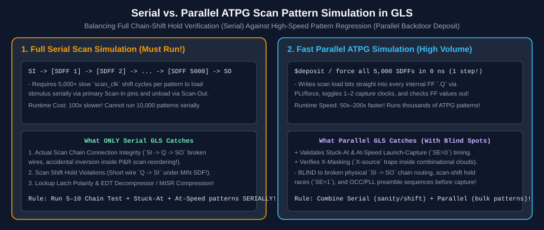
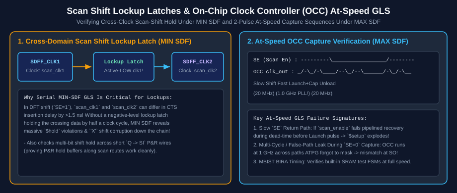

# DFT, Scan, ATPG, and MBIST Gate-Level Verification

RTL verification proves functional behavior under mission-mode clocks and resets, yet silicon yield depends equally on **Design-for-Test (DFT)** logic inserted during or after synthesis: scan chains, On-Chip Clock (OCC) controllers, test compression codecs, IEEE 1149.1 JTAG/IJTAG TAP networks, and Memory Built-In Self-Test (MBIST) wrappers. Because DFT logic is largely structurally stitched at the gate level—modifying every flip-flop into a scan flop (`SDFF`) and muxing test clocks across functional domains—**DFT Gate-Level Simulation (GLS)** is mandatory for catching scan stitching errors, shift hold violations, compression X-masking bugs, and at-speed capture timing bugs before patterns hit Automated Test Equipment (ATE).

---

## Learning Goals

- Explain why scan chains, compression logic, and ATPG patterns must be verified with **timing-annotated GLS** rather than zero-delay static checks alone.
- Distinguish between **serial scan shift**, **parallel backdoor-preload ATPG simulation**, and **broadside/at-speed transition delay patterns**.
- Verify **Launch-on-Capture (LOC)** and **Launch-on-Shift (LOS)** waveforms generated by **On-Chip Clock (OCC)** controllers under min/max SDF timing.
- Diagnose and eliminate unknown (`X`) sources during scan capture—including uninitialized non-scan flops, floating tri-states, memory outputs, and false/multicycle paths.
- Validate **MBIST** and **Built-In Self-Repair (BISR)** fuse/redundancy sequences at gate level across real SRAM behavioral models and memory wrappers.

---

## Role of Gate-Level Simulation in DFT Sign-Off

Static DFT rule checkers (Tessent DRC, TetraMAX DRC, Modus) analyze netlist topology rapidly and generate deterministic **STIL** or **WGL** vector sets along with Verilog testbenches (`write_testbench`). However, static ATPG tools rely on idealized assumptions about asynchronous resets, PLL/OCC lock sequences, Analog/PHY bypass pins, and multi-clock interactions.

Common silicon-killing DFT bugs missed by RTL & static ATPG DRC, yet caught immediately by **DFT GLS**, include:

- **Scan Shift Hold Violations**: During scan shift (`SE = 1`), the `Q -> SI` path between adjacent flip-flops often contains **zero combinational logic**—making it acutely vulnerable to clock-tree skew at fast-corner (`min`) SDF timing!
- **Mode-Entry Sequence / Lockup Latch Bugs**: JTAG/IJTAG instruction sequences needed to put pads into test mode, bypass PLLs, or disable watchdog timers fail due to subtle reset polarities or miswired lockup latches between clock domains.
- **OCC Glitching or Double-Pulsing**: When switching from slow ATE shift clock (`clk_ate`) to high-speed PLL functional clock (`clk_pll`) for a 2-pulse at-speed capture window, SDF mux-select delays can create a runt glitch on the root clock tree.
- **Unexpected X-Corruption in Decompressor / Compactor**: If an X-bounding gate (`test_mode` clamp on an analog block or memory output) was forgotten, the ATPG simulator thought an output was `0`/`1` while the real Verilog model outputs `1'bx`—destroying the compacted signature on ATE!

> [!IMPORTANT]
> **Golden DFT Sign-Off Rule**: Never send an ATPG pattern set to the foundry test floor until **at least a representative sample of serial-shift, parallel-load, stuck-at, transition-delay (LOC/LOS), and IDDQ patterns** pass cleanly in **timing-annotated (Min and Max SDF) Gate-Level Simulation** with zero mismatches!

---

## Scan Chain Architecture, Stitching Verification, and Shift Simulation

During scan synthesis, standard flip-flops (`DFF`) are swapped for multiplexed scan flip-flops (`SDFF`), adding **Scan Input (`SI`)** and **Scan Enable (`SE`)** pins:

```
          +-------------------+
  D  ---->| 0                 |
          |   MUX   ---> D_in |----> [ DFF ] ---> Q ---> Functional Logic & Next SI
  SI ---->| 1                 |        ^
          +-------------------+        |
                 ^                    CLK
                 |
                SE (1 = Shift, 0 = Capture)
```

In a chip with 2,000,000 flip-flops organized into 200 internal scan chains (each 10,000 flops deep):
- Every shift cycle clocks all 2,000,000 flops simultaneously—creating huge dynamic IR-drop potential and stressing **shift clock skew** across physical domains.
- Whenever a scan chain crosses from **Clock Domain A** (e.g., `clk_a`, early arrival) to **Clock Domain B** (e.g., `clk_b`, late arrival), a **negative-edge (or active-opposite) Lockup Latch** is inserted at the domain boundary to add half a cycle of hold margin during shift.

### Verifying Chain Integrity via Flush / Chain-Test Patterns

The very first ATPG pattern executed in DFT GLS is the **Chain Test (`chain_test`)**:

1. Hold `SE = 1` continuously while pulsing the shift clock for `L + K` cycles (where `L` is the longest chain length and `K` is pipeline/compression latency).
2. Shift a distinctive non-periodic bit signature such as `00110011_0101...` (often `001101...` so stuck-at-0, stuck-at-1, AND slow-to-rise/fall transitions along the chain all get checked) into `SCAN_IN[i]`.
3. Verify the exact bit sequence emerges undisturbed at `SCAN_OUT[i]` after exactly `L` clock cycles!

If a chain test fails in GLS:
- **All `X` at `SCAN_OUT`**: A flop inside the chain lacks async reset immunity (a functional async reset fired during shift because `test_mode` didn't gate it!), a clock gate (`ICG`) failed to open (`TE` pin wasn't tied to `SE | test_mode`), or a **clock-domain crossing lacked a lockup latch** and hit a `$hold` violation at `min` SDF!
- **All `0` or All `1`**: Broken netlist wire, wrong inversion polarity, or misconnected compression MUX bypass (`edt_bypass` / `comp_bypass`).
- **Off-by-1 Cycle**: Missing or unintended extra lockup latch, or unexpected pipeline register stage in the compression decompressor/compactor.

---

## Serial vs Parallel Load ATPG Pattern Simulation

Simulating 5,000 ATPG patterns where each pattern takes 10,000 serial shift cycles would require **50 million clock cycles** of full-chip gate-level timing simulation—taking weeks per corner! DFT verification therefore partitions patterns into two complementary modes: **Serial Simulation** and **Parallel Load Simulation**.



| Dimension | Serial Scan Simulation | Parallel-Load ATPG Simulation |
| :--- | :--- | :--- |
| **How Scan State Loads** | Shifts serially bit-by-bit through `SCAN_IN` for `L` cycles per pattern | Backdoor Verilog `force` / `$deposit` loads all `SDFF` registers in `0 ns` |
| **Shift Cycles Simulated** | Full `L` shift cycles + capture + `L` unload cycles | Optional few pad-setup cycles + capture window + optional 1–2 shift checks |
| **Runtime Speed** | Very slow (hours for just 2–10 patterns) | Very fast (simulates thousands of capture patterns in minutes/hours) |
| **Tests Scan Shift Path (`SI -> Q`)** | **Yes** (catches broken chains, shift hold violations, lockup latches, ICG `TE` bugs) | **No** (bypasses shift path completely via hierarchical deposit) |
| **Tests Compression Codec** | **Yes** (exercises full decompressor & compactor logic every cycle) | Limited / Bypassed (unless parallel-load supports codec shadow-loading) |
| **Tests Functional Capture Logic** | **Yes** (exact silicon behavior) | **Yes** (primary engine for verifying stuck-at & transition capture masks!) |
| **Recommended Regression Mix** | **Chain test + first 5–10 patterns** (Min & Max SDF) | **100% (or full sample) of Stuck-At, Transition, and IDDQ patterns** (Max & Min SDF) |

> [!TIP]
> **Hybrid Serial-Plus-Parallel Strategy**: Run the full **Chain Test + first 3–5 patterns in Serial Mode** at both Min and Max corners to guarantee the physical shift highway, compression logic, JTAG initialization sequence, and pad IO directions work completely end-to-end. Then run the remaining **hundreds/thousands of functional capture patterns in Parallel Mode** so every capture X-mask, false-path, and OCC pulse width gets tested within reasonable compute budgets!

### How Parallel Backdoor Preload Works in ATPG Testbenches

When ATPG tools emit a parallel-mode Verilog testbench (`stil2verilog -parallel`), the generated testbench initializes internal registers directly via hierarchical references (`$deposit` or `force`/`release`) before pulsing the capture clocks:

```verilog
// Excerpt from an ATPG Parallel-Load Verilog Testbench
task load_pattern_42;
    begin
        // Backdoor-load internal scan cells directly (zero shift cycles!)
        // Simulator-specific VPI/system task ($deposit preserves driveability without locking)
        `ifdef VCS
            $deposit(tb.u_dut.u_core.u_alu.reg_a_reg_0_.Q, 1'b1);
            $deposit(tb.u_dut.u_core.u_alu.reg_a_reg_1_.Q, 1'b0);
            // Note: Many SDFF models require setting master & slave internal nodes (.notifier / IQ)!
        `endif
        #1; // Settle combinational fanout from newly loaded scan Q pins
    end
endtask
```

> [!CAUTION]
> **SDF Flip-Flop Internal Node Naming Pitfall**: A standard Verilog `SDFF` UDP often stores state in an internal primitive register named `IQ` or `q_reg`, NOT directly on port `Q` (which is driven by a continuous `buf` from `IQ`). If an ATPG parallel-load bench uses `$deposit(...Q, 1'b1)` on the output port instead of the underlying sequential register (`IQ`), the `buf` immediately overwrites `Q` back to `X`! Always verify the **cell-internal scan-flop mapping** (`.sdf` / `.v` UDP node name, e.g., `IQ` or `Q_reg`) in your foundry library before running parallel-load ATPG GLS!

---

## Timing-Annotated Shift, Launch-on-Shift, and Launch-on-Capture

Modern sub-28nm/5nm SoCs fail primarily due to **resistive vias, RC delay defects, and marginal timing paths** that simple slow stuck-at tests miss. At-speed **Transition Delay Fault (TDF)** testing verifies that nodes transition within one full functional clock period ($T_{\text{func}}$). Two primary protocols exist:

1. **Launch-on-Capture (LOC / Broadside)**:
   - Shift clocks run slowly at ATE frequency (e.g., `20–50 MHz`).
   - `SE` goes LOW (`1 -> 0`) well before the functional launch edge.
   - The **On-Chip Clock (OCC)** fires **two rapid pulses** at full functional frequency (e.g., `1.5 GHz`, $T = 667\text{ ps}$):
     - **Pulse 1 (Launch)**: Captures initial pattern state (`SE = 0`), launching a $0 \to 1$ or $1 \to 0$ transition along functional combinational cones.
     - **Pulse 2 (Capture)**: Captures the propagated transition exactly one functional cycle later!
2. **Launch-on-Shift (LOS / Skewed-Load)**:
   - The **last slow shift edge (`SE = 1`)** acts as the **Launch edge**.
   - Immediately after the last shift edge, `SE` must switch **from `1 -> 0` at full functional speed** (`667 ps` in the example above!) before the **Capture pulse** arrives!
   - Because routing a high-fanout global `SE` tree across millions of flops at full functional speed is physically expensive, most large SoCs favor **LOC**, reserving **LOS** (via pipelined fast-`SE` trees) for targeted high-coverage partitions.



### Critical Timing Checks Exposed in At-Speed DFT GLS

When running **Max-Corner and Min-Corner SDF GLS** on LOC/LOS patterns:

- **Min-Corner Shift Hold (`SE = 1`)**: Verifies lockup latches and scan-route hold buffers meet hold requirements on `SI -> Q` paths across clock branches.
- **Max-Corner `SE` Turnaround in LOC (`SE: 1 -> 0` Setup)**: Ensures the slow ATE-driven `SE` tree finishes settling across the entire chip *before* the OCC emits Launch Pulse 1! If `SE` is still `1` at distant corners when Launch Pulse 1 arrives, those flops accidentally perform another scan shift instead of functional capture—corrupting the pattern!
- **Max-Corner Functional Launch-to-Capture (`P1 -> P2`)**: Ensures real timing paths complete within `1x` clock period, AND validates that **false paths / multicycle paths** between mismatched clocks were properly **X-masked** in ATPG rather than mistakenly expected to capture deterministically!

---

## On-Chip Clock (OCC) Controllers, Compression, and X-Masking

External ATE testers typically cannot toggle chip pads cleanly above ~100–400 MHz, whereas internal cores run at 1–4 GHz. Therefore, internal **On-Chip Clock (OCC)** controllers mux together:
- Slow external **ATE Shift Clock (`ate_clk`)** while `SE == 1`
- High-speed internal **PLL Clock (`pll_clk`)** gated down to an exact programmable burst (typically 2 pulses) during the capture window when `SE == 0`.

### Anatomy of an OCC Glitch-Free Clock Switch & Common Bugs

```verilog
// Conceptual Glitch-Free OCC Mux & Pulse Counter verified in DFT GLS
always @(negedge pll_clk or negedge scan_rst_n) begin
    if (!scan_rst_n) begin
        pll_gate_q <= 1'b0;
        pulse_cnt  <= 2'd0;
    end else if (capture_window_sync) begin
        if (pulse_cnt < target_pulses) begin
            pll_gate_q <= 1'b1;          // Enable exact 2-pulse burst!
            pulse_cnt  <= pulse_cnt + 2'd1;
        end else begin
            pll_gate_q <= 1'b0;
        end
    end else begin
        pll_gate_q <= 1'b0;
        pulse_cnt  <= 2'd0;
    end
end
```

Three subtle **OCC bugs frequently caught ONLY in DFT GLS**:
1. **Un-synchronized `SE` Falling Edge Crossing into `pll_clk` Domain**: If `SE` transitions asynchronously relative to `pll_clk`, `capture_window_sync` experiences metastability (`$setuphold` violation in SDF GLS), corrupting the pulse count from 2 pulses to 1 pulse or 3 pulses!
2. **PLL Not Locked or Wrong Bypass Divider**: Functional testbench might `force` PLL lock, whereas the standalone ATPG testbench relies on external reset/JTAG initialization sequences that forget to wait for PLL lock or configure the divider differently than ATPG assumed!
3. **Inter-Clock Capture Skew**: When testing paths between `OCC_A` (domain A) and `OCC_B` (domain B) simultaneously in multi-clock capture, mismatching pipeline latencies inside `OCC_A` vs `OCC_B` shifts Pulse 1 of A relative to Pulse 2 of B by one or more cycles.

### Test Compression (EDT / OPMISR) and X-Masking Verification

Modern DFT embeds **XOR-network / MISR space compactors** at the outputs of hundreds of internal scan chains to compress them down to 8–32 external `SCAN_OUT` pins:
- A single `1'bx` anywhere in **1 out of 200 internal chains** propagates through the XOR tree and turns **every compacted `SCAN_OUT` pin into `1'bx`** for that shift cycle!
- To prevent X-contamination from analog black boxes, un-reset memories, or timing-unknown CDC paths, DFT inserts **X-bounding (`test_mode` mux clamps)** and per-cycle **X-masking gates** controlled via decompressor side-channels.
- **GLS catches missing X-masks immediately**: Whenever an unexpected `X` escapes into the compactor during DFT GLS, the XOR gate flags a simulation mismatch against the expected ATE strobe (`0` or `1`). You trace backwards from the failing compactor XOR input directly to the un-clamped non-scan cell, false path, or un-initialized SRAM!

---

## MBIST, BISR, and Memory Wrapper Gate-Level Verification

While logic ATPG tests flip-flops and standard-cell gates, embedded SRAM/ROM arrays occupy 50–70% of modern SoC silicon area and are tested via **Memory Built-In Self-Test (MBIST)** engines running March algorithms (`March C-`, `March SR`, etc.) at full functional speed.

### What Gate-Level MBIST Simulation Verifies Beyond RTL

1. **Physical Wrapper Pipeline Timing & Bypass Paths**:
   - MBIST controllers sit separated from deep SRAM macros by **retining pipeline registers** (`mbist_pipe_en`) to close multi-GHz setup timing. Post-P&R SDF GLS proves those pipeline latencies match the MBIST FSM cycle expectations at Max corner and meet hold at Min corner.
2. **Foundry Behavioral SRAM Timing Checks During March Algorithms**:
   - Vendor SRAM Verilog models include dense `specify` checks (`tAA` address setup/hold, `tCS` chip-select setup, `tCKH`/`tCKL` clock pulse width, and simultaneous read-write port collision checks on Dual-Port RAMs).
   - If the MBIST controller toggles `WEN` or `ADR` close to the clock edge, or performs an illegal back-to-back read/write on the same dual-port address, the **foundry SRAM model immediately corrupts the array to `X`** and MBIST fails comparison (`BIST_FAIL = 1`)!
3. **Built-In Self-Repair (BISR) Redundancy & eFuse Programming**:
   - Large SRAMs include **spare rows/columns** controlled via repair register rings (`BIRA` -> `BISR` scan chains -> eFuse macro).
   - **Fault-Injection DFT GLS** intentionally corrupts a single bit inside one Verilog SRAM instance (via `force` or vendor memory defect hook), runs the full MBIST diagnostic pass, verifies the repair signature compresses accurately, fuses/loads into the BISR shadow chain, re-runs MBIST cleanly with repair active (`BIST_PASS = 1`), and checks **soft-repair reset reload** after warm reset!

```systemverilog
// Fault-injection check in Gate-Level MBIST/BISR verification
initial begin
    // Wait for initial power-on reset and BISR fuse clear
    @(posedge tb.rst_por_n);

    // Inject a hard stuck-at-0 bit fault inside physical SRAM word 42, bit 7
    force tb.u_dut.u_l2_sram.u_bank0.mem_core[42][7] = 1'b0;
    $display("[%0t] DFT_BISR_TEST: Injected stuck-at-0 defect into SRAM bank0[42][7]", $time);

    // Trigger Run 1: Expect MBIST failure + automatic BIRA repair solution computed
    run_mbist_controller(.expect_pass(1'b0), .repair_capture(1'b1));

    // Transfer computed repair solution to BISR chain (simulating eFuse programming + reload)
    shift_bira_to_bisr_and_reload();

    // Release fault-forcing only? NO! Keep physical defect forced to prove spare row/col bypass works!
    // Trigger Run 2 with BISR enabled: Redundant row replaces [42], so MBIST MUST PASS!
    run_mbist_controller(.expect_pass(1'b1), .repair_capture(1'b0));
    release tb.u_dut.u_l2_sram.u_bank0.mem_core[42][7];
end
```

---

## Best Practices and Common Pitfalls

1. **Always Separate Functional vs DFT SDF Corners & Modes**: Do not reuse functional constraints blindly for DFT checks. Confirm your SDF timing checks cover **slow shift (`scan_shift` constraints)** as well as **at-speed functional capture (`scan_capture` constraints)**—an asynchronous `SE` path ignored in functional STA can silently break LOC capture!
2. **Audit `$setuphold` Timing-Check Suppression on `SCAN_IN` vs Asynchronous Sync Flops**: Use your selective timing-check disable (`tfile`) ONLY for verified asynchronous synchronizer first-stage flops (`u_sync_0`), **NEVER** wildcard-disable timing checks globally during DFT GLS—otherwise you will mask real scan-shift hold bugs (`min` corner) and launch-capture setup failures (`max` corner)!
3. **Validate ATPG-Generated Parallel-Load Scripts Against Foundry `SDFF` Models**: Confirm `$deposit` / `force` targets the exact sequential storage node inside your library's `SDFF` UDP (e.g., `IQ` vs `Q`) and check whether async `SET`/`RST` overrides parallel loads if active-low test pins float during init!
4. **Keep JTAG / IJTAG Sequence Untouched in Serial Bring-Up**: Never bypass the JTAG TAP test-mode entry sequence (`TRST_N` -> `TMS` -> `IR` -> `DR`) by backdoor-forcing internal `test_mode` signals in your primary DFT GLS regression. Half of real silicon DFT bring-up failures are pad-mux, IO-enable, or TAP-reset glitches on the entry sequence!
5. **Run MBIST at Actual Target Clock + Skewed Voltage Margins (Max SDF)**: Remember that SRAM read/write timing margins shrink fastest at low-voltage/slow corner (`SS/SSG`). Include dual-port contention tests and BISR spare-row fault-injection passes in final tapeout checklists.

---

## Practical Exercises with Solutions

### Exercise 1 Diagnosing a Scan Chain Test Failure at Min SDF

In a **Zero-Delay** DFT run, the `chain_test` pattern passes cleanly on all 64 scan chains. However, when switching to **Min-Corner (`min`) SDF GLS**, Chain 17 fails completely: `SCAN_OUT[17]` remains valid for the first 310 bits, then shifts continuous `1'bx` for the rest of the pattern, and the simulator logs:

```text
Timing violation in tb.u_dut.u_io_bridge.u_rx_reg_42 (SDFFQX1):
$hold( posedge CK: 45120.00 ns, posedge SI: 45120.04 ns, limit: 0.08 ns ); notifier toggled!
```

1. What is the physical root cause?
2. Why did Chain 17 shift 310 bits cleanly before failing on `u_rx_reg_42`?
3. How should the physical/DFT implementation team fix this?

#### Solution

1. **Root Cause**: A **scan-shift hold violation** between `u_rx_reg_41/Q` (launch flop) and `u_rx_reg_42/SI` (capture flop). `SI` changed `0.04 ns` (`40 ps`) after `posedge CK` at `u_rx_reg_42`, violating its `0.08 ns` (`80 ps`) minimum hold requirement, triggering the `notifier` to inject `X` into `u_rx_reg_42`—which then flushed down the remaining chain bits to `SCAN_OUT[17]`.
2. **Why bit 310?** Bit 310 marks the exact boundary in Chain 17 where the chain jumps either across **two separate clock trees with large positive clock skew** (`clk_rx` arriving later than `clk_tx`), or across two physically distant clusters without sufficient scan-route wire delay!
3. **Fix**:
   - If `u_rx_reg_41` and `u_rx_reg_42` sit in **different clock domains**, insert an explicit **lockup latch** (negative-edge latch clocked by `u_rx_reg_41`'s clock) between them to guarantee a half-cycle of hold margin.
   - If they share the **same clock domain**, instruct P&R (`fix_hold` in `scan_shift` mode!) to insert **hold buffers** on the `Q -> SI` path or re-order the scan chain locally to minimize cross-cluster clock skew.

---

### Exercise 2 Fixing Compactor X-Mask Failure on Uninitialized Analog Wrapper

During **Parallel-Load Stuck-At ATPG GLS**, Pattern #19 expects `SCAN_OUT[3:0] = 4'b1010`, yet GLS measures `4'bxxxx` across all four compacted outputs! Tracing back reveals an internal scan flop `u_afe_capture_reg` (inside the digital wrapper next to an Analog Front-End macro) latched `1'bx` because its `D` input comes from an un-clamped analog macro output pin `afe_adc_data[0]`, which stays `1'bx` during digital ATPG!

1. Why did all four `SCAN_OUT` channels turn `X` from a single flop?
2. Give two valid hardware/ATPG fixes so Pattern #19 passes both GLS and ATE silicon testing.

#### Solution

1. Because the **EDT/XOR space compactor** combines dozens of internal scan chains via XOR trees down onto `SCAN_OUT[3:0]`. In 4-state simulation, `1'b0 ^ 1'bx === 1'bx` and `1'b1 ^ 1'bx === 1'bx`, so a single unknown bit inside any unmasked chain spreads `X` to every `SCAN_OUT` pin sharing that XOR cone.
2. **Two Valid Fixes**:
   - **Preferred Hardware Fix (DFT Insertion)**: Insert a **test-point X-bounding clamp** (`AND2` or `MUX2` gated by `test_mode` / `scan_mode`) on every primary output of analog/hard-IP black-box macros (`afe_adc_data`), forcing deterministic `0` into `u_afe_capture_reg/D` whenever `test_mode == 1`. (Verify the analog wrapper still tests observably via dedicated analog test or boundary scan.)
   - **ATPG Pattern / Masking Fix (when RTL cannot be changed post-freeze)**: Declare `afe_adc_data` as an **X-source** (tie `X` constraints) in the ATPG setup and re-run pattern generation so the ATPG tool automatically enables **per-cycle X-masking registers** inside the compactor to gate out the affected internal chain during patterns where `u_afe_capture_reg` captures from `afe_adc_data`.

---

### Exercise 3 Catching an LOC `SE` Setup Bug in Max SDF

Consider an at-speed **Transition Delay (LOC)** pattern running a `1.0 GHz` (`1.0 ns` period) internal OCC burst while `SE` toggles externally at `25 MHz` (`40 ns` period). In **Max-Corner SDF GLS**, the first few hundred scan flops capture functional `D` correctly, while flops at the far corner of the die capture their neighbor `SI` during **Launch Pulse 1**!

What timing constraint was missed during synthesis/P&R STA, and how do you inspect and fix it?

#### Solution

1. **Missed Timing Constraint**: Although `SE` runs slowly at `25 MHz`, the transition from `SE = 1 -> 0` (the end of shift) to **OCC Launch Pulse 1** was likely either unconstrained (`set_false_path` mistakenly placed on `SE`!) or given an overly loose multicycle assumption relative to the OCC dead-time cycles between last shift edge and Launch Pulse 1. At Max corner, the `SE` buffer tree insertion delay exceeded the dead-time setup margin!
2. **Fix**:
   - Constrain the `SE` distribution tree in **capture mode** against the OCC `launch` edge using an exact **`set_multicycle_path`** matching the hardware dead-time cycles programmed in the OCC (e.g., if `SE` drops 2 ATE cycles = `80 ns` before Launch Pulse 1, constrain `SE -> SDFF/SE` within `<= 75 ns`), never `set_false_path`.
   - Alternatively, insert **more programmable dead-time cycles** (stall cycles between `SE = 0` and OCC PLL burst release) in the ATPG STIL timing protocol so the entire `SE` tree settles cleanly with wide Max-corner margin before Launch Pulse 1 fires.

---

##### Copyright (c) 2026 squared-studio
