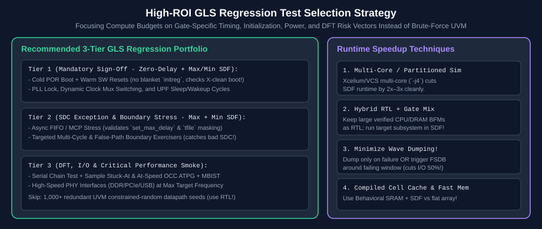
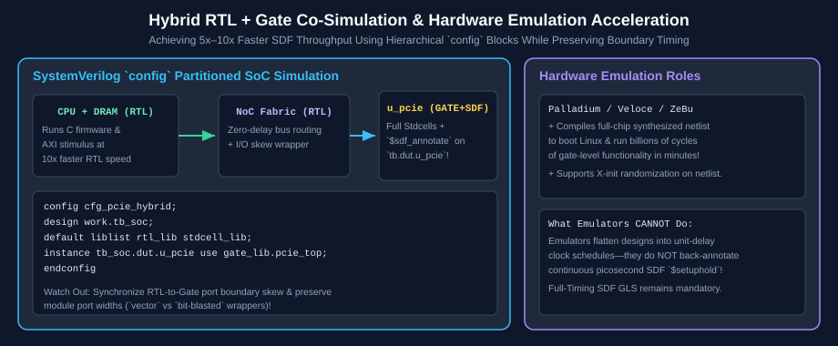

# GLS Performance Optimization, Smart Test Selection, and Acceleration

Full-chip timing-annotated Gate-Level Simulation (GLS) runs **10x to 100x slower** than behavioral RTL simulation because every combinational gate, RC interconnect edge, clock buffer, and SDF timing check must be scheduled in the discrete-event kernel. Running an entire 2,000-test RTL UVM regression blindly on a post-P&R SDF netlist is computationally impossible on pre-tapeout schedules. Achieving high silicon confidence on schedule requires disciplined engineering across four levers: **risk-driven test selection**, **mixed RTL-Gate hybrid partitioning**, **backdoor initialization shortcuts**, and **simulator/waveform performance tuning**.

---

## Learning Goals

- Structure a **multi-tier GLS regression pyramid** that maximizes bug detection per CPU hour across zero-delay, Min/Max timing, power-aware, and DFT suites.
- Partition large SoCs using **Hybrid Mixed RTL-Gate Simulation** (`mixed-sim`) to run full software boot tests at near-RTL speed while timing-checking critical blocks.
- Apply **memory backdoor preloading**, **compiled/binary SDF caching**, and **black-boxing** of verified static macros cleanly without breaking functional consistency.
- Tune **simulator thread parallelism (`-j` / multicore)**, **cell optimization flags**, and **targeted signal dumping (`FSDB`/`VPD`/`SHM`)** to avoid I/O and memory bottlenecks.
- Quantify GLS speedup ratios accurately and spot dangerous "optimizations" that silently invalidate timing sign-off.

---

## Why Full-Chip Timing GLS Is Compute-Bound

To engineer meaningful speedups, you must understand where discrete-event simulator CPU cycles actually go during SDF GLS:

1. **Clock-Tree Event Amplification (40%–65% of CPU time)**:
   - In RTL, one `clk` edge wakes up flipped blocks directly.
   - In post-P&R netlists, that single `clk` root fans out through **50,000–500,000 physical clock buffers and ICG cells**, each carrying distinct SDF `IOPATH` + `INTERCONNECT` fractional delays—scattering thousands of micro-events across picosecond timestamps!
2. **Timing Check Evaluation (`$setuphold`, `$width`, `$recovery`, `$recrem`)**:
   - Every clock toggle evaluates multiple specify-block timing checks across **millions of sequential cells**, each inspecting timestamp history windows and negative-timing-check virtual nodes.
3. **Interconnect Event Fanout & Glitch Filtering**:
   - Detailed SDF files annotate `INTERCONNECT` delays separately on every wire segment (`src/Y -> dst/A`). Inertial pulse-cancellation updates future event queues constantly across wide combinational buses.
4. **Disk & Memory Bottlenecks (SDF Parsing + Waveform Dumping)**:
   - Reading an uncompressed `40 GB` text `.sdf` file per regression job wastes massive disk I/O and RAM before simulation even reaches $t = 1\text{ ns}$. Dumping signals indiscriminately (`$fsdbDumpvars(0, tb)`) saturates network storage and cuts simulator throughput by 5x–10x!

> [!NOTE]
> Adding more CPU cores alone often yields disappointing returns on flat SDF GLS unless **clock-tree partitioning** and **I/O pruning** occur first, because discrete-event global timestamp ordering creates synchronization barriers between threads at every sub-nanosecond event!

---

## The GLS Regression Pyramid and Smart Test Selection

The single biggest GLS "optimization" happens **before a single command flag is typed**: selecting *what* to run on *which* netlist in *which* corner. Full RTL regressions verify functional edge cases (ALU corner opcodes, scoreboarding permutations, software algorithm math) that synthesis does not fundamentally alter. GLS should instead target **implementation-sensitive failure modes**.



### Tiered Regression Strategy

| Tier | Mode & Delay | Target Scope | Recommended Test Selection Criteria | Frequency |
| :--- | :--- | :--- | :--- | :--- |
| **Tier 1 (Fast Sanity)** | Zero-Delay + Unit-Delay (Post-Synth) | Subsystem / Chip | Reset bring-up (`X`-init check), basic register read/write across every IP, PLL lock & boot to `main()`, clock-mux switching | Weekly during late RTL -> Synth |
| **Tier 2 (Cornerstone Timing)** | Full Max + Min SDF (Post-P&R) | Critical Interfaces & Crossings | Every external I/O interface (DDR, PCIe, USB, SPI, I2C), all CDC/RDC crossings, multi-cycle paths (`MCP`), false paths, and reset-tree edge transitions | Every P&R freeze / ECO drop |
| **Tier 3 (Specialty Sign-Off)** | PG Netlist / DFT Modes (Max + Min SDF) | Power & Test Logic | Power-up/down of **every** UPF domain, retention save/restore, isolation transitions, ATPG chain test + serial/parallel patterns, MBIST + BISR repair | Pre-tapeout & post-ECO |
| **Tier 4 (System Stress)** | Hybrid RTL-Gate (Mixed SDF) | SoC Software / Firmware Boot | Full OS/firmware boot, concurrent DMA + CPU + GPU + Display traffic, thermal throttle & interrupt storms | Final Silicon Tape-out Gate |

### High-Value "Must-Run" GLS Tests vs Low-Value Redundancies

- **DO Run in GLS**:
  - Cold Power-On Reset (POR) and warm reset *while clocks are running AND while clocks are gated*.
  - Highest-frequency operational mode exercising **critical timing paths** and **maximum toggle density**.
  - All programmable **multicycle path (`MCP`)** and **dividing clock ratios** (1:1, 2:1, 3:2, asynchronous).
  - Real firmware initialization loops writing every configuration CSR, polling status bits, and handling interrupts.
  - Low-power entry/exit sequences (`WFI` -> retention -> wake) and DFT mode entry (`JTAG` -> `MBIST` -> `Mission`).
- **AVOID Repeating Redundantly in Full-Chip SDF GLS**:
  - 10,000 constrained-random UVM scoreboard permutations testing pure data-integrity math (e.g., 5,000 random AES keys or randomized floating-point rounding variants). Run 2–5 **worst-case activity toggle vectors** at SDF instead!

---

## Mixed RTL-Gate Hybrid Simulation and Black-Boxing Strategies

When verifying an entire 500M-gate AI SoC running a 10M-cycle Linux or firmware boot sequence, running every tile in timing-annotated gate level is slow and unnecessary when **IP tiles were already verified at unit/subsystem SDF GLS**.

**Hybrid (Mixed RTL-Gate) Simulation** partitions the DUT hierarchy cleanly:
- **Subsystem under focus** (e.g., Interconnect NoC + DDR Controller + Power Controller): Compiled as **Post-P&R Gate-Level Netlist** with full **SDF annotation**.
- **Previously signed-off accelerators/cores** (e.g., 8x AI NPU cores, Graphics Shader, static peripherals): Substituted with **cycle-accurate RTL modules** (or higher-speed gate netlists in Zero-Delay mode!).



### Managing Hierarchical Configuration via SystemVerilog `config` Blocks

Instead of maintaining fragile hacked netlist copies, use IEEE 1800 SystemVerilog **`config`** declarations (`liblist` / `instance` binding) to swap RTL vs Gate views cleanly at elaboration time:

```systemverilog
// Hybrid Simulation Configuration File: config_hybrid_boot.sv
config cfg_soc_hybrid;
    design work.tb_soc_top;

    // Default to fast behavioral RTL library for most SoC subsystems
    default liblist rtl_lib stdcell_behav_lib;

    // Override specific critical instances to use Post-P&R Gate-Level Netlist!
    instance tb_soc_top.u_dut.u_noc_fabric    use gate_lib.noc_fabric;
    instance tb_soc_top.u_dut.u_pmu_ctrl      use gate_lib.pmu_ctrl;
    instance tb_soc_top.u_dut.u_ddr_subsys    use gate_lib.ddr_subsys;

    // Leave massive CPU cluster or GPU shaders in RTL to achieve 15x faster boot!
    instance tb_soc_top.u_dut.u_cpu_cluster   use rtl_lib.cpu_cluster;
    instance tb_soc_top.u_dut.u_npu_array     use rtl_lib.npu_array;
endconfig
```

### Scoped SDF Annotation in Hybrid Runs

Notice the critical rule when annotating SDF onto a hybrid hierarchy: **never point `$sdf_annotate` at the top chip root (`tb_soc_top.u_dut`)** if `u_cpu_cluster` was swapped back to RTL! Doing so throws thousands of fatal `SDF cell instance not found` errors or mis-annotates sub-blocks. Instead, invoke scoped SDF blocks **exclusively on the gate-level instances**:

```systemverilog
// Target SDF ONLY to the gate-level partitions inside the hybrid configuration
$sdf_annotate("noc_fabric_max.sdf", tb_soc_top.u_dut.u_noc_fabric, , "noc_sdf.log", "MAXIMUM");
$sdf_annotate("pmu_ctrl_max.sdf",   tb_soc_top.u_dut.u_pmu_ctrl,   , "pmu_sdf.log", "MAXIMUM");
$sdf_annotate("ddr_subsys_max.sdf", tb_soc_top.u_dut.u_ddr_subsys, , "ddr_sdf.log", "MAXIMUM");
```

### Handling RTL-to-Gate Boundary Pitfalls in Hybrid Runs

1. **Synthesized Port / Bus Unpacking Mismatches**: Synthesis flattens SystemVerilog structs, `interface` modports, and unpacked multidimensional arrays (`logic [7:0] arr [0:3]`) into flat 1D bit vectors (`\arr[0] [7:0]`, etc.). Use `-unpacked_port` flags or thin **boundary wrapper adapters** generated alongside the netlist (`write_rtl_wrapper`) so RTL modules bind seamlessly to gate modules without manual edits.
2. **Time-0 Signal Driving & X-Leakage**: RTL blocks output clean `0`/`1` resets instantly (`0 ns`), whereas Gate blocks take clock/reset buffer insertion latency (`1.8 ns`) to leave reset. Gate-to-RTL boundaries can momentarily expose `X` to RTL behavioral `if (sig)` statements unless RTL boundary interfaces qualify signals cleanly after reset deassertion!
3. **Black-Boxing Truly Inactive Macros**: If a test exercises only the PCIe subsystem while SerDes lanes 4–7 or an unrelated Vision ISP remain powered off, swap the Vision ISP for a **stub/black-box model** (tying outputs safely to quiescent values) to shed millions of idle clock-buffer evaluations per cycle.

---

## Memory Backdoor Preloading, Compiled SDF, and Simulator Optimizations

Beyond test selection and partitioning, four low-friction techniques cut runtime by **3x–10x** with zero loss of timing fidelity on the main scenario.

### 1. Memory Backdoor Preloading (`$readmemh` / VPI)

Booting an embedded CPU over slow UART/SPI Flash via gate-level bit-banging can burn 1,000,000 simulation cycles before real test code executes! Instead:
- Keep **Cold Reset & BootROM execution** in one dedicated short gate-level boot test.
- For all subsequent functional/DMA/stress GLS tests, run **por_reset** cleanly to test hardware reset release, then load the compiled firmware `.hex`/`.bin` image directly into the behavioral SRAM/DRAM storage arrays via **`$readmemh`** (or `$deposit` / UVM backdoor adapters mapped to gate memory paths) in **zero simulation time**!

```systemverilog
// Fast firmware preload after gate-level reset stabilizes
initial begin
    @(posedge tb.u_dut.rst_sys_n);
    #100ns; // Allow reset sync tree + SDF settle
    $display("[%0t] Preloading firmware image into Boot SRAM gate wrapper...", $time);
    $readmemh("firmware_stress.hex", tb.u_dut.u_sram_subsys.u_boot_ram_0.mem_array);
end
```

### 2. Compiled / Binary SDF Caching

Text `.sdf` parsing for a 100M-gate chip can take **20–45 minutes per job**! Multiply by 200 parallel regression jobs and 100+ CPU hours vanish just reading ASCII text:
- **Cadence Xcelium**: Pre-compile SDF once using `xmsdfc -compile soc_max.sdf -o soc_max.sdf.X` and pass the compiled binary `.sdf.X` (`-sdf_cmd_file`) to all regression jobs!
- **Synopsys VCS**: Enable pre-compiled / binary SDF flow (`+sdfverbose` for first audit, then `+csdf+precompile` or VCS compiled-SDF cache `+vcs+sdf_compile`), cutting per-job startup time from 30 minutes down to under 60 seconds.
- **Siemens Questa**: Pre-compile SDF using `sdfcom` (`sdfcom soc_max.sdf soc_max_compiled.sdf`) before launching `vsim -sdftyp /tb/u_dut=soc_max_compiled.sdf` (or binary SDF cache).

### 3. Cell Library Optimization & Transport/Pulse Tuning

- **No-Notifier Optimization for Known Non-Timing Runs**: When running **Zero-Delay** or **Functional Sanity GLS**, turn off specify blocks completely (`+nospecify` + `+notimingchecks`)—running at 3x–5x faster simulation speed while keeping exact gate boolean connectivity!
- **Delay Compression (`+delay_mode_path` / Boundary Optimization)**: Enable simulator global-partition compilation flags (`-partcomp` in VCS, `-mccodegen` in Xcelium, `+acc` pruning in Questa) so the compiler merges buffers and simple inverter chains inside combinational cones without altering `IOPATH` timing or violating `INTERCONNECT` edges.

> [!WARNING]
> **Careful with Over-Aggressive Optimization Flags**: In Questa (`vopt`), passing `+acc` globally turns on full debug visibility on every single leaf net and kills simulation performance by 5x! Conversely, passing aggressive optimization without preserving **SDF target pin visibility** causes `$sdf_annotate` failures (`Pin X optimized away`). Always use scoped optimization (keep SDF pins + UVM probe ports visible, optimize internal combinational buffer trees!).

---

## Multi-Core Threading, Partitioning, and Waveform Pruning

### Multi-Core Simulation (`Fine-Grained` & `Partitioned`)

Modern simulators provide multi-core parallel engines specifically tuned for massive gate-level netlists:
- **VCS Fine-Grained Parallelism (`fgp`)**: Compile with `-fgp` and run with `-fgp=num_threads:8,allow_less_cores` so independent sub-partitions of the gate clock/logic graph run across 8 CPU cores simultaneously.
- **Xcelium Multi-Core (`-mce` / `-xmsim_multicore`)**: Compiles with `-mccodegen` and spawns worker threads across partitioned logic islands (`-mcmaxcores 8`).

*Note on Thread Scaling*: SDF timing checks and tight feedback loops across clock domains create synchronization overhead; **4 to 8 cores** typically yields the sweet-spot speedup (**2x–4x speedup**) before thread communication saturates gains. Adding 64 threads rarely improves flat SDF GLS beyond 8 threads.

### Surgical Waveform Dumping

Never run regression jobs with full-chip waveform dumping (`$dumpvars(0, tb)` or `$fsdbDumpvars(0, tb)`):
1. **Default Off**: Run the regression completely with **waveforms disabled**, saving ONLY lightweight pass/fail logs and SVA assertion errors.
2. **Delayed / Triggered Window Dump**: For reproducible failures, enable dumping **only around the failure window**:
   - Use `$fsdbDumpoff` at $t = 0$, then `$fsdbDumpon` at `t_fail - 50 us`.
   - Dump **ports/interfaces only** (`$fsdbDumpvars(2, tb.u_dut, "+all")`) at depth 2–3 first; only drill down to depth `0` on the specific failing sub-module (`$fsdbDumpvars(0, tb.u_dut.u_pcie_ctrl)`).
3. **Avoid Dumping `INTERCONNECT` Glitches When Unnecessary**: Dumping every intermediate buffer output inside the clock tree bloats `.fsdb` files to terabytes; trace clock trees selectively during root-cause triage!

---

## Best Practices and Common Pitfalls

1. **Always Run One Clean Baseline Before Optimizing**: Whenever enabling `-fgp`, `-mccodegen`, binary SDF, or aggressive `+O` compiler flags on a new project, compare the exact simulation signature and violation log against an un-optimized golden run on one short sanity test to guarantee bit-exact equivalence!
2. **Never Disable Timing Checks (`+notimingchecks`) on Sign-Off Timing Runs**: Turning off timing checks speeds up runtime by ~25%—at the cost of hiding real setup/hold/width failures and turning timing GLS into an expensive delayed-logic simulation.
3. **Use Gzipped SDF (`.sdf.gz`) Carefully**: While gzipping saves disk space, streaming decompression during runtime stalls multi-job cluster runs unless your simulator supports native binary pre-compiled SDF caches (`.sdf.X` / `sdfcom`).
4. **Monitor Memory Footprint (RSS) Per Job**: A 200M-gate SDF GLS job can easily consume **80–250 GB RAM**! Launching 50 such jobs onto shared cluster nodes without requesting proper LSF/Slurm RAM limits causes OOM kills or severe swap thrashing that drops CPU efficiency below 5%.
5. **Maintain Automated Boundary Checkers on Hybrid Views**: Whenever P&R updates a netlist, automatically regenerate and compile-check the SystemVerilog `config` and RTL-to-Gate port wrappers in CI so hybrid regressions never silently drift out of sync with the full-chip netlist!

---

## Practical Exercises with Solutions

### Exercise 1 Calculating GLS Compute Savings with the Regression Pyramid

A team has 1,000 RTL tests averaging `200 us` simulation time each.
- Full-chip Max-Corner SDF GLS runs at `1 us per CPU minute` (meaning one `200 us` test takes `200 minutes = 3.33 hours`).
- Running all 1,000 tests at **both** Max and Min corners blindly would take $1000 \times 2 \times 3.33 = 6,667\text{ CPU hours}$!

Propose an optimized 4-tier GLS plan using **Smart Test Selection + Hybrid Sim + Precompiled SDF (cutting 30 min startup per job)** that keeps regression under **600 CPU hours total** while maximizing bug-finding coverage.

#### Solution

1. **Eliminate Startup Overhead**: Pre-compile Min and Max SDF once (~1 hr total setup), saving $0.5\text{ hr} \times \text{jobs}$ across the whole regression.
2. **Tiered Allocation (~480–550 CPU Hours Total)**:
   - **Zero-Delay / Unit-Delay Full-Chip Reset & Sanity (20 directed tests @ ~0.4 hr each)**: `8 CPU hrs` (verifies reset init & connectivity).
   - **Full-Chip Max SDF Directed Cornerstone Suite (40 targeted tests covering I/O, CDC, MCP, Reset, Clocks, High-Toggle @ 3.3 hrs each)**: `132 CPU hrs`.
   - **Full-Chip Min SDF Hold/Reset-Race Suite (30 critical I/O, clock-mux, scan-shift, and async-reset tests @ 3.3 hrs each)**: `100 CPU hrs`.
   - **Hybrid RTL-Gate System Stress & Firmware Boot (15 long `1000 us` boot/DMA tests running 4x faster in hybrid @ 4 hrs each)**: `60 CPU hrs`.
   - **PG Power-Aware & DFT Serial+Parallel Sign-Off Suite (selected UPF transitions + chain test + parallel ATPG + MBIST)**: `~150 CPU hrs`.
   - **Total**: **`~450 CPU hours`** (< 7% of the naive 6,667-hour brute-force runtime!), yet covers **100%** of physical risk surfaces (corners, resets, power, DFT, I/O, and system integration).

---

### Exercise 2 Fixing Broken `$sdf_annotate` in a Hybrid RTL-Gate Netlist

An engineer creates a hybrid configuration where `u_cpu` is RTL and `u_noc` is Post-P&R Gate-Level (`noc.v`), then keeps the full-chip annotation call unchanged:

```systemverilog
$sdf_annotate("full_chip_max.sdf", tb.u_dut, , "sdf.log", "MAXIMUM");
```

The simulation aborts immediately with 400,000 errors: `SDF Error: Instance u_cpu/u_alu/u_adder_32 not found`. How do you fix both the SDF file usage and the annotation call?

#### Solution

1. **Never pass a full-chip monolithic SDF against a partially-RTL hierarchy** unless either:
   - You use **block-level / hierarchical SDF files** (`noc_max.sdf`, `pmu_max.sdf`) scoped explicitly to each gate-level instance:
     ```systemverilog
     $sdf_annotate("noc_max.sdf", tb.u_dut.u_noc, , "noc_sdf.log", "MAXIMUM");
     ```
   - **OR**, if only a flat full-chip `.sdf` exists, configure the simulator to scope/filter SDF down to the gate blocks only (or slice the hierarchical block `.sdf` cleanly using STA `write_sdf -instance u_noc` from PrimeTime/Tempus) so zero errors fire on RTL blocks—never rely on blindly suppressing SDF errors with `MTM_ERRORS=IGNORE`, because genuine mismatches inside `u_noc` would also be silently ignored!

---

### Exercise 3 Resolving a Sudden 8x Simulation Slowdown During Debug

A clean Max-Corner GLS test normally finishes in **45 minutes**. After an engineer modifies the testbench to investigate a failure and re-runs, the simulation stalls and takes **6 hours**, producing a **480 GB** waveform file. Inspection shows `u_dut` has `50M` gates and the added testbench snippet was:

```systemverilog
initial begin
    $fsdbDumpfile("debug.fsdb");
    $fsdbDumpvars(0, tb); // <-- Added this line!
end
```

1. Why did runtime explode 8x?
2. Rewrite the dumping setup to capture complete debugging visibility around an error occurring at `t = 420 us` in **under 10 GB** with minimal runtime slowdown.

#### Solution

1. Calling `$fsdbDumpvars(0, tb)` from $t = 0$ enables debug visibility (`+acc`) across **all 50 million leaf nets, clock buffers, and intermediate SDF glitch events** continuously for the entire run, bottlenecking both CPU event callbacks and network disk write bandwidth!
2. **Surgical Triggered Waveform Dumping**:
   - Pass time-windowed dump control centered strictly around the failure window (`390 us -> 425 us`), and restrict global dumping to module ports/2–3 hierarchy levels while only dumping level `0` inside the suspect block (`u_suspect_ip`):

```systemverilog
initial begin
    $fsdbDumpfile("debug_window.fsdb");
    // Step 1: Dump ONLY top interfaces & status registers at shallow depth (level 3)
    $fsdbDumpvars(3, tb.u_dut, "+all");
    // Step 2: Deep internal gate visibility ONLY on the suspect subsystem
    $fsdbDumpvars(0, tb.u_dut.u_suspect_ip);
    // Step 3: Keep dumping OFF during long firmware init / idle cycles!
    $fsdbDumpoff;

    #390us;
    $fsdbDumpon;  // Turn on 30us before failure at 420us
    #35us;
    $fsdbDumpoff; // Stop dumping once failure signature is captured
end
```

---

##### Copyright (c) 2026 squared-studio
