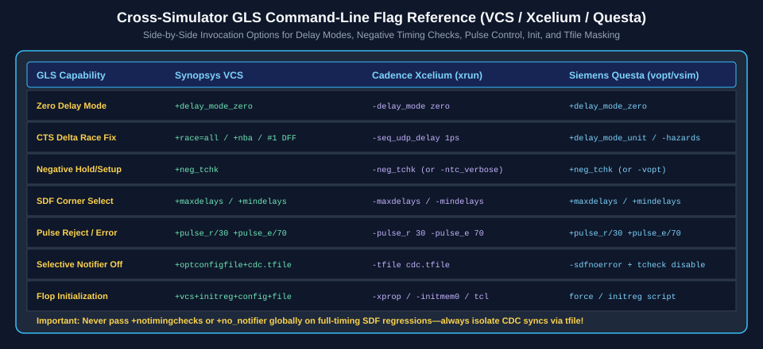
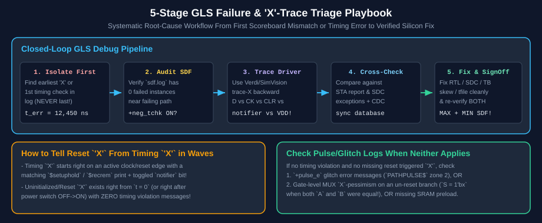

# Comprehensive GLS Simulator Reference, Triage Playbook, and Sign-Off

Bringing a complex SoC through Gate-Level Simulation (GLS) requires fluently translating between Synopsys VCS, Cadence Xcelium, and Siemens Questa ecosystems, managing timing-exception (`tfile`) governance under strict review, triaging `X`-propagation disasters under tight tape-out deadlines, and proving quantitative readiness before releasing GDSII to the foundry. This capstone chapter consolidates cross-simulator GLS command matrices, timing exception governance, a deterministic failure triage playbook, and production sign-off checklists.

---

## Learning Goals

- Translate every major GLS compilation and simulation switch cleanly across **Synopsys VCS**, **Cadence Xcelium**, and **Siemens Questa** (`delay modes`, `SDF corners`, `+neg_tchk`, `X-prop`, `+nospecify`, `+notimingchecks`, and hybrid/PG switches).
- Govern timing-exception (`tfile` / `no_timing` / `no_notifier`) waivers safely with peer-reviewed justification, never accidentally hiding true single-clock setup or hold bugs.
- Execute a structured **5-step GLS failure & X-trace triage playbook** to isolate root causes rapidly across testbench, RTL, synthesis, P&R, SDF, or cell-library layers.
- Evaluate project readiness using an actionable **GLS Tape-Out Sign-Off Checklist** covering coverage, waiver audits, corner combinations, PG UPF, and DFT regressions.
- Close the loop by feeding GLS discoveries back into pre-silicon RTL coding guidelines, SDC constraints, and CDC/RDC rules for next-generation projects.

---

## Cross-Simulator GLS Command Matrix for VCS, Xcelium, and Questa

Verification teams routinely port IP or work across multi-vendor environments (e.g., IP vendor delivers tests on Xcelium while SoC integrator signs off on VCS or Questa). Because Verilog `specify` defaults, SDF precedence, negative timing check handling, and pulse-rejection algorithms differ subtly across tools, blind flag translation creates false failures or silently disabled timing checks!



### Master Cross-Simulator Reference Table

| Capability / Mode | Synopsys VCS (`vcs` / `simv`) | Cadence Xcelium (`xrun`) | Siemens Questa (`vlog` / `vopt` / `vsim`) |
| :--- | :--- | :--- | :--- |
| **Compile Stdcell Libraries** | `-v lib.v` / `-y lib_dir +libext+.v` | `-v lib.v` / `-y lib_dir +libext+.v` | `vlog -work std_lib lib.v` / `-v lib.v` |
| **Zero-Delay Mode** | `+delay_mode_zero` (or `+nospecify`) | `-delay_mode zero` (or `-nospecify`) | `+delay_mode_zero` (or `+nospecify`) |
| **Distributed Gate-Delay Only** | `+delay_mode_distributed` | `-delay_mode distr` | `+delay_mode_distributed` |
| **Path (Specify) Delay Mode** | `+delay_mode_path` | `-delay_mode path` | `+delay_mode_path` |
| **Disable All Timing Checks** | `+notimingchecks` | `-notimingchecks` | `+notimingchecks` |
| **Enable Negative Timing Checks** | `+neg_tchk` (compile + sim) | `-negdelay` | `+neg_tchk` (with `vopt`/`vsim`) |
| **Disable Negative Checks (Zero Clamp)** | *(Default without `+neg_tchk`)* | *(Default without `-negdelay`)* | *(Default or `+no_neg_tchk`)* |
| **SDF Annotation (Max/Min/Typ)** | `-sdf max:tb.u_dut:max.sdf` (or `$sdf_annotate`) | `-sdf_cmd_file sdf.cmd` / `-maxdelays` / `-mindelays` | `vsim -sdfmax /tb/u_dut=max.sdf` (or `-sdfmin`) |
| **Verbose SDF Annotation Logs** | `+sdfverbose` | `-sdf_verbose` | `-sdfnoerror` / check transcript + `+sdfreport` |
| **Preserve Multi-Driver / Interconnect** | `+multisource_int_delays` | `-sdf_multisource` | `+multisource_int_delays` |
| **Pulse Error / Reject Control** | `+pulse_r/0 +pulse_e/0` / `+transport_path_delays` | `-pulse_r 0 -pulse_e 0` / `-transport_path_delays` | `+pulse_r/0 +pulse_e/0` / `+transport_path_delays` |
| **No Notifier Global (Debug Only!)** | `+no_notifier` | `-no_notifier` | `+no_notifier` |
| **Selective Timing Disable File** | `+optconfigfile+tfile.cfg` | `-tfile tfile.txt` | `-tcheck tfile.txt` / SDF/instance waivers |
| **RTL / Gate X-Prop Enforcement** | `-xprop=tmerge` (or `Fmerge` config) | `-xprop F` (or `C` with config) | `vsim -xprop` / `vopt +xprop` |
| **Prevent Time-0 UDP Race** | `+vcs+initreg+0` / `+initreg+random` | `-initreg 0` / `-initreg_seed` | `+initreg+0` / `vsim -rndinit` |
| **Parallel / Multi-Core SDF Sim** | `-fgp` (compile), `-fgp=num_threads:8` (sim) | `-mccodegen` + `-mcmaxcores 8` | Multi-core `vsim` / partitioning flow |
| **Pre-Compiled Binary SDF** | `+csdf+precompile` | `xmsdfc -compile in.sdf -o in.sdf.X` | `sdfcom in.sdf out.sdf` |

> [!CAUTION]
> **Critical Portability Trap (`+neg_tchk` vs `-negdelay`)**: Omitting `+neg_tchk` (VCS/Questa) or `-negdelay` (Xcelium) silently clamps every negative setup or hold limit in your foundry `.sdf` file down to `0.000 ns`! While an aggressive negative hold limit (e.g., `-45 ps` hold meaning data can safely transition 45 ps *before* the clock!) clamped to `0 ps` sounds pessimistic, clamping negative *setup* limits or omitting negative virtual timing checks shifts notifier behavior completely out of sync with PrimeTime/Tempus STA. **Always compile with `+neg_tchk` / `-negdelay` on timing runs!**

### Pulse Control Flag Equivalence Check

Recall from pulse filtering principles that inertial default limits vary slightly across cell primitives (`PATHPULSE$` inside SDF vs global overrides). Standard production **Full-Timing Sign-Off** typically enforces **conservative glitch visibility** (`X`-injection on runt pulses):

```bash
# Synopsys VCS conservative pulse handling + full timing checks
vcs -sverilog +v2k -full64 +neg_tchk +sdfverbose +multisource_int_delays \
    +pulse_e/40 +pulse_r/20 +transport_int_delays +transport_path_delays \
    +optconfigfile+cdc_tfile.cfg -v stdcell.v netlist_pnr.v tb_top.sv

# Cadence Xcelium equivalent
xrun -sv -64bit -negdelay -sdf_verbose -sdf_multisource \
    -pulse_e 40 -pulse_r 20 -transport_int_delays -transport_path_delays \
    -tfile cdc_tfile.txt -sdf_cmd_file sdf_max.cmd -v stdcell.v netlist_pnr.v tb_top.sv
```

> [!TIP]
> Notice the order and meaning of `+pulse_r/20` (**Reject** pulses `< 20%` of cell delay completely) and `+pulse_e/40` (**Error / X** pulses between `20%` and `40%` of delay). Always confirm with your foundry ASIC sign-off team whether your technology node expects `0/0` (ultra-pessimistic: turn *any* sub-delay glitch into `X`), `20/40`, or pure `PATHPULSE$` specified directly inside PrimeTime/Tempus `write_sdf`!

---

## Unified Timing Exception and Notifier File Governance

As established in timing-violation debugging, asynchronous CDC synchronizer first stages (`u_sync_0`), asynchronous reset synchronizers (`u_rst_sync_0`), and verified true false paths legitimately violate `$setuphold` or `$recovery` checks in dynamic GLS—requiring targeted **timing-check waivers (`tfile`)**.

However, **uncontrolled `tfile` proliferation is the #1 way teams accidentally hide real silicon timing bugs before tape-out!**

### Strict `tfile` Governance Rules

Every single entry in a project's approved `tfile` MUST follow strict verification hygiene:

1. **Instance-Specific Leaf Paths Only — Never Wildcard Subsystems**:
   - **FORBIDDEN**: `instance tb.u_dut.u_usb_ctrl.* { noTiming; }` (silences every setup and hold check in the entire USB controller!).
   - **ALLOWED**: `instance tb.u_dut.u_usb_ctrl.u_cdc_rx_valid.u_sync_ff0 { noNotifier; }` (suppresses notifier `X`-injection ONLY on the single CDC meta-hardened flop, while keeping its `$setuphold` report logged or explicitly bound to CDC checking!).
2. **`noNotifier` vs `noTiming`**:
   - Prefer disabling the **notifier (`noNotifier`)** or replacing it with a **random `0`/`1` metastability injector** on CDC `sync_0` flops rather than completely muting the warning with `noTiming`. That way, your CDC assertion suite still confirms the upstream CDC data held stable according to protocol!
3. **Mandatory Audit Linkage to Approved STA Constraints**:
   - Auto-generate `tfile` entries directly from **signed-off CDC structural reports** (`SpyGlass CDC` / `VC SpyGlass` / `Questa CDC`) and **approved `set_false_path` waivers**—never hand-typed ad-hoc during late-night regression crunch without CDC/STA dual sign-off!

Example cross-tool waiver governance configuration:

```text
// ============================================================================
// File: approved_cdc_waivers.tfile (Xcelium format)
// Auto-generated from VC SpyGlass CDC sign-off v4.2 on 2026-10-12
// DO NOT HAND EDIT WITHOUT STA & CDC OWNER APPROVAL
// ============================================================================

// [CDC-001] 2-FF Data Synchronizer: clk_pcie -> clk_sys (MTBF > 1e12 yrs)
PATH { tb.u_dut.u_pcie.u_sync_irq.gen_sync_0.u_dff_meta } -tcheck { SETUPHOLD } -nonotifier;

// [RDC-004] Async Reset Synchronizer Bridge: rst_por_n -> clk_sys
PATH { tb.u_dut.u_clkgen.u_rst_sync_sys.u_rst_ff0 } -tcheck { RECREM RECOVERY REMOVAL } -nonotifier;
```

```text
// Equivalent Synopsys VCS +optconfigfile format (cdc_tfile.cfg)
instance { tb.u_dut.u_pcie.u_sync_irq.gen_sync_0.u_dff_meta } { noNotifier; };
instance { tb.u_dut.u_clkgen.u_rst_sync_sys.u_rst_ff0 } { noNotifier; };
```

---

## Systematic X-Trace and Failure Triage Playbook

When a GLS test fails at 3:00 AM, panic leads engineers to scatter random `force` statements or disable `+notimingchecks`. Instead, follow a deterministic, repeatable **5-Step Triage Playbook** to isolate the exact root cause in minutes rather than days.



### Step 1 Reproduce & Isolate Symptom Type

Look first at *where* and *when* the failure occurred:
- **Does the test fail in Zero-Delay / Unit-Delay GLS too?**
  - **YES** -> It is a **non-timing** failure: testbench hierarchy bug, uninitialized flop / X-optimism mismatch, RTL vs Synthesis LEC gap, reset sequence omission, or netlist tie-off bug! Debug in Zero-Delay (3x–5x faster iteration!).
  - **NO (Zero-Delay PASSES, only SDF fails)** -> Confirmed **timing or SDF-related** failure! Proceed straight to Step 2.

### Step 2 Audit the SDF Annotation & Compile Logs

Before opening waveforms on an SDF failure, inspect `sdf.log` and compile output:
- Were **100% of SDF instances and timing arcs** annotated cleanly (`0 failed annotations` or only approved black-boxes)?
- Were both **compile and sim flags matched** (e.g., `+neg_tchk` / `-negdelay`, proper `MIN`/`MAX` corner matched to temperature/voltage)?
- Did `$sdf_annotate` apply the **same corner across the entire chip** (avoiding accidental `MIN` on one IP and `MAX` on another)?

### Step 3 Separate Timing Violation Failure vs Clean Functional Divergence

Check the simulation transcript around `t_fail` (and up to `100 clock cycles` prior to `t_fail`):
- **Case A: Timing Violation Logged Just Before Failure (`$setuphold`, `$width`, `$recovery`, `$recrem`)**:
  - Open waveforms at `t_viol`.
  - Inspect the violating pin: Is it a **CDC first-stage flop** missing from the approved `tfile`? A **testbench signal** driven directly on `posedge clk` without input setup delay? Or a **real broken silicon timing path** (missing STA exception, clock skew, too-short reset pulse, false-path cross-clock)?
- **Case B: Zero Timing Violations Logged, Yet Outputs Turn `X` or Diverge**:
  - **Check Pulse Rejection / Glitch Collapse**: Enable `+pulse_e/0` warnings or dump intermediate gates; an internal combinational glitch turned `X` via pulse error limits!
  - **Check Bus Contention / Tri-State / Uninitialized SRAM**: Inspect memory wrapper read-enables on uninitialized words, or bidirectional pad enables turning `1'bx`.
  - **Check PG Supply Isolation**: Check whether a power rail (`VDD_SW`) collapsed or isolation failed while SDF skew delayed clamp arrival!

### Step 4 Execute Backward X-Trace (`First-X` Isolation)

Do **not** trace `X` starting from the symptom (`t = 500 us` when UVM scoreboard detects an `X` mismatch on PCIe packet data). Use your waveform debugger's **Active X-Trace** (Verdi `Active Trace X`, SimVision `SimCompare/X-Trace`, Questa `X-Trace`):
1. Identify the exact signal that first became `X` at the scoreboard/assertion.
2. Jump **backward in causal time** (`Trace Driver -> Active Driver at edge when target became X`) until hitting the **Root Origin Event**:
   - *A register `Q` turning `X` with zero timing violation and `D` valid?* -> **Time-0 uninitialized flop**, **Async reset collision**, or **PG power-collapse**.
   - *A register `Q` turning `X` right after `notifier` toggled?* -> **Timing check failure** (inspect Step 3A).
   - *A combinational gate `Y` turning `X` when all inputs were valid `0`/`1`?* -> **Pulse-error glitch collapse (`+pulse_e`)** or **multi-driver wire contention (`0 + 1 -> X`)**!

### Step 5 Classify, Fix at Source, and Lock Regression Prevention

Every GLS root cause lands in one of five owners:

| Root Cause Category | Permanent Fix Action | Prevention Feedback |
| :--- | :--- | :--- |
| **1. Testbench Timing / X-Optimism** | Drive async/TB signals negedge or with explicit skew (`#input_delay`), add reset init, clean RTL `if(x)` optimism | Enforce `-xprop` in **RTL CI regressions** before synthesis! |
| **2. Unwaived CDC / RDC Sync Flop** | Validate CDC report, confirm 2-FF MTBF + protocol, add leaf-path entry to governed `tfile` | Auto-sync CDC tool waivers to GLS `tfile` nightly |
| **3. Synthesis / Netlist / UPF-PG Bug** | Fix RTL/constraints, fix UPF/P&R isolation tie-offs, regenerate netlist & rerun LEC + GLS | Add SVA power & DFT monitors into RTL & Zero-Delay |
| **4. Genuine Timing Failure (STA Gap)** | Fix missing/incorrect SDC (`set_false_path`, `set_multicycle_path`, `create_clock`), fix clock/reset skew in P&R | Report STA constraint bug immediately; ban waiving real functional violations! |
| **5. Library / SDF / Simulator Bug** | Upgrade foundry Verilog/SDF model or file simulator patch; temporarily isolate with documented tool waiver | Verify foundry `SDFF`/`SRPG`/`HDR` PDK models during early test-chip bring-up |

---

## Tape-Out Readiness Metrics and GLS Sign-Off Checklists

Before declaring GLS signed off for tape-out, engineering leads review objective evidence—not anecdotal "we ran some netlist sims."

### Pre-Tapeout GLS Sign-Off Matrix

| Check Item | Requirement / Exit Criterion | Verification Proof Artifact |
| :--- | :--- | :--- |
| **1. Zero-Delay RTL Parity** | 100% of targeted sanity, boot, reset, and CSR tests pass on post-synth & post-P&R netlists | Zero-delay regression pass report (`0 X-failures`) |
| **2. SDF Annotation Completeness** | `100%` of design timing arcs annotated (`0` unintended missing cells/arcs in `sdf.log`) | Audited `sdf.log` summary + black-box justification list |
| **3. Corner Coverage** | Representative targeted suite passes across **both** worst-case slow (`Max`: SS/low-V/high-T & low-T inversion) and worst-case fast (`Min`: FF/high-V) corners | Separate Max and Min regression dashboards (`100% pass`) |
| **4. `tfile` Waiver Audit** | `0` wildcard subsystem waivers; `100%` of suppressed instances match signed-off CDC/RDC reports or dual-signed false-path documents | Peer-reviewed & CI-checked `cdc_waivers.tfile` diff log |
| **5. Uninitialized State & X-Prop** | Full cold reset tested with `+initreg+random` (or `+vcs+initreg+0` vs `random` comparison) proving zero boot dependencies on initial SRAM/flop states | Passing randomized-init cold-boot GLS logs |
| **6. Low-Power / PG Netlist GLS** | All UPF power modes, power switch sequencing, retention save/restore, and physical isolation pins verified on **PG netlist** | Passing PG GLS logs + SVA low-power protocol assertion reports |
| **7. DFT & MBIST Verification** | Scan chain test + serial patterns (Min & Max), parallel ATPG sample, at-speed LOC/LOS bursts, and MBIST + BISR fault-injection tests pass | Foundry-accepted ATPG & MBIST GLS pass sign-off |
| **8. Hybrid / Post-ECO Regression** | Every final P&R metal/all-layer ECO netlist drop re-verified on affected partitions + full-chip sanity + SDF corner checks | Clean delta regression report matched to final GDSII netlist hash |

---

## Integrating GLS Lessons into Pre-Silicon RTL and STA Flows

The ultimate measure of a mature silicon verification organization is making subsequent tape-outs require **less painful GLS firefighting** by shifting GLS failure categories left into early RTL and STA stages:

1. **Shift X-Optimism Left (`RTL -xprop`)**: Turn on strict `-xprop` (tmerge/Fmerge) inside your nightly **RTL** regression from day one. Ninety percent of "GLS X-propagation bugs" are actually RTL `if/case` X-optimism flaws hiding silently until gate synthesis converts them into concrete MUXes/AND gates!
2. **Automate Random Initialization Checks in RTL**: Simulate cold reset sequences in RTL with **random register & SRAM pre-initialization** (`+initreg+random` / `+xinit`) and verify reset reaches every sequential element.
3. **Sync CDC/RDC and SDC Exceptions Automatically**: Establish a single source of truth linking SDC (`set_clock_groups`, `set_multicycle_path`, `set_false_path`), CDC/RDC waivers, and GLS `tfile` generation so manual mismatches cannot creep in during tape-out crunch.
4. **Embed GLS-Friendly Testbench Hygiene Early**: Mandate that all VIP/BFM drivers and UVM drivers synchronize driving transitions strictly away from DUT clock edges (or model exact I/O board timing constraints) from initial block bring-up, eliminating wasted weeks fixing testbench race conditions when the first gate netlist drops!

---

## Best Practices and Common Pitfalls

1. **Treat Random-Init GLS as Mandatory, Not Optional**: A design that passes with `+initreg+0` yet hangs with `+initreg+random` has a ticking silicon time bomb—real power-on silicon latches wake up with unpredictable physical biases (`0` or `1`), never neatly cleared to `0`!
2. **Never Merge Timing Waiver Approvals With Speed Shortcuts**: Keep `+no_notifier` and `+notimingchecks` strictly out of sign-off regression Make/CI templates. Any run invoked with `+notimingchecks` should automatically tag itself `[NON_TIMING_SANITY]` in the regression dashboard so nobody mistakes it for SDF sign-off.
3. **Track Netlist Git/SHA Hash in Every GLS Report**: In chaotic tape-out weeks with multiple nightly P&R ECOs (`rev_eco4`, `rev_eco5`), verify that every signed-off GLS pass record logs the exact MD5/SHA256 checksum of the `.v`, `.sdf`, and `.upf` files used—ensuring your final sign-off matches the actual taped-out GDSII!
4. **Audit Temperature Inversion Corners (`-40C` Slow vs `125C` Slow)**: At advanced FinFET/GAA nodes (<16nm), cold temperature (`-40C` at low `VDD`) often produces **slower interconnect/cell delays** than hot temperature (`125C`)—verify which corner actually represents your true `MAX` and `MIN` timing bounds before labeling corners!
5. **Re-Verify After Any Foundry PDK / Standard-Cell Model Update**: Library updates occasionally modify UDP `notifier` logic, `PATHPULSE$` overrides, or `SRPG` retention hooks. Run a quick regression diff whenever foundry Verilog models change.

---

## Practical Exercises with Solutions

### Exercise 1 Detecting Hidden Timing Masking in a Simulator Command Line

During final tape-out review, you inspect the regression launch command used by a junior engineer to sign off the DDR controller on **Synopsys VCS**:

```bash
vcs -sverilog +v2k -full64 +nospecify +delay_mode_zero +notimingchecks \
    -sdf max:tb.u_ddr:ddr_max.sdf -v stdcell.v ddr_pnr.v tb_ddr.sv
```

Identify **four critical mistakes** in that command line that completely invalidate timing sign-off!

#### Solution

1. **`+nospecify`**: Completely ignores all `specify` blocks in `stdcell.v`, making all `IOPATH` timing arcs and `PATHPULSE` limits non-existent.
2. **`+delay_mode_zero`**: Strips away all gate and interconnect delays, collapsing the entire simulation into zero-delay logical behavior!
3. **`+notimingchecks`**: Disables all `$setuphold`, `$width`, `$recovery`, and `$recrem` checks—guaranteeing zero timing errors will ever be detected regardless of SDF values.
4. **Missing `+neg_tchk` & `+multisource_int_delays`**: Even if the zero-delay flags were removed, omitting `+neg_tchk` silently clamps negative setup/hold constraints from `ddr_max.sdf` to zero! (Also missing `+sdfverbose` for auditability.)

**Corrected Sign-Off Command**:
```bash
vcs -sverilog +v2k -full64 +neg_tchk +sdfverbose +multisource_int_delays \
    +optconfigfile+approved_cdc.cfg -sdf max:tb.u_ddr:ddr_max.sdf \
    -v stdcell.v ddr_pnr.v tb_ddr.sv
```

---

### Exercise 2 Auditing an Unapproved `tfile` Waiver During Tape-Out Review

In the final pre-tapeout `tfile` diff, you spot two entries added two days ago:

```text
// Entry A
instance { tb.u_dut.u_eth_mac.u_rx_cdc_fifo.u_gray_sync_w2r.gen_bits_0_.u_ff0 } { noNotifier; };

// Entry B
instance { tb.u_dut.u_pcie_dma.u_desc_arbiter.* } { noTiming; };
```

For each entry, state whether you **Approve** or **Reject** it for tape-out sign-off and explain why.

#### Solution

1. **Entry A -> APPROVE (after CDC cross-check)**: It targets a **single leaf first-stage synchronizer flip-flop (`u_ff0`)** inside an explicit Gray-code CDC synchronizer (`u_gray_sync_w2r`), using `noNotifier` rather than blinding the whole block. Confirming `u_gray_sync_w2r` appears in the approved CDC sign-off checklist makes this a textbook valid waiver.
2. **Entry B -> STRICTLY REJECT**: It uses a **subsystem-wide wildcard (`u_desc_arbiter.*`)** AND sets **`noTiming`** across an entire synchronous PCIe DMA descriptor arbiter! Synchronous arbiters have zero valid reason to suppress setup/hold checks. This waiver masks genuine timing failures (bad SDC `set_false_path`, missing STA optimization, or clock skew inside `u_pcie_dma`) and must be reverted immediately and debugged using the 5-step playbook!

---

### Exercise 3 Triaging an Intermittent `+initreg+random` Failure

A cold-boot SoC GLS test passes 100% of runs when compiled with `+vcs+initreg+0`, yet fails roughly **25% of seeds** when compiled with `+vcs+initreg+random`! The failure occurs `12 us` after reset release: a Finite State Machine inside `u_pmu_ctrl` jumps to an illegal state `3'b111` and locks up. No timing violations appear in the log.

Using the **5-Step Triage Playbook**, explain why `+initreg+0` masked the bug and trace the two most likely hardware root causes.

#### Solution

1. **Why `+initreg+0` Masked the Bug**: Hardware reset polarity was `0` (active-low clear/zero reset), so initializing every register in the chip to `0` at $t = 0$ conveniently forced un-reset flops into their exact reset state `0` *before reset even toggled*! Under `+initreg+random`, un-reset or missed-reset flops randomly wake up as `1` (just as real silicon powers up unpredictably).
2. **Two Most Likely Root Causes (No Timing Violations Logged)**:
   - **Root Cause 1 (Un-Reset Flop / Pipeline Stage Feeding FSM)**: A control flop or comparator upstream of `u_pmu_ctrl` was coded without reset in RTL (`always_ff @(posedge clk)`) under the false assumption it wouldn't be read until later—or its output leaked into the FSM transition condition during the 1–2 cycles while reset propagated!
   - **Root Cause 2 (Clock-Gated Reset Bug / Sync Reset Without Clock)**: `u_pmu_ctrl` uses **synchronous reset**, yet its local clock was gated OFF (`ICG` closed) during the `rst_n` pulse on certain seeds where the `ICG` enable flop initialized randomly to `0`! Consequently, the FSM state flop stayed stuck at a random value (e.g., `3'b111`) instead of resetting to `IDLE` (`3'b000`).
3. **Triage Confirmation**: Run Verdi/SimVision `First-X` / backward driver trace on `u_pmu_ctrl/state_reg` from $t = 0$ through reset release—inspecting whether `rst_n` ever reached the async pin (or whether `CK` toggled while sync reset was active).

---

##### Copyright (c) 2026 squared-studio
