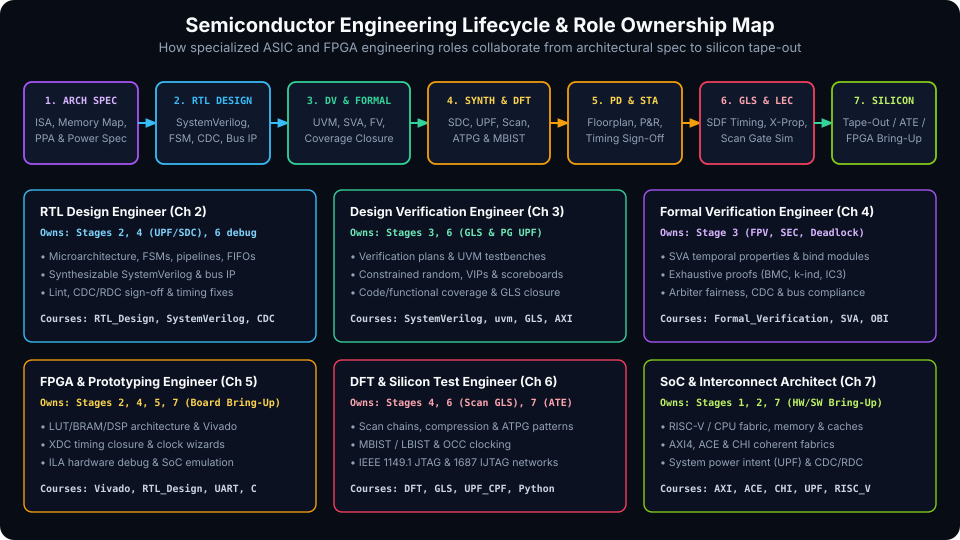
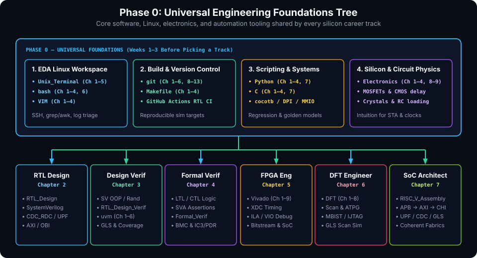

# Silicon Career Landscape and Universal Engineering Foundations

## Learning Goals

After completing this chapter, you should be able to:

- Distinguish the responsibilities, deliverables, and daily tooling of the six major front-end hardware engineering roles: RTL Design, Design Verification (DV), Formal Verification, FPGA Engineering, Design for Testability (DFT), and SoC Architecture.
- Identify where each role operates across the complete ASIC and FPGA silicon development lifecycle.
- Complete the universal **Phase 0 Foundations** shared by every semiconductor engineer (`Unix_Terminal`, `bash`, `git`, `Makefile`, `VIM`, `C`, `Python`, and `Electronics`).
- Choose a primary career track aligned with your strengths and build a structured study sequence through SkillVerse.

---

## The Semiconductor Engineering Role Landscape

Unlike generalist software engineering where one full-stack developer often builds, tests, and deploys an application end-to-end, semiconductor development splits responsibility across deeply specialized teams. Because manufacturing an ASIC costs millions of dollars in masks and takes months in a foundry, bugs cannot be "hotfixed after tape-out." Each engineering discipline guards a different aspect of silicon correctness, timing, power, and yield.

| Role | Primary Question Answered | Core Daily Languages & Standards | Primary SkillVerse Pathway |
| :--- | :--- | :--- | :--- |
| **RTL Design Engineer** | *Does this hardware architecture meet functionality, timing, area, and power targets?* | SystemVerilog RTL, SVA, SDC, UPF/CPF | [Chapter 2: RTL Design](chapter_00002.md) |
| **Design Verification (DV) Engineer** | *Can we mathematically and dynamically break this design across corner cases?* | SystemVerilog OOP, UVM, SVA, Python (`cocotb`) | [Chapter 3: Design Verification](chapter_00003.md) |
| **Formal Verification Engineer** | *Can we exhaustively prove critical invariants hold for every possible input cycle?* | SVA, LTL/CTL, SymbiYosys, JasperGold / VC Formal | [Chapter 4: Formal Verification](chapter_00004.md) |
| **FPGA & Prototyping Engineer** | *Does the design map cleanly onto LUTs/BRAM/DSP, meet XDC timing, and run on live boards?* | SystemVerilog, Tcl, XDC, Vivado / ILA, C | [Chapter 5: FPGA Engineering](chapter_00005.md) |
| **DFT & Silicon Test Engineer** | *Once fabricated on a wafer, can factory testers catch physical defects in milliseconds?* | Scan, ATPG, MBIST, LBIST, IEEE 1149.1 / 1687 IJTAG | [Chapter 6: DFT & Silicon Test](chapter_00006.md) |
| **SoC & Interconnect Architect** | *How do CPU cores, caches, buses, power domains, and firmware integrate into a system?* | AMBA (APB, AXI, ACE, CHI), OBI, RISC-V, UPF, C | [Chapter 7: SoC Architecture](chapter_00007.md) |

> [!NOTE]
> **Industry Staffing Ratio:** On a modern SoC team, **Design Verification engineers frequently outnumber RTL designers 2:1 or 3:1**. Verification, Formal, and DFT offer massive hiring volume for graduates and career switchers who combine software/scripting fluency with digital hardware knowledge.

---

## Where Each Role Fits in the ASIC and FPGA Flow

Every chip or FPGA bitstream moves through seven major phases—from architectural specification down to physical implementation, gate-level verification, and lab bring-up.

### Key Handoff Boundaries Between Teams

1. **Architecture → RTL Design**: Architects define memory maps, bus topologies, latency budgets, and power state tables. RTL engineers implement cycle-accurate microarchitecture in synthesizable SystemVerilog.
2. **RTL Design ↔ DV & Formal**: While RTL engineers write the Design Under Test (DUT), DV and Formal engineers build independent verification environments from the **specification**—never merely copying the RTL author's assumptions—to expose protocol bugs, corner-case races, and deadlocks.
3. **RTL + UPF + DFT → Synthesis & Physical Design**: RTL must pass static **Lint**, **CDC/RDC**, and **Logic Equivalence (LEC)** checks before synthesis inserts scan chains, maps standard cells, and hands off to Place-and-Route (P&R) and Static Timing Analysis (STA).
4. **Netlist + SDF → Gate-Level Simulation (GLS) & Silicon**: DV and DFT engineers simulate the post-layout gate netlist annotated with real interconnect delays (SDF), verifying reset propagation, timing violations, power switches, and scan/MBIST patterns before tape-out.

---

## Phase 0 Universal Foundations Every Hardware Engineer Needs

Before specializing in SystemVerilog, UVM, or Vivado, every hardware engineer works inside Linux terminals, remote compute farms, Git repositories, Makefiles, and Python/C automation scripts. Skipping this phase is the #1 reason beginners struggle when opening real EDA flows.

### Phase 0 Curriculum (Recommended 2–3 Weeks)

| Pillar | What You Must Master | Direct SkillVerse Starting Points |
| :--- | :--- | :--- |
| **1. Linux & Shell** | Filesystem navigation, permissions, SSH, `grep`/`awk`/`sed`, job control, pipelines | [Unix Terminal](../Unix_Terminal.md) (Ch 1–6) · [Bash](../bash.md) (Ch 1–4, 6) |
| **2. Editor Speed** | Modal navigation, visual-block column edits on port lists, macros, quickfix logs | [VIM](../VIM.md) (Ch 1–4) |
| **3. Git & CI Automation** | Branching, rebasing, resolving conflicts, PR workflows, automated Verilator/lint CI | [Git & GitHub CI/CD](../git.md) (Ch 1–6, [Ch 13 RTL CI](../git/chapter_00013.md)) |
| **4. Build Automation** | Dependency graphs, pattern rules, multi-target simulation & clean workflows | [Makefile](../Makefile.md) (Ch 1–4) |
| **5. Systems Programming** | Pointers, bitmasks, structs, MMIO (`C`) + regression runners & `cocotb` (`Python`) | [C Programming](../C.md) (Ch 1–4, 7) · [Python](../Python.md) (Ch 1–4, 7) |
| **6. Electrical Intuition** | Resistors, RC time constants, diodes, MOSFET switching physics, quartz oscillators | [Electronics](../Electronics.md) (Ch 1–4, 8–9) |

> [!TIP]
> **Don't Wait Until Phase 0 Is 100% Memorized:** Spend 2–3 focused weeks covering the core chapters above, build a small `Makefile`-driven C/Python project in Git, and then move immediately into your chosen hardware track while keeping Phase 0 chapters as reference manuals.

---

## Choosing Your Primary Track

Use this quick decision guide to pick your primary pathway—remembering that the best engineers cross-train later:

- **Pick [RTL Design Engineer (Chapter 2)](chapter_00002.md)** if you enjoy thinking in clock cycles, state machines, datapaths, pipelines, and squeezing maximum throughput out of minimal silicon area and power.
- **Pick [Design Verification Engineer (Chapter 3)](chapter_00003.md)** if you love software architecture (OOP, randomization, Python/SV), breaking complex protocols, and hunting subtle corner-case concurrency bugs.
- **Pick [Formal Verification Engineer (Chapter 4)](chapter_00004.md)** if you enjoy mathematical logic, invariants, temporal reasoning, and proving properties exhaustively without writing stimulus vectors.
- **Pick [FPGA & Prototyping Engineer (Chapter 5)](chapter_00005.md)** if you want tangible hardware bring-up—blinking LEDs, driving real UART/SPI/AXI peripherals, closing timing in Vivado, and debugging signals live with an on-chip logic analyzer.
- **Pick [DFT & Silicon Test Engineer (Chapter 6)](chapter_00006.md)** if you like structural chip architecture, high-scale automation across full SoCs, fault coverage math, and bridging RTL with physical silicon manufacturing testers.
- **Pick [SoC & Interconnect Architect (Chapter 7)](chapter_00007.md)** if you already know basic RTL/DV and want to master RISC-V cores, cache coherency (`ACE`/`CHI`), multi-domain low-power design (`UPF`), and full-chip integration.

---

## How to Study Effectively with SkillVerse

Passive reading produces false confidence in hardware engineering. Follow the **Read → Simulate → Break → Document** loop for every phase:

1. **Read with Pen and Timing Diagrams**: Whenever a chapter shows a handshake (such as `valid`/`ready`, `PSEL`/`PENABLE`, or a 2-FF CDC synchronizer), draw the cycle-by-cycle waveform yourself before looking at the code.
2. **Simulate Locally Using Free Open-Source Tools**: Almost every chapter across RTL, DV, Formal, and RISC-V can be executed locally on Linux or WSL2 using **Verilator**, **Icarus Verilog**, **Yosys + SymbiYosys**, **GTKWave / Surfer**, and **Python `cocotb`**.
3. **Break Your Own Design Intentionally**: Inject a latch, violate a setup/hold timing check, drop a `ready` signal mid-burst, or omit a `cover` witness in formal—observing the failure mode cements understanding far better than happy-path runs.
4. **Automate Every Project with `Makefile` + GitHub Actions CI**: Publish clean repositories with block diagrams, automated linting, and self-checking tests as described in [Chapter 8](chapter_00008.md).

---

## Practical Checkpoints

1. Verify you have a working Linux or WSL2 terminal environment with `git`, `make`, `python3`, `gcc`, `verilator`, `iverilog`, and `gtkwave` (or `surfer`) installed.
2. Create a clean practice repository on GitHub following [Git Chapter 2](../git/chapter_00002.md) and write a minimal `Makefile` ([Makefile Chapter 1](../Makefile/chapter_00001.md)) with `lint`, `sim`, and `clean` targets.
3. Review [Electronics Chapter 8 (MOSFETs)](../Electronics/chapter_00008.md) and [Chapter 9 (Quartz Crystals)](../Electronics/chapter_00009.md) so gate delay, fanout capacitance, and clock jitter feel concrete when you encounter setup/hold timing in the next chapter.
4. Choose your target role and jump directly to [Chapter 2](chapter_00002.md), [Chapter 3](chapter_00003.md), [Chapter 4](chapter_00004.md), [Chapter 5](chapter_00005.md), [Chapter 6](chapter_00006.md), or [Chapter 7](chapter_00007.md).

##### Copyright (c) 2026 squared-studio
