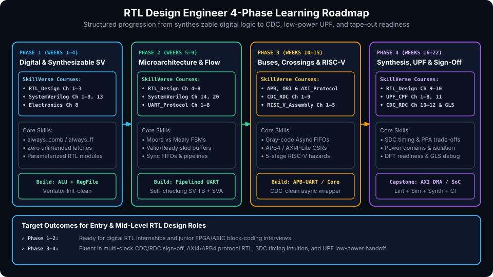
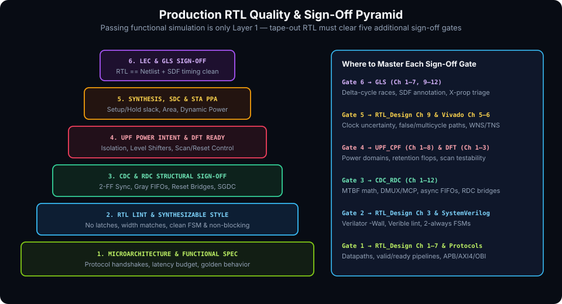

# RTL Design Engineer Learning Pathway

## Learning Goals

After completing this pathway chapter, you should be able to:

- Navigate a complete 4-phase study roadmap from basic combinational/sequential digital logic to sign-off-ready RTL design.
- Select exact chapters across `RTL_Design`, `SystemVerilog`, bus protocols, `CDC_RDC`, `UPF_CPF`, `DFT`, and `GLS` in the proper prerequisite order.
- Explain the six layers of production RTL quality (functional spec, lint, CDC/RDC, UPF power intent, synthesis/STA, and LEC/GLS).
- Build a four-stage RTL engineering portfolio culminating in a protocol-wrapped, CDC-clean subsystem backed by automated CI.

---

## What an RTL Design Engineer Owns

An **RTL (Register-Transfer Level) Design Engineer** translates architectural specifications into synthesizable SystemVerilog code that describes cycle-by-cycle data movement and control logic between flip-flops and memories. Unlike software where performance is tuned mostly by algorithms, RTL engineers balance **PPA (Power, Performance, and Area)** simultaneously—while ensuring the logic synthesizes cleanly into gates, passes static timing analysis (STA), crosses asynchronous clock domains without metastability, and cooperates with DFT and low-power UPF flows.

---

## Phase-by-Phase SkillVerse Study Plan

Follow these four sequential phases (roughly 18–22 weeks at 10–12 hours per week):

### Phase 1: Digital Foundations & Synthesizable SystemVerilog (Weeks 1–4)

Focus strictly on writing clean, unambiguous hardware—never confuse testbench-only constructs (`initial`, `#delays`, `fork-join`) with synthesizable RTL.

| Order | SkillVerse Resource | Core Concepts Mastered |
| :---: | :--- | :--- |
| 1 | [RTL Design Ch 1: Introduction to RTL Design](../RTL_Design/chapter_00001.md) | Hardware parallelism vs. sequential software mindset, ASIC/FPGA design flow |
| 2 | [RTL Design Ch 2: Digital Design Fundamentals](../RTL_Design/chapter_00002.md) | Combinational vs. sequential logic, setup/hold windows, register-to-register timing |
| 3 | [SystemVerilog Ch 1–9](../SystemVerilog.md) | `logic` 4-state types, packed arrays, `always_comb`, `always_ff`, operators, control flow |
| 4 | [SystemVerilog Ch 13: Modules](../SystemVerilog/chapter_00013.md) & [Ch 17: Packages](../SystemVerilog/chapter_00017.md) | Parameterized modules, `localparam`, structs/enums in shared `pkg` files |
| 5 | [RTL Design Ch 3: RTL Coding Styles](../RTL_Design/chapter_00003.md) | Blocking (`=`) vs. non-blocking (`<=`), eliminating unintended latches, lint cleanliness |

### Phase 2: Microarchitecture, FSMs, Memories & Pipelines (Weeks 5–9)

Learn the fundamental hardware building blocks that appear in nearly every silicon block interview and real-world IP core.

| Order | SkillVerse Resource | Core Concepts Mastered |
| :---: | :--- | :--- |
| 1 | [RTL Design Ch 4: Clocking and Reset](../RTL_Design/chapter_00004.md) | Synchronous vs. async reset, reset bridge, clock skew intuition |
| 2 | [RTL Design Ch 5: Memory Design](../RTL_Design/chapter_00005.md) | Single/dual-port SRAM inference, synchronous circular FIFOs, pointer wraparound |
| 3 | [RTL Design Ch 6: Finite State Machines (FSMs)](../RTL_Design/chapter_00006.md) | Moore vs. Mealy FSMs, 2-always/3-always coding styles, one-hot vs. binary encoding |
| 4 | [RTL Design Ch 7: Pipelining](../RTL_Design/chapter_00007.md) | Latency vs. throughput, `valid`/`ready` backpressure, skid buffers, hazard stalls |
| 5 | [SystemVerilog Ch 14: Interfaces](../SystemVerilog/chapter_00014.md) & [RTL Design Ch 8](../RTL_Design/chapter_00008.md) | Clean `modport` RTL bundles and writing self-checking sanity testbenches |
| 6 | [UART Protocol Ch 1–8](../UART_Protocol.md) | Real-world serial framing, oversampling clock recovery, TX/RX FSMs, FIFO buffering |

### Phase 3: Bus Protocols, Clock/Reset Crossings & RISC-V (Weeks 10–15)

Modern IP blocks never sit in isolation; they connect over standardized interconnects and operate across multiple clock and reset domains.

| Order | SkillVerse Resource | Core Concepts Mastered |
| :---: | :--- | :--- |
| 1 | [APB Protocol Ch 1–7](../APB_Protocol.md) | Control/status register (CSR) access (`PSEL`, `PENABLE`, `PREADY`, `PSTRB`, `PSLVERR`) |
| 2 | [OBI Protocol Ch 1–6](../OBI.md) | Minimal pipelined request/response bus used in open-source RISC-V cores |
| 3 | [AXI Protocol Ch 1–7](../AXI_Protocol.md) & [Ch 10](../AXI_Protocol/chapter_00010.md) | 5 independent channels, burst math, ordering, AXI4-Lite, and AXI-to-APB bridges |
| 4 | [CDC / RDC Ch 1–9](../CDC_RDC.md) | Metastability, MTBF, 2-FF & pulse syncs, DMUX/MCP, Gray-code async FIFOs, RDC |
| 5 | [RISC-V Assembly Ch 1–5](../RISC_V_Assembly.md) | Instruction formats, ALU/branch/load-store datapaths, ABI conventions |

### Phase 4: Synthesis, Low-Power UPF, DFT & Sign-Off (Weeks 16–22)

Bridge the gap between "it passes simulation" and "it survives tape-out."

| Order | SkillVerse Resource | Core Concepts Mastered |
| :---: | :--- | :--- |
| 1 | [RTL Design Ch 9: Synthesis & STA](../RTL_Design/chapter_00009.md) & [Ch 10](../RTL_Design/chapter_00010.md) | SDC constraints, synthesis optimization trade-offs, retiming, PPA impact of RTL style |
| 2 | [CDC / RDC Ch 10–12](../CDC_RDC.md) | Static CDC constraints (SDC/SGDC), waiver discipline, physical skew bounds |
| 3 | [UPF / CPF Low-Power Design Ch 1–8, 11](../UPF_CPF.md) | Power domains, isolation cells, level shifters, state retention, PMC sequencing |
| 4 | [DFT Ch 1–2](../DFT.md) & [GLS Ch 1–4, 6](../GLS.md) | Avoiding non-scannable flops/async clock mux glitches, debugging X-optimism/pessimism |

---

## Core Technical Milestones and Sign-Off Fluency

Senior RTL engineers do not wait for backend or verification teams to catch basic structural issues. You should adopt the **Six-Layer RTL Quality Pyramid** on every block you author:

> [!IMPORTANT]
> **X-Optimism vs. Gate-Level Reality:** A classic RTL mistake is writing `if (sel) out = a; else out = b;` where `sel` is `1'bx` after reset. Standard RTL simulation evaluates `1'bx` as false and silently picks `b`, hiding a bug until [Gate-Level Simulation (GLS Ch 6)](../GLS/chapter_00006.md) propagates `X` across the chip. Learn unique/priority `case` pitfalls and proper reset architectures early!

---

## Progressive RTL Portfolio Projects

1. **Tier 1 — Parameterized Synchronous & Asynchronous Gray-Code FIFO**: Implement both single-clock (`almost_full`/`almost_empty`, registered output option) and dual-clock Gray-pointer async FIFOs ([CDC_RDC Ch 7](../CDC_RDC/chapter_00007.md)). Lint cleanly with `verilator --lint-only -Wall`.
2. **Tier 2 — APB4-Controlled UART Peripheral with TX/RX FIFOs**: Build a complete CSR register bank (baud divisor, parity, FIFO watermarks, sticky error flags) wrapping an oversampling UART RX/TX core ([UART_Protocol](../UART_Protocol.md) + [APB_Protocol](../APB_Protocol.md)).
3. **Tier 3 — Pipelined Skid-Buffered AXI4-Stream / AXI4-Lite DMA Engine**: Design a valid/ready pipelined engine supporting unaligned bursts and burst boundary splitting ([AXI_Protocol Ch 4–5](../AXI_Protocol/chapter_00004.md)).
4. **Tier 4 — Single-Cycle / 5-Stage Pipelined RV32I Core (with OBI Instruction/Data Bus)**: Implement forwarding, load-use hazard stalls, and branch flush logic running compiled C programs ([RISC_V_Assembly](../RISC_V_Assembly.md) + [OBI](../OBI.md)).

---

## Common Beginner Pitfalls and Career Progression

- **Pitfall 1 — Writing Behavioral Software Inside `always_comb`**: Loops with dynamic bounds, incomplete `case` sensitivity defaults, or reading and writing the same variable carelessly can create feedback loops or latches.
- **Pitfall 2 — Passing Multi-Bit Buses Through 2-FF Synchronizers**: Two-flop synchronizers work **only** for single-bit quasi-static or Gray-coded signals; multi-bit data requires DMUX qualifiers, MCP handshakes, or async FIFOs ([CDC_RDC Ch 5–6](../CDC_RDC/chapter_00005.md)).
- **Pitfall 3 — Ignoring Reset Domain Crossings (RDC)**: Asserting an asynchronous reset in one clock domain while a downstream flop remains unreset on another clock creates metastability even when clocks are synchronous ([CDC_RDC Ch 9](../CDC_RDC/chapter_00009.md)).

### Career Growth Trajectory
**Junior RTL Block Designer** (leaf FSMs, CSR blocks, FIFOs) → **IP Lead / Microarchitect** (AXI/DMA/cache subsystems, PPA & CDC sign-off) → **Principal Architect / SoC Lead** (system fabrics, low-power architecture, chip-level trade-offs — see [Chapter 7](chapter_00007.md)).

---

## Readiness Self-Check

- [ ] Can you explain from first principles why non-blocking (`<=`) is mandatory inside `always_ff` and blocking (`=`) inside `always_comb`?
- [ ] Can you sketch a `valid`/`ready` pipeline skid buffer on a whiteboard that sustains 100% throughput with zero combinational path on `ready`?
- [ ] Can you draw a Gray-code asynchronous FIFO, size its depth for burst rate differences, and derive why `full` compares two inverted MSBs?
- [ ] Can you trace why `if (rst_n == 0)` on a gate-level flip-flop requires a recovery/removal timing check when de-asserted?
- [ ] Have you shipped at least two RTL repositories with passing `verilator --lint-only -Wall`, automated testbenches, and GitHub CI ([Git Ch 13](../git/chapter_00013.md))?

##### Copyright (c) 2026 squared-studio
