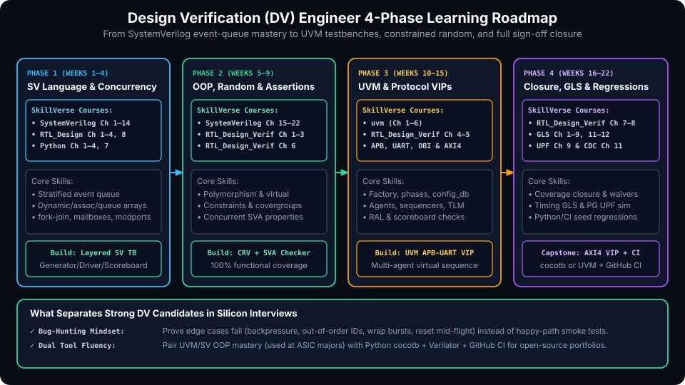
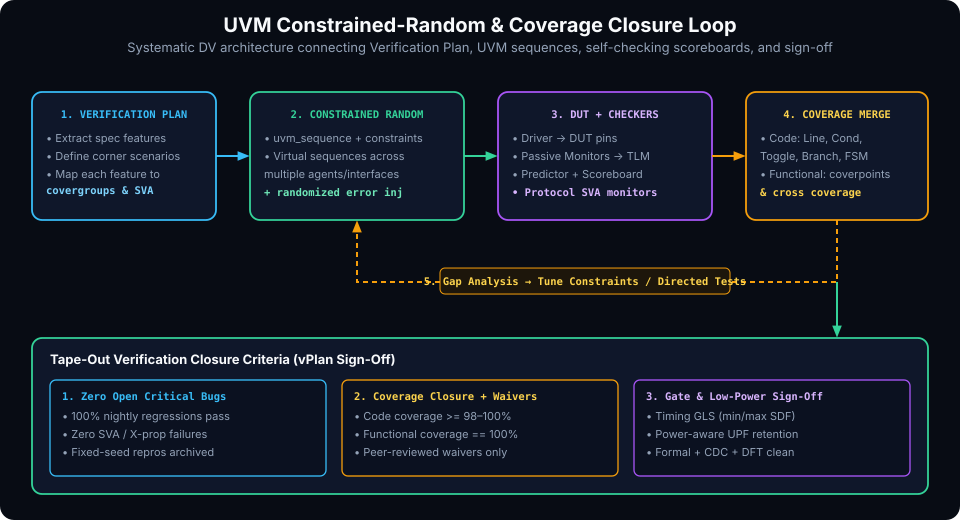

# Design Verification (DV) Engineer Learning Pathway

## Learning Goals

After completing this pathway chapter, you should be able to:

- Follow a structured 4-phase Design Verification roadmap from basic SystemVerilog testbenches to UVM environments, VIPs, and coverage closure.
- Understand SystemVerilog concurrency, the stratified event queue, OOP polymorphism, constrained-random generation, and SystemVerilog Assertions (SVA).
- Architect complete UVM testbenches using the factory, `uvm_config_db`, virtual sequences, TLM analysis ports, scoreboards, and the Register Abstraction Layer (RAL).
- Manage the verification closure loop—combining code coverage, functional coverage, directed corner tests, GLS, and UPF power-aware verification.

---

## Why Verification Engineers Outnumber Designers

Fixing a single functional bug discovered after ASIC tape-out costs tens of millions of dollars in mask respins and lost market windows. Consequently, **60%–70% of total pre-silicon chip effort goes into verification**. Modern **Design Verification (DV)** engineers are software architects applied to hardware: they build object-oriented simulation frameworks, constrained-random stimulus generators, cycle-accurate reference predictors, formal protocol monitors, and automated regression pipelines.

---

## Phase-by-Phase SkillVerse Study Plan

Follow this four-phase sequence (roughly 18–22 weeks) using SkillVerse's dedicated SystemVerilog, Verification, and UVM tracks:

### Phase 1: SystemVerilog Language & Event-Queue Fundamentals (Weeks 1–4)

Even strong C++/Python programmers trip over SystemVerilog's hardware concurrency and simulation scheduling if they skip the fundamentals.

| Order | SkillVerse Resource | Core Concepts Mastered |
| :---: | :--- | :--- |
| 1 | [RTL Design Ch 1–4, 8](../RTL_Design.md) | Basic hardware intuition, clocking, resets, and how DUTs behave |
| 2 | [SystemVerilog Ch 1–9](../SystemVerilog.md) | 2-state vs. 4-state types (`bit` vs. `logic`), dynamic/associative arrays, queues |
| 3 | [SystemVerilog Ch 10: Fork-Join](../SystemVerilog/chapter_00010.md) | `fork-join`, `join_any`, `join_none`, `wait fork`, `disable fork`, loop-variable traps |
| 4 | [SystemVerilog Ch 11–12](../SystemVerilog.md) | Automatic tasks/functions, mailboxes, semaphores, `@(event)` synchronization |
| 5 | [SystemVerilog Ch 14: Interfaces](../SystemVerilog/chapter_00014.md) & [RTL Design Ch 8](../RTL_Design/chapter_00008.md) | `clocking` blocks (zero race conditions), `virtual interface`, stratified event queue |
| 6 | [RTL Design Verification Ch 1–2](../RTL_Design_Verification.md) | Verification plans (`vPlan`), layered testbench architecture, reference models |

### Phase 2: OOP, Constrained Randomization, SVA & Functional Coverage (Weeks 5–9)

Master the core verification triad: **Randomize** interesting legal/illegal stimulus → **Check** automatically via predictors & SVA → **Measure** completeness via coverage.

| Order | SkillVerse Resource | Core Concepts Mastered |
| :---: | :--- | :--- |
| 1 | [SystemVerilog Ch 15: Classes](../SystemVerilog/chapter_00015.md) | Inheritance, polymorphism, `virtual` methods, `$cast`, shallow vs. deep copy |
| 2 | [SystemVerilog Ch 16: Randomization](../SystemVerilog/chapter_00016.md) & [DV Ch 3](../RTL_Design_Verification/chapter_00003.md) | `rand`/`randc`, `solve...before`, `dist` weights, inline `randomize() with`, `pre/post_randomize` |
| 3 | [SystemVerilog Ch 18–19](../SystemVerilog.md) | `+plusargs` runtime test seeds, file I/O hex/CSV stimulus loading |
| 4 | [SystemVerilog Ch 20: Assertions (SVA)](../SystemVerilog/chapter_00020.md) & [DV Ch 6](../RTL_Design_Verification/chapter_00006.md) | Concurrent sequences, `|->` vs. `|=>`, `disable iff`, binding assertions non-invasively |
| 5 | [SystemVerilog Ch 21: Coverage](../SystemVerilog/chapter_00021.md) | `covergroup`, `bins`/`illegal_bins`/`ignore_bins`, cross coverage, code vs. functional coverage |

### Phase 3: UVM Methodology & Protocol Verification IPs (Weeks 10–15)

**UVM (Universal Verification Methodology)** is the standard IEEE 1800.2 verification framework across almost every commercial ASIC team. Study both the high-level architecture and SkillVerse's end-to-end APB-UART UVM case study:

| Order | SkillVerse Resource | Core Concepts Mastered |
| :---: | :--- | :--- |
| 1 | [DV Ch 4–5](../RTL_Design_Verification.md) | Overview of UVM class hierarchy, TLM ports, and Register Abstraction Layer (RAL) |
| 2 | [UVM Ch 1: Problem & Language](../uvm/chapter_00001.md) & [Ch 2: Top-Level Flow](../uvm/chapter_00002.md) | `uvm_pkg`, `uvm_config_db` virtual interface handoff, component vs. transaction objects |
| 3 | [UVM Ch 3: Phases & Objections](../uvm/chapter_00003.md) | `build_phase`, `connect_phase`, `run_phase`, `raise_objection`/`drop_objection` |
| 4 | [UVM Ch 4: Agents & Sequences](../uvm/chapter_00004.md) | Active vs. passive agents, driver-sequencer handshake (`get_next_item`/`item_done`) |
| 5 | [UVM Ch 5–6](../uvm.md) | `uvm_analysis_port`, golden scoreboard comparison, factory overrides, extending environments |
| 6 | [APB](../APB_Protocol.md), [UART](../UART_Protocol.md), [OBI](../OBI.md) & [AXI4](../AXI_Protocol.md) | Writing reusable Verification IPs (VIPs) with protocol SVA & out-of-order scoreboards |

### Phase 4: Coverage Closure, GLS, Low-Power Sim & CI Regressions (Weeks 16–22)

Move from single block tests to chip-level sign-off flows.

| Order | SkillVerse Resource | Core Concepts Mastered |
| :---: | :--- | :--- |
| 1 | [DV Ch 7–8](../RTL_Design_Verification.md) | Waveform triage, seed replay, merging coverage databases, waiver reviews |
| 2 | [GLS Ch 1–8, 11–12](../GLS.md) | Adapting UVM benches for SDF back-annotated gate netlists, X-prop, hybrid RTL/gate sim |
| 3 | [UPF / CPF Ch 9](../UPF_CPF/chapter_00009.md) & [CDC / RDC Ch 11](../CDC_RDC/chapter_00011.md) | Power-aware UPF corruption/retention verification & dynamic CDC jitter simulation |
| 4 | [Python Ch 7](../Python/chapter_00007.md) & [Git Ch 13](../git/chapter_00013.md) | Python `cocotb` verification + automated parallel regression orchestration in CI |

---

## Mastering the Verification Closure Loop

Running 10,000 random tests means nothing if 9,999 of them exercise the same idle path. DV engineers drive verification systematically using the **Closure Loop**:

> [!TIP]
> **Self-Checking or Useless:** Never rely on visually inspecting waveforms to decide whether a test passed. Every testbench must compare DUT outputs automatically against a cycle-accurate or transaction-level **reference model (scoreboard)** plus **SVA protocol checkers**, exiting non-zero immediately on mismatch.

---

## Progressive DV Portfolio Projects

Since commercial UVM simulators (VCS, Questa, Xcelium) require enterprise licenses, pair SystemVerilog/UVM fluency (running on EDA Playground or Questa/Verilator partial support) with **open-source Python `cocotb` + Verilator + SVA** repositories on GitHub so recruiters can run `make sim` directly:

1. **Tier 1 — Layered SystemVerilog + `cocotb` Scoreboard for Sync/Async FIFO**: Verify simultaneous read/write wraparound, full/empty stalls, randomized reset mid-flight, and 100% cross-coverage of pointer offsets.
2. **Tier 2 — Complete UVM (or `cocotb-bus`) APB4 + UART Environment**: Implement an active APB agent, a passive UART monitor, a register scoreboard (RAL concept), baud-error injection, and parity/framing error coverage ([UVM Ch 4–5](../uvm/chapter_00004.md)).
3. **Tier 3 — AXI4 Full Protocol VIP & Out-of-Order Scoreboard**: Verify variable burst types (`FIXED`, `INCR`, `WRAP`), 4 KB boundary rules, write strobes (`WSTRB`), multi-ID out-of-order read/write responses, and backpressure stalls on every channel ([AXI_Protocol Ch 2–7](../AXI_Protocol.md)).
4. **Tier 4 — Regression Runner + Coverage Dashboard in CI**: Build a Python runner script (`argparse` + `subprocess` + seed logging) running 100 randomized seeds in parallel via GitHub Actions matrix sharding, publishing pass/fail tables to `$GITHUB_STEP_SUMMARY`.

---

## Common DV Pitfalls and Career Progression

- **Pitfall 1 — Driving DUT Inputs on Active Clock Edges Without `clocking` Blocks**: Causes delta-cycle race conditions between testbench stimulus and `always_ff` sampling ([SystemVerilog Ch 14](../SystemVerilog/chapter_00014.md)).
- **Pitfall 2 — Forgetting `raise_objection` / `drop_objection`**: Causes `run_phase` to terminate at time `0` before the first sequence item executes ([UVM Ch 3](../uvm/chapter_00003.md)).
- **Pitfall 3 — Chasing 100% Line Coverage Without Assertions**: A testbench that toggles every line without verifying output values gives 100% code coverage while missing 100% of data corruption bugs!
- **Pitfall 4 — Over-Constraining Random Sequences**: Restricting stimulus exclusively to "clean" back-to-back transfers hides backpressure, reset-on-valid, and error-response bugs.

### Career Growth Trajectory
**Block-Level DV Engineer** (SV/UVM agents, scoreboards, coverage closure) → **Subsystem / VIP Lead** (UVM RAL, AXI/CHI/PCIe VIPs, formal/low-power co-verif) → **SoC Verification Lead / Architect** (full-chip verification plan, emulation, GLS/UPF sign-off, silicon bring-up).

---

## Readiness Self-Check

- [ ] Can you explain the SystemVerilog **stratified event queue** (Active, Inactive, NBA, Observed, Reactive) and why program/clocking blocks prevent TB-DUT races?
- [ ] Can you catch the classic `for (int i=0; i<4; i++) fork ... join_none` loop-index capture bug and fix it with `automatic int j = i;`?
- [ ] Can you implement a UVM `build_phase` → `connect_phase` → `run_phase` flow from memory, including `uvm_analysis_imp` in a scoreboard?
- [ ] Can you design cross-coverage bins and explain how `illegal_bins` catches invalid DUT states during simulation?
- [ ] Can you explain why `uvm_config_db#(virtual inf)::set` uses `uvm_root::get()` and wildcard paths cleanly?

##### Copyright (c) 2026 squared-studio
