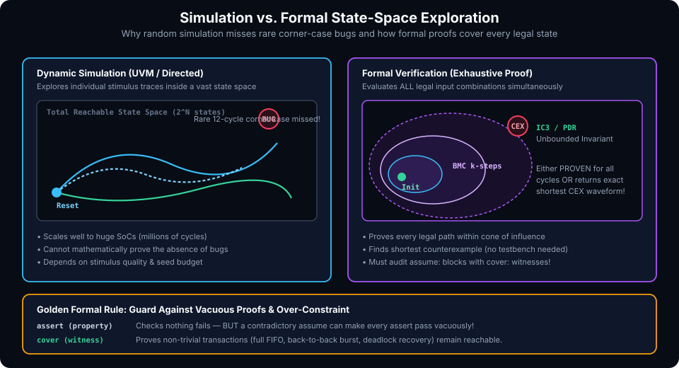
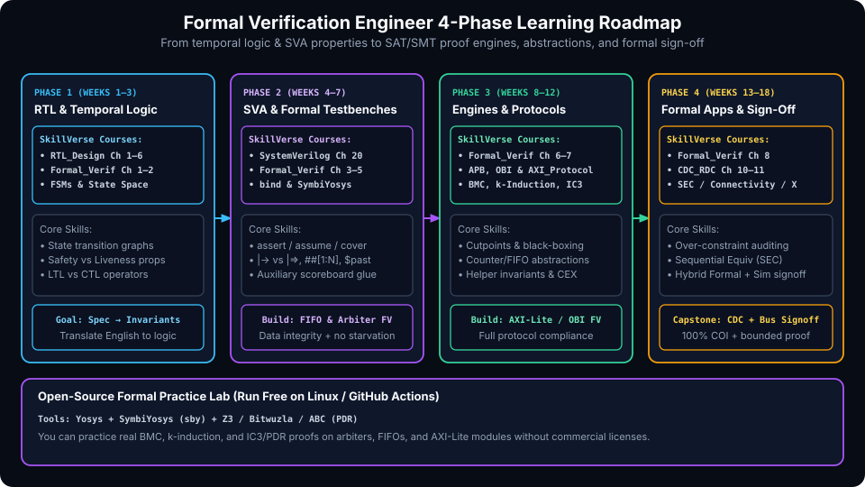

# Formal Verification Engineer Learning Pathway

## Learning Goals

After completing this pathway chapter, you should be able to:

- Explain how Formal Property Verification (FPV) complements dynamic simulation by exhaustively exploring all legal input trajectories.
- Write clean, non-vacuous SystemVerilog Assertions (`assert`, `assume`, `cover`) bound safely via `bind` files.
- Choose and tune formal engines—Bounded Model Checking (BMC), k-Induction, and IC3/PDR—and apply abstractions (cutpoints, black-boxing, counter reduction) to eliminate state-space explosion.
- Apply formal verification to real industrial domains: arbiters, FIFOs, bus protocol compliance (`APB`, `OBI`, `AXI4`), CDC/RDC, and Sequential Equivalence Checking (SEC).

---

## How Formal Verification Complements Simulation

Simulation tests **individual stimulus paths**—no matter how many billions of random cycles you run, rare multi-cycle corner cases (such as an exact sequence of back-to-back wrap bursts coinciding with an async FIFO full transition and a reset) can escape undetected. **Formal Verification** converts your RTL and SystemVerilog Assertions into mathematical SAT/SMT formulas and checks **every possible legal input combination on every clock cycle simultaneously**.

| Verification Dimension | Dynamic Simulation (UVM / `cocotb`) | Formal Property Verification (FPV) |
| :--- | :--- | :--- |
| **Input Stimulus** | Explicit testbench & constrained random seeds | Exhaustive symbolic exploration (zero stimulus needed) |
| **Scale Limit** | Scales to full multi-billion-transistor SoCs | Best on control logic, arbiters, bridges, protocols (up to ~100k–1M flops) |
| **Bug Finding Strength** | Deep end-to-end data flows (thousands of cycles) | Deep concurrency, deadlocks, security leaks, arbitration fairness |
| **Output Result** | Pass/Fail for simulated seeds only | Mathematical **PROVEN** OR exact shortest **Counterexample (CEX)** |
| **Primary Risk** | Missed corner cases due to incomplete stimulus | Over-constraining `assume` properties → **vacuous passes** |

---

## Phase-by-Phase SkillVerse Study Plan

Follow this four-phase sequence (14–18 weeks) to build formal mastery using SkillVerse's `Formal_Verification`, `SystemVerilog`, and bus protocol tracks:

### Phase 1: RTL Intuition & Temporal Logic Foundations (Weeks 1–3)

Formal engineers think in state transition systems and temporal invariants rather than imperative test sequences.

| Order | SkillVerse Resource | Core Concepts Mastered |
| :---: | :--- | :--- |
| 1 | [RTL Design Ch 1–6](../RTL_Design.md) | Synchronous state machines, FIFOs, valid/ready handshakes, hardware invariants |
| 2 | [Formal Verification Ch 1: Foundations & Modeling](../Formal_Verification/chapter_00001.md) | Kripke structures, state transition systems, safety vs. liveness properties |
| 3 | [Formal Verification Ch 2: LTL vs. CTL](../Formal_Verification/chapter_00002.md) | Temporal operators (`G`, `F`, `X`, `U`), safety (`[] p`) vs. liveness (`<> p`), fairness |

### Phase 2: SystemVerilog Assertions (SVA) & Bind Architecture (Weeks 4–7)

Master expressing hardware rules accurately in SVA and isolating verification collateral from synthesis RTL.

| Order | SkillVerse Resource | Core Concepts Mastered |
| :---: | :--- | :--- |
| 1 | [SystemVerilog Ch 20: SVA](../SystemVerilog/chapter_00020.md) | Immediate vs. concurrent assertions, sequence timing, `|->` vs. `|=>` |
| 2 | [Formal Verification Ch 3: SVA Deep Dive](../Formal_Verification/chapter_00003.md) | `assume`, `assert`, `cover`, `restrict`, `$past()`, `$rose()`, `$stable()`, auxiliary glue logic |
| 3 | [Formal Verification Ch 4: Engines & Setup](../Formal_Verification/chapter_00004.md) | Formal testbench harnesses, `bind` files, clock/reset assumptions, SymbiYosys (`.sby`) |
| 4 | [Formal Verification Ch 5: Control & FSMs](../Formal_Verification/chapter_00005.md) | Mutual exclusion, no-starvation fairness, deadlock/livelock detection, reachability |

### Phase 3: Proof Engines, Abstractions & Protocol Compliance (Weeks 8–12)

Unbounded proofs on real-world designs often hit complexity walls unless you understand how SAT/SMT solvers work and how to guide them cleanly.

| Order | SkillVerse Resource | Core Concepts Mastered |
| :---: | :--- | :--- |
| 1 | [Formal Verification Ch 7: BMC, k-Induction & IC3/PDR](../Formal_Verification/chapter_00007.md) | Bounded depth `k`, unreachable state induction failures, Property Directed Reachability |
| 2 | [APB Protocol](../APB_Protocol.md) & [OBI Protocol](../OBI.md) | Formalizing stability rules (signals held stable while `!PREADY` / `!gnt_i`) |
| 3 | [AXI Protocol Ch 1–7](../AXI_Protocol.md) & [Formal Ch 6](../Formal_Verification/chapter_00006.md) | AXI4 formal VIP rules, tracking outstanding burst IDs without state explosion |
| 4 | Abstraction Techniques ([Formal Ch 7](../Formal_Verification/chapter_00007.md)) | FIFO/memory data-independence (`1-word` / `2-address` symmetry), cutpoints, helper invariants |

### Phase 4: Specialized Formal Apps & Hybrid Sign-Off (Weeks 13–18)

| Order | SkillVerse Resource | Core Concepts Mastered |
| :---: | :--- | :--- |
| 1 | [Formal Verification Ch 8: Coverage & Sign-Off](../Formal_Verification/chapter_00008.md) | Cone-of-Influence (COI) coverage, formal mutation checks, over-constraint auditing |
| 2 | [CDC / RDC Ch 10–11](../CDC_RDC.md) | Formal CDC protocol checks, data-stability proofs across DMUX/MCP handshakes |
| 3 | Logic & Sequential Equivalence ([Formal Ch 7](../Formal_Verification/chapter_00007.md)) | Combinational LEC (RTL-to-Gate) and Sequential Equivalence Checking (SEC for clock gating / pipelining) |

---

## Core Formal Disciplines and Sign-Off Apps

In industry (using tools like Cadence JasperGold, Synopsys VC Formal, or Siemens Questa Formal), specialists routinely apply targeted **Formal Apps**:

1. **Formal Property Verification (FPV)**: Custom architectural & microarchitectural assertions proving functional invariants (no FIFO overflow/underflow, data order preserved, arbiter starvation-free).
2. **Connectivity Checking (C2RTL / FCONN)**: Exhaustively verifying thousands of SoC pin-muxes, tie-offs, and pad-ring connections straight from CSV spreadsheets without running slow full-chip simulation.
3. **Deadlock & Unreachability (UNR)**: Proving no FSM state can lock up forever and identifying dead RTL branches for formal coverage waivers.
4. **Sequential Equivalence Checking (SEC)**: Proving a power-optimized or retimed RTL refactor behaves identically cycle-for-cycle (or latency-shifted) compared to the legacy golden RTL.
5. **Security & Information-Flow Verification**: Proving secret cryptographic keys or privileged CSRs cannot leak to unprivileged debug pins or AXI ports.

---

## Hands-On Formal Projects with Open-Source Tools

You can build a top-tier formal verification portfolio entirely on free open-source tools (**Yosys + SymbiYosys (`sby`) + Z3 / Bitwuzla / ABC**) running in minutes locally and on GitHub Actions:

1. **Project 1 — Formal Proof of a Synchronous & Async FIFO**: Write SVA + auxiliary tracking registers ("two arbitrary magic bytes" method!) to prove data integrity, FIFO ordering, and non-overflow/underflow for *all* data values without exploding bit widths.
2. **Project 2 — Round-Robin Arbiter Fairness & Starvation Proof**: Prove mutual exclusion (`$onehot0(gnt)`) via IC3/PDR and bounded liveness (`req[i] |-> ##[1:N] gnt[i]`) under fairness assumptions.
3. **Project 3 — Complete OBI / APB4 / AXI4-Lite Formal Compliance Suite**: Create a standalone formal monitor bound via `bind` that proves master/slave handshake stability, zero spurious `RVALID`/`BVALID` responses, and `cover` witness traces for back-to-back burst traffic.
4. **Project 4 — SEC Proof of a Clock-Gated / Pipelined Refactor**: Use Yosys `equiv` / SymbiYosys miter circuits to formally prove an optimized RTL module matches its unoptimized golden specification.

---

## Common Formal Pitfalls and Career Progression

- **Pitfall 1 — Writing `assume` Without Matching `cover` Witnesses**: Over-constraining inputs (e.g., accidentally assuming `req == 0` forever) causes every `assert` to pass **vacuously**. Always pair assumptions with non-trivial `cover` reachability checks!
- **Pitfall 2 — Trying to Formally Prove a 64-bit × 64-bit Multiplier or 4 KB Memory Array Unabstracted**: SAT/SMT engines choke on wide multipliers and deep counters. Replace deep RAMs with small symbolic 2-entry memories or black-boxed cutpoints ([Formal Ch 7](../Formal_Verification/chapter_00007.md)).
- **Pitfall 3 — Confusing Bounded Proofs (`bmc`) With Full Proofs (`prove`)**: Passing BMC to depth `k = 20` only guarantees no bug exists in the first 20 cycles after reset—it does not prove cycle 21! Always verify unbounded invariants via `prove` (k-induction or PDR/IC3) whenever feasible.

### Career Growth Trajectory
**FV Block Engineer** (SVA, FPV on arbiters/bridges, formal apps) → **Formal Methodology / Lead** (SEC for low-power/clock-gating, CPU/cache coherence proofs, formal sign-off) → **Principal Verification Architect** (hybrid formal + UVM strategies across flagship SoCs).

---

## Readiness Self-Check

- [ ] Can you explain the exact cycle-by-cycle difference between `a |-> b`, `a |=> b`, and `a ##1 b`?
- [ ] How do you formally verify data integrity of a 64-bit-wide, 1024-deep FIFO without hitting state-space explosion?
- [ ] Why can `k-induction` fail even on a bug-free design, and how do helper invariants (`assert` lemmas) strengthen induction?
- [ ] What steps do you take to confirm that an `assert` did not pass vacuously due to contradictory `assume` properties?
- [ ] Have you run at least two `sby` (`bmc` + `prove`) formal labs and inspected a `.vcd` counterexample trace?

##### Copyright (c) 2026 squared-studio
