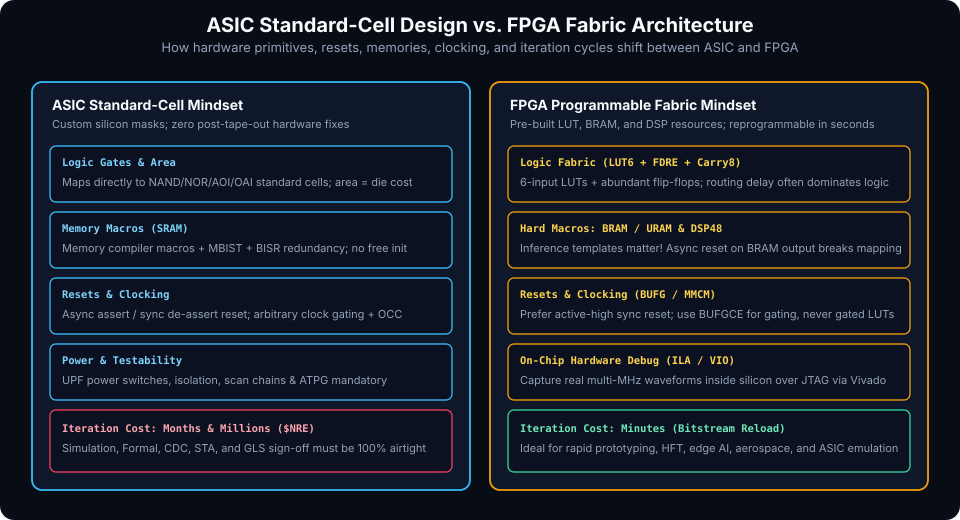
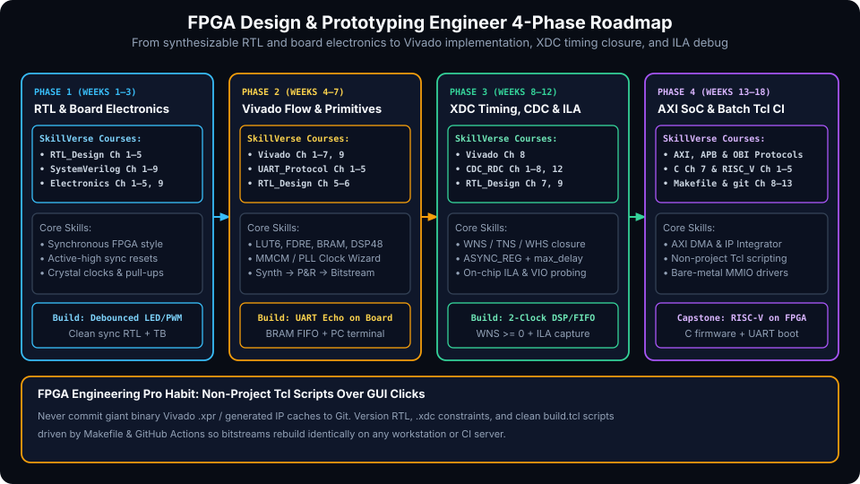

# FPGA Design and Prototyping Engineer Learning Pathway

## Learning Goals

After completing this pathway chapter, you should be able to:

- Contrast FPGA programmable fabric architecture (`LUT6`, `FDRE`, `BRAM`/`URAM`, `DSP48`, `MMCM`/`BUFG`) against ASIC standard-cell design practices.
- Follow a 4-phase SkillVerse roadmap covering board electronics, Vivado synthesis/implementation/bitstream flows, XDC timing closure, CDC, and hardware bring-up.
- Debug live on-chip hardware waveforms using Vivado Integrated Logic Analyzer (`ILA`) and Virtual I/O (`VIO`) cores over JTAG.
- Automate reproducible non-project Tcl FPGA builds alongside embedded bare-metal C/RISC-V firmware.

---

## FPGA Engineering vs. ASIC RTL Design

While both ASIC and FPGA engineers write SystemVerilog RTL, **targeting a pre-manufactured programmable fabric changes key architectural decisions**. An ASIC engineer synthesizes logic straight to standard-cell gates and pays silicon die area per gate; an FPGA engineer maps RTL onto pre-placed 6-input Lookup Tables (`LUT6`), dedicated flip-flops, Block RAM (`BRAM`), hard `DSP48` math slices, and fixed global clock buffers (`BUFG`).



| Architectural Aspect | ASIC Standard-Cell Flow | FPGA Fabric Flow (AMD/Xilinx Vivado) |
| :--- | :--- | :--- |
| **Reset Convention** | Often active-low async reset (depending on cell library) | **Active-high synchronous reset** strongly preferred (avoids blocking `BRAM`/`DSP48` inference and cuts routing congestion) |
| **Memory Inference** | Memory compiler SRAM macros + MBIST | Specific RTL read/write patterns infer `BRAM` (36 Kb) or `LUTRAM`; async reads force slow LUT RAM |
| **Clock Gating** | Integrated Clock Gating (`ICG`) cells everywhere | **Never gate clocks in LUTs!** Causes clock skew; use `CE` (Clock Enable) pins on flops or `BUFGCE` |
| **Power-On State** | Unknown (`X`) until explicit reset pulses | Configuration bitstream initializes registers cleanly (`INIT` value) |
| **Verification & Debug** | Heavy UVM + Formal + GLS before tape-out | Simulation + live multi-MHz hardware probing via `ILA` & `VIO` over JTAG |

---

## Phase-by-Phase SkillVerse Study Plan

Follow these four sequential phases (14–18 weeks) combining hardware theory, Vivado implementation, and embedded bring-up:



### Phase 1: Synthesizable RTL & Board-Level Electronics (Weeks 1–3)

Understand both synchronous RTL design and the physical signals entering your FPGA pins (voltage dividers, pull-ups, switch bounce, crystal oscillators, and LED current limits).

| Order | SkillVerse Resource | Core Concepts Mastered |
| :---: | :--- | :--- |
| 1 | [RTL Design Ch 1–5](../RTL_Design.md) | Combinational/sequential blocks, synchronous FIFOs, avoiding latches |
| 2 | [SystemVerilog Ch 1–9, 13](../SystemVerilog.md) | `always_comb`, `always_ff`, packed structs, parameterized modules |
| 3 | [Electronics Ch 1–5](../Electronics.md) & [Ch 9: Quartz Crystals](../Electronics/chapter_00009.md) | Resistors, RC debouncing/filtering, LED drivers, crystal clock stability |

### Phase 2: Vivado Toolchain, Simulation & FPGA Primitives (Weeks 4–7)

Move from theory to running full Vivado flows—command-line simulation, synthesis, place-and-route implementation, and bitstream generation.

| Order | SkillVerse Resource | Core Concepts Mastered |
| :---: | :--- | :--- |
| 1 | [Vivado Ch 1–4](../Vivado.md) | Vivado architecture, CLI `xvlog`/`xelab`/`xsim` simulation, GUI waveforms |
| 2 | [Vivado Ch 5–7](../Vivado.md) | Synthesis utilization reports, Implementation (Place & Route), `.bit` generation |
| 3 | [Vivado Ch 9: IP Catalog](../Vivado/chapter_00009.md) | Clocking Wizard (`MMCM`/`PLL`), Processor System Reset, Block Memory Generator |
| 4 | [UART Protocol Ch 1–5](../UART_Protocol.md) | Building a real UART transceiver communicating with your workstation serial terminal |

### Phase 3: XDC Timing Closure, Clock Crossings & ILA Hardware Debug (Weeks 8–12)

Getting a design to "blink" is easy; closing timing at 200+ MHz and isolating asynchronous board glitches takes real engineering discipline.

| Order | SkillVerse Resource | Core Concepts Mastered |
| :---: | :--- | :--- |
| 1 | [RTL Design Ch 7: Pipelining](../RTL_Design/chapter_00007.md) & [Ch 9: STA](../RTL_Design/chapter_00009.md) | Breaking critical combinational paths, pipeline registers, setup/hold slack math |
| 2 | [CDC / RDC Ch 1–8, 12](../CDC_RDC.md) | 2-FF input synchronizers for external pins, `ASYNC_REG` attribute, `set_max_delay -datapath_only` |
| 3 | [Vivado Ch 8: Debugging in Vivado](../Vivado/chapter_00008.md) | Inserting Integrated Logic Analyzer (`ILA`) probes, Virtual I/O (`VIO`), trigger capture |

### Phase 4: AXI4 SoC Integration, Bare-Metal C Firmware & Tcl CI (Weeks 13–18)

| Order | SkillVerse Resource | Core Concepts Mastered |
| :---: | :--- | :--- |
| 1 | [APB Protocol](../APB_Protocol.md), [OBI](../OBI.md) & [AXI Protocol Ch 1–5, 10](../AXI_Protocol.md) | Wrapping custom IP blocks with AXI4-Lite registers and AXI4-Stream/DMA datapaths |
| 2 | [C Ch 7: Embedded MMIO](../C/chapter_00007.md) & [RISC-V Assembly Ch 1–5](../RISC_V_Assembly.md) | Writing bare-metal drivers (`volatile uint32_t *`) talking to FPGA peripherals |
| 3 | [Makefile](../Makefile.md) & [Git Ch 8–13](../git.md) | Reproducible non-project Vivado Tcl scripts + automated Verilator CI before bitstream runs |

---

## Mastering Timing Closure and Hardware Bring-Up

An FPGA build is **not done** simply because bitstream generation finishes—you must check the **Timing Summary Report** (`WNS`, `TNS`, `WHS`, `THS`):

- **WNS (Worst Negative Slack)** ≥ `0.000 ns` and **TNS (Total Negative Slack)** = `0.000 ns` confirm setup timing passes at your target frequency.
- **WHS (Worst Hold Slack)** ≥ `0.000 ns` confirms zero hold violations (often caused by poorly constrained generated clocks—always use an `MMCM`/`BUFG`, never divide clocks in flip-flop logic!).

### Essential XDC Constraint Hygiene

```tcl
# Primary external oscillator clock (100 MHz -> 10.0 ns period)
create_clock -period 10.000 -name sys_clk [get_ports clk_100m]

# Asynchronous clock groups between unrelated external / MMCM clock domains
set_clock_groups -asynchronous -group [get_clocks clk_sys] -group [get_clocks clk_uart]

# Constrain Gray-coded CDC paths tightly so skew never exceeds 1 source period
set_max_delay -datapath_only -from [get_cells -hier -filter {NAME =~ *src_gray*}] \
                             -to   [get_cells -hier -filter {NAME =~ *dst_sync*}] 8.000
```

> [!WARNING]
> **Never Silence Timing Bugs With Blind `set_false_path`:** Placing `set_false_path` between asynchronous clocks hides multi-bit skew failures on async FIFOs! Always use `set_max_delay -datapath_only` on CDC data/Gray pointers ([CDC_RDC Ch 12](../CDC_RDC/chapter_00012.md)), and mark synchronizer flops with `(* ASYNC_REG = "TRUE" *)` so Vivado places them adjacent inside the same slice.

---

## Progressive FPGA Projects

1. **Tier 1 — Hardware Debounced UART Command Shell**: Synthesize a UART RX/TX module (`115200 baud`) mapped to board switches/LEDs, verify pin constraints (`PACKAGE_PIN`, `IOSTANDARD`), and exchange commands over a USB-UART terminal.
2. **Tier 2 — Dual-Clock Audio/Sensor Streaming FIFO + ILA Capture**: Generate two unrelated clocks with an `MMCM`, bridge samples through an async Gray-code BRAM FIFO, and capture live `full`/`empty` transitions inside Vivado ILA.
3. **Tier 3 — AXI4-Lite Custom Accelerator + DMA / RISC-V Softcore**: Connect a pipelined FIR filter or CRC/AES engine over AXI4-Lite/AXI-Stream to a soft RISC-V core (or Zynq PS), driven by bare-metal C firmware ([C Ch 7](../C/chapter_00007.md)).
4. **Tier 4 — Headless Non-Project Tcl Build Pipeline**: Script synthesis, opt/place/route, utilization/timing assertions (`if {[get_property SLACK [get_timing_paths]] < 0} { exit 1 }`), and bitstream export via `Makefile`.

---

## Common FPGA Pitfalls and Career Progression

- **Pitfall 1 — Writing `always_ff @(posedge clk or negedge rst_n)` Everywhere on FPGA**: Asynchronous resets prevent packing flip-flops into `DSP48` and `BRAM` output registers, bloating LUT usage and hurting `Fmax`.
- **Pitfall 2 — Committing Huge Vivado GUI Binary Projects (`.xpr`, `.runs/`, `.cache/`) to Git**: Use `write_project_tcl` or non-project Tcl scripts so diffs remain clean and reviewable ([Git Ch 1–6](../git.md)).
- **Pitfall 3 — Skipping Simulation and Debugging Directly on Hardware**: Running a 40-minute Vivado implementation pass to find a 1-bit off-by-one FSM bug wastes hours. Always verify behavior in `xsim`/Verilator in 2 seconds first!

### Career Growth Trajectory
**FPGA Design Engineer** (RTL, Vivado/Quartus, timing closure, board bring-up) → **ASIC Prototyping / Emulation Lead** (multi-FPGA partitioning, Palladium/Zebu, high-speed DDR/PCIe/SerDes PHY) → **Hardware Systems / HFT / Aerospace Architect**.

---

## Readiness Self-Check

- [ ] Why do FPGA designs favor active-high synchronous resets and `CE` clock enables instead of async resets and LUT clock gating?
- [ ] What do **WNS**, **TNS**, **WHS**, and **THS** represent, and what happens if you ignore a negative `WHS`?
- [ ] How does `(* ASYNC_REG = "TRUE" *)` help prevent metastability and routing skew inside a 2-FF synchronizer?
- [ ] Can you explain how an **ILA** core captures internal signals in real time using FPGA BRAM without altering external I/O pins?
- [ ] Have you built a reproducible non-project Vivado Tcl script invoked from `Makefile` that checks timing slack automatically?

##### Copyright (c) 2026 squared-studio
