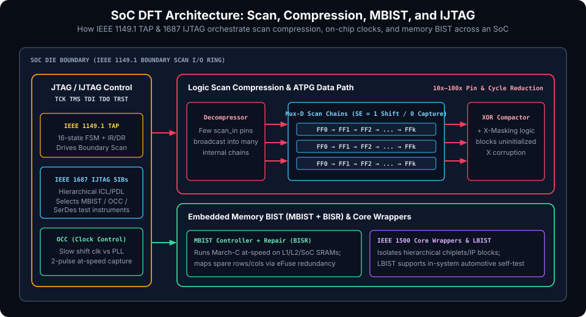
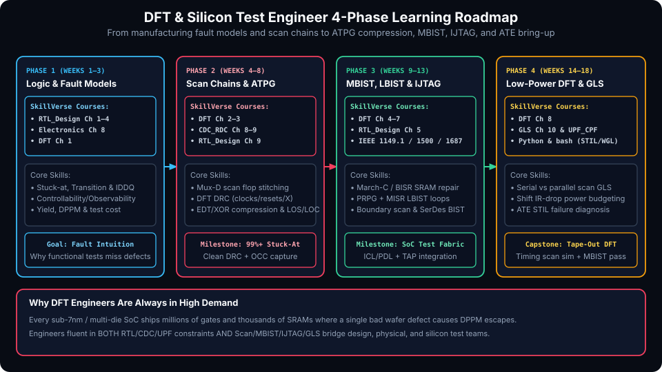

# DFT and Silicon Test Engineer Learning Pathway

## Learning Goals

After completing this pathway chapter, you should be able to:

- Explain why functional simulation alone cannot detect physical wafer manufacturing defects and how DFT keeps DPPM (Defective Parts Per Million) low.
- Navigate a 4-phase SkillVerse roadmap covering fault modeling, scan insertion, ATPG compression, MBIST/BISR, LBIST, IEEE 1149.1/1500/1687 IJTAG, and low-power scan GLS.
- Sketch how JTAG TAP, IJTAG SIB networks, On-Chip Clock (OCC) controllers, scan decompressors/compactors, and MBIST engines integrate across an SoC.
- Bridge RTL designers, physical implementation, and Automated Test Equipment (ATE) bring-up teams using Python/Bash pattern automation.

---

## Why DFT Is Critical to Modern Silicon Yield

Even if your RTL is 100% bug-free functionally, nanometer silicon fabrication introduces microscopic manufacturing flaws: open vias, metal shorts, resistive bridges, and SRAM bitcell defects. Shipping untested or poorly tested dies leads to catastrophic field failures (especially in automotive, datacenter, and aerospace silicon).

**Design for Testability (DFT)** inserts specialized test structures directly into the chip architecture so high-speed **Automated Test Equipment (ATE)** can structurally test billions of transistors and thousands of SRAM instances in fractions of a second per die.

---

## Phase-by-Phase SkillVerse Study Plan

Follow this four-phase sequence (14–18 weeks) wired directly to SkillVerse's dedicated `DFT`, `GLS`, `CDC_RDC`, and `UPF_CPF` courses:

### Phase 1: Digital Logic, CMOS Physics & Manufacturing Fault Models (Weeks 1–3)

| Order | SkillVerse Resource | Core Concepts Mastered |
| :---: | :--- | :--- |
| 1 | [RTL Design Ch 1–4](../RTL_Design.md) | Synchronous flip-flops, clock trees, async vs. sync resets, tristates |
| 2 | [Electronics Ch 8: MOSFETs](../Electronics/chapter_00008.md) | Physical CMOS switching, resistive opens/shorts, timing degradation |
| 3 | [DFT Ch 1: Fault Modeling](../DFT/chapter_00001.md) | Stuck-at (0/1), transition delay, path-delay, bridging, IDDQ, yield & DPPM |

### Phase 2: Scan Architecture, Compression & ATPG (Weeks 4–8)

Converting sequential flip-flops into shiftable **scan chains** transforms hard sequential testing into tractable combinational **Automatic Test Pattern Generation (ATPG)**.

| Order | SkillVerse Resource | Core Concepts Mastered |
| :---: | :--- | :--- |
| 1 | [DFT Ch 2: Scan Insertion](../DFT/chapter_00002.md) | Mux-D scan cells, `SE` vs. `SI`/`SO`, lockup latches across clock skew domains |
| 2 | [CDC / RDC Ch 8–9](../CDC_RDC.md) | Handling async set/reset muxes (`scan_rst_bypass`), clock-gating test mode overrides |
| 3 | [DFT Ch 3: ATPG & Compression](../DFT/chapter_00003.md) | EDT/XOR decompressors & compactors, X-masking, Launch-on-Shift (LOS) vs. Launch-on-Capture (LOC) |
| 4 | [RTL Design Ch 9: Synthesis & STA](../RTL_Design/chapter_00009.md) | Shift-mode vs. functional-mode SDC timing constraints |

### Phase 3: Embedded Memory BIST, LBIST & IEEE Test Standards (Weeks 9–13)

Modern SoCs devote 50%–70% of die area to SRAMs, which cannot be tested efficiently through external logic scan chains alone.

| Order | SkillVerse Resource | Core Concepts Mastered |
| :---: | :--- | :--- |
| 1 | [DFT Ch 4: MBIST & BISR](../DFT/chapter_00004.md) & [RTL Design Ch 5](../RTL_Design/chapter_00005.md) | March-C/March-SS algorithms, Built-In Self-Repair (BISR) row/col redundancy & eFuses |
| 2 | [DFT Ch 5: LBIST & At-Speed Test](../DFT/chapter_00005.md) | PRPG + MISR pseudo-random BIST, On-Chip Clock (OCC) PLL at-speed pulse control |
| 3 | [DFT Ch 6: IEEE 1149.1, 1500 & 1687](../DFT/chapter_00006.md) | JTAG TAP 16-state FSM, IEEE 1500 core wrappers, IEEE 1687 IJTAG SIB networks (ICL/PDL) |
| 4 | [DFT Ch 7: Analog, IO & SerDes Test](../DFT/chapter_00007.md) | IEEE 1149.6 AC-coupled boundary scan, SerDes PRBS loopback BIST |

### Phase 4: Low-Power DFT, Scan GLS Verification & ATE Sign-Off (Weeks 14–18)

| Order | SkillVerse Resource | Core Concepts Mastered |
| :---: | :--- | :--- |
| 1 | [DFT Ch 8: SoC DFT & Physical Sign-Off](../DFT/chapter_00008.md) | Hierarchical chip-level DFT stitching, shift IR-drop power limits, physical scan reordering |
| 2 | [UPF / CPF Ch 1–5, 9](../UPF_CPF.md) | Power-aware DFT (keeping `ISO`/`AO` scan control live across switched domains) |
| 3 | [GLS Ch 10: DFT, Scan, ATPG & MBIST GLS](../GLS/chapter_00010.md) | Serial vs. parallel scan load simulation, OCC capture checks, zero-X shift sign-off |
| 4 | [Python Ch 1–4, 7](../Python.md) & [Bash Ch 1–6](../bash.md) | Automating STIL/WGL pattern conversion, fault-coverage parsing, and wafer failure triage |

---

## Core DFT Pillars Across an SoC

| DFT Pillar | Target Silicon Structure | Key Sign-Off Metric |
| :--- | :--- | :--- |
| **Scan + ATPG** | Standard-cell flip-flops & combinational cones | ≥ 99% stuck-at coverage; ≥ 90–95% transition at-speed coverage |
| **MBIST + BISR** | Compiled single/dual-port SRAMs & register files | 100% memory instance coverage + redundancy fuse verification |
| **LBIST** | Safety-critical logic (e.g., ISO 26262 automotive) | Power-on & key-off diagnostic coverage within latency budget |
| **Boundary Scan & IJTAG** | Chip I/O pads & hierarchical test instruments | Clean `EXTEST`/`INTEST` & valid ICL/PDL connectivity across SIBs |

> [!IMPORTANT]
> **Why DFT Must Be Designed Into RTL From Day 1:** Uncontrolled internal tri-state buses, combinational feedback loops, internally generated clocks/resets without `test_mode` bypass muxes, and latches block scan stitching and cause severe ATPG coverage drops. Reviewing DFT DRC rules early saves painful pre-tape-out ECOs.

---

## Practical DFT Skills, Scripting, and Verification Workflow

Even without commercial ATPG suites (Tessent, DFTMAX/TetraMAX, Modus) on your laptop, you can build deeply relevant skills using open-source tools and SkillVerse labs:

1. **Implement a Complete IEEE 1149.1 JTAG TAP Controller in SystemVerilog**: Code the 16-state TAP FSM, `BYPASS`, `IDCODE`, and custom `DR` shift registers, and verify all state transitions using [Formal Verification](../Formal_Verification.md) and [cocotb](../Python/chapter_00007.md).
2. **Build a Toy Scan-Chain & Lockup-Latch Demo**: Stitch parameterized Mux-D flip-flops across two clock edges, simulate serial `shift_en=1` → 1-cycle `capture` → serial `shift_out`, and observe why a falling-edge lockup latch prevents hold races between clock domains ([DFT Ch 2](../DFT/chapter_00002.md)).
3. **Model a March-C MBIST FSM**: Design an RTL memory-test state machine generating ascending/descending `w0/r0/w1/r1` passes against a fault-injected SRAM behavioral model ([DFT Ch 4](../DFT/chapter_00004.md)).
4. **Master Python/Tcl/Bash Log Parsing**: Real DFT engineers spend huge amounts of time scripting DRC triage, parsing ATPG coverage reports, and automating `GLS` serial/parallel simulation regressions ([GLS Ch 10](../GLS/chapter_00010.md)).

---

## Common DFT Pitfalls and Career Progression

- **Pitfall 1 — Exceeding Power Limits During Scan Shift**: Functional logic rarely toggles 50% of chip flops simultaneously, but shifting random ATPG vectors can trigger massive simultaneous switching (`IR-drop`), destroying real silicon during wafer test! Learn shift-power gating and low-power ATPG ([DFT Ch 8](../DFT/chapter_00008.md)).
- **Pitfall 2 — Skipping Timing-Annotated Serial Scan GLS**: Parallel-load scan simulations (`force` backdoor into chains) skip the shift path completely and miss hold violations along scan chains—always verify timing-annotated serial patterns ([GLS Ch 10](../GLS/chapter_00010.md)).
- **Pitfall 3 — Unmasked `X`-Generators Corrupting XOR Compactors**: Non-scan memories or uninitialized analog macros feeding combinational logic can turn an entire compactor signature into `X`. Learn X-bounding and observation points ([DFT Ch 3](../DFT/chapter_00003.md)).

### Career Growth Trajectory
**DFT Implementation Engineer** (scan/MBIST insertion, DRC, ATPG) → **SoC DFT Lead** (IJTAG, OCC, compression architecture, UPF-DFT, scan GLS closure) → **Silicon Test / Yield Architect** (ATE bring-up, shmoo plots, DPPM optimization, chiplet UCIe/3D-IC test).

---

## Readiness Self-Check

- [ ] Can you explain the structural difference between a **stuck-at** fault and a **transition delay** fault, and why Launch-on-Capture (LOC) requires an OCC?
- [ ] Why does a scan chain crossing between `clk_A` and `clk_B` require a **lockup latch**?
- [ ] How does scan compression (decompressor + XOR compactor) maintain high fault coverage while reducing tester pin count and test time?
- [ ] What is the difference between **IEEE 1149.1 (JTAG)** and **IEEE 1687 (IJTAG)**, and why do hierarchical SoCs rely on SIBs (Segment Insertion Bits)?
- [ ] Why do **serial** vs. **parallel** scan GLS simulations test completely different failure modes?

##### Copyright (c) 2026 squared-studio
