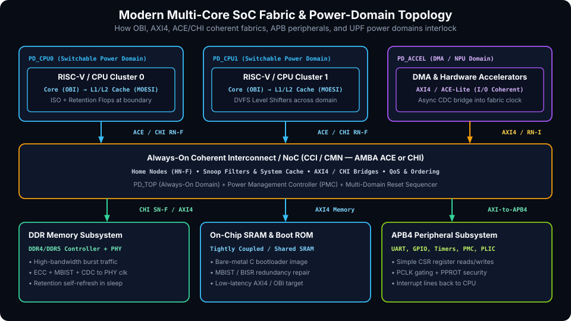
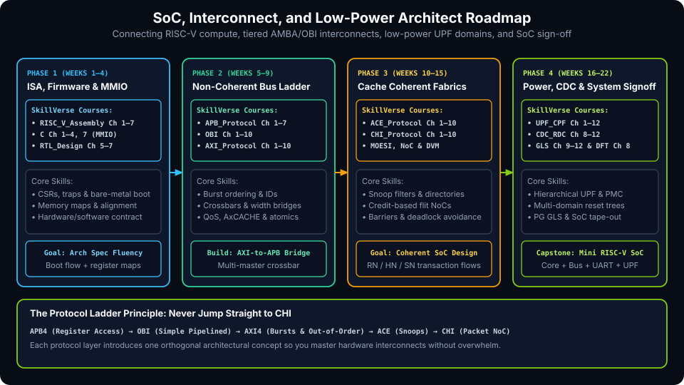

# SoC, Interconnect, and Low-Power Architect Learning Pathway

## Learning Goals

After completing this pathway chapter, you should be able to:

- Transition from single-block IP design/verification into full-chip SoC integration, memory-map design, and hardware/software co-architecture.
- Climb SkillVerse's five-step interconnect ladder cleanly: `APB4` → `OBI` → `AXI4` → `ACE` → `CHI`.
- Design multi-domain power intent (`UPF`/`CPF`), multi-clock/reset architectures (`CDC_RDC`), and full-chip power/gate-level verification (`GLS`).
- Connect bare-metal `C` firmware and `RISC-V` trap/interrupt flows directly to SoC bus transactions and power management sequencers.

---

## From Block Engineer to SoC Architect

Building an isolated UART or FIFO exercises local RTL mechanics. Designing a modern **System-on-Chip (SoC)** requires orchestrating dozens of heterogeneous blocks—multi-core CPUs, coherent caches, high-bandwidth DMA/AI accelerators, DDR memory controllers, and low-speed peripherals—across independent clock frequencies, reset trees, and switchable voltage/power domains.

---

## Phase-by-Phase SkillVerse Study Plan

This advanced 4-phase track (18–22 weeks) builds on foundational RTL or DV fluency (complete [Chapter 2](chapter_00002.md) or [Chapter 3](chapter_00003.md) Phases 1–2 first):

### Phase 1: Processor ISA, Bare-Metal C & Hardware/Software Contract (Weeks 1–4)

Every SoC architect understands both sides of the register boundary: what hardware executes and what firmware boots.

| Order | SkillVerse Resource | Core Concepts Mastered |
| :---: | :--- | :--- |
| 1 | [RISC-V Assembly Ch 1–5](../RISC_V_Assembly.md) | RV32I/RV64I encoding, load/store addressing, ABI calling conventions |
| 2 | [RISC-V Assembly Ch 6–7](../RISC_V_Assembly.md) | Atomics (`A` ext), privileged modes (M/S/U), CSRs, trap vectors, boot sequence |
| 3 | [C Ch 4, 7](../C.md) | Struct memory alignment, `volatile` MMIO registers, bare-metal interrupt handlers |
| 4 | [RTL Design Ch 5–7](../RTL_Design.md) | Memory hierarchy, pipelining hazards, arbitration & backpressure |

### Phase 2: The Non-Coherent Interconnect Ladder (Weeks 5–9)

Master register, core-local, and high-throughput burst fabrics before tackling cache coherency.

| Order | SkillVerse Resource | Core Concepts Mastered |
| :---: | :--- | :--- |
| 1 | [APB Protocol Ch 1–7](../APB_Protocol.md) | Low-power register access (`PSEL`/`PENABLE`/`PREADY`/`PPROT`), peripheral wrapping |
| 2 | [OBI Protocol Ch 1–10](../OBI.md) | Pipelined RISC-V core bus, multiple outstanding transactions, atomics (`ATOP`), ID routing |
| 3 | [AXI Protocol Ch 1–10](../AXI_Protocol.md) | 5 decoupled channels, `INCR`/`WRAP` bursts, out-of-order IDs, `AxCACHE`/`AxQOS`, AXI-to-APB |
| 4 | [UART Protocol Ch 8, 10](../UART_Protocol.md) | Wrapping real peripherals with DMA, interrupt watermarks, and APB/AXI registers |

### Phase 3: Hardware Cache Coherency & Packetized NoCs (Weeks 10–15)

Multi-core clusters sharing memory with I/O accelerators cannot rely on software cache flushing alone—they require **hardware cache coherency**.

| Order | SkillVerse Resource | Core Concepts Mastered |
| :---: | :--- | :--- |
| 1 | [ACE Protocol Ch 1–5](../ACE_Protocol.md) | Memory wall, MOESI vs. MESI states, shareability domains, coherent reads |
| 2 | [ACE Protocol Ch 6–10](../ACE_Protocol.md) | Snoop channels (`AC`/`CR`/`CD`), barriers, DVM TLB shootdowns, `ACE-Lite` I/O coherency, CCI |
| 3 | [CHI Protocol Ch 1–5](../CHI_Protocol.md) | Layered packetized Network-on-Chip (NoC), `RN`/`HN`/`SN` nodes, credit flow control, DDT |
| 4 | [CHI Protocol Ch 6–10](../CHI_Protocol.md) | Coherent writes, snoop filters, retry/QoS deadlock avoidance, protocol verification |

### Phase 4: Multi-Domain Power, Reset, and Full-Chip Sign-Off (Weeks 16–22)

| Order | SkillVerse Resource | Core Concepts Mastered |
| :---: | :--- | :--- |
| 1 | [UPF / CPF Low-Power Design Ch 1–12](../UPF_CPF.md) | Power domains, Power State Tables (PST), isolation, level shifters, retention, PMC sequencing |
| 2 | [CDC / RDC Ch 8–12](../CDC_RDC.md) | Multi-domain reset distribution, RDC isolation, formal CDC, full-chip SDC exceptions |
| 3 | [GLS Ch 9–12](../GLS.md) & [DFT Ch 8](../DFT/chapter_00008.md) | Power-Ground (PG) netlist GLS, wake-up rush current, hierarchical DFT + UPF integration |

---

## Protocol Progression from Register Buses to Coherent Fabrics

| Protocol | Topology & Primary Role | Ordering & Concurrency Model | Key Architectural Concept Learned |
| :--- | :--- | :--- | :--- |
| **APB4** | Low-speed peripheral CSRs | Single non-pipelined transfer | Clean 2-cycle `SETUP`/`ACCESS` slave interface |
| **OBI** | RISC-V instruction/data ports | Pipelined Req/Resp with `aid` | Separating address request phase from response completion |
| **AXI4** | High-throughput SoC backbone | 5 decoupled channels + `ID` tags | Burst math, out-of-order completion, `AxCACHE`/`AxQOS` |
| **ACE** | Multi-cluster coherent snooping | AXI4 + 3 snoop channels (`AC`/`CR`/`CD`) | MOESI state transitions, barriers, and DVM messages |
| **CHI** | Flagship many-core NoCs | Packetized flit channels + link credits | `RN-F`/`HN-F`/`SN-F` directory scaling without bus bottlenecks |

> [!TIP]
> **Why `ACE` Before `CHI` Matters:** `ACE` builds directly on `AXI4` channels you already know, teaching MOESI coherency, snooping races, and DVM in concrete bus signals. Once `ACE` clicks, `CHI`'s packetized Network-on-Chip (`REQ`/`RSP`/`SNP`/`DAT` flits and credit flow control) becomes immediately intuitive.

---

## System-Level Sign-Off and HW/SW Bring-Up

At the SoC level, bugs frequently occur **between** cleanly verified IP blocks:

- **Address-Map & Firewall Mismatches**: A master issuing unaligned bursts or `DECERR` to an unmapped hole without an interconnect default slave hangs the bus permanently unless error handling is verified ([AXI Ch 6](../AXI_Protocol/chapter_00006.md), [OBI Ch 8](../OBI/chapter_00008.md)).
- **Power-Up / Wake-Up Deadlocks**: Asserting isolation *after* dropping power or releasing reset before the PLL locks corrupts retention registers—only caught in [UPF Ch 8–9](../UPF_CPF/chapter_00008.md) and [PG GLS (GLS Ch 9)](../GLS/chapter_00009.md).
- **Hardware/Software Boot Co-Simulation**: Running a bare-metal C startup (`crt0.s` + UART `printf` + timer IRQ) on your RTL subsystem proves the bus fabric, memory map, endianness, and interrupt router actually work together.

---

## Capstone SoC Architecture Exercises

1. **Design an AXI4-to-APB4 Protocol Bridge**: Handle 32-bit/64-bit width alignment, `INCR` burst splitting into sequential APB4 transfers, and `PSLVERR` → `SLVERR` error translation ([AXI Ch 10](../AXI_Protocol/chapter_00010.md), [APB Ch 7](../APB_Protocol/chapter_00007.md)).
2. **Architect a Multi-Domain Power State Table (PST)**: Given `PD_TOP` (always-on `0.8V`), `PD_CPU` (switchable `0.8V`/`0.6V` DVFS + retention), and `PD_ACCEL` (switchable `0.8V`/OFF), specify every required **Isolation cell**, **Level Shifter**, and **Power Management Controller (PMC)** handshake step ([UPF_CPF Ch 4–8](../UPF_CPF.md)).
3. **Trace a Coherent Read-Dirty Hit End-to-End**: Step through both **AMBA ACE** (`ReadShared` → `AC` snoop → `CR` + `CD` dirty transfer) and **AMBA 5 CHI** (`ReadShared` → `HN-F` snoop filter → `SnpShared` → Direct Data Transfer) ([ACE Ch 5](../ACE_Protocol/chapter_00005.md), [CHI Ch 5](../CHI_Protocol/chapter_00005.md)).
4. **Integrate a Minimal RISC-V Subsystem**: Wire an `OBI` or `AXI4-Lite` RV32I core to on-chip SRAM, a boot ROM, and an `APB4` UART running a bare-metal C greeting compiled via `riscv64-unknown-elf-gcc`.

---

## Readiness Self-Check

- [ ] Can you articulate why `AXI4` enforces in-order completion *within* the same `AxID` while allowing out-of-order completion *across* distinct `AxID` values?
- [ ] Why does `ACE` introduce the **Owned (`O`)** cache state over `MESI`, and what memory bandwidth benefit does it unlock?
- [ ] In `UPF`, what is the difference between an **isolation cell** and a **voltage level shifter**, and what happens when a domain has *both* switchable power and DVFS?
- [ ] Can you explain how a **Power Management Controller (PMC)** sequences clock gating, isolation clamping, state retention save, and power-switch shutdown in exact order?
- [ ] How does a **Home Node (`HN-F`)** snoop filter prevent unnecessary snoop broadcasts in a 64-core `CHI` mesh?

##### Copyright (c) 2026 squared-studio
