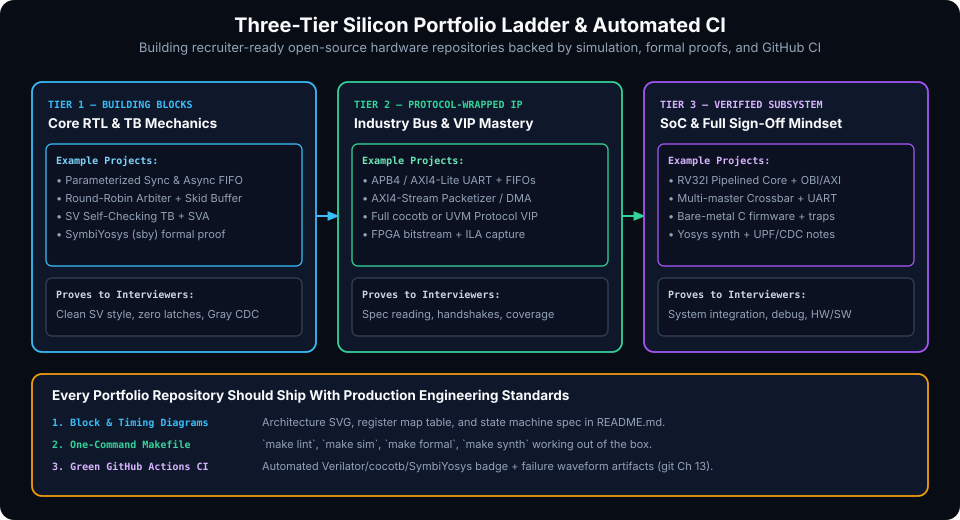
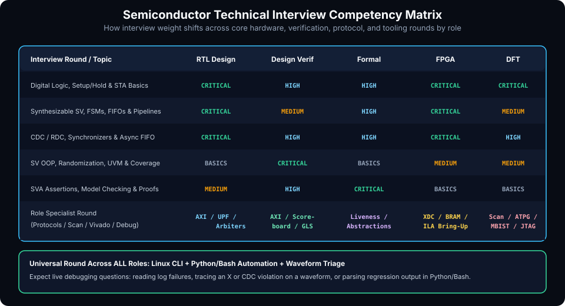

# Portfolio Projects, Open-Source Tooling, and Technical Interview Playbook

## Learning Goals

After completing this chapter, you should be able to:

- Set up a zero-cost, professional open-source ASIC/FPGA verification and formal lab on Linux or WSL2.
- Structure three progressive tiers of GitHub portfolio repositories equipped with block diagrams, one-command `Makefile` flows, and automated GitHub Actions CI.
- Prepare systematically for semiconductor interview rounds across RTL Design, Design Verification, Formal, FPGA, and DFT roles.
- Execute a concrete 12-week job-readiness sprint from foundational study to portfolio polish and mock technical interviews.

---

## The Free Open-Source Hardware Lab Stack

You do **not** need million-dollar commercial EDA licenses to build impressive, verifiable hardware engineering projects. Every tool below runs free on Ubuntu Linux, macOS, or Windows WSL2—and runs automatically in GitHub Actions CI ([Git Ch 13](../git/chapter_00013.md)):

| Category | Open-Source Tool | Replaces (Commercial Analog) | Related SkillVerse Course |
| :--- | :--- | :--- | :--- |
| **Linter & Formatter** | `verilator --lint-only -Wall`, `verible-verilog-lint` | SpyGlass Lint, Ascent Lint | [RTL Design Ch 3](../RTL_Design/chapter_00003.md) |
| **RTL Simulators** | **Verilator** (fast SV/C++), **Icarus Verilog** (`iverilog`) | VCS, Questa, Xcelium | [SystemVerilog](../SystemVerilog.md) |
| **Python Verification** | **`cocotb`** + `pytest` + `cocotb-coverage` | UVM (conceptual parity for open-source portfolios) | [Python Ch 7](../Python/chapter_00007.md) |
| **Formal Verification** | **Yosys + SymbiYosys (`sby`)** + Z3 / Bitwuzla / ABC | JasperGold, VC Formal | [Formal Verification Ch 4](../Formal_Verification/chapter_00004.md) |
| **Synthesis & FPGA** | **Yosys**, **nextpnr**, **AMD Vivado ML Standard (Free)** | Design Compiler, Genus | [Vivado](../Vivado.md) |
| **Waveform Viewers** | **GTKWave**, **Surfer** (`.fst` / `.vcd`) | Verdi, SimVision | [Unix Terminal](../Unix_Terminal.md) |
| **RISC-V Toolchain** | `riscv64-unknown-elf-gcc`, `qemu`, Spike | Commercial ISS / SDK | [RISC-V Assembly](../RISC_V_Assembly.md), [C](../C.md) |
| **Automation & CI** | GNU `Make` + **GitHub Actions** (`hdlc/sim:osflow`) | Custom LSF/Makefile regressions | [Makefile](../Makefile.md), [Git Ch 13](../git/chapter_00013.md) |

---

## Three-Tier Portfolio Project Blueprint

Hiring managers spend 30–60 seconds scanning a GitHub repository. A polished repo showing **one well-verified IP with clean diagrams, assertions, and green CI** beats ten half-finished university assignments every time.



### What Every Portfolio Repository Must Include

1. **Clear `README.md` with Architecture Diagram & Spec Table**: Draw clean block diagrams (SVG or Mermaid), register maps, timing diagrams, and explicit pass/fail verification goals.
2. **Modular File Layout**:
   ```text
   my-axi-uart/
   ├── .github/workflows/ci.yml   # Runs lint + sim + formal + synth automatically
   ├── docs/                      # Architecture diagrams & register map
   ├── rtl/                       # Clean SystemVerilog packages & modules
   ├── formal/                    # Bound SVA properties + .sby formal config
   ├── tb/                        # Self-checking SV / cocotb testbenches
   └── Makefile                   # Targets: lint, sim, formal, synth, clean
   ```
3. **One-Command Reproducibility**: Anyone cloning your repo should be able to run `make lint && make sim && make formal` with zero manual edits.
4. **Green CI Status Badge & Debug Artifacts**: Wire up GitHub Actions ([Git Ch 13](../git/chapter_00013.md)) to run Verilator lint, randomized `cocotb`/SV regressions, and SymbiYosys formal proofs on every PR—publishing a Markdown pass/fail table to `$GITHUB_STEP_SUMMARY` and uploading `.fst` waveforms on failure.

---

## Role-Specific Technical Interview Playbook

Semiconductor interviews test **first-principles hardware intuition**, **live coding**, and **systematic debugging** rather than memorized trivia. Use this matrix to weight your preparation time according to your target role:



### Classic High-Frequency Questions to Master Cold

1. **Setup, Hold & Clock Skew**: Write out both the setup and hold inequality equations. Which one is frequency-independent, and why is hold failure catastrophic in fabricated silicon? ([RTL Design Ch 2](../RTL_Design/chapter_00002.md), [Ch 9](../RTL_Design/chapter_00009.md))
2. **Valid/Ready Pipeline & Skid Buffer**: Given `in_valid`/`in_ready` and `out_valid`/`out_ready`, design a pipeline register stage that breaks *both* forward (`valid`/data) and backward (`ready`) combinational timing paths without dropping beats ([RTL Design Ch 7](../RTL_Design/chapter_00007.md)).
3. **CDC & Asynchronous FIFO Sizing**: Derive the minimum FIFO depth when write bursts run at `f_w` and read bursts drain at `f_r`, and explain why multi-bit Gray-code pointers prevent corruption across asynchronous clocks ([CDC_RDC Ch 5, 7](../CDC_RDC.md)).
4. **SystemVerilog Race & OOP/Randomization**: Trace the output of non-blocking (`<=`) vs. blocking (`=`) in an `always_ff` shift register; write a constrained-random packet class generating aligned AXI bursts not crossing a 4 KB boundary ([SystemVerilog Ch 16](../SystemVerilog/chapter_00016.md), [AXI Ch 4](../AXI_Protocol/chapter_00004.md)).
5. **UVM Flow & TLM**: Explain `build_phase` (top-down) vs. `connect_phase` (bottom-up), why sequences are `uvm_object`s rather than `uvm_component`s, and how `uvm_analysis_port` decouples monitors from scoreboards ([uvm Ch 2–5](../uvm.md)).
6. **SVA & Formal**: Distinguish `a |-> ##[1:3] b` from `a |=> b ##1 c`, and explain how `assume` over-constraints produce false green formal proofs ([Formal Ch 3, 8](../Formal_Verification.md)).

---

## 12-Week Job-Readiness Execution Plan

If you already know basic programming or digital logic and want a disciplined sprint toward internships or full-time interviews:

| Sprint Window | Focus Area | Concrete Deliverable |
| :--- | :--- | :--- |
| **Weeks 1–2** | Phase 0 Linux, Git, `Makefile`, Digital Logic | Set up WSL2/Linux lab (`verilator`, `sby`, `cocotb`), finish [Chapter 1](chapter_00001.md) foundations |
| **Weeks 3–5** | Track Core (RTL / DV / Formal / FPGA / DFT) | Complete Phases 1–2 of your chosen pathway + ship **Tier 1 Repo** (Sync/Async FIFO or Arbiter) |
| **Weeks 6–8** | Protocols & Verification Depth | Study `APB` + `AXI4` (or `DFT`/`Vivado`), ship **Tier 2 Repo** (Protocol IP or VIP + Formal + GitHub CI) |
| **Weeks 9–10** | Sign-Off Fluency (`CDC_RDC`, `UPF_CPF`, `GLS`) | Master metastability, low-power isolation/retention, and X-prop/SDF timing debug concepts |
| **Weeks 11–12** | Interview Drills & Resume Polish | Timed whiteboard coding (SV/Python), waveform triage drills, 3-minute project walkthroughs |

---

## Resume, GitHub Profile, and Demo Standards

- **Lead With Quantifiable Engineering Impact**: Instead of *"Wrote UART in Verilog"*, write *"Designed parameterized APB4 UART controller with 16-entry Gray-code async RX/TX FIFOs; achieved 100% functional & SVA protocol coverage in `cocotb`/Verilator and proved FIFO invariants via SymbiYosys IC3 in GitHub Actions CI."*
- **Pin Your Top 3 Repositories on GitHub**: Include a clean GitHub profile README showcasing architecture diagrams, waveform screenshots, and live CI badges.
- **Prepare a 3-Minute Project Walkthrough**: For every project on your resume, be ready to answer:
  1. *What block architecture and interfaces did you choose and why?*
  2. *What was the hardest bug you hit, and how did waveforms/assertions/formal catch it?*
  3. *What would break if you scaled frequency 2x or added a second clock/power domain?*

---

## Final Action Checklist

- [ ] Bookmarked your primary pathway ([Ch 2 RTL](chapter_00002.md), [Ch 3 DV](chapter_00003.md), [Ch 4 Formal](chapter_00004.md), [Ch 5 FPGA](chapter_00005.md), [Ch 6 DFT](chapter_00006.md), or [Ch 7 SoC](chapter_00007.md)) and completed Phase 0 setup.
- [ ] Installed open-source tooling locally (`verilator`, `iverilog`, `yosys`, `sby`, `cocotb`, `gtkwave`).
- [ ] Built and published at least one **Tier 1** and one **Tier 2** hardware/verification repository with clean diagrams, `Makefile`, and green GitHub Actions CI.
- [ ] Practiced timed whiteboard exercises covering timing equations, valid/ready skid buffers, async FIFOs, SV constraints, and role-specific sign-off flows.

##### Copyright (c) 2026 squared-studio
