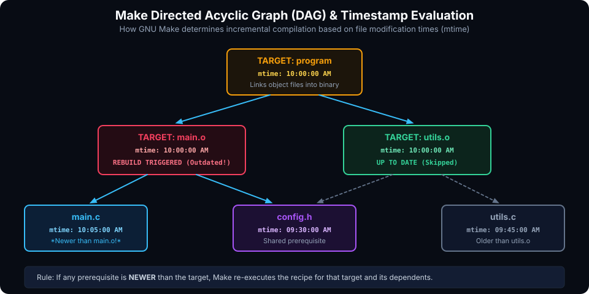

# Introduction to GNU Make & Build Automation

## Introduction: The Philosophy of Incremental Builds

In software development, systems programming, and hardware verification, projects rarely consist of a single isolated source file. Modern codebases span hundreds or thousands of translation units (`.c`, `.cpp`), header files (`.h`), assembly routines (`.s`), linker scripts (`.ld`), and test harnesses.

Compiling every single source file from scratch whenever a minor change is made is intolerably slow. If a project takes 30 minutes to compile, a developer cannot wait half an hour for each one-line bug fix.

**GNU Make** solves this problem through **declarative dependency tracking and incremental compilation**:
- It tracks the relationships between source files, intermediate object files, and final binaries as a **Directed Acyclic Graph (DAG)**.
- It compares the filesystem **modification timestamps (`mtime`)** of targets against their prerequisites.
- It executes *only* the specific compiler and linker commands necessary to bring outdated targets up to date, skipping unchanged modules entirely.

Created in 1976 by **Stuart Feldman** at Bell Labs, Make remains the foundational build automation engine powering Linux kernel builds, embedded toolchains, GCC/Clang development, and modern build system generators like CMake.

---

## The Core Mental Model: DAGs & Timestamp Evaluation

Make does not execute commands sequentially from top to bottom like a shell script. Instead, it constructs a dependency graph in memory and evaluates timestamps.



### The Timestamp Comparison Rule
For any given rule:
```makefile
target: prerequisites
	recipe
```

Make queries the filesystem for the `mtime` of the `target` and all of its `prerequisites`:
1. **If the target does not exist**, the recipe is executed immediately.
2. **If any prerequisite is NEWER than the target**, Make concludes that the target is stale and executes the recipe.
3. **If the target is NEWER than all prerequisites**, Make prints `make: 'target' is up to date.` and skips compilation.

---

## Basic Syntax & The Infamous Tab Pitfall

A Makefile is composed of one or more **Rules**. The canonical structure is:

```makefile
target ... : prerequisites ...
	recipe
	...
```

- **Target**: Usually the name of a file generated by a program (e.g. executable or `.o` object file), or the name of an action to carry out (like `clean`).
- **Prerequisites**: Files used as inputs to create the target. A target often depends on several files.
- **Recipe**: One or more shell command lines that create or update the target.

> [!WARNING]
> **The Infamous Tab Trap**:
> Every recipe line **MUST begin with a literal Tab character (`\t`)**, NOT spaces! If you use spaces, Make will fail with the cryptic error:
> ```text
> Makefile:4: *** missing separator.  Stop.
> ```
> To verify if your editor inserted tabs or spaces, inspect the file with `cat`:
> ```bash
> cat -e -t -v Makefile
> ```
> Tabs appear as `^I`, while spaces appear as normal spaces.

---

## A Complete Minimal C Makefile Walkthrough

Let us inspect a standard Makefile for a project with `main.c`, `utils.c`, and a shared header `utils.h`:

```makefile
# 1. Compiler and Flag Definitions
CC = gcc
CFLAGS = -Wall -Wextra -O2

# 2. Default Target (The first rule encountered)
all: program

# 3. Linking Stage: Combines object files into an executable
program: main.o utils.o
	$(CC) $(CFLAGS) -o program main.o utils.o

# 4. Compilation Stages: Compiles individual source files into object files
main.o: main.c utils.h
	$(CC) $(CFLAGS) -c main.c -o main.o

utils.o: utils.c utils.h
	$(CC) $(CFLAGS) -c utils.c -o utils.o

# 5. Phony Clean Target: Removes generated artifacts
.PHONY: clean
clean:
	rm -f program main.o utils.o
```

### Execution Flow Step-by-Step:

1. You run `make` in your terminal.
2. Make searches for a file named `GNUmakefile`, `makefile`, or `Makefile`.
3. It finds `all` as the first rule (the **Default Goal**). `all` depends on `program`.
4. `program` depends on `main.o` and `utils.o`.
5. Make navigates down the DAG to `main.o`, sees that `main.o` depends on `main.c` and `utils.h`. If `main.o` does not exist, it runs `gcc -Wall -Wextra -O2 -c main.c -o main.o`.
6. Make repeats this for `utils.o`.
7. Once all prerequisites are satisfied, Make returns to the `program` rule and runs `gcc -Wall -Wextra -O2 -o program main.o utils.o`.

---

## Simple Hands-On Exercise

### The Problem
You have two source files in a directory:
- `main.c`: Contains the `main()` function and calls `calculate()`.
- `calc.c`: Implements the `calculate()` math function.
- `calc.h`: Declares the `calculate()` prototype.

Write a Makefile that:
1. Defines variables for compiler (`gcc`) and compilation flags (`-Wall -g`).
2. Compiles `main.c` and `calc.c` separately into `.o` files.
3. Ensures that if `calc.h` is modified, both object files are recompiled.
4. Links the object files into an executable named `calculator`.
5. Includes a `.PHONY` target `clean` to remove compiled binaries and objects.

### The Solution

```makefile
# Compiler setup
CC = gcc
CFLAGS = -Wall -g

# Default goal
all: calculator

# Linking
calculator: main.o calc.o
	$(CC) $(CFLAGS) -o calculator main.o calc.o

# Compiling objects (with header dependency)
main.o: main.c calc.h
	$(CC) $(CFLAGS) -c main.c -o main.o

calc.o: calc.c calc.h
	$(CC) $(CFLAGS) -c calc.c -o calc.o

# Cleanup
.PHONY: clean
clean:
	rm -f calculator main.o calc.o
```

---

## Review Questions & Self-Assessment

1. **How does GNU Make decide whether a target needs to be rebuilt?**
   *Answer:* It compares the filesystem modification timestamp (`mtime`) of the target against the timestamps of all its prerequisites. If any prerequisite is newer than the target, or if the target does not exist, the recipe is executed.
2. **What causes the `*** missing separator. Stop.` error in Make?**
   *Answer:* A recipe command line begins with spaces instead of a literal Tab character (`\t`).
3. **What is the Default Goal in a Makefile?**
   *Answer:* The Default Goal is the first target encountered in the Makefile whose name does not start with a period (`.`). It is the target executed when running `make` with no command-line arguments.
4. **Why is declaring `.PHONY: clean` important?**
   *Answer:* If a physical file or directory named `clean` ever exists on disk in the same directory, Make would see that the file exists and has no prerequisites, concluding that `clean` is "up to date" and refusing to run the cleanup recipe. Declaring it `.PHONY` forces Make to run the recipe unconditionally.

---

##### Copyright (c) 2026 squared-studio
