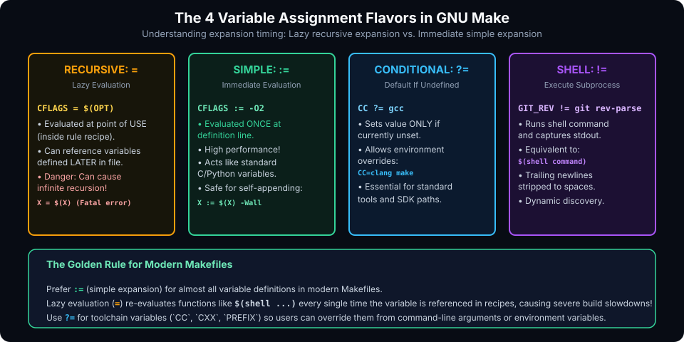

# Variables and Functions in GNU Make

## Introduction

As codebases expand across multiple directories with varying compilation flags, hardcoding filenames and tool paths directly into rules becomes unmaintainable. In GNU Make, **Variables** provide clean parameterization, while **Functions** enable dynamic text manipulation, pattern transformation, and shell command integration.

Understanding Make variables requires unlearning how variables work in standard procedural languages (like Python or C). In Make, variables operate primarily via text substitution, and the choice of assignment operator dictates **when** and **how often** that substitution is evaluated.

This chapter covers:
1. **The 4 Variable Assignment Flavors (`=`, `:=`, `?=`, `+=`, `!=`)**.
2. **Target-Specific Variable Values**.
3. **Built-in String & Filename Transformation Functions**.
4. **Conditional Directives (`ifeq`, `ifneq`, `ifdef`)**.
5. **Hands-On Exercises & Review Questions**.

---

## The 4 Variable Assignment Flavors

GNU Make features two primary variable categories—**recursively expanded** and **simply expanded**—governed by their assignment operator:



### 1. Recursively Expanded Variables (`=`)

Defined using a single equals sign. Evaluation is **deferred (lazy)** until the variable is actually used in a rule recipe:

```makefile
FOO = $(BAR)
BAR = hello

all:
	@echo $(FOO)   # Outputs: hello
```
Even though `BAR` was defined *after* `FOO`, Make expands `$(FOO)` at point of use.

> [!CAUTION]
> **Infinite Recursion Hazard**:
> Because `=` expands lazily, attempting to append to a variable like `CFLAGS = $(CFLAGS) -O2` creates an infinite recursive loop, crashing Make with `*** Recursive variable 'CFLAGS' references itself (eventually). Stop.`.

### 2. Simply Expanded Variables (`:=` or `::=`)

Defined using `:=`. The right-hand side is **evaluated immediately** at the exact line of definition, behaving like variables in standard programming languages:

```makefile
OPT := -O2
CFLAGS := $(OPT) -Wall
OPT := -O3

all:
	@echo $(CFLAGS)   # Outputs: -O2 -Wall (NOT -O3!)
```

Self-referential appending is safe with `:=`:
```makefile
CFLAGS := $(CFLAGS) -Wextra   # Safe!
```

> [!TIP]
> **Modern Best Practice**: Default to using `:=` for almost all variable definitions in modern Makefiles. Lazy evaluation (`=`) forces Make to re-evaluate expressions and shell calls every time the variable is mentioned, degrading build performance.

### 3. Conditional Assignment (`?=`)

Sets a variable **only if it has not already been defined** (either earlier in the Makefile, as an environment variable, or passed via the command line):

```makefile
CC ?= gcc
PREFIX ?= /usr/local
```
If a user runs `CC=clang make`, Make respects `clang` and skips the `gcc` default assignment.

### 4. Appending (`+=`) & Shell Assignment (`!=`)

- **Appending (`+=`)**: Adds text to the existing variable value, inserting a space between previous contents and the new string:
  ```makefile
  CFLAGS := -Wall
  CFLAGS += -Wextra -O2   # Value is now: -Wall -Wextra -O2
  ```
- **Shell Assignment (`!=`)**: Executes a shell command and captures its standard output into the variable, stripping trailing newlines:
  ```makefile
  GIT_COMMIT != git rev-parse --short HEAD
  # Equivalent to using the $(shell ...) function:
  GIT_COMMIT := $(shell git rev-parse --short HEAD)
  ```

---

## Target-Specific Variable Values

Target-specific variables allow you to customize flags or settings exclusively for a specific target and its prerequisites:

```makefile
# Default compilation flags
CFLAGS := -Wall -O2

# Debug target adds extra debug flags only during debug builds
debug: CFLAGS += -g -O0 -DDEBUG
debug: all

all: main.o utils.o
	$(CC) $(CFLAGS) -o app $^
```
When running `make debug`, `CFLAGS` contains `-Wall -O2 -g -O0 -DDEBUG`. When running standard `make all`, it contains only `-Wall -O2`.

---

## Built-in Functions in GNU Make

Functions are invoked using the syntax `$(function-name arguments)`.

### 1. String Manipulation Functions

#### Substitution: `$(subst from,to,text)`
Replaces all exact occurrences of `from` with `to`:
```makefile
$(subst .c,.o,main.c utils.c)   # Output: main.o utils.o
```

#### Pattern Substitution: `$(patsubst pattern,replacement,text)`
Uses `%` as a wildcard stem:
```makefile
SRCS := src/main.c src/utils.c
OBJS := $(patsubst src/%.c, build/%.o, $(SRCS))
# Output: build/main.o build/utils.o
```

#### Substitution Reference Shorthand:
```makefile
SRCS := main.c utils.c
OBJS := $(SRCS:.c=.o)   # Equivalent to $(patsubst %.c,%.o,$(SRCS))
```

#### Filtering: `$(filter pattern...,text)` and `$(filter-out pattern...,text)`
```makefile
SOURCES := main.c utils.c test.c config.h
C_FILES := $(filter %.c, $(SOURCES))       # main.c utils.c test.c
PROD_FILES := $(filter-out test.c, $(C_FILES)) # main.c utils.c
```

### 2. Filename Functions

- `$(wildcard pattern...)` : Expands wildcards against actual files existing on disk.
  ```makefile
  SRCS := $(wildcard src/*.c)   # Discovers all .c files currently in src/
  ```
- `$(dir names...)` : Extracts the directory portion of each file path.
  ```makefile
  $(dir src/net/socket.c)       # Output: src/net/
  ```
- `$(notdir names...)` : Extracts the filename without directory path.
  ```makefile
  $(notdir src/net/socket.c)    # Output: socket.c
  ```

---

## Conditional Directives

Make supports conditionals evaluated during Makefile parsing:

```makefile
# Check if BUILD_TYPE is set to debug
ifeq ($(BUILD_TYPE), debug)
    CFLAGS := -g -O0 -DDEBUG
else
    CFLAGS := -O3 -DNDEBUG
endif

# Check if a variable is defined
ifdef SANITIZE
    CFLAGS += -fsanitize=address,undefined
    LDFLAGS += -fsanitize=address,undefined
endif
```

---

## Hands-On Exercise

### The Problem
Write a Makefile for a C project where:
1. `SRCS` discovers all `.c` files in the current directory using `$(wildcard)`.
2. `OBJS` converts the list of `.c` files to `.o` files using a substitution reference.
3. Supports a `DEBUG` variable: if `make DEBUG=1` is invoked, compile with `-g -O0`; otherwise compile with `-O2`.
4. Uses `$(shell)` to generate a compilation timestamp passed as a macro definition `-DBUILD_DATE="..."`.

### The Solution

```makefile
CC ?= gcc
SRCS := $(wildcard *.c)
OBJS := $(SRCS:.c=.o)
TARGET := myapp

# Conditional configuration
ifeq ($(DEBUG), 1)
    CFLAGS := -Wall -Wextra -g -O0
else
    CFLAGS := -Wall -Wextra -O2
endif

# Inject build timestamp
BUILD_DATE := $(shell date +"%Y-%m-%d_%H:%M:%S")
CFLAGS += -DBUILD_DATE=\"$(BUILD_DATE)\"

all: $(TARGET)

$(TARGET): $(OBJS)
	$(CC) $(CFLAGS) -o $@ $^

%.o: %.c
	$(CC) $(CFLAGS) -c $< -o $@

.PHONY: clean
clean:
	rm -f $(TARGET) $(OBJS)
```

---

## Review Questions & Self-Assessment

1. **What is the critical difference between `VAR = val` and `VAR := val`?**
   *Answer:* `VAR = val` is recursively expanded (lazy evaluation; evaluated every time `$(VAR)` is referenced in a rule). `VAR := val` is simply expanded (evaluated immediately at the line of definition).
2. **What happens if you run `CFLAGS = $(CFLAGS) -O2`?**
   *Answer:* Because `=` is recursively expanded, referencing `$(CFLAGS)` on the right side causes an infinite recursive evaluation loop when Make attempts to expand it, crashing Make.
3. **What is the difference between `$(wildcard *.c)` and simply `*.c` in variable assignment?**
   *Answer:* In a variable definition `SRCS = *.c`, the asterisk is not expanded immediately; it remains a literal `*.c` string until passed to a rule. `$(wildcard *.c)` queries the filesystem immediately and expands to the actual list of existing `.c` files.
4. **How do target-specific variables work?**
   *Answer:* Target-specific variables define variable values that apply strictly during the execution of a designated target and all its prerequisites (e.g. `debug: CFLAGS += -g`).

---

##### Copyright (c) 2026 squared-studio
