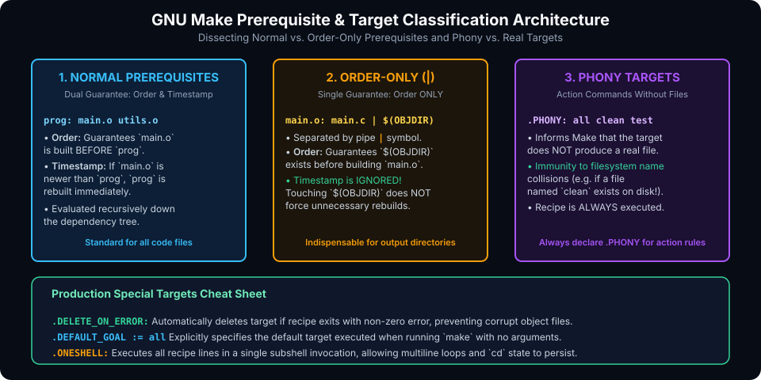

# Targets and Dependencies in GNU Make

## Introduction

At the heart of every Makefile is the relationship between **Targets** (what you want to build) and **Prerequisites** (what is required to build them). In naive Makefiles, developers treat all prerequisites identically and assume targets always correspond to physical files on disk.

In real-world engineering, this oversimplification leads to classic pitfalls:
- Directory prerequisites triggering unnecessary full-project rebuilds every time a file is created.
- File-naming collisions breaking `make clean`.
- Interrupted builds leaving corrupt, half-written object files on disk that break subsequent incremental compilations.

This chapter covers:
1. **Target Classification: Real Files vs. Phony Targets (`.PHONY`)**.
2. **Normal Prerequisites vs. Order-Only Prerequisites (`|`)**.
3. **Special Built-in Targets (`.DELETE_ON_ERROR`, `.DEFAULT_GOAL`, `.ONESHELL`)**.
4. **Multiple Rules for a Single Target**.
5. **Hands-On Exercises & Review Questions**.

---

## Prerequisite & Target Classification Architecture

GNU Make establishes a precise taxonomy of targets and prerequisites:



### 1. Real Targets vs. Phony Targets

- **Real Target**: Corresponds to an actual file on disk (such as `main.o` or `bin/app`). Make relies on filesystem `mtime` timestamps to determine whether to build it.
- **Phony Target**: Represents an action or label rather than a real file (e.g. `all`, `clean`, `test`, `install`).

> [!WARNING]
> **The Phony Target Collision**:
> If a developer creates a file or folder named `clean` in the project root:
> ```bash
> touch clean
> ```
> And you run `make clean`, Make will inspect the filesystem, see that the file `clean` already exists, has no prerequisites, and conclude:
> `make: 'clean' is up to date.` — **refusing to run your cleanup recipe!**

To prevent this collision, explicitly register action targets using the `.PHONY` special target:

```makefile
.PHONY: all clean test install

clean:
	rm -rf build bin
```

Now Make will execute `clean` unconditionally, regardless of what exists on disk.

---

## Normal vs. Order-Only Prerequisites

GNU Make supports two distinct categories of prerequisites:

### 1. Normal Prerequisites (`target: dep1 dep2`)
Imposes two guarantees:
1. **Order of Execution**: `dep1` and `dep2` are built before `target`.
2. **Timestamp Invalidation**: If `dep1` or `dep2` has a modification time (`mtime`) newer than `target`, `target` is marked stale and rebuilt.

### 2. Order-Only Prerequisites (`target: normal | order-only`)
Declared after a vertical pipe (`|`) symbol.
- **Order of Execution**: Guarantees that `order-only` prerequisites are created/updated before `target` is built.
- **Timestamp Invalidation**: **Make completely ignores the timestamp of order-only prerequisites!** Updating an order-only prerequisite will **never** cause `target` to be rebuilt.

### Why Order-Only Prerequisites Are Essential for Directories
When compiling objects into an output folder (e.g. `build/`), the directory must exist before `gcc -c ... -o build/main.o` runs:

#### The Naive Mistake (Normal Prerequisite):
```makefile
# BAD: build/ is a normal prerequisite
build/main.o: src/main.c build
	gcc -c $< -o $@

build:
	mkdir -p build
```
Whenever any file is created inside `build/`, the Linux kernel automatically updates the directory's `mtime`. Since `build` is now newer than `build/main.o`, running `make` **recompiles every single file in the project every time!** Incremental compilation is ruined.

#### The Professional Solution (Order-Only Prerequisite):
```makefile
# GOOD: build is order-only (|)
build/main.o: src/main.c | build
	gcc -c $< -o $@

build:
	mkdir -p build
```
Now `build/` is guaranteed to exist before compilation begins, but its changing timestamp will never trigger an unnecessary rebuild!

---

## Critical Special Built-in Targets

GNU Make provides special pseudo-targets that alter global build behavior:

### 1. `.DELETE_ON_ERROR:` (Mandatory for Production)
By default, if a compiler or tool crashes or you press `Ctrl+C` mid-build, Make leaves the half-written target file on disk. The next time you run `make`, Make sees that the target exists and has a fresh timestamp, so it assumes it is valid!

Adding `.DELETE_ON_ERROR:` to your Makefile instructs Make to automatically delete the target file if its recipe exits with a non-zero error:

```makefile
.DELETE_ON_ERROR:
```

### 2. `.DEFAULT_GOAL := target`
Overrides the default behavior of choosing the first rule in the file as the default target:

```makefile
.DEFAULT_GOAL := release
```

### 3. `.ONESHELL:`
Normally, Make executes each line of a recipe in a separate subshell process. Adding `.ONESHELL:` forces Make to execute the entire recipe block in a single shell invocation:

```makefile
.ONESHELL:

setup:
	cd /tmp
	pwd              # Still in /tmp!
	export FOO=bar   # Persists to subsequent lines!
```

---

## Hands-On Exercise

### The Problem
Create a Makefile for a project that:
1. Compiles `src/app.c` into `build/app.o` and links into `bin/app`.
2. Uses order-only prerequisites to guarantee that `build/` and `bin/` directories are automatically created before compilation and linking.
3. Implements `.DELETE_ON_ERROR:` to prevent corrupt object files upon failure.
4. Provides `.PHONY` targets for `all` and `clean`.

### The Solution

```makefile
CC := gcc
CFLAGS := -Wall -Wextra -O2

.DELETE_ON_ERROR:
.PHONY: all clean

all: bin/app

# Linking stage: requires bin directory as order-only prerequisite
bin/app: build/app.o | bin
	$(CC) $(CFLAGS) -o $@ $^

# Compilation stage: requires build directory as order-only prerequisite
build/app.o: src/app.c | build
	$(CC) $(CFLAGS) -c $< -o $@

# Directory creation rules
bin build:
	mkdir -p $@

clean:
	rm -rf bin build
```

---

## Review Questions & Self-Assessment

1. **What is the practical purpose of an order-only prerequisite (`|`)?**
   *Answer:* It guarantees that a prerequisite exists before building the target, but prevents changes to the prerequisite's timestamp from triggering a rebuild of the target. This is critical for build output directories.
2. **Why should every Makefile declare `.DELETE_ON_ERROR:`?**
   *Answer:* If a compilation command fails or is aborted mid-execution, `.DELETE_ON_ERROR:` deletes the corrupt, partially written target file so subsequent builds do not mistake it for a completed build artifact.
3. **What happens if you run `make` when a file named `test` exists in the folder and `test` is not marked `.PHONY`?**
   *Answer:* If `test` is a rule in your Makefile with no prerequisites, Make will see the existing `test` file on disk, assume the target is up to date, and refuse to execute the test recipe.
4. **How does `.ONESHELL:` change recipe execution?**
   *Answer:* By default, each recipe line executes in an independent subshell. `.ONESHELL:` executes all lines in a recipe within a single subshell, allowing environment variables, shell functions, and working directory changes (`cd`) to persist across lines.

---

##### Copyright (c) 2026 squared-studio
