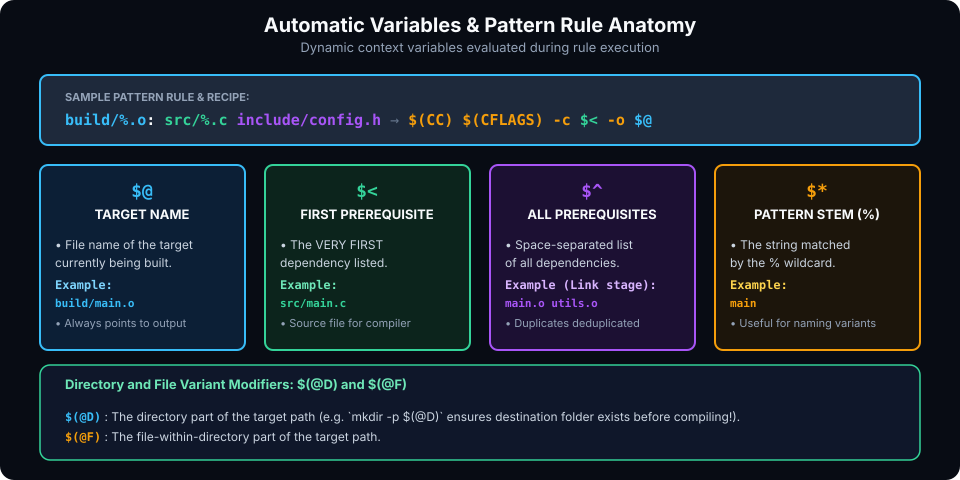

# Pattern Rules, Automatic Variables & Stem Matching

## Introduction

In Chapter 3, we wrote explicit rules such as `build/app.o: src/app.c`. In a project containing hundreds of source files, writing individual rules for every single translation unit is unmaintainable and violates the DRY (*Don't Repeat Yourself*) engineering principle.

GNU Make solves this through **Pattern Rules** and **Automatic Variables**. Rather than defining how to compile each specific file, you define a *generalized template* that instructs Make how to transform any file matching a certain pattern (such as `%.c`) into its corresponding target (such as `%.o`).

This chapter covers:
1. **The Pattern Rule Engine & Stem Matching (`%`)**.
2. **Comprehensive Guide to Automatic Variables (`$@`, `$<`, `$^`, `$*`, `$?`, `$+`)**.
3. **Directory and Filename Modifiers (`$(@D)`, `$(@F)`, `$(<D)`)**.
4. **Static Pattern Rules (`targets: target-pattern: prereq-patterns`)**.
5. **Pattern Rules vs. Obsolete Suffix Rules (`.c.o:`)**.
6. **Hands-On Exercises & Review Questions**.

---

## Pattern Rule Anatomy & Automatic Variables

Understanding how Make matches patterns and dynamically populates automatic variables is essential for writing robust build systems:



### 1. The Stem Matching Mechanism (`%`)

A pattern rule contains exactly one `%` character in the target specification. The `%` acts as a wildcard that matches any non-empty substring known as the **Stem**.

Consider the canonical C compilation pattern rule:

```makefile
build/%.o: src/%.c
	$(CC) $(CFLAGS) -c $< -o $@
```

When Make determines that it needs to build `build/utils/parser.o`:
1. It compares `build/utils/parser.o` against `build/%.o`.
2. The stem matched by `%` is `utils/parser`.
3. Make substitutes this stem into the prerequisite pattern `src/%.c`, yielding `src/utils/parser.c`.
4. If `src/utils/parser.c` exists on disk (or can be built by another rule), the pattern rule is chosen, and the recipe executes with automatic variables bound to these specific paths.

---

## The Automatic Variables Reference

Automatic variables are values computed freshly for each rule based on the target and prerequisites of that specific invocation. They are only valid inside the **recipe** section of a rule (not in prerequisites or global variable definitions).

| Variable | Description | Common Usage |
| :--- | :--- | :--- |
| **`$@`** | The file name of the target being built. | Compiler/Linker output flag: `-o $@` |
| **`$<`** | The name of the **first** prerequisite. | The primary source file: `gcc -c $<` |
| **`$^`** | Names of **all** prerequisites, space-separated, with duplicates removed. | Linker step: `gcc -o $@ $^` |
| **`$+`** | Names of **all** prerequisites, preserving duplicates and order. | Linking static libraries where duplicate archive order matters. |
| **`$*`** | The **stem** matched by `%` in a pattern rule. | Generating derivative files or naming debug logs: `echo "Compiling $*"` |
| **`$?`** | All prerequisites that are **newer** than the target. | Archive updating: `ar rcs $@ $?` |

### Why `$<` vs `$^` Matters

A frequent novice mistake is using `$^` in a compilation rule:

```makefile
# DANGEROUS / INCORRECT:
%.o: %.c header1.h header2.h
	$(CC) $(CFLAGS) -c $^ -o $@
```

Because `$^` expands to `main.c header1.h header2.h`, GCC will attempt to compile the `.h` header files directly into precompiled header fragments or throw syntax errors!

Instead, use `$<` so only the primary `.c` source file is passed to `-c`:

```makefile
# CORRECT:
%.o: %.c header1.h header2.h
	$(CC) $(CFLAGS) -c $< -o $@
```

Here, `header1.h` and `header2.h` remain prerequisites (so touching either header triggers a rebuild of `%.o`), but only `%.c` is passed to the compiler.

---

## Directory and Filename Modifiers

GNU Make provides built-in modifiers for automatic variables to extract directory paths or file basenames. These are crucial when compiling into separate nested build directories:

| Modifier | Meaning | Example (`$@ = build/net/socket.o`) |
| :--- | :--- | :--- |
| **`$(@D)`** | Directory part of target, with trailing slash removed. | `build/net` |
| **`$(@F)`** | File-within-directory part of target. | `socket.o` |
| **`$(<D)`** | Directory part of first prerequisite. | `src/net` |
| **`$(<F)`** | File part of first prerequisite. | `socket.c` |
| **`$(^D)`** | Directory parts of all prerequisites. | `src/net src/core` |
| **`$(^F)`** | File parts of all prerequisites. | `socket.c core.c` |

### Automatic Directory Creation with `$(@D)`

Instead of manually declaring order-only prerequisite rules for every sub-directory in a large project, you can use `$(@D)` directly inside the recipe:

```makefile
build/%.o: src/%.c
	@mkdir -p $(@D)
	$(CC) $(CFLAGS) -c $< -o $@
```

Before compiling any object file, Make executes `mkdir -p $(@D)` (e.g. `mkdir -p build/net`), guaranteeing that the target directory exists before `gcc` writes to it.

---

## Static Pattern Rules

A standard pattern rule (`%.o: %.c`) is **global**: it applies to every target that matches `%.o`. If Make is looking for a way to build any `.o` file, it will test that rule.

**Static Pattern Rules** restrict the pattern rule to an explicit, fixed list of targets:

```makefile
targets ...: target-pattern: prereq-patterns ...
	recipe
```

### Why Use Static Pattern Rules?

1. **Avoid Ambiguity**: You control exactly which files are governed by the rule.
2. **Multiple Source Dialects**: You can compile C and C++ or assembly files in the same project without pattern rule collisions:

```makefile
C_SRCS   := src/main.c src/net.c
CPP_SRCS := src/engine.cpp src/render.cpp

C_OBJS   := $(C_SRCS:src/%.c=build/%.o)
CPP_OBJS := $(CPP_SRCS:src/%.cpp=build/%.o)

# Static pattern rule for C files only:
$(C_OBJS): build/%.o: src/%.c
	@mkdir -p $(@D)
	$(CC) $(CFLAGS) -c $< -o $@

# Static pattern rule for C++ files only:
$(CPP_OBJS): build/%.o: src/%.cpp
	@mkdir -p $(@D)
	$(CXX) $(CXXFLAGS) -c $< -o $@
```

If you used generic pattern rules (`build/%.o: src/%.c` and `build/%.o: src/%.cpp`), Make might encounter ambiguity if both `src/test.c` and `src/test.cpp` existed. Static pattern rules resolve the ambiguity cleanly because `C_OBJS` and `CPP_OBJS` are distinct sets.

---

## Pattern Rules vs. Obsolete Suffix Rules

Before GNU Make introduced `%` pattern rules, ancient Unix Make used **Suffix Rules** (also called inference rules):

```makefile
# OBSOLETE SUFFIX RULE SYNTAX (DO NOT USE IN MODERN MAKEFILES):
.SUFFIXES: .c .o
.c.o:
	$(CC) $(CFLAGS) -c $<
```

### Why Suffix Rules Are Obsolete:
- Suffix rules cannot change directories (they cannot express `build/%.o: src/%.c`).
- They cannot define multiple prerequisites (`.c.o: foo.h` is illegal).
- They rely on maintaining a fragile `.SUFFIXES:` list.
- Modern GNU Make fully supports pattern rules with stem matching, which are strictly superior in expressiveness and clarity.

---

## Hands-On Exercise

### The Problem
You are configuring a build system for a modular C application with the following directory structure:
```text
src/
  main.c
  math/
    vector.c
    matrix.c
```
Write a Makefile that:
1. Automatically discovers all `.c` files in `src/` (including subdirectories).
2. Maps them to object files inside `build/` preserving the folder hierarchy (e.g. `src/math/vector.c` $\rightarrow$ `build/math/vector.o`).
3. Uses a static pattern rule to compile all object files.
4. Uses `$(@D)` to create required subdirectories on-the-fly.
5. Links all objects into `bin/app`.

### The Solution

```makefile
CC       := gcc
CFLAGS   := -Wall -Wextra -O2 -Iinclude
BIN      := bin/app

# Recursively locate source files using wildcard or shell
SRCS     := $(wildcard src/*.c src/*/*.c)
OBJS     := $(patsubst src/%.c, build/%.o, $(SRCS))

.DELETE_ON_ERROR:
.PHONY: all clean

all: $(BIN)

# Link step
$(BIN): $(OBJS)
	@mkdir -p $(@D)
	$(CC) $(CFLAGS) -o $@ $^
	@echo "Built target: $@"

# Static pattern compilation rule
$(OBJS): build/%.o: src/%.c
	@mkdir -p $(@D)
	$(CC) $(CFLAGS) -c $< -o $@
	@echo "Compiled: $< -> $@"

clean:
	rm -rf build bin
```

---

## Review Questions & Self-Assessment

1. **What is the difference between `$<` and `$^`?**
   *Answer:* `$<` represents only the first prerequisite (used for compiling a single `.c` file), while `$^` represents all prerequisites with duplicates removed (used for linking all object files together into an executable).
2. **What does the stem variable `$*` represent in `build/%.o: src/%.c` when compiling `build/net/http.o`?**
   *Answer:* The stem matched by `%` is `net/http`. Hence `$*` expands to `net/http`.
3. **What is the benefit of a static pattern rule over a generic pattern rule?**
   *Answer:* A static pattern rule restricts the rule application to a predetermined list of target files. This eliminates rule ambiguity, prevents accidental matches with unrelated files, and allows different rules for the same extension (e.g., C vs C++ object generation).
4. **How does `$(@D)` help organize build output directories?**
   *Answer:* `$(@D)` returns the directory portion of the current target. By executing `@mkdir -p $(@D)` in the recipe, the necessary directory hierarchy is created automatically before the compiler writes the target file.

---

##### Copyright (c) 2026 squared-studio
