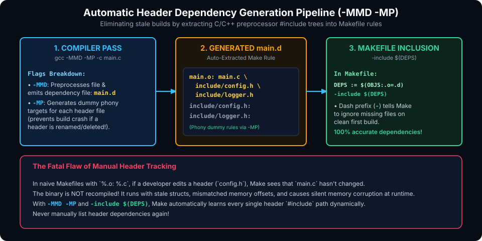

# Advanced Features, Functions & Auto-Dependencies

## Introduction

In modern C and C++ software engineering, a naive Makefile suffers from a notorious vulnerability: **the stale header problem**. If `src/main.c` includes `include/config.h`, but your Makefile rule only states `build/main.o: src/main.c`, editing `config.h` will **not** trigger a recompile of `main.o`. The developer runs the program, wonders why their header changes had no effect, and eventually resorts to running `make clean && make`—destroying incremental build performance.

GNU Make solves this problem permanently through **compiler-assisted automatic dependency generation** combined with the `-include` directive.

Furthermore, GNU Make provides a rich meta-programming functional language featuring `$(call)`, `$(eval)`, and `$(foreach)`, allowing developers to generate hundreds of rules dynamically without code duplication.

This chapter covers:
1. **The Stale Header Problem & Compiler-Generated Dependency Files (`.d`)**.
2. **GCC/Clang Dependency Flags: `-MMD -MP` Deep Dive**.
3. **The `-include` Directive & DAG Reconstruction**.
4. **Meta-Programming Functions: `$(call)`, `$(eval)`, `$(foreach)`, and `$(error)`**.
5. **Hands-On Exercises & Review Questions**.

---

## Automatic Header Dependency Pipeline

Rather than manually listing every `.h` file in prerequisites or using outdated tools like `makedepend`, modern Makefiles delegate header dependency tracking directly to the compiler during compilation:



### 1. How GCC/Clang Dependency Generation Works

When the compiler translates `main.c`, its preprocessor scans every `#include` directive. By passing specific flags to the compiler, GCC or Clang can emit a sidecar file (`main.d`) containing a valid Makefile rule listing all included headers:

```makefile
CPPFLAGS := -Iinclude -MMD -MP
```

### 2. Deep Dive into `-MMD` and `-MP`

- **`-MMD`**:
  Tells the preprocessor to generate dependency files ending in `.d`. Unlike `-MD` (which lists every standard C system library header like `/usr/include/stdio.h`), `-MMD` **ignores system headers** and tracks only user project headers (e.g. `"config.h"`, `"net/socket.h"`). This keeps `.d` files small and prevents system upgrades from invalidating local builds.
- **`-MP`**:
  Creates an empty phony target for each header dependency in the `.d` file:
  ```makefile
  # Generated inside build/main.d:
  include/config.h:
  ```
  > [!IMPORTANT]
  > **Why `-MP` Is Critical**:
  > If a developer deletes or renames a header file (e.g., renames `config.h` to `settings.h` and updates `main.c`), Make reads the old `main.d` on the next build and attempts to build `include/config.h`. Without `-MP`, Make terminates with a fatal error:
  > `make: *** No rule to make target 'include/config.h', needed by 'build/main.o'. Stop.`
  > With `-MP`, the empty target `include/config.h:` satisfies Make's prerequisite check, allowing the compilation recipe to run and regenerate the `.d` file with the new header name!

---

## Integrating Auto-Dependencies with `-include`

To feed the generated `.d` files back into Make's internal DAG, use the `-include` directive:

```makefile
SRCS := $(wildcard src/*.c)
OBJS := $(patsubst src/%.c, build/%.o, $(SRCS))
DEPS := $(OBJS:.o=.d)

# Include all generated dependency files
-include $(DEPS)
```

### Why the Minus Sign (`-include`) Is Mandatory

When you run `make` on a clean repository for the very first time, **no `.d` files exist yet**.
- A plain `include $(DEPS)` would abort immediately with:
  `Makefile:8: build/main.d: No such file or directory. Stop.`
- The `-include` directive instructs GNU Make to silently ignore files that do not exist yet. On the first build, Make compiles each `.c` file using the pattern rule, generating both `.o` and `.d`. On all subsequent runs, Make includes the generated `.d` files and accurately detects any header modifications!

---

## Meta-Programming with `$(eval)` and `$(call)`

As projects scale, you may need to build multiple executables or libraries, each with its own set of source files and compiler flags. Instead of copy-pasting recipes, you can write parameterized **Makefile functions**.

### 1. `$(call variable,param1,param2,...)`
Expands a parameterized macro by replacing `$(1)`, `$(2)`, etc. with the supplied arguments.

```makefile
define LOG_INFO
	@echo "[INFO $(shell date +%T)] $(1)"
endef

build-notify:
	$(call LOG_INFO,Starting compilation)
```

### 2. `$(eval ...)`
Takes a string, parses it as Makefile syntax, and injects it directly into the running Makefile database. When combined with `$(call)`, it provides template metaprogramming.

### Multi-Target Generation Template Example

Suppose we need to build two separate daemons (`server` and `client`) from separate source folders:

```makefile
PROGRAMS := server client

server_SRCS := src/server/main.c src/server/socket.c
client_SRCS := src/client/main.c src/client/ui.c

# Define a generic program build template:
# $(1): Program name (e.g., server)
define PROGRAM_TEMPLATE
$(1)_OBJS := $$($(1)_SRCS:src/%.c=build/%.o)
$(1)_DEPS := $$($(1)_OBJS:.o=.d)

bin/$(1): $$($(1)_OBJS) | bin
	$$(CC) $$(CFLAGS) -o $$@ $$^

-include $$($(1)_DEPS)
endef

# Dynamically instantiate the template for each program:
$(foreach prog,$(PROGRAMS),$(eval $(call PROGRAM_TEMPLATE,$(prog))))
```

> [!TIP]
> Notice the double dollar sign `$$` in the template definition. The first dollar sign is consumed when `$(call)` expands the macro string, and the second dollar sign remains intact for `$(eval)` so that Make evaluates the variable when parsing the generated rule.

---

## Defensive Programming: `$(error)` and `$(warning)`

You can enforce configuration prerequisites and environment constraints before any compilation begins:

```makefile
# Enforce compiler availability
ifeq ($(shell which $(CC) 2>/dev/null),)
    $(error "C compiler '$(CC)' not found in PATH. Please install gcc or clang.")
endif

# Check required build modes
ALLOWED_MODES := debug release
ifeq ($(filter $(MODE),$(ALLOWED_MODES)),)
    $(error "Invalid MODE='$(MODE)'. Valid modes are: $(ALLOWED_MODES)")
endif
```

- `$(error message)`: Emits an error message and terminates Make immediately with exit code 2.
- `$(warning message)`: Emits a warning message with the current file and line number, but continues execution.
- `$(info message)`: Prints diagnostic information to standard output without filename/line decorations.

---

## Hands-On Exercise

### The Problem
Create a Makefile for a project with auto-dependency tracking:
1. Sources reside in `src/` and headers reside in `include/`.
2. Output object files and `.d` files to `build/`.
3. Pass `-MMD -MP` to generate `.d` files.
4. Safely include all `.d` files with `-include`.
5. Test that changing a header file (e.g. `touch include/defs.h`) rebuilds only the object files that include `defs.h`.

### The Solution

```makefile
CC        := gcc
CFLAGS    := -Wall -Wextra -O2
CPPFLAGS  := -Iinclude -MMD -MP

SRCS      := $(wildcard src/*.c)
OBJS      := $(patsubst src/%.c, build/%.o, $(SRCS))
DEPS      := $(OBJS:.o=.d)
BIN       := bin/app

.DELETE_ON_ERROR:
.PHONY: all clean

all: $(BIN)

$(BIN): $(OBJS) | bin
	$(CC) $(CFLAGS) -o $@ $^
	@echo "Successfully linked $(BIN)"

build/%.o: src/%.c | build
	$(CC) $(CPPFLAGS) $(CFLAGS) -c $< -o $@

bin build:
	mkdir -p $@

clean:
	rm -rf bin build

# Safely include generated dependencies
-include $(DEPS)
```

---

## Review Questions & Self-Assessment

1. **Why does naive header tracking (`main.o: main.c`) fail in real-world development?**
   *Answer:* It ignores changes to `.h` files included by `main.c`. If a struct, macro, or function prototype in a header changes, Make does not detect that `main.o` is out-of-date, resulting in runtime bugs or crashes until a full clean build is performed.
2. **What is the difference between `-MD` and `-MMD` in GCC/Clang?**
   *Answer:* `-MD` emits dependencies for all headers, including system headers (e.g. `<stdio.h>`), while `-MMD` ignores system headers and lists only user project headers, keeping dependency files concise and portable.
3. **What fatal error does `-MP` prevent?**
   *Answer:* If a header file is removed or renamed, Make will fail with `No rule to make target 'deleted_header.h', needed by 'object.o'`. `-MP` creates an empty phony rule for each header, satisfying the prerequisite and allowing Make to recompile the source file.
4. **Why must the `-include` directive use a leading minus sign (`-`)?**
   *Answer:* The leading minus sign instructs Make to silently ignore missing files. On the first build, `.d` files have not been generated yet; without `-`, Make would fail with a missing file error before compilation ever begins.

---

##### Copyright (c) 2026 squared-studio
