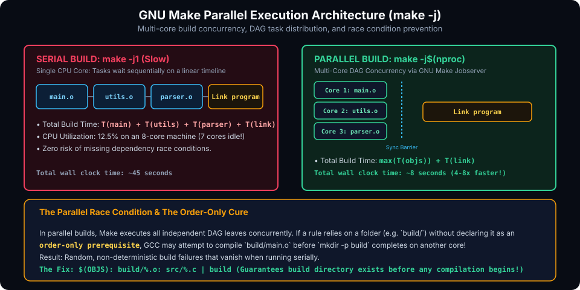

# Debugging, Profiling & Concurrency Optimization

## Introduction

As codebases scale into tens of thousands of lines across hundreds of translation units, build times become a primary bottleneck in developer productivity. Single-threaded compilation wastes the vast majority of modern multi-core CPU capacity.

GNU Make provides a high-performance **Parallel Execution Engine** via the `-j` (*jobs*) flag, backed by an operating system token-ring architecture known as the **Jobserver**. However, parallel builds introduce concurrency bugs that never manifest in serial builds: race conditions, out-of-order execution, and intermittent link failures.

This chapter covers:
1. **Parallel Execution (`make -j`) & The GNU Make Jobserver**.
2. **Identifying & Eliminating Parallel Build Race Conditions**.
3. **Controlling Concurrency: `.NOTPARALLEL` and `.WAIT`**.
4. **Diagnostic & Debugging Flags (`-n`, `-d`, `--trace`, `-p`)**.
5. **Clean Verbosity Control: The `V=1` Pattern**.
6. **Hands-On Exercises & Review Questions**.

---

## Parallel Execution & The Jobserver Architecture

When you invoke Make with `-j`, it analyzes the dependency graph (DAG) to find all targets whose prerequisites are fully satisfied and executes their recipes concurrently:



### 1. Optimal Worker Sizing

To fully saturate hardware without thrashing system memory or causing excessive thread context switching:

```bash
# On Linux:
make -j$(nproc)

# On macOS:
make -j$(sysctl -n hw.ncpu)

# Cross-platform Unix standard:
make -j$(getconf _NPROCESSORS_ONLN)
```

### 2. How the GNU Make Jobserver Works

In large modular codebases that invoke recursive sub-makes (`$(MAKE) -C subfolder`), uncoordinated `-j` flags would spawn an exponential number of processes ($N \times M$), quickly crashing the machine (fork bomb).

GNU Make solves this through the **Jobserver**:
- The top-level Make process creates an OS pipe with a fixed number of single-byte tokens (e.g. 8 tokens for `-j8`).
- Before any Make instance forks a compiler process, it must read and consume one token from the pipe.
- When the compilation process exits, Make writes the token back to the pipe.
- Sub-make processes inherit the file descriptor (`--jobserver-auth`), sharing the exact same token pool across the entire process tree.

---

## Parallel Build Race Conditions & Pitfalls

A build that succeeds reliably with `make` (single thread) may fail intermittently with `make -j8`. This occurs when prerequisites are incomplete or incorrectly specified:

### 1. The Directory Creation Race

```makefile
# DANGEROUS: Race condition under make -j
build/%.o: src/%.c
	mkdir build
	$(CC) -c $< -o $@
```

If 8 worker jobs start simultaneously, all 8 workers execute `mkdir build` at the same instant. On POSIX systems, 7 of them will fail with `mkdir: cannot create directory 'build': File exists`, halting the build.

**The Fix:** Use `mkdir -p $(@D)` or declare the directory as an order-only prerequisite (`| $(BUILD_DIR)`).

### 2. Missing Prerequisite Ordering

Consider a build that generates a parser header before compiling source code:

```makefile
# BUGGY: Serial succeeds by luck; Parallel fails intermittently
all: app

app: parser.o main.o
	$(CC) -o $@ $^

parser.c parser.h: parser.y
	bison -d -o parser.c parser.y

main.o: main.c
	$(CC) -c main.c
```

`main.c` includes `parser.h`. In serial execution, Make happens to run the `parser.c` rule first, so `parser.h` exists when `main.o` compiles.

In parallel execution (`make -j4`), Make sees that `parser.o` and `main.o` can run concurrently. It launches `gcc -c main.c` immediately. If `bison` has not finished writing `parser.h`, compilation crashes with `fatal error: parser.h: No such file or directory`.

**The Fix:** Explicitly declare that `main.o` depends on `parser.h`:

```makefile
main.o: main.c parser.h
```

---

## Controlling Concurrency: `.NOTPARALLEL` and `.WAIT`

### 1. Forcing Serial Execution with `.NOTPARALLEL`
If certain legacy targets cannot run concurrently (such as database migrations or hardware flashing), use `.NOTPARALLEL`:

```makefile
# Disables parallel execution for the entire Makefile:
.NOTPARALLEL:

# In GNU Make 4.4+, can target specific rules:
.NOTPARALLEL: flash_firmware deploy_db
```

### 2. Order Barriers with `.WAIT` (GNU Make 4.4+)
The `.WAIT` keyword instructs Make that all prerequisites preceding `.WAIT` must finish before any prerequisites following `.WAIT` may begin:

```makefile
all: generate_schema .WAIT compile_modules .WAIT link_final
```

---

## Debugging Makefiles

When a target is unexpectedly rebuilding, or a rule fails to trigger, GNU Make provides dedicated diagnostic tools:

| Flag | Purpose | Explanation |
| :--- | :--- | :--- |
| **`-n`**, **`--dry-run`** | Dry-run | Prints the exact shell commands that would run without actually executing them. |
| **`--trace`** | Rule Execution Trace | (GNU Make 4.1+) Prints why each target is being rebuilt and the recipe executed. |
| **`-d`** | Full Debug Log | Extremely detailed diagnostic log of timestamp comparisons and implicit rule searches. |
| **`--debug=b`** | Basic Debug Log | Prints only the targets that are out of date and the specific prerequisite triggering the rebuild. |
| **`-p`**, **`--print-data-base`** | Dump Internal DB | Outputs all parsed rules, variables, and default configuration settings. |

### Inspecting Variables with `$(info)`
To inspect internal variables without running shell commands, use `$(info)`:

```makefile
$(info [DEBUG] Source files detected: $(SRCS))
$(info [DEBUG] Target object list: $(OBJS))
```

---

## Clean Output & The `V=1` Verbosity Toggle

By default, GCC output can flood the terminal, hiding compiler warnings. Professional Makefiles provide concise progress indicators by default, while supporting a verbose switch (`V=1`):

```makefile
# Verbosity control
ifeq ($(V),1)
    Q :=
else
    Q := @
endif

build/%.o: src/%.c
	@echo "  CC      $<"
	$(Q)$(CC) $(CFLAGS) -c $< -o $@

$(BIN): $(OBJS)
	@echo "  LINK    $@"
	$(Q)$(CC) $(CFLAGS) -o $@ $^
```

- When running `make`, the terminal displays clean, readable output:
  ```text
    CC      src/main.c
    CC      src/net.c
    LINK    bin/app
  ```
- When running `make V=1`, the `@` prefix is omitted, printing the full raw command line for debugging.

---

## Hands-On Exercise

### The Problem
You are given a broken Makefile where parallel builds (`make -j`) fail due to race conditions:
```makefile
CC = gcc
all: bin/app

bin/app: build/main.o build/calc.o
	mkdir bin
	$(CC) -o $@ $^

build/calc.o: src/calc.c
	mkdir build
	$(CC) -c $< -o $@

build/main.o: src/main.c
	mkdir build
	$(CC) -c $< -o $@
```
Refactor this Makefile to:
1. Eliminate all directory race conditions safely under `make -j8`.
2. Add `.DELETE_ON_ERROR:` to guarantee clean rebuilds upon failure.
3. Add a `V=1` verbose logging toggle with formatted progress messages (`CC`, `LINK`, `MKDIR`).

### The Solution

```makefile
CC     := gcc
CFLAGS := -Wall -Wextra -O2
BIN    := bin/app
SRCS   := src/main.c src/calc.c
OBJS   := $(patsubst src/%.c, build/%.o, $(SRCS))

# Verbosity toggle
ifeq ($(V),1)
    Q :=
else
    Q := @
endif

.DELETE_ON_ERROR:
.PHONY: all clean

all: $(BIN)

# Link rule: requires bin directory as order-only prerequisite
$(BIN): $(OBJS) | bin
	@echo "  LINK    $@"
	$(Q)$(CC) $(CFLAGS) -o $@ $^

# Compilation rule: requires build directory as order-only prerequisite
build/%.o: src/%.c | build
	@echo "  CC      $<"
	$(Q)$(CC) $(CFLAGS) -c $< -o $@

# Safe directory creation
bin build:
	@echo "  MKDIR   $@"
	$(Q)mkdir -p $@

clean:
	@echo "  CLEAN"
	$(Q)rm -rf bin build
```

---

## Review Questions & Self-Assessment

1. **How does the GNU Make Jobserver prevent system overload during recursive parallel builds?**
   *Answer:* It maintains a token pool across an OS pipe. Any sub-make must acquire an authorization token from the pipe before launching a process and release it when complete, ensuring the total active compiler processes never exceed the `-j` limit.
2. **Why does `mkdir build` inside individual compilation recipes cause parallel builds to fail?**
   *Answer:* When multiple jobs execute concurrently, multiple processes execute `mkdir build` simultaneously. On POSIX systems, concurrent `mkdir` on an existing folder returns an error, halting the build.
3. **What does the `--trace` flag in GNU Make provide?**
   *Answer:* It outputs each target being evaluated, the exact prerequisite that caused it to be considered out-of-date, and the recipe being executed.
4. **How does the `V=1` convention improve developer ergonomics?**
   *Answer:* It silences long compiler command lines by default to highlight compiler warnings and errors, while allowing developers to easily inspect full command invocations when debugging with `make V=1`.

---

##### Copyright (c) 2026 squared-studio
