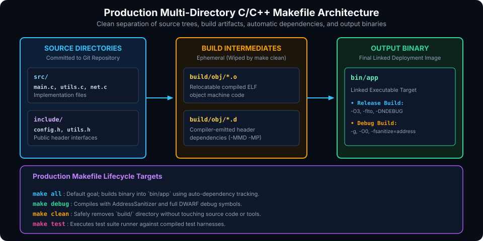

# Production Multi-Directory C/C++ Project Architecture

## Introduction

Throughout this series, we have mastered every foundational concept of GNU Make: DAG dependency evaluation, variable flavors, order-only prerequisites, pattern rules, automatic variables, compiler-generated dependency tracking, and parallel execution.

In this capstone chapter, we assemble these building blocks into a **complete, production-grade Makefile architecture**. This architecture is battle-tested, robust against parallel race conditions, immune to stale header bugs, and supports configuration profiles (Debug vs. Release), address sanitizers, automated test runners, and standard POSIX installation conventions.

This chapter covers:
1. **Standard Project Directory Layout**.
2. **Production Multi-Directory Makefile Architecture**.
3. **The Complete Production-Ready Makefile Template**.
4. **Configuration Profiles (Debug, Release, AddressSanitizer)**.
5. **Polyglot Task Runner Usage (Python, Go, Docker)**.
6. **Best Practices vs. Antipatterns Summary**.
7. **Hands-On Exercises & Comprehensive Review Questions**.

---

## Production Project Architecture

A robust C/C++ build system enforces clean separation of concerns: source files are kept strictly isolated from build artifacts:



### Directory Layout

```text
my_project/
├── Makefile
├── include/
│   ├── app.h
│   └── math/
│       └── matrix.h
├── src/
│   ├── main.c
│   ├── app.c
│   └── math/
│       └── matrix.c
├── tests/
│   └── test_matrix.c
├── build/
│   ├── obj/          # Object files (*.o) and dependency files (*.d)
│   └── test/
└── bin/              # Final linked binary executables
```

---

## The Production-Ready Makefile Blueprint

Below is the complete, modular, and fully documented production Makefile:

```makefile
# ==============================================================================
# Production C/C++ Multi-Directory Makefile
# Compatible with GNU Make 3.82+ and POSIX tools
# ==============================================================================

# 1. Shell & Default Configuration
SHELL           := /bin/sh
.DEFAULT_GOAL   := all
.DELETE_ON_ERROR:
.SUFFIXES:

# 2. Toolchain Definitions
CC              ?= gcc
CXX             ?= g++
RM              := rm -rf
MKDIR           := mkdir -p
INSTALL         := install
PREFIX          ?= /usr/local

# 3. Project Directories
SRC_DIR         := src
INC_DIR         := include
TEST_DIR        := tests
BUILD_DIR       := build
OBJ_DIR         := $(BUILD_DIR)/obj
BIN_DIR         := bin
TARGET          := $(BIN_DIR)/app

# 4. Source & Object Discovery
# Locate all C files in src/ and its subdirectories
SRCS            := $(shell find $(SRC_DIR) -name '*.c' 2>/dev/null)
OBJS            := $(patsubst $(SRC_DIR)/%.c, $(OBJ_DIR)/%.o, $(SRCS))
DEPS            := $(OBJS:.o=.d)

# 5. Compiler Flags & Profile Configuration
# MODE can be 'release' (default) or 'debug'
MODE            ?= release

COMMON_FLAGS    := -Wall -Wextra -Wpedantic -Wshadow -Wformat=2
CPPFLAGS        := -I$(INC_DIR) -MMD -MP

ifeq ($(MODE),debug)
    CFLAGS      := $(COMMON_FLAGS) -O0 -g3 -DDEBUG -fsanitize=address,undefined
    LDFLAGS     := -fsanitize=address,undefined
else ifeq ($(MODE),release)
    CFLAGS      := $(COMMON_FLAGS) -O3 -DNDEBUG -march=native
    LDFLAGS     :=
else
    $(error "Invalid MODE='$(MODE)'. Valid options: release, debug")
endif

# 6. Verbosity Formatting (Run with V=1 for raw commands)
ifeq ($(V),1)
    Q           :=
else
    Q           := @
endif

# ==============================================================================
# Targets & Build Rules
# ==============================================================================

.PHONY: all clean distclean test install uninstall info help

all: $(TARGET)

# Link Application Binary
$(TARGET): $(OBJS) | $(BIN_DIR)
	@printf "  LINK    %-30s -> %s\n" "[$(MODE)]" "$@"
	$(Q)$(CC) $(OBJS) $(LDFLAGS) -o $@

# Compile Source Files with Directory Mirroring
$(OBJ_DIR)/%.o: $(SRC_DIR)/%.c | $(OBJ_DIR)
	@mkdir -p $(@D)
	@printf "  CC      %-30s -> %s\n" "$<" "$@"
	$(Q)$(CC) $(CPPFLAGS) $(CFLAGS) -c $< -o $@

# Create Directory Targets
$(BIN_DIR) $(OBJ_DIR):
	$(Q)$(MKDIR) $@

# ==============================================================================
# Testing & Quality Assurance
# ==============================================================================

TEST_SRCS       := $(shell find $(TEST_DIR) -name '*.c' 2>/dev/null)
TEST_BINS       := $(patsubst $(TEST_DIR)/%.c, $(BUILD_DIR)/test/%, $(TEST_SRCS))

test: $(TEST_BINS)
	@echo "Running test suite..."
	@for t in $(TEST_BINS); do echo "  EXEC $$t"; ./$$t || exit 1; done
	@echo "All tests passed successfully!"

$(BUILD_DIR)/test/%: $(TEST_DIR)/%.c $(filter-out $(OBJ_DIR)/main.o, $(OBJS))
	@mkdir -p $(@D)
	$(Q)$(CC) $(CPPFLAGS) $(CFLAGS) -I$(SRC_DIR) $< $(filter-out $(OBJ_DIR)/main.o, $(OBJS)) $(LDFLAGS) -o $@

# ==============================================================================
# Installation & Packaging
# ==============================================================================

install: $(TARGET)
	@echo "Installing $(TARGET) to $(DESTDIR)$(PREFIX)/bin..."
	$(Q)$(MKDIR) $(DESTDIR)$(PREFIX)/bin
	$(Q)$(INSTALL) -m 755 $(TARGET) $(DESTDIR)$(PREFIX)/bin/

uninstall:
	@echo "Removing $(TARGET) from $(DESTDIR)$(PREFIX)/bin..."
	$(Q)$(RM) $(DESTDIR)$(PREFIX)/bin/$(notdir $(TARGET))

# ==============================================================================
# Maintenance & Diagnostics
# ==============================================================================

clean:
	@echo "Cleaning build artifacts..."
	$(Q)$(RM) $(BUILD_DIR)

distclean: clean
	@echo "Removing all output binaries..."
	$(Q)$(RM) $(BIN_DIR)

info:
	@echo "Project Configuration:"
	@echo "  Target:       $(TARGET)"
	@echo "  Mode:         $(MODE)"
	@echo "  Compiler:     $(CC)"
	@echo "  Sources:      $(words $(SRCS)) files"
	@echo "  Objects:      $(words $(OBJS)) files"

# 7. Safe Automatic Dependency Inclusion
-include $(DEPS)
```

---

## Key Architectural Highlights

### 1. Robust Directory Mirroring
In deep directory hierarchies (e.g. `src/math/geometry/vector.c`), the recipe uses:
```makefile
@mkdir -p $(@D)
```
This guarantees that `build/obj/math/geometry/` is created dynamically before `gcc` emits `vector.o` and `vector.d`, without requiring manual rules for every subfolder.

### 2. Test Execution Without Main Collision
When linking unit tests, the Makefile uses:
```makefile
$(filter-out $(OBJ_DIR)/main.o, $(OBJS))
```
This extracts all project implementation objects while stripping out the production entry point `main.o`, preventing duplicate symbol collisions (`multiple definition of 'main'`) during test linking.

### 3. Debug Profiles with AddressSanitizer
Running `make MODE=debug` compiles code with AddressSanitizer (`-fsanitize=address,undefined`) and debug symbols (`-g3 -O0`). Any memory leaks, buffer overruns, or undefined behavior immediately emit stack traces upon binary execution.

---

## Polyglot Task Runner Usage

Make is not restricted to C/C++; it is widely adopted as a unified, dependency-free automation runner for polyglot systems:

### Python Engineering Workflow
```makefile
PYTHON := python3
VENV   := .venv

.PHONY: env test lint run clean

env: $(VENV)/bin/activate

$(VENV)/bin/activate: requirements.txt
	$(PYTHON) -m venv $(VENV)
	./$(VENV)/bin/pip install -U pip -r requirements.txt
	touch $(VENV)/bin/activate

test: env
	./$(VENV)/bin/pytest tests/

lint: env
	./$(VENV)/bin/ruff check src/

run: env
	./$(VENV)/bin/python -m my_app

clean:
	rm -rf $(VENV) .pytest_cache
```

### Go Service Architecture
```makefile
BINARY := bin/service
SRCS   := $(shell find . -name '*.go')

.PHONY: all build test clean docker

all: build

build: $(BINARY)

$(BINARY): $(SRCS)
	go build -ldflags="-s -w" -o $@ ./cmd/service

test:
	go test -v -race ./...

docker:
	docker build -t my-org/service:latest .

clean:
	rm -rf bin/
```

---

## Best Practices vs. Antipatterns

| Practice | Correct Modern Approach | Antipattern to Avoid |
| :--- | :--- | :--- |
| **Error Safety** | `.DELETE_ON_ERROR:` at top of Makefile. | Omitting it, leaving corrupt object files upon build interruption. |
| **Dependency Tracking** | Compiler `-MMD -MP` with `-include $(DEPS)`. | Manual header lists or relying on `make clean && make`. |
| **Directory Prerequisites** | Order-only prerequisites `| $(DIR)` or `mkdir -p $(@D)`. | Normal prerequisites on folders causing perpetual rebuilds. |
| **Variable Flavor** | Simple expansion (`:=`) for evaluated paths. | Recursive expansion (`=`) re-running `$(shell ...)` repeatedly. |
| **Action Targets** | Explicit `.PHONY: all clean test`. | Relying on absence of files with identical names. |
| **Tool Customization** | `CC ?= gcc` (allows environment override). | Hardcoding `CC = gcc` (breaks cross-compilation). |
| **Parallel Safety** | Explicit dependency links across all stages. | Relying on rule order in the file for sequencing. |

---

## Hands-On Exercise

### The Problem
Using the production template provided in this chapter:
1. Initialize a Git repository with `src/core/math.c`, `include/core/math.h`, `src/main.c`, and `tests/test_math.c`.
2. Verify that running `make` compiles in `release` mode with `-O3`.
3. Verify that running `make MODE=debug` compiles with AddressSanitizer.
4. Verify that running `make test` compiles and runs the unit tests successfully.
5. Touch `include/core/math.h` and confirm that only affected objects rebuild on subsequent `make`.

---

## Review Questions & Comprehensive Self-Assessment

1. **Why does our production Makefile strip `main.o` when compiling test targets?**
   *Answer:* The unit test file defines its own test runner entry point (`main()`). If `main.o` from the production app were included in the link command, the linker would abort with a duplicate symbol error.
2. **What does `touch $(VENV)/bin/activate` achieve in the Python task runner Makefile?**
   *Answer:* Installing packages with `pip` may not update the timestamp on `activate`. Touching the file ensures its `mtime` is newer than `requirements.txt`, preventing Make from re-running the installation recipe on every subsequent invocation.
3. **Why should compilers and tools be assigned with `?=` instead of `:=` or `=`?**
   *Answer:* `?=` allows callers or continuous integration pipelines to override the toolchain from the environment or command line (e.g. `CC=clang make` or `CC=arm-linux-gnueabihf-gcc make` for cross-compilation).
4. **How does `.DELETE_ON_ERROR:` safeguard CI/CD pipelines?**
   *Answer:* In CI/CD pipelines, if a compilation or link step is aborted by a timeout or out-of-memory killer, `.DELETE_ON_ERROR:` ensures any partial output file is deleted. This prevents cached artifact systems from storing invalid binaries.

---

##### Copyright (c) 2026 squared-studio
