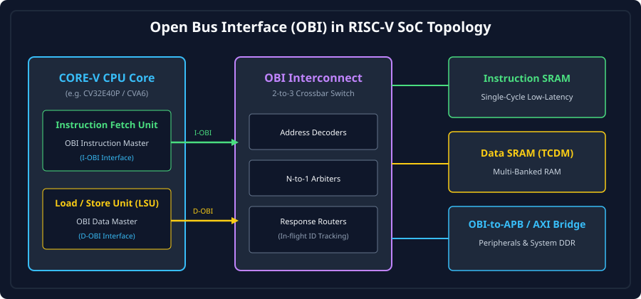
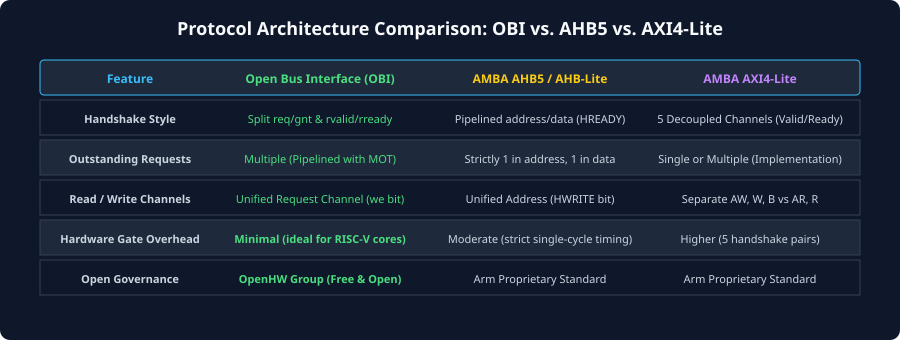

# Introduction to Open Bus Interface (OBI) and OpenHW Ecosystem

### Learning Objectives
- Understand the historical origin and evolution of the **Open Bus Interface (OBI)** from the PULP platform (RI5CY) to the official **OpenHW Group** standard.
- Analyze the role of OBI in modern open-source RISC-V processor cores, including **CV32E40P**, **CV32E40X**, **CV32E40S**, and **CVA6**.
- Compare and contrast OBI with industry-standard on-chip protocols: **AMBA AXI4-Lite**, **AMBA AHB-Lite / AHB5**, and **TileLink-UL**.
- Master the fundamental architectural philosophy of OBI: decoupled split request/response phases, latency insensitivity, and minimal silicon area footprint.
- Examine the dual-bus system topology of RISC-V processors: the **Instruction OBI (I-OBI)** and **Data OBI (D-OBI)** interfaces.

---

## The Genesis of the Open Bus Interface (OBI)

In the open-source silicon and RISC-V revolution, processor cores require high-performance, royalty-free, standardized on-chip bus interfaces. Historically, open-source cores faced an architectural dilemma:

1. **AMBA Protocols (Arm):** While protocols like AHB and AXI are ubiquitous in commercial silicon, their specifications and IP wrappers are encumbered by proprietary ecosystem standards and legacy complexities that add unnecessary gate overhead to lightweight 32-bit embedded microcontroller cores.
2. **Proprietary Core Buses:** Early RISC-V research implementations utilized ad-hoc, core-specific internal interfaces. For example, the **PULP (Parallel Ultra-Low-Power) Platform** developed by ETH Zürich and the University of Bologna introduced an internal low-latency bus interface for the **RI5CY** (later renamed CV32E40P) processor core.
3. **The Need for Standardization:** As the **OpenHW Group** formed to drive industrial-grade, verified open-source RISC-V cores into commercial automotive and industrial silicon, this interface was formally extracted, standardized, and codified as the **Open Bus Interface (OBI)** specification.

Today, OBI is the premier open-source on-chip interconnect standard for high-efficiency embedded RISC-V computing.

---

## OBI in the CORE-V Processor Ecosystem

The OpenHW Group's **CORE-V** family of open-source RISC-V cores relies on OBI as its primary system interface:

### Dual-Bus Core Architecture:
A modern 32-bit or 64-bit RISC-V processor core integrates two physically separate OBI master interfaces:
1. **Instruction OBI (I-OBI):** Dedicated exclusively to the Instruction Fetch Unit (IFU). It operates in read-only mode (`we` is permanently tied to `0`), streaming instructions from on-chip SRAM or instruction cache with minimal latency.
2. **Data OBI (D-OBI):** Dedicated to the Load/Store Unit (LSU). It handles both read (load) and write (store) transactions, supporting partial-word byte enables (`be`) and atomic memory operations (`atop`).

Because I-OBI and D-OBI operate as independent bus masters, the processor can execute a 32-bit data memory store while simultaneously fetching the next instruction from code memory, achieving full **Harvard Architecture** concurrency.

---

## Architectural Comparison: OBI vs. AHB vs. AXI4-Lite vs. TileLink

To understand why OBI was chosen for modern RISC-V cores, consider how it compares to alternative on-chip buses:

| Feature | Open Bus Interface (OBI) | AMBA AHB5 / AHB-Lite | AMBA AXI4-Lite | TileLink-UL (Uncached) |
|---|---|---|---|---|
| **Governance** | **OpenHW Group (Open Source)** | Arm Proprietary | Arm Proprietary | SiFive / RISC-V International |
| **Channel Structure** | **2 Decoupled Channels** (Request &amp; Response) | Single Pipelined Bus (Address then Data) | **5 Independent Channels** (AW, W, B, AR, R) | 2 Channels (A Channel &amp; D Channel) |
| **Handshake Mechanics** | Request: `req`/`gnt` Response: `rvalid` | Pipelined single handshake (`HREADY`) | Two-way valid/ready on all 5 channels | Ready/Valid on both channels |
| **Read / Write Channel** | **Unified Request Channel** (`we` bit) | Unified Address Bus (`HWRITE`) | **Split Channels** (AW/W vs AR/R) | Unified Request (`a_opcode`) |
| **Pipelining / MOT** | **Yes** (Multiple Outstanding Transactions) | Strictly 1 in address, 1 in data phase | Implementation-defined | **Yes** (Multiple outstanding requests) |
| **Hardware Complexity** | **Ultra-Low** (~1,500 gates/switch) | Moderate (~3,000 gates) | Higher (~6,000+ gates) | Low-to-Moderate |
| **Critical Timing Path** | Decoupled; register slices insertable | Tight: `HREADY` feeds across masters/slaves | Decoupled; skid buffers insertable | Decoupled |

### The "Sweet Spot" of OBI:
- Compared to **AHB-Lite**, OBI eliminates the rigid requirement that a slave must accept data exactly one cycle after the address phase, removing tight combinatorial feedback paths and allowing arbitrary multi-cycle memory latencies.
- Compared to **AXI4-Lite**, OBI collapses five separate channels down into **two intuitive channels** (Request and Response), reducing interconnect wire counts and routing congestion by over $40\%$ while retaining high pipelined throughput.

---

## Fundamental Architectural Principles of OBI

Four foundational architectural tenets define OBI:

### The Request-Response Phase Decoupling
An OBI transaction is cleanly split into two asynchronous, decoupled phases:
1. **The Request Phase:** The master presents the address, control attributes, and write data (if a write). The slave signals acceptance via the grant wire (`gnt`).
2. **The Response Phase:** At a later clock cycle, the slave signals completion via `rvalid` and returns read data (`rdata`) or error status (`err`).

Because the response phase is completely decoupled from request acceptance, memory controllers with variable access latencies (such as DRAM, flash memory, or multi-bank SRAM) can accept requests immediately into FIFOs without stalling the master's pipeline.

### Symmetrical Read and Write Phase Mechanics
In OBI, **write transactions follow the exact same phase structure as read transactions**:
- In a read, `rvalid` indicates that valid data is present on `rdata`.
- In a write, `rvalid` serves as an explicit **completion acknowledgment**, indicating that the write has been safely committed to the destination memory or peripheral register.

### Pipelining and Multiple Outstanding Transactions (MOT)
Unlike simple buses that force the master to wait for `rvalid` before issuing the next request, OBI natively supports **Multiple Outstanding Transactions**. A master can issue consecutive requests across cycles 1, 2, and 3; the slave accepts them with `gnt`, and subsequently streams responses back across cycles 4, 5, and 6, achieving **100% bus utilization**.

### Implementation Modularity
The OBI specification defines a minimal mandatory baseline (`req`, `gnt`, `addr`, `we`, `be`, `wdata`, `rvalid`, `rdata`) while offering standardized optional extensions:
- **`atop[5:0]`** for hardware Atomic Memory Operations (RISC-V 'A' extension),
- **`prot[2:0]`** for Privilege and TrustZone-style hardware security firewalls,
- **`dbg`** for non-intrusive on-chip hardware debug module access,
- **`mid` / `rid`** for out-of-order multi-master interconnect routing.

---

## Protocol Efficiency and Theoretical Bandwidth

The peak theoretical bandwidth of an OBI bus interface is determined by the system clock frequency and data bus width.

### Maximum Bandwidth Formula
$$BW_{peak} = f_{CLK} \times W_{bytes} = f_{CLK} \times \frac{\text{Data Width in Bits}}{8}$$

### Example: High-Performance CV32E40P RISC-V SoC
Consider an embedded SoC operating at $f_{CLK} = 250\text{ MHz}$ with a standard 32-bit OBI bus:
- Data Width = 32 bits = 4 bytes per transfer.
- Peak Bandwidth:
  $$BW_{peak} = 250 \times 10^6 \times 4 = 1.0\times 10^9\text{ Bytes/sec} = \mathbf{1.0\text{ GB/s}}$$

Because OBI supports back-to-back pipelined requests with zero turnaround overhead, an on-chip SRAM block can sustain one 32-bit transfer **on every single clock cycle**, reaching 100% bus efficiency ($\eta = 100\%$).

---

## Chapter Summary

- **OBI (Open Bus Interface)** is the official, open-source on-chip bus standard managed by the **OpenHW Group**.
- OBI originated from the PULP platform's **RI5CY** core bus and is now standard across the **CORE-V** family (CV32E40P, CV32E40X, CVA6).
- A CORE-V processor typically exposes two OBI interfaces: **I-OBI** for instruction fetch and **D-OBI** for data load/stores.
- OBI provides a 2-channel decoupled architecture (**Request Phase** and **Response Phase**), avoiding the combinatorial timing pitfalls of AHB and the silicon area overhead of AXI.
- Write operations return an explicit `rvalid` completion acknowledgment just like reads.
- Pipelined requests and Multiple Outstanding Transactions enable 100% theoretical bus utilization over pipelined on-chip memories.

---

## Review Questions

### Question 1
Why does a CORE-V RISC-V processor core expose two separate OBI interfaces (I-OBI and D-OBI) rather than multiplexing both onto a single shared bus?

<b>View Answer</b>

Exposing separate I-OBI and D-OBI interfaces implements a Harvard Architecture at the core boundary. If instruction fetches and data load/stores shared a single bus, memory accesses would compete for bus cycles, forcing the instruction fetch unit to stall every time a load or store instruction executed (structural hazard). Separate buses allow simultaneous instruction prefetching and data memory access without bus contention.

### Question 2
What is the primary architectural difference between OBI's write completion mechanism and AHB's write completion mechanism?

<b>View Answer</b>

In AHB, a write transfer is considered completed when the slave asserts `HREADY = 1` during the data phase immediately following the address phase. The master cannot separate address and data phases by multiple cycles. In OBI, write transactions are decoupled: the write data is delivered during the request phase (`req` & `gnt`), and the slave returns an explicit `rvalid = 1` response completion acknowledgment at an arbitrary later cycle. This allows write buffers and interconnects to absorb writes without holding the master's address pipeline.

### Question 3
An OBI master issues a read request at Cycle 1. The slave asserts `gnt` in Cycle 1, but does not assert `rvalid` until Cycle 4. Did the master need to hold `req = 1` during Cycles 2 and 3?

<b>View Answer</b>

No. In OBI, once a request has been granted (`req = 1` and `gnt = 1` in Cycle 1), the request phase is complete. The master may deassert `req` in Cycle 2 (or issue a brand-new pipelined request). The master does not need to maintain `req = 1` while waiting for `rvalid`.

### Question 4
Why is OBI considered significantly less complex to route in silicon than AMBA AXI4-Lite?

<b>View Answer</b>

AXI4-Lite requires five completely separate physical channels (AW, W, B, AR, R), each possessing its own independent `VALID` and `READY` flow control handshake lines and routing multiplexers. OBI collapses these into just two channels: a unified Request Channel (handling both reads and writes via a `we` select line) and a unified Response Channel. This reduces wire counts, multiplexer area, and routing congestion by over 40%.

---

##### Copyright (c) 2026 squared-studio
