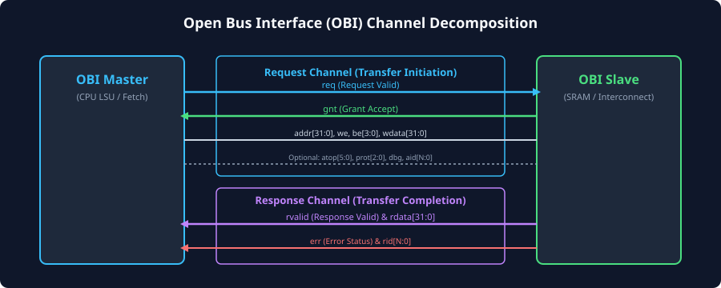
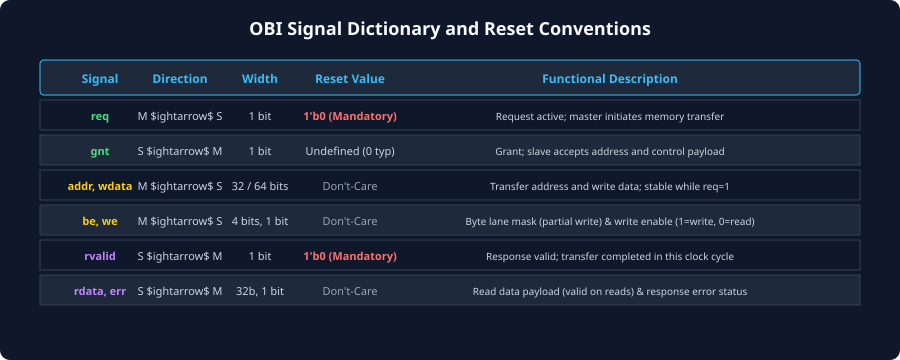

# Signal Architecture and Channel Decomposition

### Learning Objectives

- Master the architectural decomposition of OBI into two decoupled logical channels: the **Request Channel (A Channel)** and the **Response Channel (R Channel)**.
- Memorize the complete OBI signal dictionary, including signal directionality, widths, and reset invariants.
- Understand the role of optional architectural sideband signals: `atop[5:0]`, `prot[2:0]`, `dbg`, and transaction ID tags (`aid`, `mid`, `rid`).
- Analyze the strict reset semantics required by the OBI specification (`reset_n`).
- Trace how unidirectional point-to-point wiring eliminates bus contention and eases physical timing closure.

---

## The Two-Channel Architecture

The Open Bus Interface decomposes all bus communications into two unidirectional, point-to-point logical channels:

### The Request Channel (A Channel)

Carries all transfer initiation information from the Master to the Slave.

- **Handshake signals:** `req` (Master $\rightarrow$ Slave) and `gnt` (Slave $\rightarrow$ Master).
- **Payload signals:** `addr`, `we`, `be`, and `wdata`.
- **Sideband attributes:** `atop` (atomic operation), `prot` (privilege/security), `dbg` (debug access), and `aid`/`mid` (transaction IDs).

### The Response Channel (R Channel)

Carries completion status, error reporting, and read data from the Slave back to the Master.

- **Handshake signal:** `rvalid` (Slave $\rightarrow$ Master).
- **Payload signals:** `rdata` (read data payload) and `err` (error indication).
- **Sideband attributes:** `rid` (response transaction ID matching).

---

## Complete OBI Signal Dictionary

The following table provides the exhaustive specification for all signals defined in the OpenHW Group OBI standard:

###.1 Global Signals
| Signal | Direction | Width | Reset State | Detailed Description |
|---|:---:|:---:|:---:|---|
| **`clk`** | Input (all) | 1 bit | N/A | Global system clock. All interface signals are sampled strictly on the rising edge of `clk`. |
| **`reset_n`** | Input (all) | 1 bit | Active-LOW | Global active-LOW reset signal. Asynchronous assertion, synchronous deassertion. |

###.2 Request Channel Signals (Master $\rightarrow$ Slave)
| Signal | Direction | Width | Reset State | Detailed Description |
|---|:---:|:---:|:---:|---|
| **`req`** | Master $\rightarrow$ Slave | 1 bit | **`1'b0` (Mandatory)** | **Request Valid:** Asserted HIGH by the master to initiate a memory transfer. Must remain stable until granted. |
| **`gnt`** | Slave $\rightarrow$ Master | 1 bit | Undefined (`0` typ) | **Grant:** Asserted HIGH by the slave to accept the current transfer request into its internal pipeline or buffer. |
| **`addr`** | Master $\rightarrow$ Slave | `ADDR_WIDTH` (32b typ) | Don't-Care | **Transfer Address:** Byte address targeting memory or peripheral register space. |
| **`we`** | Master $\rightarrow$ Slave | 1 bit | Don't-Care | **Write Enable:** `1'b1` indicates a write transaction; `1'b0` indicates a read transaction. |
| **`be`** | Master $\rightarrow$ Slave | `DATA_WIDTH/8` (4b typ) | Don't-Care | **Byte Enables:** Active-HIGH bitmask indicating valid byte lanes during writes. |
| **`wdata`** | Master $\rightarrow$ Slave | `DATA_WIDTH` (32b typ) | Don't-Care | **Write Data:** Parallel write data bus. Valid only when `we = 1'b1`. |
| **`atop[5:0]`** | Master $\rightarrow$ Slave | 6 bits (Optional) | Don't-Care | **Atomic Operation:** Encodes RISC-V atomic memory operations (LR/SC, AMOSWAP, AMOADD, etc.). |
| **`prot[2:0]`** | Master $\rightarrow$ Slave | 3 bits (Optional) | Don't-Care | **Protection Attributes:** Privilege level (User vs. Privileged), Security (Secure vs. Non-Secure), Type (Data vs. Instruction). |
| **`dbg`** | Master $\rightarrow$ Slave | 1 bit (Optional) | Don't-Care | **Debug Transfer:** Asserted HIGH when the transfer originates from the RISC-V Debug Module. |
| **`aid[N:0]`** | Master $\rightarrow$ Slave | Parameterized | Don't-Care | **Address ID:** Master-assigned transaction tag for out-of-order response matching. |

###.3 Response Channel Signals (Slave $\rightarrow$ Master)
| Signal | Direction | Width | Reset State | Detailed Description |
|---|:---:|:---:|:---:|---|
| **`rvalid`** | Slave $\rightarrow$ Master | 1 bit | **`1'b0` (Mandatory)** | **Response Valid:** Asserted HIGH by the slave to signal transaction completion. |
| **`rready`** | Master $\rightarrow$ Slave | 1 bit (Optional) | Undefined | **Response Ready:** Optional backpressure signal from master (used in multi-beat / advanced OBI profiles). |
| **`rdata`** | Slave $\rightarrow$ Master | `DATA_WIDTH` (32b typ) | Don't-Care | **Read Data:** Read data payload returned by the slave. Valid only when `rvalid = 1'b1` for reads. |
| **`err`** | Slave $\rightarrow$ Master | 1 bit | Don't-Care | **Error Indicator:** `1'b1` indicates that the transfer failed (bus error, unmapped address, ECC error). |
| **`rid[N:0]`** | Slave $\rightarrow$ Master | Parameterized | Don't-Care | **Response ID:** Echoes the `aid` of the transaction being completed. |

---

## Clocking and Reset Semantics

The OBI specification enforces strict behavioral invariants regarding reset behavior to prevent spurious transaction launches and electrical bus conflicts:

### Reset Invariant: Validity Suppression

During any clock cycle where `reset_n` is sampled LOW (`0`):

- The master **must drive `req = 1'b0`**.
- The slave **must drive `rvalid = 1'b0`**.
- All payload buses (`addr`, `wdata`, `be`, `rdata`) are considered "don't care" and do not require reset registers, saving significant flip-flop silicon area and reset routing capacitance.

### Post-Reset Operation

The earliest clock cycle a master is permitted to assert `req = 1'b1` is the **first active rising clock edge after `reset_n` has transitioned from 0 to 1**.

### Synchronous Sampling Invariant

All signals across both Request and Response channels are sampled strictly on the **rising edge of `clk`**. There are no falling-edge transfers, dual-data-rate transitions, or transparent latch dependencies.

---

## Channel Sizing and Data Width Conventions

The Open Bus Interface is width-parameterized to support diverse microcontroller and high-performance processor profiles:

- **Standard 32-Bit Profile (RV32):**
  - `ADDR_WIDTH = 32` bits (4 GB address space).
  - `DATA_WIDTH = 32` bits (4 bytes).
  - `be` width = $32 / 8 = \mathbf{4\text{ bits}}$ (`be[3:0]`).
- **Standard 64-Bit Profile (RV64):**
  - `ADDR_WIDTH = 64` bits (or 48-bit physical address).
  - `DATA_WIDTH = 64` bits (8 bytes).
  - `be` width = $64 / 8 = \mathbf{8\text{ bits}}$ (`be[7:0]`).
- **High-Bandwidth Cache Refill Profile:**
  - `ADDR_WIDTH = 32` or `64` bits.
  - `DATA_WIDTH = 128` or `256` bits (matching CPU L1/L2 cache line size).
  - `be` width = 16 or 32 bits.

Regardless of the bus width, each bit of the byte enable signal (`be[n]`) controls exactly one byte:
$$\text{Byte Lane } n \iff \text{Data Bits } [8n+7 : 8n]$$

---

## Chapter Summary

- OBI separates all communications into two unidirectional channels: the **Request Channel** (M $\rightarrow$ S) and the **Response Channel** (S $\rightarrow$ M).
- The request handshake is governed by **`req`** and **`gnt`**; the response handshake is governed by **`rvalid`** (and optional `rready`).
- During reset (`reset_n = 0`), **`req` and `rvalid` must be driven strictly LOW**; all payload signals are don't-care.
- Standard profiles support 32-bit and 64-bit architectures with dedicated byte enables (`be`) per byte lane.
- Optional architectural sidebands include **`atop[5:0]`** (Atomic Operations), **`prot[2:0]`** (Protection), and **`dbg`** (Debug).

---

## Review Questions

### Question 1

Which specific signals must be driven to a known logic value during reset (`reset_n = 0`) in an OBI system? What is the status of the remaining signals?

<b>View Answer</b>

Only the handshake validation signals must be driven to a known logic level:
- The master must drive `req = 1'b0`.
- The slave must drive `rvalid = 1'b0`.  
All other address, control, and data signals (`addr`, `we`, `be`, `wdata`, `rdata`, `err`, `gnt`) are considered "don't-care" and may float or hold uninitialized values, minimizing the number of resettable flip-flops required in silicon.

### Question 2

What is the functional difference between `we` and `be` on the OBI Request Channel?

<b>View Answer</b>

- **`we` (Write Enable):** A 1-bit control signal that specifies the overall direction of the transaction (`1'b1` for a write, `1'b0` for a read).  
- **`be` (Byte Enable):** A multi-bit mask (e.g., 4 bits for a 32-bit bus) that specifies which individual byte lanes on `wdata` contain valid data to be committed to memory. This allows the master to execute partial-word writes (e.g., storing an 8-bit byte or 16-bit halfword into a 32-bit memory location).

### Question 3

In a 64-bit OBI interface, what is the width of the byte enable (`be`) bus? If the master performs a 32-bit word write targeting the upper 32 bits of a 64-bit doubleword, what is the binary value of `be`?

<b>View Answer</b>

- Width of `be` = $\text{Data Width} / 8 = 64 / 8 = \mathbf{8\text{ bits}}$ (`be[7:0]`).
- The upper 32 bits correspond to byte lanes 4, 5, 6, and 7.
- Therefore, the byte enable mask is: `be = 8'b1111_0000` (`8'hF0`).

### Question 4

Why is unidirectional point-to-point wiring an advantage in deep-submicron SoC physical synthesis?

<b>View Answer</b>

Unidirectional wiring means every signal has exactly one driver and travels in a single, predictable direction. There are no shared multi-driver tri-state buses, which avoids electrical contention, bus hold delays, and complex timing constraints. Furthermore, because each channel is decoupled, digital designers can easily insert pipeline registers (register slices) on long cross-chip routing wires to meet high clock frequency targets without violating protocol semantics.

---

##### Copyright (c) 2026 squared-studio
