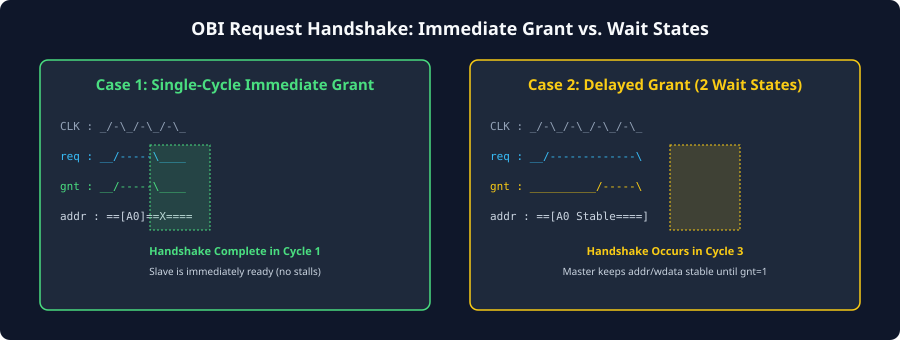
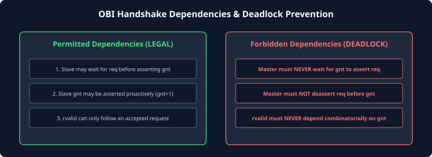

# Handshake Protocols: Request and Response Phase Mechanics

### Learning Objectives

- Master the fundamental mechanics of the **Request Handshake** (`req` and `gnt`) and **Response Handshake** (`rvalid`).
- Understand the strict invariants governing the **Request Stability Rule**.
- Contrast the three request timing relationships: Single-Cycle Immediate Grant, Delayed Grant Wait States, and Back-to-Back Pipelined Grants.
- Analyze response timing profiles across single-cycle SRAMs and high-latency multi-cycle peripherals.
- Dissect the legal vs. illegal **Cross-Phase Handshake Dependencies** to eliminate combinatorial deadlock loops.

---

## The Two Independent Handshakes

An OBI transaction is governed by two independent, phase-separated handshakes:

```
[ Master ] --- (1. Request Phase: req & gnt) --------> [ Slave ]
[ Master ] <-- (2. Response Phase: rvalid & err) ------ [ Slave ]
```

### The Request Handshake (`req` & `gnt`)

- **Condition:** An access request is formally accepted by the slave **if and only if** both `req` and `gnt` are observed HIGH on the active rising edge of `clk`:
  $$\text{Request Accepted} \iff (\text{req} = 1) \land (\text{gnt} = 1) \text{ at posedge clk}$$
- Once accepted on that clock edge, the slave has captured the address, control attributes, and write data (if a write). The request phase is **complete**.

### The Response Handshake (`rvalid`)

- **Condition:** The transaction completes and retires **if and only if** `rvalid` is observed HIGH on the rising edge of `clk`:
  $$\text{Transaction Completed} \iff (\text{rvalid} = 1) \text{ at posedge clk}$$
- On this clock edge, read data (`rdata`) is captured by the master, or write completion status is logged.

---

## The Core Protocol Invariant: Request Stability Rule

To prevent data corruption, race conditions, and glitches, the OBI specification defines an unyielding stability rule for the Request Channel:

> **The Request Stability Invariant:**
> **Once asserted (`req = 1`), the master MUST maintain `req = 1` and hold ALL associated payload signals (`addr`, `we`, `be`, `wdata`, `atop`, `prot`, `dbg`, `aid`) completely constant and stable until the cycle in which the slave asserts `gnt = 1`.**

### Why Early Deassertion is Strictly Forbidden:

If a master were allowed to pull `req` LOW before receiving `gnt`, a severe race condition would occur:

- The slave might assert `gnt` on the exact clock cycle the master drops `req`.
- The slave would capture corrupt, half-transitioning address or data bits, committing invalid writes to memory.
- Therefore, in OBI: **A request cannot be canceled once launched.**

---

## Request Handshake Timing Scenarios

The OBI specification grants timing autonomy to both master and slave. A request transfer can proceed under three distinct scenarios:



### Scenario A: Immediate Single-Cycle Grant (Zero Wait States)

- Master asserts `req = 1` and places `addr = A0` on the bus.
- The slave is idle and ready, asserting `gnt = 1` concurrently in that exact same clock cycle.
- On the rising clock edge of Cycle 1, both `req` and `gnt` are HIGH: **The request is accepted immediately in a single cycle**.
- Master drops `req = 0` in Cycle 2 (unless a new request is immediately available).

### Scenario B: Delayed Grant (Wait States Inserted by Slave)

- Master asserts `req = 1` with `addr = A0` (Cycle 1).
- The slave is currently busy or internal input FIFOs are full, driving `gnt = 0`.
- The master **holds `req = 1` and keeps `addr` completely stable** across Cycles 1 and 2.
- In Cycle 3, the slave becomes ready and drives `gnt = 1`.
- On the rising edge of Cycle 3: **The request handshake completes**.

### Scenario C: Pipelined Back-to-Back Grants (Streaming Requests)

- Slave holds `gnt = 1` continuously across multiple cycles.
- Master drives `req = 1` with `addr = A0` in Cycle 1 $\implies$ Accepted on Edge 1.
- Master immediately changes to `addr = A1` with `req = 1` in Cycle 2 $\implies$ Accepted on Edge 2.
- Master streams `addr = A2` with `req = 1` in Cycle 3 $\implies$ Accepted on Edge 3.
- Delivers maximum theoretical address throughput of **1 request per cycle**.

---

## Response Phase Latency and Behaviors

Because the Response Channel is decoupled from the Request Channel, the slave can return `rvalid` after an arbitrary latency:

```
Cycle:        1       2       3       4       5       6
            +-------+-------+-------+-------+-------+-------+
req  & gnt: [Req 0]  (Request accepted in Cycle 1)
            +-------+-------+-------+-------+-------+-------+
SRAM rvalid:        [Resp 0]  (Single-cycle SRAM latency: Cycle 2)
DRAM rvalid:                        [Resp 0]  (Multi-cycle latency: Cycle 5)
```

1. **Zero-Latency Response (Unsupported):** OBI does **not** permit combinatorial zero-cycle responses (i.e., `rvalid` asserting in the exact same cycle as `req` for the same request). The earliest `rvalid` can return is the clock cycle **immediately following the grant cycle** ($L_{\min} = 1\text{ cycle}$).
2. **Single-Cycle Response (SRAM):** The slave accepts the request in Cycle 1 and returns `rvalid = 1` in Cycle 2. This matches synchronous on-chip SRAM access timing.
3. **Multi-Cycle Response (Flash / DRAM / Peripherals):** The slave accepts the request in Cycle 1, accesses external memory or peripheral registers over several cycles, and asserts `rvalid = 1` in Cycle 5.

---

## Cross-Phase Handshake Dependencies and Deadlock Freedom

When integrating arbiters, crossbars, and slave controllers, designers must obey strict rules regarding which signals are allowed to depend combinatorially on other signals:



### Rule 1: Grant Generation May Depend on Request

A slave is fully permitted to evaluate `req` before generating `gnt`:
$$\text{assign } gnt = req \ \& \ slave\_has\_space; \quad \mathbf{\text{(LEGAL)}}$$
Alternatively, a slave may proactively drive `gnt = 1` even when `req = 0` to indicate idle readiness.

### Rule 2: Request Generation Must NEVER Depend on Grant

A master must **never** wait for `gnt` before asserting `req`:
$$\text{assign } req = gnt \ \& \ internal\_request; \quad \mathbf{\text{(STRICTLY FORBIDDEN! DEADLOCK!)}}$$
If both master and slave waited for the other party to assert their signal first, neither signal would ever go HIGH, locking the bus in permanent deadlock.

### Rule 3: Response Generation Must NEVER Depend on Request Phase in the Same Cycle

A slave must never create a combinatorial path from `req` or `gnt` to `rvalid` within the same clock cycle. `rvalid` must be driven from internal state registers or sequential logic, ensuring that timing closure is decoupled across pipeline boundaries.

---

## Handshake Rules Summary Matrix

| Handshake Wire | Driven By | Can it depend combinatorially on the other channel wire? |      Permitted to Deassert Before Handshake?       |
| -------------- | :-------: | -------------------------------------------------------- | :------------------------------------------------: |
| **`req`**      |  Master   | **NO** (Must never depend on `gnt`)                      |      **NO** (Must hold stable until `gnt=1`)       |
| **`gnt`**      |   Slave   | **YES** (May evaluate `req` before granting)             | YES (May toggle dynamically based on buffer state) |
| **`rvalid`**   |   Slave   | **NO** (Cannot depend on current-cycle `req` or `gnt`)   |     **NO** (Must hold until sampled/completed)     |

---

## Chapter Summary

- An OBI transaction requires two distinct handshakes: the **Request Handshake** (`req` & `gnt`) and the **Response Handshake** (`rvalid`).
- **Request Stability Invariant:** Once `req` is asserted, all address, control, and data signals must remain completely unchanged until granted (`gnt = 1`).
- The earliest a response can arrive is the cycle immediately following the grant ($L \ge 1\text{ cycle}$).
- Combinatorial deadlocks are avoided by enforcing the rule that **`req` must never wait for `gnt`**.
- Decoupled phase timing allows OBI systems to interface effortlessly with both zero-wait on-chip SRAMs and multi-cycle external memories.

---

## Review Questions

### Question 1

An OBI master asserts `req = 1` with `addr = 0x8000_0000`. In the following cycle, `gnt` is `0`, but software instructs the master to cancel the memory access. Can the master pull `req` LOW to cancel the transfer?

<details>
<summary><b>View Answer</b></summary>
No. Under the OBI Request Stability Invariant, once `req` is asserted, the master is strictly prohibited from deasserting `req` or changing any payload signals until a cycle occurs where `gnt = 1`. Deasserting `req` early would violate the protocol and risk data corruption if the slave asserted `gnt` concurrently. The master must allow the transaction to complete, and discard the returned response in software.
</details>

### Question 2

Can an OBI slave tie `gnt` permanently HIGH (`assign gnt = 1'b1;`)? What are the implications of doing so?

<details>
<summary><b>View Answer</b></summary>
Yes, this is completely legal and very common for single-cycle on-chip SRAM controllers. By holding `gnt = 1` permanently, the slave indicates that it is capable of accepting a new transfer request on every single clock cycle without wait states. The request handshake completes in whichever cycle the master asserts `req = 1`.
</details>

### Question 3

Explain why OBI prohibits combinatorial zero-cycle responses (i.e., returning `rvalid = 1` in the exact same cycle as the `req` & `gnt` handshake).

<details>
<summary><b>View Answer</b></summary>
A zero-cycle response would require the master's request signals to pass through the interconnect address decoder, enter the slave's internal memory array or register logic, read the data, and drive `rvalid` and `rdata` back through the interconnect multiplexers to the master—all within a single clock period. This long combinatorial path would severely limit the maximum achievable clock frequency of the entire SoC. Enforcing a minimum 1-cycle response latency guarantees that the response phase is registered, enabling high clock speeds.
</details>

### Question 4

What happens if an RTL designer accidentally writes `assign req = gnt & tx_ready;` in a master module?

<details>
<summary><b>View Answer</b></summary>
This creates a fatal circular dependency deadlock. If the slave is designed to wait for `req` before asserting `gnt` (`assign gnt = req & slave_ready;`), neither signal will ever go HIGH. The master will wait for `gnt` to assert `req`, and the slave will wait for `req` to assert `gnt`. Both devices will freeze permanently. The master's `req` generation must always be independent of `gnt`.
</details>

---

##### Copyright (c) 2026 squared-studio
