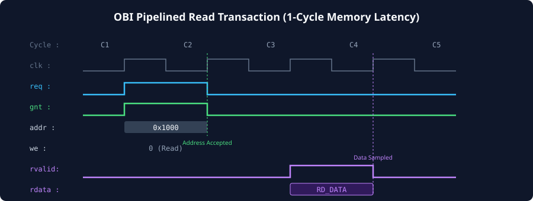
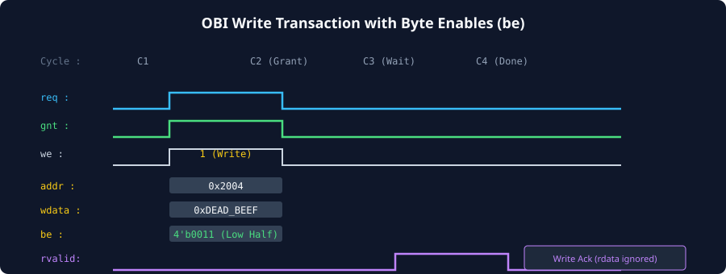

# Basic Read and Write Transfers

### Learning Objectives

- Step through the complete cycle-by-cycle timing flow of an OBI **Read Transaction** across Request and Response channels.
- Step through the complete cycle-by-cycle timing flow of an OBI **Write Transaction** with write completion signaling.
- Master the operation of **Byte Enables (`be`)** for partial-word stores: Byte (8-bit), Halfword (16-bit), and Word (32-bit).
- Analyze memory access latency profiles (single-cycle on-chip SRAM vs. multi-cycle peripheral access).
- Identify and resolve **Read-After-Write (RAW) pipeline hazards** in OBI memory controllers.

---

## Anatomy of an OBI Read Transaction

An OBI read transaction consists of:

1. **Request Phase:** The master drives `addr`, sets `we = 0`, asserts `req = 1`, and waits for `gnt = 1`.
2. **Response Phase:** The slave retrieves data from memory and drives `rdata` while asserting `rvalid = 1`.



### Cycle-by-Cycle Breakdown (1-Cycle Latency SRAM Read):

- **Cycle 1 (Request Phase):**
  - Master asserts `req = 1`, `we = 0` (indicating Read), and drives `addr = 0x1000`.
  - Slave is ready and asserts `gnt = 1`.
  - On the rising edge of Cycle 1, both `req` and `gnt` are HIGH: **The read request is accepted**.
- **Cycle 2 (Memory Access / Request Termination):**
  - The master has completed its request phase and deasserts `req = 0`.
  - The slave internal SRAM array reads the memory cell addressed by `0x1000`.
  - `rvalid` remains LOW; the master waits.
- **Cycle 3 (Response Phase):**
  - The slave drives the fetched data onto `rdata = RD_DATA` and asserts `rvalid = 1`. `err = 0`.
  - On the rising edge of Cycle 3, the master samples `rdata`: **Read transaction successfully completed**.

---

## Anatomy of an OBI Write Transaction

A common misconception among engineers familiar with AHB or APB is that a write operation does not require a response. In OBI, **every write transaction returns an explicit response on the Response Channel (`rvalid`)**:



### Cycle-by-Cycle Breakdown (2-Cycle Latency Peripheral Write):

- **Cycle 1 (Request Presentation):**
  - Master drives `addr = 0x2004`, `we = 1` (indicating Write), `wdata = 0xDEAD_BEEF`, and `be = 4'b0011`.
  - Master asserts `req = 1`.
  - Slave is not ready (`gnt = 0`).
- **Cycle 2 (Grant Handshake):**
  - Master maintains all payload signals stable.
  - Slave asserts `gnt = 1`.
  - On the rising clock edge of Cycle 2: **Write request and data accepted**.
- **Cycle 3 (Peripheral Internal Write / Memory Commit):**
  - Master drops `req = 0`.
  - Slave hardware commits `0xBEEF` into the lower 16 bits of register `0x2004`.
  - `rvalid` is LOW.
- **Cycle 4 (Write Acknowledgment):**
  - Slave asserts `rvalid = 1` with `err = 0`.
  - `rdata` is don't-care and ignored by the master.
  - Master logs that the write has officially retired: **Write transaction completed**.

---

## Byte Enable (`be`) Mechanics and Partial Writes

RISC-V architectures provide dedicated store instructions of varying operand widths:

- `SB` (Store Byte: 8 bits)
- `SH` (Store Halfword: 16 bits)
- `SW` (Store Word: 32 bits)
- `SD` (Store Doubleword: 64 bits, RV64)

The OBI **Byte Enable (`be`)** bus allows the processor to execute these sub-word writes on a 32-bit or 64-bit data bus without requiring a Read-Modify-Write cycle:

### 32-Bit OBI Bus Byte-Lane Mapping (`DATA_WIDTH = 32`, `be[3:0]`):

| Target Store Operation       | Target Address (`addr[1:0]`) | Active Byte Enable (`be[3:0]`) | Valid Byte Lane on `wdata[31:0]` |
| ---------------------------- | :--------------------------: | :----------------------------: | -------------------------------- |
| **Store Byte (Byte 0)**      |           `2'b00`            |     **`4'b0001`** (`4'h1`)     | `wdata[7:0]`                     |
| **Store Byte (Byte 1)**      |           `2'b01`            |     **`4'b0010`** (`4'h2`)     | `wdata[15:8]`                    |
| **Store Byte (Byte 2)**      |           `2'b10`            |     **`4'b0100`** (`4'h4`)     | `wdata[23:16]`                   |
| **Store Byte (Byte 3)**      |           `2'b11`            |     **`4'b1000`** (`4'h8`)     | `wdata[31:24]`                   |
| **Store Halfword (Lower)**   |           `2'b00`            |     **`4'b0011`** (`4'h3`)     | `wdata[15:0]`                    |
| **Store Halfword (Upper)**   |           `2'b10`            |     **`4'b1100`** (`4'hC`)     | `wdata[31:16]`                   |
| **Store Word (Full 32-bit)** |           `2'b00`            |     **`4'b1111`** (`4'hF`)     | `wdata[31:0]` (All 4 bytes)      |

### Memory Controller Action on Byte Enables:

When the memory controller commits the write to physical SRAM:

$$
\text{mem}[addr][8n+7 : 8n] \le \begin{cases}
wdata[8n+7 : 8n], & \text{if } be[n] = 1 \\
\text{mem}[addr][8n+7 : 8n], & \text{if } be[n] = 0 \text{ (Preserved untouched!)}
\end{cases}
$$

---

## Read-After-Write (RAW) Hazards in OBI Systems

Because OBI allows requests and responses to be decoupled by multiple clock cycles, memory subsystems must handle **Read-After-Write (RAW)** ordering hazards:

```
Cycle:         1             2             3             4
             +-------------+-------------+-------------+-------------+
Request:     [ Write to X ] [ Read from X ]
             +-------------+-------------+-------------+-------------+
RAM State:   (Write in FIFO)              (Committed)
Response:                                              [ Read Data ]
```

### The Hazard Scenario:

1. The CPU core issues a write to address `0x1000` with data `0xAAAA_AAAA` in Cycle 1.
2. The slave controller accepts the write (`gnt = 1`) and pushes it into an internal write buffer queue.
3. In Cycle 2, the CPU immediately issues a read targeting the **exact same address** `0x1000`.
4. If the slave controller reads directly from the physical SRAM array before the write buffer has drained, the read will return the **old, stale data** that was in memory before Cycle 1!

### Architectural Solutions:

1. **Write-Buffer Bypassing (Forwarding):** The slave controller compares the read address against the pending entries in its write buffer. If an address match is detected, the controller forwards the updated write data directly to the read response, bypassing the RAM array.
2. **Buffer Drain on Collision:** If a read matches a pending write address, the slave controller stalls the read (`gnt = 0`) until the write buffer has completely drained into memory.

---

## Comparison of OBI Read and Write Characteristics

| Feature                 | OBI Read Transaction                   | OBI Write Transaction                         |
| ----------------------- | -------------------------------------- | --------------------------------------------- |
| **`we` Signal Level**   | `0` (Logic LOW)                        | `1` (Logic HIGH)                              |
| **`wdata` Payload**     | Don't-Care (ignored by slave)          | **Valid write data** (must match `be`)        |
| **`be` Byte Mask**      | Typically `4'b1111` (or sub-word mask) | **Active byte mask** (`4'b0001` to `4'b1111`) |
| **Acceptance Phase**    | `req = 1` and `gnt = 1`                | `req = 1` and `gnt = 1`                       |
| **Response Phase**      | `rvalid = 1`, `rdata` sampled          | `rvalid = 1`, `rdata` ignored                 |
| **Purpose of `rvalid`** | Returns valid data and status          | **Confirms write completion and status**      |

---

## Chapter Summary

- Read transactions initiate with `we = 0`, capture address on `req & gnt`, and sample `rdata` on `rvalid = 1`.
- Write transactions initiate with `we = 1`, deliver `wdata` and `be` on `req & gnt`, and receive an explicit completion acknowledgment on `rvalid = 1`.
- **Byte Enables (`be`)** allow 8-bit (`SB`) and 16-bit (`SH`) partial-word stores without requiring read-modify-write memory operations.
- Slaves must implement write-forwarding or drain-stalling to prevent **Read-After-Write (RAW)** stale data hazards.
- The minimum response latency for any OBI transaction is 1 clock cycle.

---

## Review Questions

### Question 1

Why does an OBI write transaction require an `rvalid = 1` response from the slave, even though write data was already delivered during the request phase?

<details>
<summary><b>View Answer</b></summary>
The `rvalid` signal on a write transaction serves as an explicit completion acknowledgment and error reporting mechanism. It confirms that the write has been successfully committed to memory (or safely absorbed into a buffered interconnect) and reports whether a bus error occurred via `err`. Without `rvalid`, the master processor would have no way of knowing when a store instruction has retired or if a memory protection violation occurred.
</details>

### Question 2

A 32-bit RISC-V processor executes a Store Halfword (`SH`) instruction writing `0x1234` to address `0x0000_1002`. What are the values of `addr`, `wdata`, and `be[3:0]` on the OBI bus?

<details>
<summary><b>View Answer</b></summary>
- **Address (`addr`):** `0x0000_1002` (or aligned word base `0x0000_1000` with byte offset 2).
- **Target Byte Lanes:** Address offset `2` corresponds to bytes 2 and 3 (the upper 16 bits of the 32-bit word).
- **Byte Enable (`be`):** `4'b1100` (`4'hC`).
- **Write Data (`wdata`):** The halfword `0x1234` is aligned to the upper 16 bits: `wdata = 32'h1234_xxxx` (or `32'h1234_0000`).
</details>

### Question 3

Can an OBI master issue a new read request while waiting for the `rvalid` response of an earlier write request?

<details>
<summary><b>View Answer</b></summary>
Yes. In an OBI implementation that supports pipelined Multiple Outstanding Transactions (MOT), once the write request phase completes (`req = 1` and `gnt = 1`), the master is fully authorized to issue a subsequent read request on the Request Channel in the very next cycle, even while the previous write's `rvalid` is still pending.
</details>

### Question 4

What failure occurs in an on-chip memory system if a slave returns read data without addressing Read-After-Write (RAW) hazards?

<details>
<summary><b>View Answer</b></summary>
If a write request is accepted into an internal write buffer and a subsequent read request targets the same address before the write buffer has updated the physical SRAM, a RAW hazard occurs. If the controller does not implement write forwarding or buffer flushing, the read will sample the old un-updated contents of the SRAM cell, returning stale data to the CPU and causing catastrophic software bugs.
</details>

---

##### Copyright (c) 2026 squared-studio
