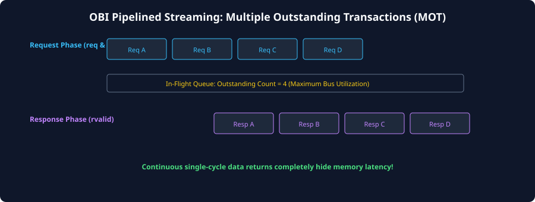
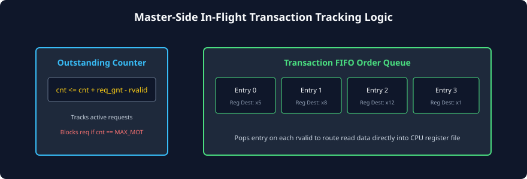

# Pipelining and Multiple Outstanding Transactions (MOT)

### Learning Objectives
- Understand the throughput penalty imposed by single-outstanding transaction models.
- Master the mechanics of **Pipelined Request Issuing** and **Multiple Outstanding Transactions (MOT)**.
- Analyze the operation of the master-side **In-Flight Credit Counter** (`cnt <= cnt + req_gnt - rvalid`).
- Examine master-side **Transaction Tracking FIFOs** that map returning responses to destination CPU registers.
- Calculate the minimum queue depth required to achieve **100% bus efficiency** over multi-cycle latency memory paths.

---

## The Single-Outstanding Throughput Bottleneck

In the most basic implementation of OBI, a master enforces a strict **Single Outstanding Transaction** constraint:
- The master issues Request 0, receives Grant 0, and then drops `req = 0`.
- The master **freezes and refuses to issue Request 1** until the slave returns `rvalid = 1` for Request 0.

```
Single-Outstanding Bus Timeline (with 3-Cycle Memory Latency):
Cycle:        1       2       3       4       5       6       7       8
            +-------+-------+-------+-------+-------+-------+-------+-------+
req & gnt:  [Req 0]  (Stalled waiting for rvalid)   [Req 1]  (Stalled...)
rvalid:                             [Resp 0]                        [Resp 1]
Bus Duty Cycle: Only 1 transfer every 4 cycles = 25% Efficiency!
```

If memory access latency is 3 cycles, the Request Channel sits completely idle for 3 out of every 4 clock cycles, slashing effective system bandwidth by **$75\%$**!

To unlock the full performance of high-speed RISC-V cores, OBI natively supports **Multiple Outstanding Transactions (MOT)**.

---

## Pipelined Streaming: Multiple Outstanding Transactions

With Multiple Outstanding Transactions enabled, the master does not wait for responses before issuing new requests. It pipelines requests continuously on every cycle that `gnt = 1`:



### Pipelining Timeline Analysis:
- **Cycles 1 through 4:** The master streams four consecutive requests (`Req A`, `Req B`, `Req C`, `Req D`) on consecutive clock edges.
- **Cycles 4 through 7:** As the memory pipeline delay elapses, the slave returns the four responses (`Resp A`, `Resp B`, `Resp C`, `Resp D`) on consecutive clock edges!
- **Result:** After the initial latency ramp-up, the interface achieves **100% bus throughput**—delivering one full 32-bit word on every single clock cycle!

---

## In-Flight Transaction Tracking Architecture

When multiple requests are active in the memory pipeline simultaneously, the master must track how many requests are currently in flight to avoid buffer overflows.



### The In-Flight Credit Counter
The master maintains an internal unsigned counter that tracks the net balance of active requests:

$$\Delta_{\text{inflight}} = (\text{req} \land \text{gnt}) - \text{rvalid}$$

```
always_ff @(posedge clk or negedge reset_n) begin
  if (!reset_n) begin
    inflight_cnt <= '0;
  end else begin
    case ({req && gnt, rvalid})
      2'b10:   inflight_cnt <= inflight_cnt + 1; // New request granted
      2'b01:   inflight_cnt <= inflight_cnt - 1; // Response returned
      default: inflight_cnt <= inflight_cnt;     // Idle or simultaneous
    endcase
  end
end
```

### Flow Control Backpressure Threshold
The master is parameterized with a maximum outstanding capacity: $N_{MOT}$ (e.g., $N_{MOT} = 4$ or $8$).
- When `inflight_cnt < N_MOT` $\implies$ Master is free to assert `req = 1`.
- When `inflight_cnt == N_MOT` $\implies$ Master **must hold `req = 0`** until at least one pending transaction retires (`rvalid = 1`).

---

## Master-Side Transaction Order Queue

In a pipelined CPU core (like the CV32E40P), when the Load/Store Unit executes a load instruction (e.g., `lw x5, 0(x10)`), it issues an OBI read request. 

Because the response will not return until several cycles later, the LSU must remember:
*Which CPU destination register should receive this returning data?*

### The FIFO Order Queue Mechanism:
1. **At Request Acceptance (`req & gnt = 1`):** The master pushes the destination register index (e.g., `x5`, `x8`, `x12`) and operation type (Load Byte vs. Load Word) into an internal **Transaction FIFO Order Queue**.
2. **At Response Return (`rvalid = 1`):** The master pops the oldest entry from the front of the queue.
3. The popped metadata routes `rdata` directly into the correct destination register in the CPU register file.
4. Because standard OBI responses return **strictly in-order** for a single master, a simple First-In, First-Out queue guarantees deterministic register file writeback!

---

## Little's Law and FIFO Depth Sizing

How deep must the master's in-flight tracking FIFO and the slave's internal buffers be to sustain 100% bus utilization?

We apply the classical queuing theory result known as **Little's Law**:

$$N_{\text{optimal}} = \text{Throughput} \times \text{Latency}$$

### Derivation of Optimal MOT Depth ($N_{MOT}$):
Let:
- Target Throughput = $1\text{ transfer per clock cycle}$ ($R = 1$).
- Memory Round-Trip Latency = $L$ clock cycles (from `req & gnt` to `rvalid`).

$$N_{MOT} \ge L + 1$$

### Practical Sizing Examples:
1. **On-Chip Tightly Coupled SRAM ($L = 1\text{ cycle}$ latency):**
   $$N_{MOT} \ge 1 + 1 = \mathbf{2\text{ Outstanding Transactions}}$$
   A shallow tracking depth of 2 entries sustains 100% continuous bandwidth over on-chip SRAM.
2. **Multi-Bank Interconnect / Cache Subsystem ($L = 4\text{ cycles}$ latency):**
   $$N_{MOT} \ge 4 + 1 = \mathbf{5\text{ (Provision for 8 entries)}}$$
   A tracking depth of 8 entries completely masks the 4-cycle cache access latency.
3. **External DDR Memory Controller ($L = 15\text{ cycles}$ latency):**
   $$N_{MOT} \ge 15 + 1 = \mathbf{16\text{ Outstanding Transactions}}$$
   Requires a 16-entry tracking queue to prevent the processor's data cache from stalling during burst fills.

---

## Chapter Summary

- A single-outstanding transaction constraint limits bus efficiency to $1 / (L + 1)$, creating massive throughput stalls over multi-cycle memory.
- **Multiple Outstanding Transactions (MOT)** allow masters to pipeline requests on consecutive clock cycles, achieving 100% bus utilization.
- Masters track in-flight requests using an **In-Flight Credit Counter** incremented on `req & gnt` and decremented on `rvalid`.
- Masters utilize a **Transaction FIFO Order Queue** to map returning responses to the correct CPU destination registers.
- To maintain peak throughput without pipeline bubbles, the MOT capacity must satisfy **$N_{MOT} \ge L + 1$** (Little's Law).

---

## Review Questions

### Question 1
A RISC-V processor connects to an OBI memory subsystem with a fixed round-trip read latency of 5 clock cycles ($L = 5$). What is the maximum achievable bus efficiency if the master only supports a single outstanding transaction?
<details>
<summary><b>View Answer</b></summary>
In a single-outstanding model, the master issues a request at Cycle 1 and must wait for `rvalid` at Cycle 6 before issuing the next request:
$$\text{Total Period} = L + 1 = 5 + 1 = 6\text{ cycles}$$
Only 1 cycle out of every 6 cycles carries valid data:
$$\text{Efficiency } (\eta) = \frac{1}{6} \times 100\% \approx \mathbf{16.67\%}$$
The bus is idle 83.3% of the time!
</details>

### Question 2
In an OBI master supporting up to 4 multiple outstanding transactions ($N_{MOT} = 4$), what condition causes the master to withhold asserting `req` even though its internal execution pipeline has a valid load instruction ready?
<details>
<summary><b>View Answer</b></summary>
The master must withhold `req` when its internal in-flight transaction counter reaches the maximum capacity:
$$\text{inflight\_cnt} == 4$$
If the master launched a 5th request, it would overflow its internal tracking FIFO and lose the ability to associate the returning `rdata` with the corresponding CPU destination register. The master must stall its LSU pipeline until at least one pending transaction retires with `rvalid = 1`.
</details>

### Question 3
If an OBI interface observes `req = 1`, `gnt = 1`, and `rvalid = 1` in the exact same clock cycle, how should the in-flight credit counter update on the next rising clock edge?
<details>
<summary><b>View Answer</b></summary>
The counter evaluates the net change:
$$\Delta = (\text{req} \land \text{gnt}) - \text{rvalid} = 1 - 1 = 0$$
Because a new transaction was accepted at the exact same moment an earlier transaction retired, the net count of active in-flight requests remains **completely unchanged** (`inflight_cnt <= inflight_cnt`).
</details>

### Question 4
Why is a simple First-In, First-Out (FIFO) queue sufficient for a master to track destination registers in a standard OBI system?
<details>
<summary><b>View Answer</b></summary>
Because in a standard single-master OBI implementation, the slave memory subsystem guarantees **strict in-order response delivery**. Responses return in the exact chronological sequence in which their requests were granted. Therefore, the oldest entry waiting at the head of the FIFO always corresponds to the transaction currently completing on `rvalid`.
</details>

---

##### Copyright (c) 2026 squared-studio
