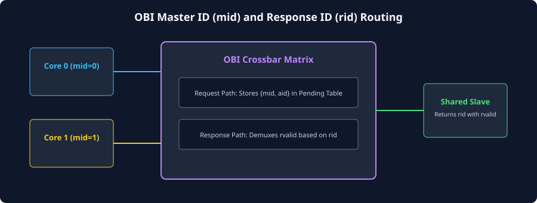
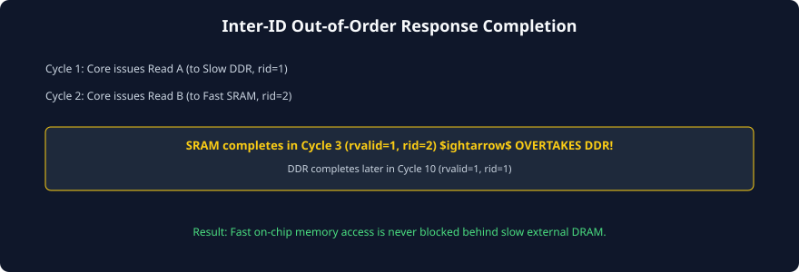

# Transaction IDs, Routing, and Out-of-Order Execution

### Learning Objectives
- Master the role and encoding of OBI Transaction Identifiers: **Address ID (`aid`)**, **Master ID (`mid`)**, and **Response ID (`rid`)**.
- Analyze how multi-master crossbars implement **ID Widening (Prefix Prepending)** to disambiguate concurrent master requests.
- Contrast strict **Intra-ID In-Order Execution** with flexible **Inter-ID Out-of-Order Completion**.
- Understand how fast on-chip SRAM responses can overtake slow external memory responses without violating RISC-V memory consistency models.
- Trace the internal reassembly tables used by crossbar interconnects to route responses back to the originating master ports.

---

## Multi-Master Interconnect Routing: The Role of IDs

In a single-master, single-slave system, transaction IDs are unnecessary because all responses return in the exact order they were issued.

However, in modern multi-core RISC-V SoCs:
1. Multiple cores (e.g., Core 0 and Core 1) concurrently access shared memory across an interconnect crossbar.
2. Individual cores access wildly different targets: on-chip SRAM (1-cycle latency), tightly coupled peripherals (2-cycle latency), and external DDR memory (20-cycle latency).

If the interconnect forced all transactions to return in strict global order, a fast SRAM read from Core 1 would sit stalled waiting behind a 20-cycle DDR access from Core 0!

To prevent this bottleneck, OBI defines standardized **Transaction Identifiers**:



### The OBI ID Signals:
- **`aid[N:0]` (Address ID):** An identification tag driven by the master on the Request Channel alongside `addr`.
- **`mid[M:0]` (Master ID):** An identifier assigned by the interconnect crossbar to denote which master port initiated the request.
- **`rid[R:0]` (Response ID):** Driven by the slave on the Response Channel alongside `rvalid`. It matches the `aid` / `mid` of the transaction being completed.

---

## Interconnect ID Widening (Prefix Prepending)

When multiple masters connect to a shared OBI crossbar, each master independently assigns its own `aid` tags (e.g., Core 0 uses tags `0` to `3`, and Core 1 also uses tags `0` to `3`).

How does a shared slave distinguish between Core 0's request with `aid = 1` and Core 1's request with `aid = 1`?

```
Core 0 (aid = 2'b01) ----\
                          ---> [ OBI Crossbar ] ---> Slave Interface (Wider ID: 4 bits)
Core 1 (aid = 2'b01) ----/     Prepends Master Port Index:
                               Core 0 -> {2'b00, 2'b01} = 4'b0001
                               Core 1 -> {2'b01, 2'b01} = 4'b0101
```

### The ID Extension Mechanism:
1. When Core 0 issues a request, the crossbar prepends Core 0's port index:
   $$\text{Slave\_ID} = \{\text{mid}, \ \text{aid}\} = \{2'b00, \ \text{aid}\}$$
2. The slave receives the widened ID and stores it in its internal memory pipeline.
3. When the slave returns the response, it echoes the widened ID on **`rid`**.
4. The crossbar inspects the `mid` prefix bits of `rid`, identifies that the response belongs to Core 0, strips the prefix, and routes the response exclusively to Core 0's response port!

---

## OBI Ordering Rules: Intra-ID vs. Inter-ID

OBI enforces precise ordering semantics to ensure that software memory operations behave deterministically:



### Rule 1: Strict Intra-ID In-Order Execution
> **Transactions that share the same transaction ID (`aid`) MUST be completed and retired in the exact chronological order in which they were granted.**

- If a master issues Request A (`aid = 1`) and then Request B (`aid = 1`), the slave or interconnect **must return Response A before returning Response B**.
- This guarantees that sequential memory loads within the same instruction thread retain sequential consistency.

### Rule 2: Inter-ID Out-of-Order Execution
> **Transactions that possess different transaction IDs (`aid`) have NO ordering restrictions. The interconnect or slave is fully permitted to return responses out-of-order.**

- If a master issues Request A (`aid = 1`, targeting slow DDR) and then Request B (`aid = 2`, targeting fast SRAM):
  - The SRAM can return Response B (`rvalid = 1, rid = 2`) in Cycle 3!
  - The DDR can return Response A (`rvalid = 1, rid = 1`) later in Cycle 10.
- Fast accesses **overtake** slow accesses, completely eliminating head-of-line blocking!

---

## Interconnect Pending Transaction Table (PTT)

To support out-of-order responses across complex crossbars, the interconnect switch maintains an internal hardware table called the **Pending Transaction Table (PTT)**:

| Table Entry Index | Master Port Source (`mid`) | Master Original `aid` | Target Slave Port | Transaction Status |
|:---:|:---:|:---:|:---:|:---:|
| **Entry 0** | Core 0 (`2'b00`) | `4'h1` | Slave 2 (DDR) | Pending (Cycle 1) |
| **Entry 1** | Core 1 (`2'b01`) | `4'h0` | Slave 0 (SRAM) | **Completed (Cycle 3)** $\rightarrow$ Retired |
| **Entry 2** | Core 0 (`2'b00`) | `4'h2` | Slave 1 (UART) | Pending (Cycle 2) |

When a slave asserts `rvalid`, the crossbar matches `rid` against the PTT:
1. The crossbar immediately identifies which master port must receive the data.
2. The crossbar verifies that no Intra-ID ordering rules are violated.
3. The table entry is deallocated, returning credit back to the master.

---

## Preserving RISC-V Memory Consistency

In multi-threaded RISC-V systems, out-of-order bus responses must strictly comply with the **RISC-V Weak Memory Ordering (RVWMO)** specification:

- If software executes a sequence of independent loads, the processor core assigns **different `aid` tags**, allowing the OBI bus to reorder them for maximum memory throughput.
- If software executes a memory barrier instruction (`FENCE` or `FENCE.I`):
  1. The CPU core stalls its OBI Request Channel.
  2. The core waits until **all outstanding in-flight OBI transactions have retired** (in-flight counter drains to `0`).
  3. Only after all pending transactions have returned `rvalid` does the core resume issuing post-fence requests.
- This guarantees that software-defined synchronization points are never compromised by hardware bus reordering.

---

## Chapter Summary

- In multi-master systems, **`aid` (Address ID)** and **`mid` (Master ID)** tags identify the origin of requests, while **`rid` (Response ID)** routes completions.
- Interconnect crossbars implement **ID Widening** by prepending master port indices to incoming IDs.
- **Intra-ID transactions (same ID)** must strictly execute and retire in-order to preserve sequential consistency.
- **Inter-ID transactions (different IDs)** may retire **out-of-order**, allowing fast on-chip SRAM to overtake high-latency DDR memory accesses.
- Crossbars utilize a **Pending Transaction Table (PTT)** to track and demultiplex out-of-order responses.
- RISC-V `FENCE` instructions are enforced at the bus level by draining all active OBI transactions before proceeding.

---

## Review Questions

### Question 1
A dual-core processor connects to an OBI crossbar. Core 0 issues a request with `aid = 4'h3`. Core 1 simultaneously issues a request with `aid = 4'h3`. How does the crossbar prevent these two identical IDs from colliding at a shared slave?
<details>
<summary><b>View Answer</b></summary>
The crossbar performs ID Widening (prefix prepending). It prepends the master's hardware port index (`mid`) to the request's `aid`. For example:
- Core 0's request is presented to the slave with widened ID: `{1'b0, 4'h3} = 5'h03`.
- Core 1's request is presented to the slave with widened ID: `{1'b1, 4'h3} = 5'h13`.  
When the slave completes the access and returns `rid`, the crossbar decodes the MSB: if `0`, it routes the response to Core 0; if `1`, it routes the response to Core 1.
</details>

### Question 2
Under what conditions is an OBI slave permitted to return responses out-of-order relative to the order in which the requests were accepted?
<details>
<summary><b>View Answer</b></summary>
An OBI slave (or interconnect) is permitted to return responses out-of-order **if and only if the transactions possess different Transaction IDs (`aid` / `rid`)**. Transactions that share the exact same ID value are subject to strict Intra-ID ordering rules and must always complete in the order they were granted.
</details>

### Question 3
How does a RISC-V processor core ensure that a `FENCE` instruction is respected when connecting over an out-of-order OBI interconnect?
<details>
<summary><b>View Answer</b></summary>
When the processor pipeline decodes a `FENCE` instruction, it halts the issuance of any new memory requests on the OBI Request Channel. It then monitors its internal in-flight transaction counter. Only when all pending requests have returned their corresponding `rvalid` responses (in-flight counter reaches zero) does the core consider the `FENCE` satisfied. The processor then resumes issuing subsequent memory requests.
</details>

### Question 4
Why is out-of-order execution particularly beneficial in heterogenous SoCs with both on-chip SRAM and external flash memory?
<details>
<summary><b>View Answer</b></summary>
On-chip SRAM has a very low latency (typically 1 clock cycle), whereas external SPI NOR flash or DDR memory has a latency of dozens to hundreds of clock cycles. Without out-of-order execution, an access to SRAM issued after a flash access would be blocked until the slow flash read completed (head-of-line blocking). With out-of-order OBI support (using different IDs), the SRAM access completes immediately in 1 cycle, allowing the CPU to continue executing code while the flash access completes in the background.
</details>

---

##### Copyright (c) 2026 squared-studio
