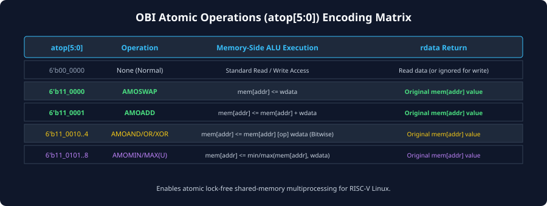
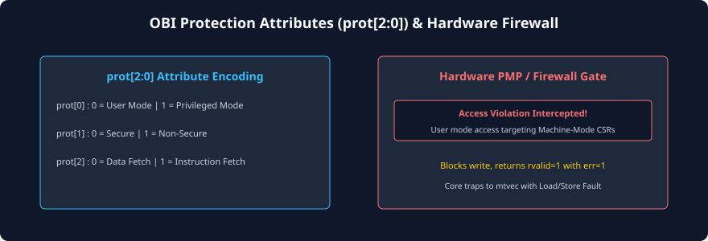

# Atomic Operations (ATOP) and Protection Attributes

### Learning Objectives
- Master the integration of the **RISC-V 'A' (Atomic) Standard Extension** over the Open Bus Interface.
- Decode the 6-bit Atomic Operation signal: **`atop[5:0]`** (AMOSWAP, AMOADD, AMOAND, AMOOR, AMOXOR, AMOMAX, AMOMIN).
- Contrast **Memory-Side Atomic Execution** with traditional core-side atomic locking.
- Decode the 3-bit Protection attribute: **`prot[2:0]`** for hardware security firewalls and Physical Memory Protection (PMP).
- Analyze the role of the **`dbg`** signal during non-intrusive on-chip hardware debugging.

---

## Supporting the RISC-V 'A' Extension in OBI

In shared-memory multi-core systems, software requires atomic primitives (such as spinlocks, mutexes, and thread-safe counters) to prevent race conditions during read-modify-write operations:

$$\text{Read Original Value} \longrightarrow \text{Compute New Value} \longrightarrow \text{Write New Value}$$

Traditionally, atomic operations required locking the entire bus arbiter (stalling all other masters) or using Load-Reserved / Store-Conditional (`LR`/`SC`) monitors.

To achieve maximum multi-core scalability, the OBI specification introduces **Memory-Side Atomic Memory Operations (AMOs)** via the 6-bit **`atop[5:0]`** sideband bus:

```
[ CPU Core ] ===== (atop[5:0], addr, wdata) =====> [ Smart Memory Controller ]
                                                             |
                                            Executes ALU operation internally
                                            inside memory (Atomic in 1 cycle!)
                                                             |
[ CPU Core ] <==== (rvalid=1, rdata=Original_Val) <==========+
```

### The Memory-Side Atomic Advantage:
- Instead of the CPU reading the data into its registers, modifying it in its execution ALU, and writing it back across the bus, the CPU offloads the entire operation to the memory controller in a **single OBI transaction**!
- The memory controller's internal arithmetic unit modifies the memory location atomically in place and returns the **original unmodified value** back to the CPU on `rdata`.
- This eliminates multi-cycle bus turnaround and prevents any possibility of race conditions between competing cores.

---

## The `atop[5:0]` Encoding Matrix

The 6-bit `atop[5:0]` signal maps directly to the standard RISC-V AMO instruction opcodes:



| `atop[5:0]` Value | Instruction Mnemonic | Memory-Side ALU Operation Performed | Value Returned on `rdata` |
|:---:|---|---|---|
| **`6'b00_0000`** | **None (Normal)** | Standard Read (`we=0`) or Write (`we=1`) | Read data (or ignored for write) |
| **`6'b11_0000`** | **`AMOSWAP.W`** | `mem[addr] <= wdata` | Original `mem[addr]` value |
| **`6'b11_0001`** | **`AMOADD.W`** | `mem[addr] <= mem[addr] + wdata` | Original `mem[addr]` value |
| **`6'b11_0010`** | **`AMOAND.W`** | `mem[addr] <= mem[addr] & wdata` | Original `mem[addr]` value |
| **`6'b11_0011`** | **`AMOOR.W`** | `mem[addr] <= mem[addr] | wdata` | Original `mem[addr]` value |
| **`6'b11_0100`** | **`AMOXOR.W`** | `mem[addr] <= mem[addr] ^ wdata` | Original `mem[addr]` value |
| **`6'b11_0101`** | **`AMOMAX.W`** | `mem[addr] <= max_signed(mem[addr], wdata)` | Original `mem[addr]` value |
| **`6'b11_0110`** | **`AMOMIN.W`** | `mem[addr] <= min_signed(mem[addr], wdata)` | Original `mem[addr]` value |
| **`6'b11_0111`** | **`AMOMAXU.W`**| `mem[addr] <= max_unsigned(mem[addr], wdata)`| Original `mem[addr]` value |
| **`6'b11_1000`** | **`AMOMINU.W`**| `mem[addr] <= min_unsigned(mem[addr], wdata)`| Original `mem[addr]` value |

### Handshake Semantics of an Atomic Transfer:
During an atomic transfer:
1. Master asserts `req = 1`, `we = 1`, and drives `atop` with the desired operation (e.g., `6'b11_0001` for `AMOADD`).
2. Slave accepts `req` with `gnt = 1`.
3. In the subsequent response phase, the slave asserts `rvalid = 1`.
4. Even though `we = 1` was asserted during the request, the slave **drives `rdata` with the original value** present in memory prior to the atomic arithmetic operation!

---

## Protection Levels and `prot[2:0]` Signaling

To enforce operating system privilege boundaries and isolate untrusted user software from secure kernel peripherals, OBI provides the 3-bit **`prot[2:0]`** protection signal:



### Bit Definitions of `prot[2:0]`:

#### Bit 0: Privilege Mode (`prot[0]`)
- `0` = **Normal / User Mode (`U-Mode`):** Issued by unprivileged user-space applications.
- `1` = **Privileged Mode (`M-Mode` / `S-Mode`):** Issued by operating system kernels, hypervisors, or Machine-mode firmware.
- *Application:* Memory controllers reject accesses where `prot[0] = 0` targeting kernel CSRs or hardware interrupt controllers.

#### Bit 1: Security Domain (`prot[1]`)
- `0` = **Secure Access:** Issued by a secure execution enclave or Trusted Execution Environment (TEE).
- `1` = **Non-Secure Access:** Issued by standard, untrusted operating systems.
- *Application:* Hardware firewalls block non-secure accesses targeting cryptographic key registers, returning `err = 1`.

#### Bit 2: Access Type (`prot[2]`)
- `0` = **Data Access:** Load or store instruction execution from the Load/Store Unit (LSU).
- `1` = **Instruction Access:** CPU program counter instruction fetch from the Instruction Fetch Unit (IFU).
- *Application:* Enforces **Execute-Never (XN)** policies by rejecting instruction fetches from data-only RAM regions to thwart buffer-overflow code injection attacks.

---

## Hardware Security Firewalls and RISC-V PMP

In modern RISC-V architectures, the **Physical Memory Protection (PMP)** unit inside the CPU checks addresses against memory access permissions.

When an SoC integrates DMA engines or multi-core interconnects, external hardware firewalls outside the CPU core monitor the OBI Request Channel:

```
[ Master ] --- (req, addr, prot[2:0]) ---> [ OBI Security Firewall ] ---> [ Target Peripheral ]
                                                    |
                                      Does prot violate permissions?
                                           /                 \
                                         YES                  NO
                                         /                     \
                             [ Block Request ]           [ Forward to Slave ]
                             [ Return rvalid=1 with err=1 ]
```

- If an unprivileged master attempts to write to a secure register, the firewall **blocks the request from reaching the slave**.
- To prevent the bus from deadlocking, the firewall responds to the master with **`rvalid = 1` and `err = 1`**.
- The processor core intercepts `err = 1` and traps to its exception vector with an **Access Fault**.

---

## The Debug Access Signal (`dbg`)

The OBI specification defines an optional 1-bit **`dbg`** signal:
- Asserted HIGH when a bus transfer originates from the on-chip **RISC-V Debug Module (DM)** (e.g., via a JTAG / OpenOCD probe).
- **Security Bypass Capability:** Certain secure peripherals permit debug probes to inspect memory for system diagnostics even when CPU cores are halted.
- **Trace and Triggering:** Hardware Logic Analyzers (ILAs) and debug trace units use `dbg = 1` to filter out non-intrusive debug memory accesses from normal software program execution.

---

## Chapter Summary

- OBI supports the **RISC-V 'A' Extension** using the 6-bit **`atop[5:0]`** signal for memory-side Atomic Memory Operations.
- `atop` offloads read-modify-write arithmetic (such as `AMOADD` and `AMOSWAP`) to the memory controller in a single atomic transaction, returning the original memory value on `rdata`.
- **`prot[2:0]`** encodes Privilege level (User vs. Privileged), Security domain (Secure vs. Non-Secure), and Access type (Data vs. Instruction).
- Hardware firewalls intercept unauthorized `prot` accesses and return **`err = 1`** to trigger architectural exceptions.
- The **`dbg`** signal flags non-intrusive memory accesses originating from the RISC-V Hardware Debug Module.

---

## Review Questions

### Question 1
How does an OBI memory-side atomic operation (`atop = 6'b11_0001` for `AMOADD.W`) differ from a standard CPU-driven read-modify-write sequence?
<details>
<summary><b>View Answer</b></summary>
In a CPU-driven sequence, the CPU must issue an OBI read request, wait for the response, perform the addition in its internal ALU, and then issue an OBI write request across the bus. This requires two separate bus transactions and leaves a window where another core could modify the memory location in between (a race condition). With memory-side `atop`, the CPU issues a single write-like transaction containing the addition operand. The memory controller executes the addition internally in one atomic cycle and returns the original pre-addition value on `rdata`, eliminating race conditions and cutting bus traffic in half.
</details>

### Question 2
During an `AMOSWAP.W` atomic transaction, the master asserts `we = 1` during the request phase. Does the slave return valid data on `rdata` during the response phase? What data does it contain?
<details>
<summary><b>View Answer</b></summary>
Yes. In an OBI atomic transaction, even though `we = 1` is driven on the Request Channel, the slave **must return the original, pre-swap value** stored in that memory location on `rdata` alongside `rvalid = 1`. This allows the processor core to place the original value into the destination register specified by the RISC-V instruction.
</details>

### Question 3
How does an on-chip memory controller utilize `prot[2]` to implement an Execute-Never (XN) hardware security policy?
<details>
<summary><b>View Answer</b></summary>
`prot[2]` indicates the access type: `1` for an instruction fetch, and `0` for a data access. In memory regions designated for data storage (such as the stack, heap, or DMA buffers), the memory controller checks `prot[2]`. If an access arrives with `prot[2] = 1` (indicating that the CPU is attempting to execute instructions from a data buffer), the controller immediately blocks the fetch and returns `rvalid = 1` with `err = 1`. The CPU traps with an **Instruction Access Fault**, blocking malicious code injection exploits.
</details>

### Question 4
What is the state of `atop[5:0]` during a standard, non-atomic OBI memory write?
<details>
<summary><b>View Answer</b></summary>
During a standard read or write, `atop[5:0]` must be driven to all zeros: **`6'b00_0000`** (`None`), indicating to the target slave that no arithmetic or atomic operations are requested.
</details>

---

##### Copyright (c) 2026 squared-studio
