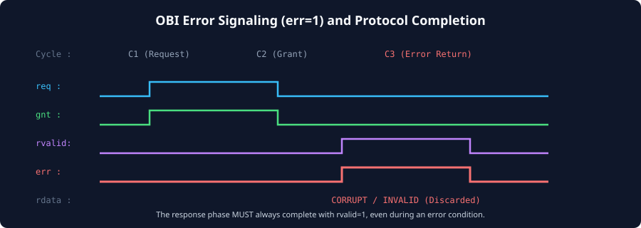
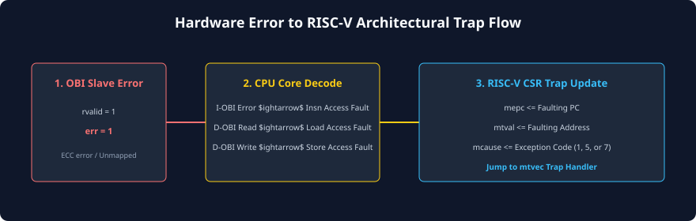

# Error Reporting, Fault Handling, and Bus Exceptions

### Learning Objectives
- Master the operation of the OBI **Error Indicator (`err`)** signal on the Response Channel.
- Distinguish between **Slave-Generated Errors** (ECC faults, alignment violations) and **Interconnect Decode Errors** (unmapped space).
- Understand the critical **Response Completion Invariant** during bus fault conditions.
- Trace the hardware translation of OBI bus errors into **RISC-V Architectural Exceptions**.
- Analyze CPU register updates upon trap entry: **`mcause`**, **`mepc`**, and **`mtval`**.

---

## The OBI Error Indicator Signal (`err`)

Every OBI response carries a 1-bit status signal: **`err`**.

- **Normal Success:** `rvalid = 1` and `err = 0`. The transaction completed successfully; for reads, `rdata` contains valid memory data.
- **Bus Fault / Error:** `rvalid = 1` and `err = 1`. The transaction failed. For reads, `rdata` is invalid and must be discarded.



### Cycle Timing of Error Signaling:
As shown in the timing diagram above:
1. In Cycle 1, the master issues a request (`req = 1`, `gnt = 1`).
2. The addressed slave evaluates the request and detects an unrecoverable hardware fault.
3. In Cycle 3, the slave asserts **both `rvalid = 1` and `err = 1`**.
4. The master samples `err = 1` on the rising clock edge and immediately aborts the retired instruction, vectoring the CPU into an operating system trap handler.

---

## Root Causes of OBI Bus Errors

In modern SoCs, OBI errors fall into two primary hardware classifications:

### Slave-Generated Errors
Generated internally by an addressed peripheral or memory controller:
- **Uncorrectable ECC / Parity Errors:** An internal SRAM block detects a multi-bit memory corruption that cannot be corrected by on-chip error-correcting codes.
- **Privilege / Protection Violations:** An unprivileged User-mode access (`prot[0] = 0`) targets a restricted Machine-mode control register.
- **Write to Read-Only Register:** A software store instruction targets a hardware status register that is physically read-only.
- **Unsupported Atomic Operation:** A master requests an atomic operation (`atop != 0`) targeting a legacy peripheral that does not support hardware AMOs.

### Interconnect-Generated Decode Errors
Generated by the **Interconnect Fabric** itself when an access does not map to any physical slave:
- If a master issues an address targeting an unmapped "hole" in the system address map, the interconnect address decoder detects that no slave select line (`PSEL`) was asserted.
- An internal **Default Error Slave** inside the crossbar accepts the request (`gnt = 1`) and returns **`rvalid = 1` with `err = 1`** on the subsequent cycle, preventing the master from hanging indefinitely waiting for a grant.

---

## The Response Completion Invariant

A fundamental rule of OBI protocol compliance is:

> **The Response Completion Invariant:**
> **Every accepted request (`req & gnt = 1`) MUST be acknowledged by exactly ONE response completion (`rvalid = 1`), EVEN IF AN ERROR OCCURS.**

### Why This Rule is Vital:
Recall from Chapter 5 that OBI masters maintain an internal in-flight credit counter to track pending requests (`inflight_cnt`):
- If a slave simply dropped the request or refused to assert `rvalid` because an address was invalid, the master's in-flight counter would **never decrement**.
- The master's tracking FIFO would remain permanently locked, and the master would eventually freeze all subsequent bus operations.
- **The Protocol-Compliant Behavior:** Even during a fatal bus fault, the slave or interconnect MUST assert `rvalid = 1` alongside `err = 1` to cleanly balance the master's in-flight accounting!

---

## Translation to RISC-V Architectural Exceptions

When an OBI master (such as the CORE-V CV32E40P processor core) receives an error response (`rvalid = 1` with `err = 1`), its internal exception unit maps the bus fault directly to the RISC-V privileged architecture:



### The Three RISC-V Bus Fault Exceptions:
Depending on which functional unit issued the transaction, the core traps to a specific exception code:

| OBI Master Interface | Faulting Operation | RISC-V Exception Code (`mcause`) | Exception Name |
|---|---|:---:|---|
| **I-OBI (Instruction)** | Instruction Prefetch / Fetch | **`1`** | **Instruction Access Fault** |
| **D-OBI (Data)** | Load Instruction (`LW`, `LH`, `LB`) | **`5`** | **Load Access Fault** |
| **D-OBI (Data)** | Store Instruction (`SW`, `SH`, `SB`) | **`7`** | **Store/AMO Access Fault** |
| **D-OBI (Data)** | Atomic Operation (`AMOADD`, etc.) | **`7`** | **Store/AMO Access Fault** |

---

## Architectural CSR Updates on Trap Entry

When the RISC-V processor takes an access fault trap, hardware automatically updates four critical Control and Status Registers (CSRs):

```
       +-------------------------------------------------------------+
mepc   | Holds the Virtual Address of the Faulting Instruction       |
       +-------------------------------------------------------------+
mcause | Holds Exception Code (1 for Insn, 5 for Load, 7 for Store)  |
       +-------------------------------------------------------------+
mtval  | Holds the Faulting Target Physical Memory Address           |
       +-------------------------------------------------------------+
mstatus| Saves previous privilege mode in MPP; clears MIE (IRQ mask) |
       +-------------------------------------------------------------+
                                      |
                                      v
                    CPU Jumps to Trap Vector (mtvec)
```

### The Diagnostic Utility of `mtval`:
When an operating system kernel (such as FreeRTOS, Zephyr, or Linux) catches a `Store/AMO Access Fault`:
1. The kernel inspects **`mepc`** to find the exact line of assembly code that executed the bad store.
2. The kernel inspects **`mtval`** to identify the exact physical address on the OBI bus that failed.
3. The kernel can determine whether the fault was caused by a null-pointer dereference, an unmapped memory region, or a peripheral security violation, terminating the offending application or halting with a kernel panic.

---

## Chapter Summary

- Transaction success or failure is signaled on the Response Channel using the **`err`** wire alongside `rvalid`.
- **Slave Errors** are generated by addressed peripherals (e.g., ECC failures or alignment violations); **Decode Errors** are generated by the interconnect when an address maps to empty space.
- **Response Completion Invariant:** Every granted request must receive an `rvalid = 1` response, even during an error, to preserve master in-flight counter balance.
- OBI errors map to standard RISC-V exceptions: **Instruction Access Fault** (`mcause = 1`), **Load Access Fault** (`mcause = 5`), and **Store/AMO Access Fault** (`mcause = 7`).
- Upon trap entry, **`mepc`** captures the faulting instruction PC, and **`mtval`** captures the faulting OBI target address.

---

## Review Questions

### Question 1
What failure occurs in an OBI master core if an interconnect slave simply ignores an invalid request without asserting `rvalid`?
<details>
<summary><b>View Answer</b></summary>
If a slave does not return `rvalid`, the master's internal in-flight transaction counter will never decrement. The transaction will remain permanently active in the master's tracking FIFO. Eventually, the master's in-flight queue will fill to capacity ($N_{MOT}$), causing the master to stall its execution pipeline permanently waiting for space. To prevent this hang, the interconnect must always return `rvalid = 1` with `err = 1` for every granted request.
</details>

### Question 2
When an OBI slave asserts `rvalid = 1` and `err = 1` in response to a read request, what is the status of the data driven on `rdata`?
<details>
<summary><b>View Answer</b></summary>
The data on `rdata` is considered invalid and undefined (garbage data). The master core's Load/Store Unit must discard `rdata` and must not write it into any CPU destination register. Instead, the core immediately raises a **Load Access Fault** exception.
</details>

### Question 3
A RISC-V core executes a Store Word (`SW x10, 0(x11)`) instruction that accesses an unmapped memory hole. Which RISC-V CSRs are updated, and what values do they hold?
<details>
<summary><b>View Answer</b></summary>
1. **`mcause`:** Updated with Exception Code **`7`** (**Store/AMO Access Fault**).
2. **`mepc`:** Updated with the Program Counter (PC) address of the `SW` instruction.
3. **`mtval`:** Updated with the target physical address (the value of `x11 + 0`).
4. **`mstatus`:** Updates `MPP` with the privilege mode prior to the trap and clears `MIE` to disable interrupts.
</details>

### Question 4
How does an interconnect Default Error Slave prevent the processor core from hanging when software accesses an address that does not map to any physical device in the SoC?
<details>
<summary><b>View Answer</b></summary>
When the interconnect address decoder detects that the target address does not match any slave's address range, it routes the request to an internal Default Error Slave. This error slave asserts `gnt = 1` to absorb the request and, on the next clock cycle, asserts `rvalid = 1` with `err = 1`. This safely completes the bus handshake and alerts the CPU to raise an access fault without hanging the bus.
</details>

---

##### Copyright (c) 2026 squared-studio
