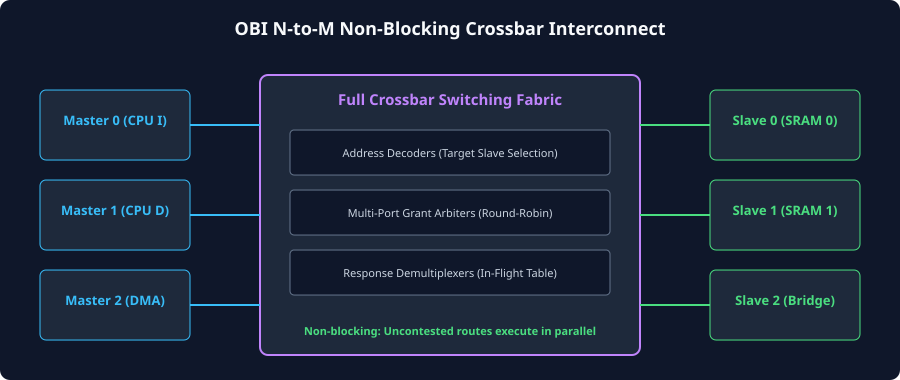
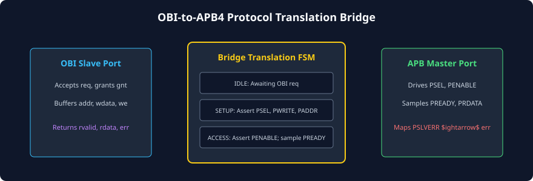

# Interconnect Architecture: Crossbars, Arbiters, and Bridges

### Learning Objectives
- Master the internal design of multi-master, multi-slave **OBI Crossbar Interconnects**.
- Implement **1-to-N Address Demultiplexers** and **N-to-1 Multi-Port Arbiters** (Round-Robin and Fixed Priority).
- Understand non-blocking crossbar routing where uncontested routes execute in parallel.
- Analyze the architectural translation of an **OBI-to-APB4 Bridge** for low-power peripherals.
- Trace the operation of an **OBI-to-AXI4 Bridge** and **OBI-to-SRAM Memory Wrappers**.

---

## Multi-Master, Multi-Slave OBI Interconnects

In a complete RISC-V SoC, multiple bus masters (e.g., Instruction Fetch, Data LSU, DMA Controller, Hardware Crypto Accelerator) must communicate concurrently with multiple memory slaves (e.g., Instruction SRAM, Data TCDM SRAM, Peripheral Bridge, Boot ROM).

The **OBI Crossbar Switch** provides the switching fabric that arbitrates and routes these transactions:



### The Non-Blocking Crossbar Advantage:
Because OBI channels are point-to-point and unidirectional:
- If Master 0 (Instruction Fetch) accesses Slave 0 (Instruction SRAM) while Master 1 (Data LSU) accesses Slave 1 (Data SRAM), **both transactions execute simultaneously in the exact same clock cycle without any contention or arbitration stall**!
- Only when two masters attempt to access the **exact same physical slave** does arbitration occur.

---

## Fundamental Interconnect Building Blocks

An OBI interconnect crossbar is composed of three primary digital logic building blocks:

### 1-to-N Address Decoders
Located at each master input port. It inspects the upper address bits of `addr` against the system memory map:
$$\text{Target Slave Select} = \text{Decode}(\text{addr[31:20]})$$
- Generates internal qualified request lines: `req_to_slave[N-1:0]`.
- Routes `gnt` back to the master from the selected slave.

### N-to-1 Grant Arbiters
Located at each slave interface port. When multiple masters target the same slave concurrently:
- Evaluates active request lines from competing masters.
- Selects a winner using **Round-Robin** (fair bandwidth sharing) or **Fixed Priority** (low-latency CPU priority).
- Multiplexes the winner's `addr`, `we`, `be`, and `wdata` onto the slave's pins.
- Asserts `gnt` back **only to the winning master**. Losing masters see `gnt = 0` and hold their requests stable for the next cycle.

### Response Demultiplexers
When a slave returns `rvalid`, the response demultiplexer uses the Transaction ID (`rid` / `mid`) or an internal pending request queue to route `rvalid`, `rdata`, and `err` back exclusively to the master that initiated the request.

---

## The OBI-to-APB4 Peripheral Bridge

Because low-power peripherals (such as UART, SPI, I2C, Timers, and GPIOs) operate on the simple AMBA APB protocol, modern SoCs incorporate an **OBI-to-APB Bridge**:



### Bridge Finite State Machine (FSM):
The bridge translates OBI's decoupled request/response phases into APB's two-phase cycle (**SETUP Phase** followed by **ACCESS Phase**):

```
       +--------------+
       |   IDLE       |<------------------------------------------+
       +--------------+                                           |
              | (obi_req == 1)                                    |
              v                                                   |
       +--------------+                                           |
       |  APB_SETUP   |  --> Drives PSEL=1, PENABLE=0, PADDR      |
       +--------------+                                           |
              | (Next Clock Edge)                                 |
              v                                                   |
       +--------------+                                           |
       |  APB_ACCESS  |  --> Drives PENABLE=1; Samples PREADY     |
       +--------------+                                           |
              |                                                   |
         PREADY == 1 ?                                            |
         /          \                                             |
       YES           NO (Insert APB Wait States)                  |
       /              \                                           |
      v                +--> Stay in APB_ACCESS                    |
  Assert obi_rvalid = 1                                           |
  Map PSLVERR -> obi_err -----------------------------------------+
```

### Signal Translation Mapping:
| OBI Signal (Input to Bridge) | APB4 Signal (Driven by Bridge) | Functional Mapping Rule |
|---|---|---|
| `addr` | `PADDR` | Direct address mapping. |
| `we` | `PWRITE` | Direct direction mapping (`1` for Write, `0` for Read). |
| `wdata` | `PWDATA` | Direct write data mapping. |
| `be` | `PSTRB` | Byte enable directly drives APB4 write byte strobes. |
| `prot` | `PPROT` | Privilege and security attributes mapped 1-to-1. |
| *(Internal Bridge State)* | `PSEL` | Asserted during `APB_SETUP` and `APB_ACCESS`. |
| *(Internal Bridge State)* | `PENABLE` | Asserted during `APB_ACCESS`. |
| `PREADY` | `gnt` / `rvalid` | When `PREADY = 1`, bridge asserts `rvalid = 1`. |
| `PRDATA` | `rdata` | Sampled by bridge and returned on `rdata`. |
| `PSLVERR` | `err` | If `PSLVERR = 1`, bridge asserts `err = 1`. |

---

## The OBI-to-AXI4 Interconnect Bridge

When an embedded RISC-V core must connect to a high-performance system interconnect (e.g., to access external DDR5 memory alongside an on-chip GPU), an **OBI-to-AXI4 Bridge** is deployed:

### Translation Mechanics:
1. **Read Request Translation:**
   - OBI read request (`we = 0`, `req = 1`, `gnt = 1`) $\implies$ Converted into an AXI Read Address handshake on the **AR Channel** (`ARVALID = 1`, `ARLEN = 0` for 1 beat).
   - When AXI returns read data on the **R Channel** (`RVALID = 1`), the bridge drives `rdata = RDATA` and asserts `obi_rvalid = 1`.
2. **Write Request Translation:**
   - OBI write request (`we = 1`) $\implies$ Converted into simultaneous handshakes on the AXI **AW Channel** (`AWADDR`) and **W Channel** (`WDATA`, `WSTRB = be`, `WLAST = 1`).
   - The bridge waits until the slave completes the write and acknowledges on the AXI **B Channel** (`BVALID = 1`).
   - The bridge then asserts `obi_rvalid = 1` with `err = (BRESP != 2'b00)`.

---

## OBI-to-SRAM Memory Wrappers

Most ASIC and FPGA on-chip memories use standard synchronous SRAM primitives (such as single-port or dual-port RAM macros) with basic chip-select (`cs`), write-enable (`we`), address (`addr`), and data pins.

An **OBI SRAM Wrapper** bridges the protocol cleanly:
- When `obi_req = 1`, the wrapper generates the internal SRAM chip-select: `sram_cs = 1`.
- Because single-port SRAM can service an access on every rising clock edge, the wrapper drives **`obi_gnt = 1` continuously**.
- The wrapper latches the read enable into a 1-cycle delay flip-flop:
  $$\text{assign } obi\_rvalid = req\_gnt\_registered;$$
- Synchronous SRAM data output feeds directly to `obi_rdata`.
- This creates an ultra-efficient, single-cycle latency SRAM interface with zero dead cycles!

---

## Chapter Summary

- **OBI Crossbars** provide non-blocking switching: uncontested master-slave routes execute concurrently in parallel.
- Interconnect switches combine **1-to-N Address Decoders**, **N-to-1 Arbiters**, and **Response Demultiplexers**.
- The **OBI-to-APB4 Bridge** translates decoupled OBI phases into APB's two-phase `SETUP` and `ACCESS` cycles.
- The **OBI-to-AXI4 Bridge** converts unified OBI requests into AXI4 split-channel transactions.
- **SRAM Wrappers** map OBI requests directly to synchronous memory macros, providing continuous single-cycle bandwidth.

---

## Review Questions

### Question 1
Explain why two masters in an OBI crossbar can execute memory accesses at the exact same clock cycle without stalling, provided they target different slaves.
<details>
<summary><b>View Answer</b></summary>
OBI signals are unidirectional point-to-point connections. In a non-blocking crossbar matrix, every master port has independent routing paths and separate multiplexers to each slave port. If Master 0 decodes to Slave 0 and Master 1 decodes to Slave 1, their data paths do not share any physical wires or arbiters. Both request handshakes (`req & gnt`) and subsequent responses proceed in parallel with zero contention.
</details>

### Question 2
How does an OBI-to-APB bridge map the APB slave error signal `PSLVERR` into the OBI protocol?
<details>
<summary><b>View Answer</b></summary>
During the APB `ACCESS` phase, when the APB slave asserts `PREADY = 1` to complete the transfer, the bridge samples `PSLVERR`. If `PSLVERR = 1` (indicating an APB peripheral error), the bridge asserts `obi_rvalid = 1` alongside `obi_err = 1`. This safely completes the OBI transaction and alerts the processor core to raise an architectural access fault exception.
</details>

### Question 3
In an OBI-to-SRAM wrapper, why can `gnt` be held permanently at `1'b1`?
<details>
<summary><b>View Answer</b></summary>
A synchronous on-chip SRAM macro can accept a new address on every single rising clock edge without requiring wait states. Because the memory is always ready to accept an incoming read or write request, the wrapper can permanently tie `gnt = 1'b1`, indicating to masters that requests are accepted with zero wait states.
</details>

### Question 4
What happens in an OBI arbiter when Master A and Master B simultaneously assert `req = 1` targeting the exact same physical slave?
<details>
<summary><b>View Answer</b></summary>
The arbiter evaluates its configured arbitration policy (such as Round-Robin or Fixed Priority):
- The winning master has its address and data routed to the slave, and receives **`gnt = 1`** on that clock edge (request accepted).
- The losing master receives **`gnt = 0`** (stalled). Under the OBI Request Stability Rule, the losing master must keep its `req = 1` and hold all payload signals stable until the next arbitration cycle where it is granted access.
</details>

---

##### Copyright (c) 2026 squared-studio
