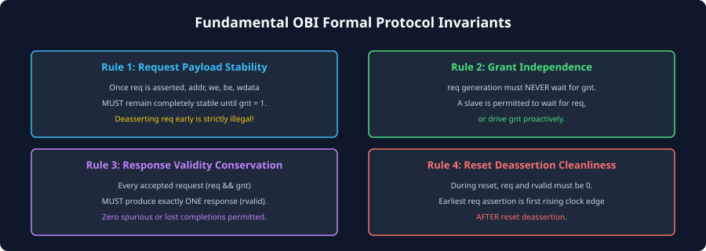
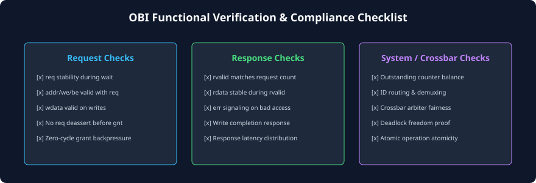

# Verification, Protocol Invariants, and Best Practices

### Learning Objectives
- Master the four core **Formal Protocol Invariants** that define a compliant Open Bus Interface implementation.
- Understand the mathematical formulation of protocol verification assertions (SVA principles described conceptually).
- Execute the comprehensive **OBI Functional Verification & Compliance Checklist**.
- Prevent common architectural bugs in OBI interconnect design, including credit counter leakage and grant race conditions.
- Review the complete synthesis of the Open Bus Interface series.

---

## The Four Fundamental OBI Protocol Invariants

Formal verification engineers verify OBI compliance by proving four mathematical invariants across all possible states of the bus fabric:

---

## Mathematical Formulation of Protocol Invariants

### Invariant 1: Request Payload Stability Rule
> **Formal Property:**
> If `req` is asserted in cycle $t$ and `gnt` is NOT asserted in cycle $t$, then in cycle $t+1$, `req` MUST remain asserted, and all payload buses (`addr`, `we`, `be`, `wdata`, `atop`, `prot`) MUST remain identical to their values in cycle $t$.

$$\forall t: \left( \text{req}_t \land \neg \text{gnt}_t \right) \implies \left( \text{req}_{t+1} \land (\text{payload}_{t+1} = \text{payload}_t) \right)$$

- **Verification Check:** Flags any master that cancels a request or glitches an address wire before receiving a grant.

### Invariant 2: Grant Independence Rule
> **Formal Property:**
> The assertion of `req` by a master MUST NOT depend combinatorially on `gnt` from the slave.

$$\frac{\partial(\text{req})}{\partial(\text{gnt})} = 0$$

- **Verification Check:** Proves freedom from combinatorial circular deadlocks between master and slave interfaces.

### Invariant 3: Response Validity Conservation (Counter Balance)
> **Formal Property:**
> Over any closed execution window from reset to time $T$, the total number of accepted requests must be greater than or equal to the total number of returned responses. Furthermore, the difference must never exceed the maximum in-flight capacity $N_{MOT}$.

$$0 \le \sum_{t=0}^{T} (\text{req}_t \land \text{gnt}_t) - \sum_{t=0}^{T} (\text{rvalid}_t) \le N_{MOT}$$

- **Verification Check:** Detects "phantom" responses (spurious `rvalid` without a preceding request) or "lost" completions (dropped responses that hang the CPU).

### Invariant 4: Reset Deassertion Cleanliness
> **Formal Property:**
> While `reset_n = 0`, both `req` and `rvalid` must be strictly `0`. The earliest permitted assertion of `req` is the first rising clock edge AFTER `reset_n` has transitioned to `1`.

$$\neg \text{reset\_n}_t \implies (\text{req}_t = 0 \land \text{rvalid}_t = 0)$$

---

## OBI Functional Verification Checklist

When building or validating an OBI IP core, crossbar interconnect, or bridge, verification teams follow a structured compliance scorecard:

### Request Channel Verification Checklist:
- [x] **Zero-Cycle Grant Test:** Verify proper single-cycle transfer when `gnt` is asserted in the same cycle as `req`.
- [x] **Extended Backpressure Test:** Stall `gnt` for 100 consecutive cycles; verify that `req`, `addr`, and `wdata` remain 100% stable without jitter.
- [x] **Back-to-Back Pipelined Requests:** Issue continuous requests with `gnt = 1` on every cycle; verify that the slave correctly samples unique addresses on every rising edge.
- [x] **Byte Enable Coverage:** Exercise all 16 permutations of `be[3:0]` during write operations, confirming that unselected byte lanes are preserved in memory.

### Response Channel Verification Checklist:
- [x] **Latency Distribution Testing:** Randomize slave response latency from 1 cycle to 50 cycles; confirm that master in-flight tracking does not underflow or overflow.
- [x] **Error Response Injection:** Force `err = 1` on both read and write transactions; verify that the processor core takes the correct exception trap (`mcause = 1, 5, \text{or } 7`).
- [x] **Burst Response Retirement:** Verify that responses returning on back-to-back cycles are all captured cleanly by the master without dropping characters.

### Crossbar & System-Level Verification Checklist:
- [x] **Crossbar Contention Arbitration:** Have multiple masters simultaneously target the same slave; verify that arbitration grants access fairly according to policy without starving any master.
- [x] **Non-Blocking Concurrency:** Have Master 0 access Slave 0 while Master 1 accesses Slave 1; prove that both transfers achieve full wire speed without mutual interference.
- [x] **Transaction ID Widening Integrity:** Verify that `aid` and `mid` tags are widened correctly on the forward path and stripped accurately on the response path.

---

## Common Architectural Pitfalls in OBI Design

### Pitfall 1: Credit Counter Leakage (Lost Responses)
- **Bug:** An interconnect bridge accepts an OBI request, converts it to an APB transaction, but an internal timeout terminates the APB cycle without asserting `obi_rvalid`.
- **Consequence:** The master's in-flight transaction counter never decrements. After several timeouts, the master locks up permanently.
- **Fix:** Every accepted request must **always** terminate with `rvalid = 1`, asserting `err = 1` if a timeout occurs.

### Pitfall 2: Combinatorial Path on `gnt`
- **Bug:** An interconnect arbiter creates a deep combinatorial logic cone from `req` through address decoders and priority logic to generate `gnt`.
- **Consequence:** Long timing paths degrade the maximum clock frequency of the entire chip.
- **Fix:** Register grant outputs or place skid buffers (register slices) on the Request Channel.

---

## Comprehensive Summary of the OBI Protocol Series

| Architectural Dimension | Key Architectural Takeaway |
|---|---|
| **Protocol Purpose** | Open-source, high-efficiency, royalty-free on-chip bus standard managed by the **OpenHW Group**. |
| **Core Architecture** | Dual-channel split design: **Request Channel** (`req`/`gnt`) and **Response Channel** (`rvalid`/`err`). |
| **Harvard Core Topology** | RISC-V processors expose **I-OBI** (Instruction Fetch) and **D-OBI** (Data LSU) for concurrent code and data memory access. |
| **Pipelining (MOT)** | Supports **Multiple Outstanding Transactions**, achieving 100% bus utilization over multi-cycle latency memory. |
| **Transaction Ordering** | Strict **Intra-ID in-order** execution; flexible **Inter-ID out-of-order** completion allows fast SRAM to overtake slow DRAM. |
| **Atomic Support** | **`atop[5:0]`** enables single-transaction memory-side Atomic Memory Operations for the RISC-V 'A' extension. |
| **Security Attributes** | **`prot[2:0]`** enforces User vs. Privileged mode, TrustZone security domains, and Execute-Never (XN) policies. |
| **Error Handling** | Response error signal **`err`** maps directly to RISC-V architectural traps: Instruction, Load, or Store Access Faults. |
| **Interconnect Bridges** | Native support for **non-blocking crossbars**, **OBI-to-APB4 bridges**, and **OBI-to-AXI4 bridges**. |

---

## Review Questions

### Question 1
State the OBI Request Stability Invariant and explain what failure would occur in an SoC if a master violated this rule.

<b>View Answer</b>

**The Request Stability Invariant:** Once a master asserts `req = 1`, it must keep `req` asserted and maintain all payload signals (`addr`, `we`, `be`, `wdata`, `atop`, `prot`) completely stable until a clock cycle occurs where `gnt = 1`.  
**Failure Consequence:** If a master deasserted `req` or changed `addr` while waiting for `gnt`, a race condition would occur if the slave asserted `gnt` on that exact cycle. The slave would capture corrupt or transitioning address/data bits, resulting in silent data corruption in memory or writing data to the wrong peripheral register.

### Question 2
What is the mathematical condition governing the relationship between the total number of granted requests and the total number of returned responses in a compliant OBI system?

<b>View Answer</b>

The system must satisfy Response Validity Conservation:
$$0 \le \sum (\text{req} \land \text{gnt}) - \sum (\text{rvalid}) \le N_{MOT}$$
The cumulative count of granted requests must always be greater than or equal to the cumulative count of returned responses (responses cannot be returned for non-existent requests), and the net difference (the number of active in-flight requests) must never exceed the maximum configured multiple outstanding transaction capacity ($N_{MOT}$).

### Question 3
How do register slices (skid buffers) help resolve critical timing paths on long OBI interconnect routing channels without violating protocol semantics?

<b>View Answer</b>

Because OBI channels are unidirectional and decoupled, a register slice can be inserted directly into the channel. The register slice captures incoming payload signals into flip-flops, isolating upstream timing paths from downstream paths. It handles the two-way `req`/`gnt` flow control across registers using internal shadow buffers, completely breaking long combinatorial wires across large dies while maintaining full throughput and zero dead cycles.

### Question 4
Why is formal property checking (assertions) particularly effective for verifying OBI interfaces compared to ad-hoc directed simulation?

<b>View Answer</b>

OBI relies on strict invariants (stability, independence, conservation, reset cleanliness). Directed simulation tests only specific stimulus sequences and may miss rare corner cases (e.g., an error response arriving on the exact cycle a multi-master crossbar switches grant priority under maximum FIFO depth). Formal verification mathematically evaluates the entire state space of the protocol under all possible timing delays, definitively proving that deadlocks, counter leakage, and stability violations can never occur under any legal sequence of events.

---

##### Copyright (c) 2026 squared-studio
