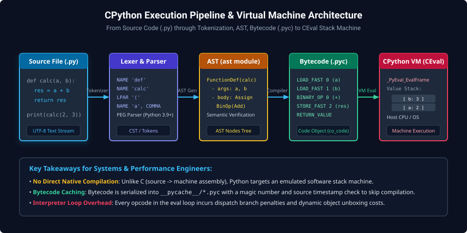
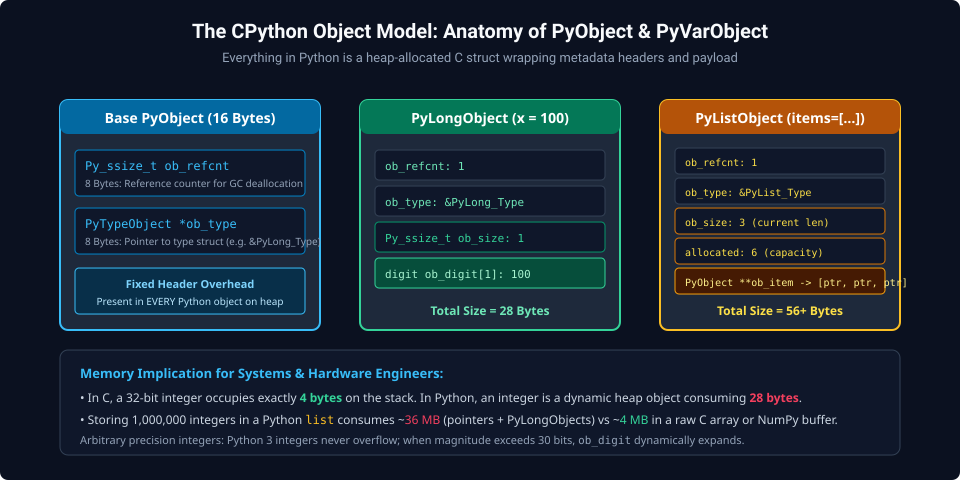
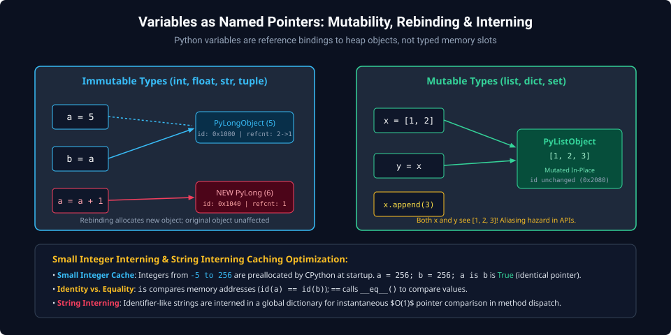

# Chapter 1: Python Runtime Architecture, Data Model & Execution Lifecycle

Python is an interpreted, dynamically-typed, high-level programming language built upon a rigorous C runtime architecture known as **CPython**. For systems engineers, hardware designers, and verification architects, understanding Python goes far beyond high-level syntax; it requires mastering how source text transforms into bytecode, how heap-allocated C structures model language objects, and how dynamic reference bindings govern variable lifecycles.

---

## 1.1 The CPython Execution Pipeline

Unlike ahead-of-time (AOT) compiled languages like C or Rust that compile directly into native CPU machine instructions, Python executes on top of an emulated stack-based virtual machine.



### Compilation Stages

1. **Source Parsing & Lexical Analysis**:
   - The tokenizer converts raw UTF-8 text into a linear stream of language tokens (`NAME`, `OP`, `NUMBER`, `INDENT`, `DEDENT`).
   - Python 3.9+ employs a Parsing Expression Grammar (**PEG**) parser that constructs a Concrete Syntax Tree (CST) without backtracking ambiguity.
2. **Abstract Syntax Tree (AST)**:
   - The CST transforms into an AST (accessible via the standard library `ast` module), representing semantic program hierarchy independently of source formatting.
3. **Bytecode Compilation**:
   - The compiler walks the AST and emits a linear array of 16-bit instructions known as **Bytecode** packed inside a `PyCodeObject` (`co_code`).
   - Bytecode is cached on disk within `__pycache__/*.pyc` files with a header containing a format magic number and source timestamp.
4. **Virtual Machine Evaluation Loop (`_PyEval_EvalFrame`)**:
   - The CPython evaluation loop operates as an emulated stack machine. Instructions push and pop object pointers to/from a thread-local value stack.

```python
import dis

def calculate_checksum(addr: int, data: int) -> int:
    crc = addr ^ data
    return crc

# Disassemble bytecode instructions
dis.dis(calculate_checksum)
```

_Disassembly output:_

```text
  2           0 LOAD_FAST                0 (addr)
              2 LOAD_FAST                1 (data)
              4 BINARY_OP                12 (^)
              8 STORE_FAST               2 (crc)

  3          10 LOAD_FAST                2 (crc)
             12 RETURN_VALUE
```

---

## 1.2 The Python Data Model: `PyObject` Anatomy

In Python, **everything is an object**—including integers, functions, strings, and modules. In CPython, all objects are allocated on the heap as instances of C structures derived from the base `PyObject` header.



### The Base `PyObject` Struct

At the C level (defined in `Include/object.h`), every object begins with two mandatory 64-bit fields ($16\text{ bytes}$ total on 64-bit systems):

```c
typedef struct _object {
    _PyObject_HEAD_EXTRA    // Doubly-linked list pointers for debug GC
    Py_ssize_t ob_refcnt;   // 64-bit reference counter
    PyTypeObject *ob_type;  // Pointer to object type descriptor struct
} PyObject;
```

### Variable-Length Objects (`PyVarObject`)

Collections and variable-length data (such as `str`, `list`, `tuple`, `bytes`) extend `PyObject` with an item counter:

```c
typedef struct {
    PyObject ob_base;
    Py_ssize_t ob_size;     // Number of items in variable part
} PyVarObject;
```

### Memory Footprint Discrepancy

Because of this metadata header, primitive values consume significantly more memory in Python than in native C:

- A C 32-bit integer: exactly $4\text{ bytes}$ on the stack.
- A Python `int`: a heap-allocated `PyLongObject` consuming $28\text{ bytes}$ ($16\text{B header} + 8\text{B size} + 4\text{B digit payload}$).

```python
import sys

x = 100
print(f"Size of integer 100: {sys.getsizeof(x)} bytes")       # 28 bytes
print(f"Size of empty list:   {sys.getsizeof([])} bytes")      # 56 bytes
print(f"Size of empty dict:   {sys.getsizeof({})} bytes")      # 64 bytes
```

---

## 1.3 Variables as Named References & Mutability

In Python, a variable is **never a typed memory box**; it is simply a human-readable name bound to an object reference in an execution namespace dictionary.



### Mutability Classification

- **Immutable Types**: `int`, `float`, `complex`, `str`, `bytes`, `tuple`, `frozenset`.
  - Once created in memory, their payload cannot be modified. Rebinding creates a brand-new object on the heap.
- **Mutable Types**: `list`, `dict`, `set`, `bytearray`, user-defined classes.
  - Can be modified in-place without altering the underlying object address (`id()`).

### Identity (`is`) vs. Equality (`==`)

- **`is`**: Compares memory addresses: `id(a) == id(b)`. Evaluates whether two variables point to the exact same physical heap object.
- **`==`**: Invokes the `__eq__()` magic method to check whether two distinct objects hold equivalent values.

### Small Integer Caching & String Interning

To avoid heap allocation thrashing, CPython pre-allocates a global array of small integers in the range $[-5, 256]$ at startup. Any reference to an integer within this range points to the identical singleton object:

```python
# Small integer caching
a = 250
b = 250
print(a is b)  # True: Identical cached singleton pointer

x = 1000
y = 1000
print(x is y)  # False: Distinct heap objects allocated
print(x == y)  # True: Identical numerical values
```

---

## 1.4 Modern Control Flow & Structural Pattern Matching

Python 3.10 introduced **Structural Pattern Matching** (`match` / `case`), enabling expressive destructuring of complex data structures and hardware protocol packets.

```python
def decode_bus_transaction(packet: tuple) -> str:
    match packet:
        case ("READ", int(addr)) if addr < 0x1000:
            return f"Internal CSR Read @ 0x{addr:04X}"
        case ("READ", int(addr)):
            return f"External DRAM Read @ 0x{addr:08X}"
        case ("WRITE", int(addr), int(data)):
            return f"Bus Write @ 0x{addr:04X} = 0x{data:08X}"
        case ("BURST", int(addr), [*data_words]) if len(data_words) > 0:
            return f"Burst Write of {len(data_words)} beats @ 0x{addr:04X}"
        case _:
            raise ValueError(f"Malformed bus transaction: {packet}")
```

### The Walrus Operator (`:=`)

Assignment expressions (introduced in Python 3.8) assign values to variables inside conditional expressions, avoiding redundant function calls:

```python
# Read hardware register until status bit clears
while (status := read_hardware_status()) & 0x01:
    poll_wait_cycles(10)
```

---

## 1.5 Type Hints & Static Verification

While Python is dynamically typed at runtime, modern systems software relies heavily on PEP 484 type annotations for IDE autocompletion, static code analysis via `mypy`, and contract validation:

```python
from typing import Final, Protocol, TypeVar

# Constant definition
AXI_MAX_BURST_LEN: Final[int] = 256

class Decodable(Protocol):
    def decode(self) -> bytes: ...

T = TypeVar("T", bound=Decodable)

def process_stream(device: T) -> None:
    raw = device.decode()
    print(f"Decoded {len(raw)} bytes.")
```

---

##### Copyright (c) 2026 squared-studio
