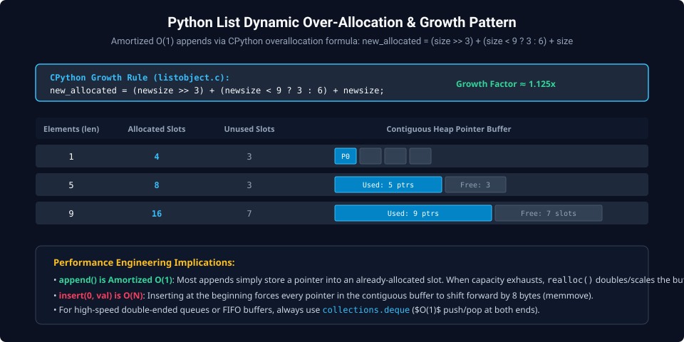
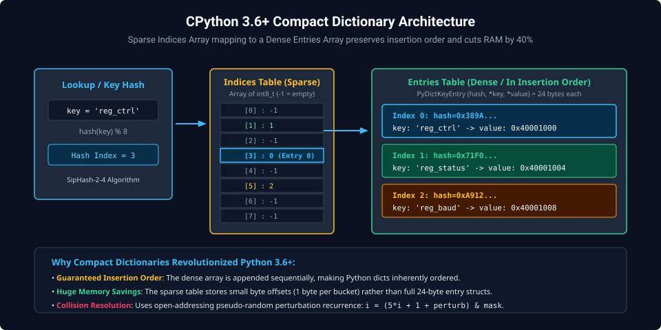
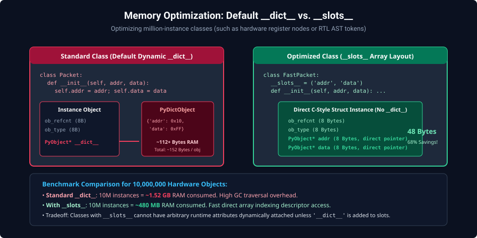

# Chapter 2: Data Structures, Memory Layout & Computational Complexity

Writing performant Python scripts for hardware register modeling, big-data waveform analysis, and automation requires a deep understanding of standard container internals. In CPython, collections are not generic linked structures; they are highly optimized, cache-friendly contiguous arrays and sparse-dense hash tables.

---

## 2.1 Lists and Tuples: Dynamic Array Over-Allocation

A Python `list` is not a linked list; it is a **dynamic array of pointers** (`PyObject**`) allocated in contiguous heap memory.



### Amortized $O(1)$ Growth Formula

When elements are appended beyond current capacity, CPython reallocates the pointer buffer with proportional over-allocation to guarantee that appending $N$ items requires $O(N)$ total time rather than $O(N^2)$:

$$\text{new\_allocated} = \text{newsize} + (\text{newsize} \gg 3) + (\text{newsize} < 9 \;?\; 3 : 6)$$

```python
import sys

data = []
prev_size = sys.getsizeof(data)

print("Tracking List Capacity Expansion:")
for i in range(26):
    data.append(i)
    curr_size = sys.getsizeof(data)
    if curr_size != prev_size:
        # Allocated slots = (size - empty_list_overhead) / pointer_size (8 bytes)
        slots = (curr_size - 56) // 8
        print(f"Length {i:2d} -> New Buffer Size: {curr_size} bytes (Capacity: {slots} slots)")
        prev_size = curr_size
```

### Tuples vs. Lists

- **`tuple`**: Fixed length, immutable contiguous array. Because length is immutable, tuples have zero over-allocation overhead and participate in CPython's free-list recycling (reusing deallocated tuple structs under 20 elements).
- **Complexity Comparison**:
  - `list.append(x)`: $O(1)$ amortized.
  - `list.pop()`: $O(1)$ from tail.
  - `list.insert(0, x)` / `list.pop(0)`: $O(N)$ because the entire contiguous buffer must be shifted using `memmove()`.

> [!TIP]
> For high-throughput FIFO queues or sliding windows, never use `list.pop(0)`. Always use `collections.deque`, which implements a doubly-linked list of 64-element contiguous memory blocks for true $O(1)$ pushes and pops at both ends.

---

## 2.2 Modern Dictionaries & Hash Tables

Since Python 3.6, CPython uses an open-addressing compact hash table architecture that reduces memory consumption by 30% to 40% while inherently preserving key insertion order.



### Compact Dictionary Layout

Traditional hash tables store entries directly in a sparse table containing hash, key pointer, and value pointer ($24\text{ bytes}$ per slot), leaving most slots empty. The modern compact dictionary splits storage into two tables:

1. **Sparse Indices Table**: A compact array of small signed integers (`int8_t`, `int16_t`, or `int32_t` depending on dictionary size). An index of `-1` indicates an empty slot.
2. **Dense Entries Table**: A contiguous array of 24-byte structs (`PyDictKeyEntry`) containing:
   ```c
   typedef struct {
       Py_hash_t me_hash;     // Cached 64-bit SipHash
       PyObject *me_key;      // Pointer to key object
       PyObject *me_value;    // Pointer to value object
   } PyDictKeyEntry;
   ```

### Lookup Sequence & Collision Resolution

1. Compute the key's 64-bit hash using SipHash-2-4.
2. Mask the hash to find the initial bucket in the Indices table: $i = \text{hash} \ \& \ \text{mask}$.
3. Read the entry index from the bucket. If empty (`-1`), key does not exist.
4. If occupied, inspect the entry in the Dense table. If hashes match and `key == entry.key`, return value.
5. If collision occurs, CPython uses pseudo-random perturbation recurrence to probe the next slot:
   $$i = (5 \times i + 1 + \text{perturb}) \ \& \ \text{mask}; \quad \text{perturb} \gg= 5$$

---

## 2.3 Memory Optimization: `__slots__` vs. `__dict__`

By default, every Python class instance maintains a dynamic dictionary (`__dict__`) to store user-defined instance attributes. While flexible, this imposes an overhead of $\sim 152\text{ bytes}$ per instance.



### The `__slots__` Directive

When managing millions of objects (such as nodes in an RTL Abstract Syntax Tree or register bitfields), defining `__slots__` removes `__dict__` entirely, converting instance variables into fixed C-struct pointer arrays:

```python
import sys

class StandardRegister:
    def __init__(self, name: str, addr: int, reset_val: int):
        self.name = name
        self.addr = addr
        self.reset_val = reset_val

class SlottedRegister:
    __slots__ = ('name', 'addr', 'reset_val')
    def __init__(self, name: str, addr: int, reset_val: int):
        self.name = name
        self.addr = addr
        self.reset_val = reset_val

reg_std  = StandardRegister("CTRL", 0x4000, 0x00)
reg_slot = SlottedRegister("CTRL", 0x4000, 0x00)

print(f"Standard instance + dict: {sys.getsizeof(reg_std) + sys.getsizeof(reg_std.__dict__)} bytes")
print(f"Slotted instance:         {sys.getsizeof(reg_slot)} bytes")
```

_Memory savings: Slotted objects consume 48 bytes vs ~152 bytes for standard objects (68% reduction)._

---

## 2.4 The Iteration Protocol & Memory-Efficient Generators

The Python iteration protocol relies on two special methods:

- `__iter__()`: Returns the iterator object itself.
- `__next__()`: Returns the next element or raises `StopIteration` when exhausted.

```python
from itertools import islice

# Generator expression: O(1) memory consumption regardless of stream size
def fibonacci_stream():
    a, b = 0, 1
    while True:
        yield a
        a, b = b, a + b

# Extract first 10 numbers without generating full list
first_10 = list(islice(fibonacci_stream(), 10))
print(f"First 10 Fibonacci numbers: {first_10}")
```

---

##### Copyright (c) 2026 squared-studio
