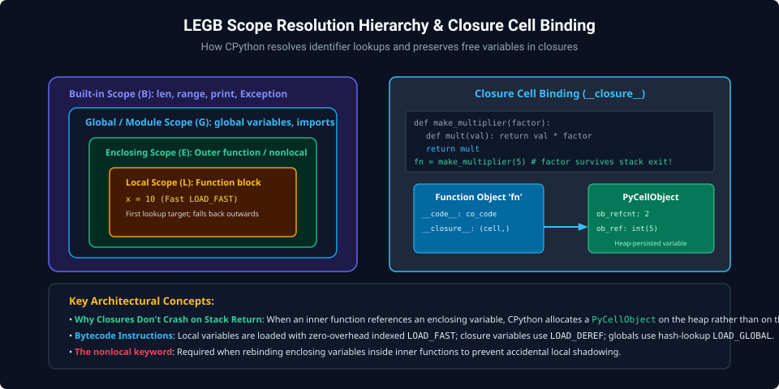
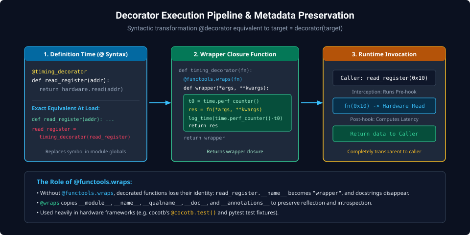
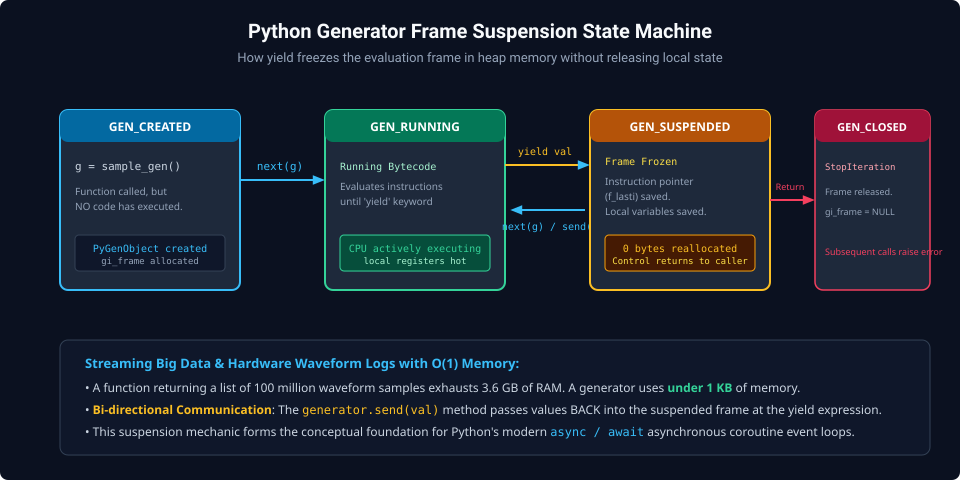

# Chapter 3: Functional Programming, Closures, Decorators & Generators

Python seamlessly merges object-oriented and functional paradigms. In systems engineering, functional abstractions such as closures, decorators, generators, and context managers form the backbone of testing frameworks (e.g., `pytest`, `cocotb`), performance tracing hooks, and streaming waveform decoders.

---

## 3.1 Lexical Scope & The LEGB Rule

Python resolves variable names using the **LEGB Hierarchy**:

1. **L (Local)**: Identifiers defined within the active function body (`LOAD_FAST`).
2. **E (Enclosing)**: Identifiers in outer enclosing functions (`LOAD_DEREF`).
3. **G (Global)**: Identifiers defined at module root (`LOAD_GLOBAL`).
4. **B (Built-in)**: Pre-loaded Python symbols (`len`, `range`, `Exception`).



### Closures & `PyCellObject`

When an inner function references a variable from an enclosing scope, that variable becomes a **free variable**. Because local stack frames are destroyed when a function returns, CPython packages free variables into heap-allocated `PyCellObject` wrappers, ensuring the variable persists for the inner function's entire lifecycle.

```python
def make_scaler(multiplier: float):
    # 'multiplier' is enclosed in a cell object on the heap
    def scale(value: float) -> float:
        return value * multiplier
    return scale

scale_voltage = make_scaler(3.3 / 4096.0) # 12-bit ADC scaler
print(f"Scaled ADC Count 2048: {scale_voltage(2048):.3f} V")

# Inspect closure cells
print(f"Closure cells: {scale_voltage.__closure__}")
print(f"Enclosed value: {scale_voltage.__closure__[0].cell_contents}")
```

---

## 3.2 Decorator Architecture & Metadata Preservation

A decorator is a higher-order function that takes a callable as an argument and returns an augmented callable. The syntax `@decorator` is syntactic sugar for:
$$\text{target} = \text{decorator}(\text{target})$$



### Function Signature & Metadata Preservation (`functools.wraps`)

Without `functools.wraps`, decorated functions lose their identity: `func.__name__` becomes `"wrapper"` and docstrings vanish. `@wraps` copies `__name__`, `__doc__`, and `__annotations__`:

```python
import time
import functools
from typing import Callable, Any

def trace_latency(func: Callable) -> Callable:
    @functools.wraps(func)
    def wrapper(*args: Any, **kwargs: Any) -> Any:
        start_time = time.perf_counter_ns()
        result = func(*args, **kwargs)
        duration_ns = time.perf_counter_ns() - start_time
        print(f"[TRACE] {func.__name__} executed in {duration_ns / 1_000.0:.2f} µs")
        return result
    return wrapper

@trace_latency
def write_axi_register(addr: int, data: int) -> bool:
    # Simulates bus write transaction.
    time.sleep(0.001) # Simulate hardware bus delay
    return True

write_axi_register(0x1000, 0xDEADBEEF)
print(f"Preserved function name: {write_axi_register.__name__}")
print(f"Preserved docstring:     {write_axi_register.__doc__}")
```

---

## 3.3 Generators & State Machine Frame Suspension

When a function includes the `yield` keyword, compiling it generates a generator function. Calling a generator function does not execute its body; instead, it returns a `PyGenObject`.



### Frame Freezing Mechanics

1. **`GEN_CREATED`**: The generator object is instantiated with a suspended evaluation frame (`gi_frame`).
2. **`GEN_RUNNING`**: Executed via `next(g)` or `g.send(val)`.
3. **`GEN_SUSPENDED`**: When `yield` is reached, execution halts. The instruction pointer (`f_lasti`) and all local variable references remain frozen in heap memory.
4. **`GEN_CLOSED`**: When the function exits or raises `StopIteration`, the frame is released.

### Bi-Directional Coroutine Communication (`send()`)

Generators can receive values dynamically using the `send()` method:

```python
def moving_average_filter():
    total = 0.0
    count = 0
    average = 0.0
    while True:
        # yield current average, then pause and wait for incoming sample
        sample = yield average
        if sample is None:
            break
        total += sample
        count += 1
        average = total / count

filter_stream = moving_average_filter()
next(filter_stream) # Prime the generator to first yield

for raw_val in [10.0, 12.0, 14.0, 16.0]:
    curr_avg = filter_stream.send(raw_val)
    print(f"Sample: {raw_val} -> Running Average: {curr_avg:.2f}")
```

---

## 3.4 Context Managers & Resource Safety

Context managers ensure deterministic resource acquisition and release using the Context Management Protocol:

- `__enter__()`: Allocates resources (files, hardware locks, DMA buffers).
- `__exit__(exc_type, exc_val, exc_tb)`: Reclaims resources, even if unhandled exceptions occur.

```python
from contextlib import contextmanager
import time

@contextmanager
def hardware_transaction_lock(bus_id: int):
    print(f"[LOCK] Acquired hardware mutex for Bus {bus_id}")
    try:
        yield bus_id
    finally:
        print(f"[LOCK] Released hardware mutex for Bus {bus_id}")

with hardware_transaction_lock(0) as bus:
    print(f"Writing configuration data to Bus {bus}...")
```

---

##### Copyright (c) 2026 squared-studio
