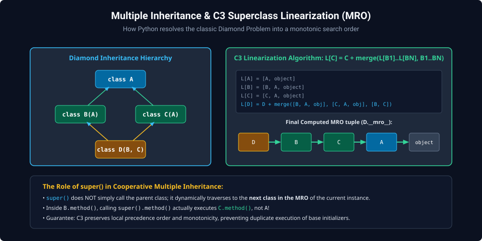
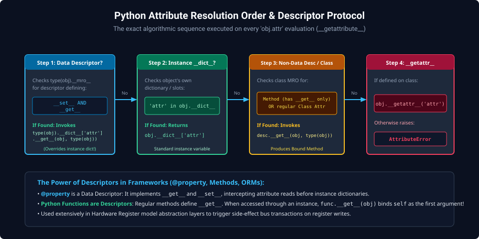
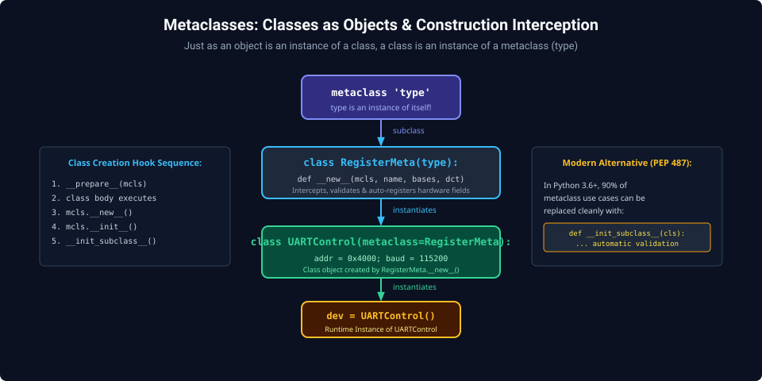

# Chapter 4: Object-Oriented Programming, Metaclasses & Descriptors

Object-oriented programming in Python extends far beyond simple encapsulation. By mastering the C3 Superclass Linearization algorithm, the Descriptor Protocol, and Metaclasses, engineers can construct declarative hardware register abstraction layers (RAL), domain-specific modeling languages, and self-validating configuration trees.

---

## 4.1 Multiple Inheritance & C3 Linearization (MRO)

Python supports multiple inheritance. When resolving attributes across complex diamond inheritance graphs, Python avoids ambiguity using the **C3 Superclass Linearization Algorithm** (Method Resolution Order, MRO).



### C3 Linearization Rules

The linearization $L[C]$ of a class $C$ with base classes $B_1, B_2, \dots, B_N$ is:
$$L[C] = [C] + \text{merge}\big(L[B_1], L[B_2], \dots, L[B_N], [B_1, B_2, \dots, B_N]\big)$$

The `merge` operation selects the first head of a list that does not appear in the tail of any other list. This guarantees:

1. **Local Precedence**: Base classes are inspected in the order defined in the class declaration.
2. **Monotonicity**: If class $A$ precedes class $B$ in any linearization, $A$ precedes $B$ in all descendant linearizations.

```python
class BaseRegister:
    def write(self, val: int):
        print(f"BaseRegister: writing 0x{val:X}")

class ReadClearRegister(BaseRegister):
    def write(self, val: int):
        print("ReadClearRegister: clearing status flags")
        super().write(val)

class LoggedRegister(BaseRegister):
    def write(self, val: int):
        print("LoggedRegister: logging transaction to disk")
        super().write(val)

class StatusRegister(ReadClearRegister, LoggedRegister):
    pass

# Inspect computed MRO
print("MRO Resolution Order:")
for cls in StatusRegister.__mro__:
    print(f"  -> {cls.__name__}")

# Demonstrate cooperative super() calls
reg = StatusRegister()
reg.write(0xFF)
```

_Execution trace shows cooperative chaining:_ `ReadClearRegister` $\to$ `LoggedRegister` $\to$ `BaseRegister`.

---

## 4.2 The Descriptor Protocol

Descriptors power Python's core attribute machinery—including `@property`, `@classmethod`, `@staticmethod`, and ORM field mappings. A descriptor is any class that defines one or more of `__get__`, `__set__`, or `__delete__`.



### Data Descriptors vs. Non-Data Descriptors

- **Data Descriptor**: Implements both `__get__()` and `__set__()`. **Takes precedence over the instance's own `__dict__`**.
- **Non-Data Descriptor**: Implements only `__get__()` (e.g. standard methods). Yields precedence to instance attributes.

### Building a Hardware Register Field Descriptor

```python
class BitField:
    def __init__(self, offset: int, width: int, doc: str = ""):
        self.offset = offset
        self.width = width
        self.mask = ((1 << width) - 1) << offset
        self.name = ""

    def __set_name__(self, owner, name):
        self.name = name

    def __get__(self, instance, owner):
        if instance is None:
            return self
        raw_val = instance.raw_value
        return (raw_val & self.mask) >> self.offset

    def __set__(self, instance, value: int):
        max_val = (1 << self.width) - 1
        if not (0 <= value <= max_val):
            raise ValueError(f"{self.name} value {value} out of bounds (max {max_val})")
        # Read-Modify-Write bitfield
        instance.raw_value = (instance.raw_value & ~self.mask) | ((value << self.offset) & self.mask)

class UARTControlReg:
    enable = BitField(offset=0, width=1, doc="Module Enable")
    mode   = BitField(offset=1, width=3, doc="Operating Mode")
    parity = BitField(offset=4, width=2, doc="Parity Mode")

    def __init__(self):
        self.raw_value = 0x00

ctrl = UARTControlReg()
ctrl.enable = 1
ctrl.mode = 5
ctrl.parity = 2
print(f"Assembled 32-bit Register Value: 0x{ctrl.raw_value:02X}")
print(f"Extracted Mode Field:           {ctrl.mode}")
```

---

## 4.3 Metaclasses & Class Construction Interception

In Python, classes are themselves runtime objects. A **Metaclass** is the class of a class. The default metaclass in Python is `type`.



### Intercepting Class Creation

Metaclasses permit validating class attributes, auto-generating serialization schemas, or registering models at import time:

```python
class RegisterMeta(type):
    def __new__(mcls, name, bases, attrs):
        # Auto-detect all BitField descriptors and register their offsets
        fields = {}
        for key, val in list(attrs.items()):
            if isinstance(val, BitField):
                fields[key] = val
        attrs["_fields"] = fields
        cls = super().__new__(mcls, name, bases, attrs)
        print(f"[META] Registered peripheral model: '{name}' with {len(fields)} fields")
        return cls

class I2CControl(metaclass=RegisterMeta):
    start = BitField(0, 1)
    stop  = BitField(1, 1)
    ack   = BitField(2, 1)
```

> [!TIP]
> In Python 3.6+, the special method `__init_subclass__()` handles most metaclass use cases with cleaner, more idiomatic syntax without requiring full metaclass machinery.

---

##### Copyright (c) 2026 squared-studio
