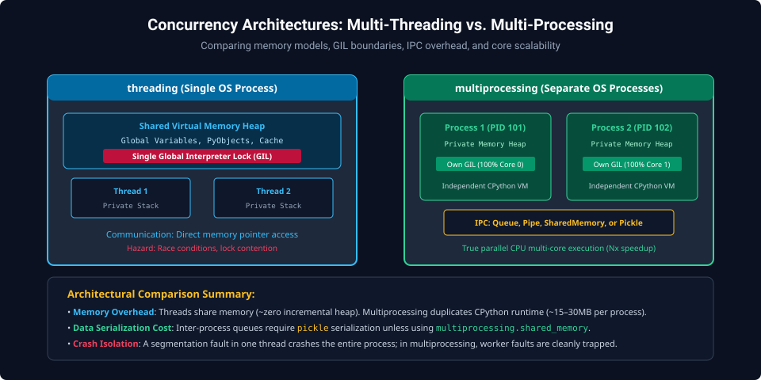
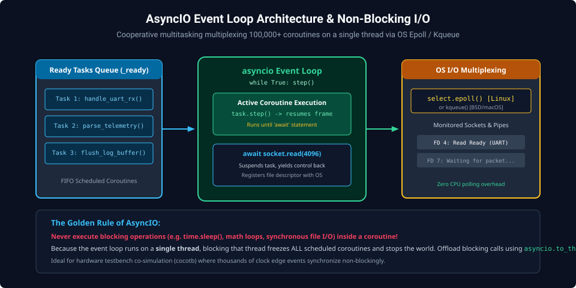

# Chapter 5: Concurrency, Parallelism & Asynchronous I/O

High-throughput systems software must process concurrent I/O streams, execute parallel simulations, and communicate across processes. Python provides three distinct concurrency models: Multi-Threading, Multi-Processing, and Asynchronous Event Loops (`asyncio`). Choosing the correct model requires understanding operating system scheduling, memory isolation, and the CPython Global Interpreter Lock (GIL).

---

## 5.1 The Global Interpreter Lock (GIL) Mechanics

The CPython **Global Interpreter Lock** is a mutual exclusion lock that prevents multiple native OS threads from executing Python bytecodes concurrently within a single process.


### Why the GIL Exists

CPython's internal memory manager is not thread-safe. Without the GIL, concurrent mutations of `ob_refcnt` across native threads would cause catastrophic race conditions, memory leaks, and premature object deallocations.

### When the GIL Releases

CPython releases the GIL during:

- Blocking OS system calls (disk file I/O, network socket `recv`/`send`, `select`).
- Pure C/C++ extensions and NumPy computations (via `Py_BEGIN_ALLOW_THREADS`).
- Periodic bytecode switching intervals (default: every $5\text{ ms}$).

---

## 5.2 Multi-Threading vs. Multi-Processing



### Architecture Comparison

| Feature           | `threading`                                     | `multiprocessing`                                |
| :---------------- | :---------------------------------------------- | :----------------------------------------------- |
| **Address Space** | Single shared virtual memory heap               | Completely isolated memory per process           |
| **GIL Bound?**    | **Yes** (limited to 1 CPU core for Python code) | **No** (Each process runs its own CPython VM)    |
| **Data Sharing**  | Direct pointer access (requires locks)          | Inter-Process Communication (IPC, Shared Memory) |
| **Best Used For** | I/O-bound tasks (network, serial logging)       | CPU-bound computation (parsing, compilation)     |

### Parallel Worker Pool Implementation

```python
import multiprocessing as mp
import time

def compute_crc_chunk(chunk_id: int, size: int) -> int:
    crc = 0xFFFFFFFF
    for i in range(size):
        crc ^= (chunk_id * 1000 + i)
    return crc

if __name__ == "__main__":
    chunk_size = 5_000_000
    tasks = [(i, chunk_size) for i in range(4)]

    # Utilize all available CPU cores concurrently
    with mp.Pool(processes=mp.cpu_count()) as pool:
        start_time = time.perf_counter()
        results = pool.starmap(compute_crc_chunk, tasks)
        elapsed = time.perf_counter() - start_time

    print(f"Parallel CRC Results: {results}")
    print(f"Elapsed Time across {mp.cpu_count()} cores: {elapsed:.3f} s")
```

---

## 5.3 Asynchronous Programming (`asyncio`)

`asyncio` provides cooperative, single-threaded concurrency using an **Event Loop** multiplexing non-blocking file descriptors via OS kernel interfaces (`epoll` on Linux, `kqueue` on macOS/BSD).



### Core Async Primitives

- **`async def`**: Declares a native coroutine function.
- **`await`**: Yields control back to the event loop until the awaited `Future` completes.
- **`asyncio.gather()`**: Runs multiple coroutines concurrently.

```python
import asyncio

async def poll_peripheral_status(name: str, poll_interval_ms: int):
    for cycle in range(3):
        await asyncio.sleep(poll_interval_ms / 1000.0) # Non-blocking sleep
        print(f"[{name}] Polled status register: Cycle {cycle}")

async def main():
    # Concurrently monitor two hardware peripherals on a single thread
    await asyncio.gather(
        poll_peripheral_status("UART0", 100),
        poll_peripheral_status("SPI1",  150)
    )

asyncio.run(main())
```

---

##### Copyright (c) 2026 squared-studio
