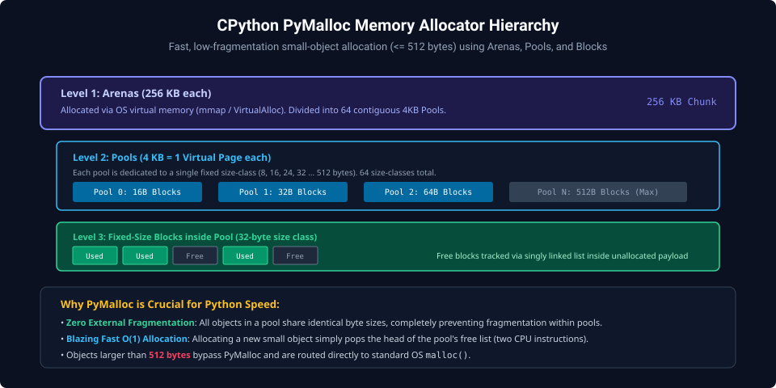
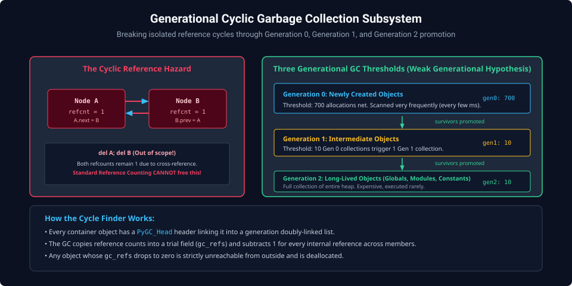
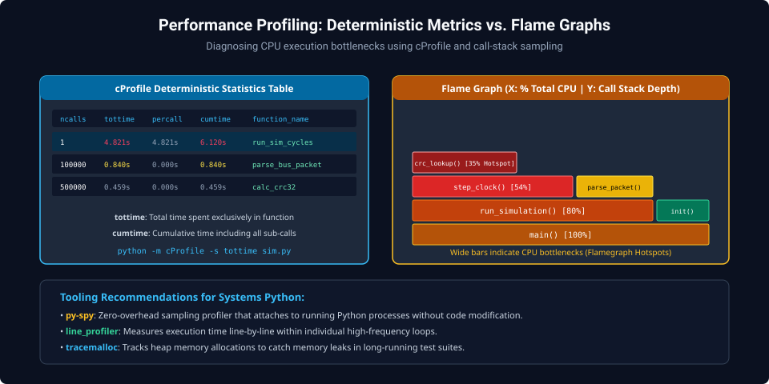

# Chapter 6: Memory Management, Garbage Collection & Performance Profiling

Writing reliable long-running daemons, test suites, and automation pipelines requires understanding how CPython allocates physical RAM, reclaims cyclic references, and profiles execution bottlenecks.

---

## 6.1 PyMalloc: Small Object Allocator Hierarchy

CPython implements a specialized memory allocator (`pymalloc`) tailored for small objects ($\le 512\text{ bytes}$). Allocating and freeing millions of small objects via system `malloc()` causes catastrophic heap fragmentation and CPU kernel context switches.



### The PyMalloc 3-Tier Hierarchy

1. **Arenas ($256\text{ KB}$)**:
   - Chunk of contiguous virtual memory requested from the OS via `mmap()` or `VirtualAlloc()`.
   - Divided into 64 contiguous $4\text{ KB}$ Pools.
2. **Pools ($4\text{ KB} = 1\text{ OS page}$)**:
   - Bound to a specific **Size-Class** (e.g. 16, 32, 48 ... 512 bytes).
   - Manages an array of uniform, fixed-size blocks.
3. **Blocks**:
   - The exact memory slots returned to `PyObject`.
   - Free blocks inside a pool are tracked via an embedded singly-linked free list ($O(1)$ allocation).

---

## 6.2 The Generational Cyclic Garbage Collector

CPython uses a two-tier memory reclamation strategy:

1. **Reference Counting**: The primary mechanism. When an object's `ob_refcnt` drops to zero, its memory is deallocated **immediately**.
2. **Cyclic Garbage Collector**: Resolves circular references that reference counting cannot break (e.g., $A \to B \to A$).



### The Three GC Generations

Objects are categorized into three generations based on the **Weak Generational Hypothesis** (most objects die young):

- **Generation 0**: Newly allocated container objects. Scanned frequently (after 700 net allocations).
- **Generation 1**: Objects that survive a Generation 0 collection.
- **Generation 2**: Long-lived objects (modules, static configuration, globals). Scanned rarely.

### Cycle Detection Algorithm

Containers maintain a `PyGC_Head` header linked into doubly-linked generation lists. The GC performs trial subtractions: it decrements trial reference counts for all internal pointers. Any object whose trial count drops to zero is provably unreachable from outside and is scheduled for collection.

```python
import gc

# Disable automatic collection during latency-critical loops
gc.disable()

# Perform time-critical hardware read sequence...

# Re-enable and force collection
gc.enable()
collected = gc.collect()
print(f"Collected {collected} unreachable cyclic objects.")
```

---

## 6.3 Performance Profiling: `cProfile` & Flame Graphs

Premature optimization wastes engineering time. Systems engineers rely on deterministic profilers to identify real bottlenecks.



### Profiling with `cProfile`

```python
import cProfile
import pstats

def high_overhead_task():
    return [sum(range(1000)) for _ in range(5000)]

profiler = cProfile.Profile()
profiler.enable()

high_overhead_task()

profiler.disable()
stats = pstats.Stats(profiler).sort_stats("tottime")
stats.print_stats(5)
```

- **`ncalls`**: Number of invocations.
- **`tottime`**: Total time spent exclusively within the function (excluding child calls).
- **`cumtime`**: Cumulative time spent in function and all descendant functions.

---

##### Copyright (c) 2026 squared-studio
