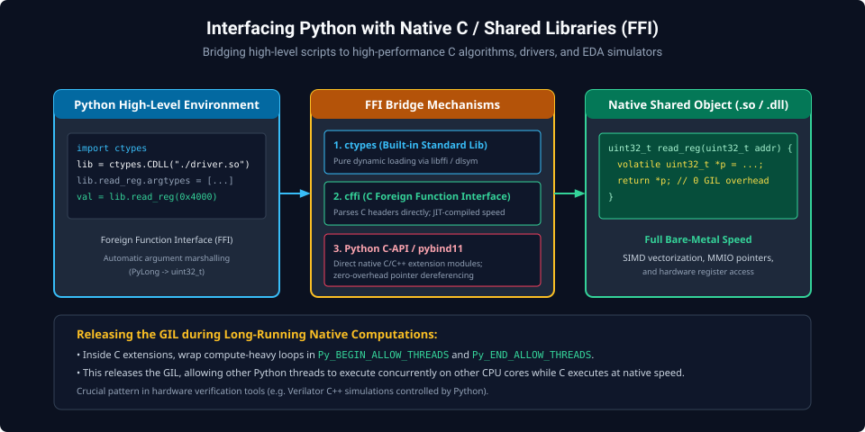
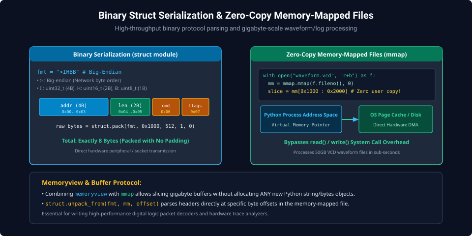
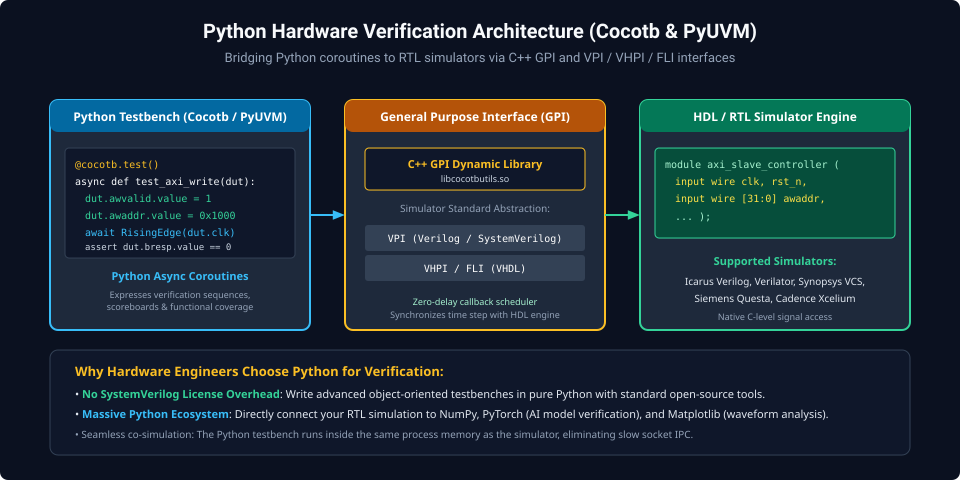

# Chapter 7: Systems Programming, C Extensions & Hardware Verification Scripting

Python's real power in systems and hardware engineering lies in its ability to interface directly with low-level OS system calls, call compiled C libraries with zero overhead, stream binary waveforms, and drive RTL verification testbenches.

---

## 7.1 Interfacing with C: `ctypes` & `cffi`

Python can directly invoke functions inside compiled shared objects (`.so`, `.dll`, `.dylib`) without writing C boilerplate.



### `ctypes` Standard Library FFI

```python
import ctypes

# Define C struct layout matching native hardware driver
class HardwareRegMap(ctypes.Structure):
    _fields_ = [
        ("ctrl",   ctypes.c_uint32),
        ("status", ctypes.c_uint32),
        ("baud",   ctypes.c_uint16),
        ("flags",  ctypes.c_uint8),
    ]

# Cast an integer base address into a typed C pointer
PERIPHERAL_BASE = 0x40001000
reg_ptr = ctypes.POINTER(HardwareRegMap)(ctypes.c_void_p(PERIPHERAL_BASE))
```

---

## 7.2 Binary Serialization & Zero-Copy `mmap`

Handling binary packets and multi-gigabyte VCD waveform logs requires zero-copy stream processing.



### Packed Struct Serialization (`struct`)

```python
import struct

# Format: > (Big-Endian), I (uint32), H (uint16), B (uint8)
PACKET_FMT = ">IHB"

packet_data = struct.pack(PACKET_FMT, 0x1000, 512, 0x01)
print(f"Serialized Binary Stream ({len(packet_data)} bytes): {packet_data.hex()}")

# Unpack directly
addr, length, cmd = struct.unpack(PACKET_FMT, packet_data)
print(f"Unpacked: Addr=0x{addr:X}, Len={length}, Cmd={cmd}")
```

### Zero-Copy Memory-Mapped Waveform Parsing (`mmap`)

```python
import mmap

def scan_vcd_waveform(filename: str):
    with open(filename, "r+b") as f:
        # Map entire file directly into process virtual memory
        with mmap.mmap(f.fileno(), 0, access=mmap.ACCESS_READ) as mm:
            # Zero-copy slicing via memoryview
            view = memoryview(mm)
            if view[:5] == b"$date":
                print("Valid VCD header detected.")
```

---

## 7.3 Python Hardware Verification: Cocotb Architecture

Modern hardware engineering increasingly adopts **Cocotb** (Coroutine Co-simulation Testbench) to replace cumbersome SystemVerilog testbenches with clean, test-driven Python code.



### Cocotb Co-Simulation Flow

1. The RTL simulator (Icarus Verilog, Verilator, Questa, VCS) loads the compiled C++ **General Purpose Interface (GPI)** library.
2. The GPI embeds the CPython runtime directly inside the simulator process memory.
3. Python testbench coroutines interact with Verilog/SystemVerilog wires as native Python attributes via VPI/VHPI.

```python
# Example Cocotb Testbench
import cocotb
from cocotb.triggers import RisingEdge, Timer

@cocotb.test()
async def test_axi_write_cycle(dut):
    # Initialize clock and reset
    dut.clk.value = 0
    dut.rst_n.value = 0
    await Timer(10, units="ns")
    dut.rst_n.value = 1

    # Drive AXI Bus Transaction
    dut.awaddr.value = 0x4000
    dut.awvalid.value = 1
    await RisingEdge(dut.clk)

    # Verify DUT response
    while not dut.awready.value:
        await RisingEdge(dut.clk)

    dut.awvalid.value = 0
    assert dut.bresp.value == 0, "AXI Write Error response!"
```

---

##### Copyright (c) 2026 squared-studio
