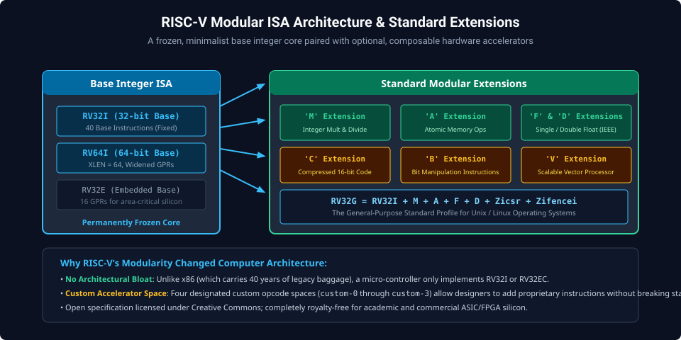
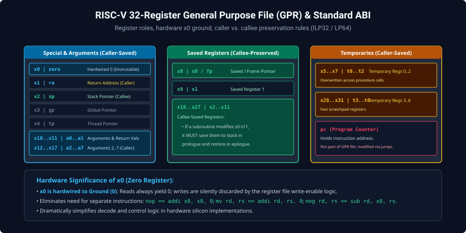
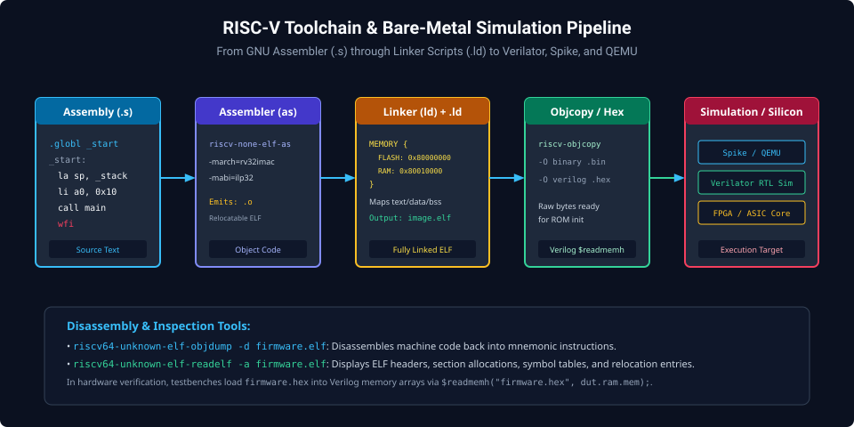

# Chapter 1: RISC-V Architecture, ISA Modular Philosophy & Register File

The RISC-V (pronounced "risk-five") Instruction Set Architecture represents a paradigm shift in computer architecture. Born at UC Berkeley in 2010, RISC-V is an open, royalty-free, extensible standard based on Reduced Instruction Set Computer (RISC) principles. Unlike proprietary, complex instruction set architectures burdened by decades of backwards-compatibility bloat, RISC-V features a clean-slate design partitioned into a small, permanently frozen base integer ISA and optional, standardized modular extensions.

---

## 1.1 The RISC-V Modular Philosophy & Standard Extensions

The fundamental design principle of RISC-V is modularity: a tiny, complete base integer instruction set can be implemented in minimal silicon area (under 15,000 gates for a microcontroller), while domain-specific hardware accelerators and floating-point units can be added modularly without altering the core integer instructions.



### The Base Integer ISAs

The base integer ISA is strictly frozen and comes in three machine-word widths ($XLEN$):

1. **RV32I ($XLEN = 32$)**: 32-bit address space and 32-bit general-purpose registers. Consists of only 40 core instructions.
2. **RV64I ($XLEN = 64$)**: 64-bit address space and widened 64-bit general-purpose registers, standard for Unix-capable applications.
3. **RV32E ($XLEN = 32$)**: Embedded subset with only 16 general-purpose registers (`x0`–`x15`), optimizing physical silicon die area for ultra-low-power microcontrollers.

### Standard Modular Extensions

- **M (Integer Multiplication and Division)**: Hardware multiply, divide, and remainder operations.
- **A (Atomic Memory Operations)**: Synchronization primitives including Load-Reserved/Store-Conditional (`lr`/`sc`) and Atomic Memory Operations (`amo`).
- **F & D (Single and Double-Precision Floating Point)**: IEEE 754-2008 compliant floating-point registers and compute hardware.
- **C (Compressed Instructions)**: 16-bit encoded instruction subset reducing binary code size by 25–30%.
- **B (Bit Manipulation)**: Hardware acceleration for bitwise rotation, population count (`cpop`), leading zero count (`clz`), and bitfield extraction.
- **V (Vector Architecture)**: Scalable SIMD vector pipelines for ML, DSP, and scientific computing.
- **RV32G / RV64G**: Standard general-purpose profile defined as:
  $$\text{RV32G} = \text{RV32I} + \text{M} + \text{A} + \text{F} + \text{D} + \text{Zicsr} + \text{Zifencei}$$

---

## 1.2 General-Purpose Register File & The Zero Register (`x0`)

RISC-V processors provide 32 general-purpose integer registers designated by hardware indices `x0` through `x31`. Each register holds a word of width $XLEN$ bits.



### Hardware Register `x0` (`zero`)

Register `x0` is physically hardwired to Ground ($0$).

- **Reads**: Any read from `x0` evaluates to numerical zero ($0x00000000$).
- **Writes**: Any write targeting `x0` is discarded silently by the register file write-enable logic.
- **Architectural Elegance**: Eliminates the need for separate dedicated instructions:
  - `nop` is encoded as `addi x0, x0, 0`
  - `mv rd, rs` is encoded as `addi rd, rs, 0`
  - `neg rd, rs` is encoded as `sub rd, x0, rs`

---

## 1.3 Register Roles & Standard ABI Calling Conventions

The standard RISC-V Application Binary Interface (ABI) establishes strict software conventions governing how registers are allocated across procedure boundaries:

| Register    | ABI Name    | Role                                | Saver       |
| :---------- | :---------- | :---------------------------------- | :---------- |
| `x0`        | `zero`      | Hardwired Zero                      | N/A         |
| `x1`        | `ra`        | Return Address                      | Caller      |
| `x2`        | `sp`        | Stack Pointer (16-byte aligned)     | Callee      |
| `x3`        | `gp`        | Global Pointer                      | Static Init |
| `x4`        | `tp`        | Thread Pointer                      | Static Init |
| `x5`–`x7`   | `t0`–`t2`   | Temporary Registers 0–2             | Caller      |
| `x8`        | `s0` / `fp` | Saved Register 0 / Frame Pointer    | Callee      |
| `x9`        | `s1`        | Saved Register 1                    | Callee      |
| `x10`–`x11` | `a0`–`a1`   | Function Arguments & Return Values  | Caller      |
| `x12`–`x17` | `a2`–`a7`   | Function Arguments 2–7              | Caller      |
| `x18`–`x27` | `s2`–`s11`  | Saved Registers 2–11                | Callee      |
| `x28`–`x31` | `t3`–`t6`   | Temporary Registers 3–6             | Caller      |
| `pc`        | `pc`        | Program Counter (internal register) | N/A         |

### Caller-Saved vs. Callee-Saved Conventions

- **Caller-Saved (`t0-t6`, `a0-a7`, `ra`)**: A called function is free to overwrite these registers without preserving their previous values. If the caller requires their contents after the call, the caller must spill them onto the stack.
- **Callee-Saved (`s0-s11`, `sp`)**: A called function must guarantee that these registers retain their original values upon return. If a subroutine modifies `s0`, it must save `s0` onto the stack during its prologue and restore it in its epilogue.

---

## 1.4 Toolchain, Assembly Compilation & Simulation

RISC-V assembly programs are built using the GNU cross-compilation toolchain and tested inside instruction set simulators or RTL testbenches.



### GNU Toolchain Commands

```bash
# 1. Assemble source into relocatable object file (.o)
riscv64-unknown-elf-as -march=rv32im -mabi=ilp32 boot.s -o boot.o

# 2. Link object files using custom memory linker script
riscv64-unknown-elf-ld -T linker.ld boot.o -o firmware.elf

# 3. Disassemble to verify machine instructions
riscv64-unknown-elf-objdump -d -M numeric firmware.elf

# 4. Generate raw binary / Verilog hex for ROM loading
riscv64-unknown-elf-objcopy -O verilog firmware.elf firmware.hex
```

---

##### Copyright (c) 2026 squared-studio
