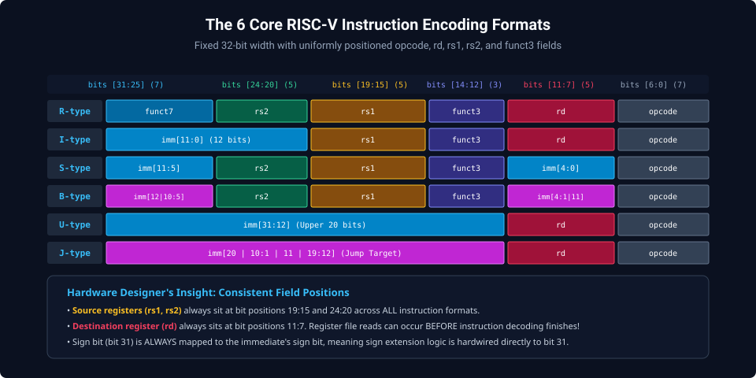
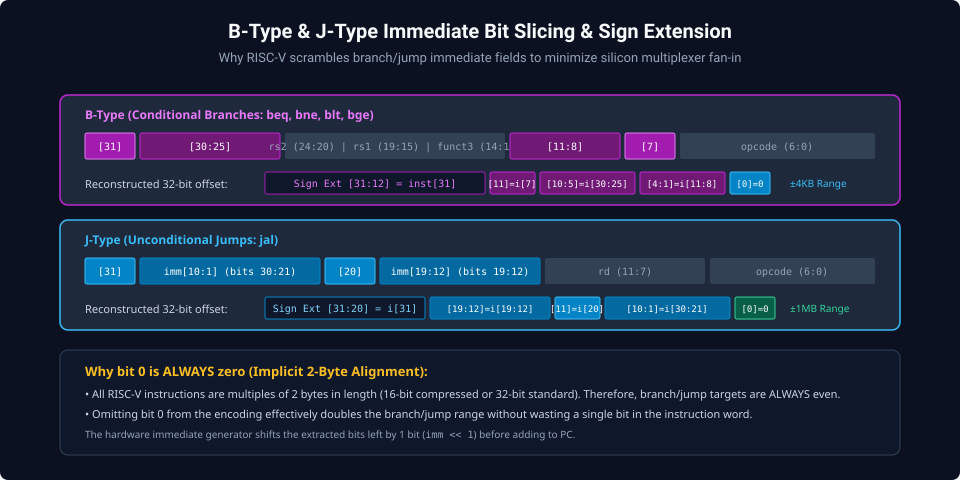
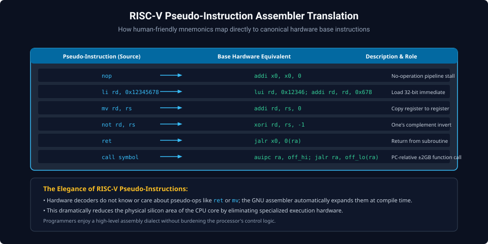

# Chapter 2: Instruction Encoding Formats & Machine Code Generation

Every instruction in the base RISC-V ISA is exactly 32 bits ($4\text{ bytes}$) wide and must reside at a 4-byte memory boundary (or a 2-byte boundary when the C compressed extension is enabled). By adopting a fixed-length format with strictly uniform register and immediate positions, RISC-V dramatically simplifies instruction decode logic and minimizes hardware multiplexer delays in pipelined execution units.

---

## 2.1 The 6 Core Instruction Formats

All RV32I instructions map to one of six core encoding formats:



### Format Classification

1. **R-Type (Register-Register)**:
   - Arithmetic and logic operations operating strictly on registers (`add`, `sub`, `sll`, `xor`, `srl`, `sra`, `or`, `and`).
   - Fields: `funct7[31:25]`, `rs2[24:20]`, `rs1[19:15]`, `funct3[14:12]`, `rd[11:7]`, `opcode[6:0]`.
2. **I-Type (Immediate / Loads)**:
   - Arithmetic with 12-bit constants (`addi`, `andi`, `ori`, `xori`), memory loads (`lw`, `lh`, `lb`), and indirect jumps (`jalr`).
   - Fields: `imm[11:0]` (bits 31:20), `rs1[19:15]`, `funct3[14:12]`, `rd[11:7]`, `opcode[6:0]`.
3. **S-Type (Stores)**:
   - Memory store operations (`sw`, `sh`, `sb`). The 12-bit immediate is split into two fragments across the word.
   - Fields: `imm[11:5]` (bits 31:25), `rs2[24:20]`, `rs1[19:15]`, `funct3[14:12]`, `imm[4:0]` (bits 11:7), `opcode[6:0]`.
4. **B-Type (Branches)**:
   - Conditional branches (`beq`, `bne`, `blt`, `bge`, `bltu`, `bgeu`). Encodes a signed $\pm 4\text{KB}$ PC-relative offset.
5. **U-Type (Upper Immediate)**:
   - 20-bit upper immediate operations (`lui`, `auipc`).
   - Fields: `imm[31:12]` (upper 20 bits), `rd[11:7]`, `opcode[6:0]`.
6. **J-Type (Unconditional Jumps)**:
   - Unconditional jump and link (`jal`). Encodes a signed $\pm 1\text{MB}$ PC-relative offset.

---

## 2.2 Immediate Slicing & Sign Extension Mechanics

To achieve maximum performance in silicon, RISC-V designers intentionally scrambled immediate bit positions in S, B, and J formats.



### Why Scramble Bits?

- **Bit 31 is ALWAYS the Sign Bit**: In every single immediate format (I, S, B, U, J), the instruction's sign bit resides at bit position 31. Hardware sign-extension logic wires bit 31 directly to the upper bits without waiting for instruction decode.
- **Zero Mux Fan-In for Register Read**: The source register fields (`rs1` at 19:15 and `rs2` at 24:20) and destination field (`rd` at 11:7) remain at identical bit positions across all formats. The register file access begins immediately during instruction fetch!
- **Implicit Bit 0 = 0**: Because branch and jump targets are multiples of 2 bytes, bit 0 is omitted from B and J encodings, doubling the jump reach:
  - B-type: 12 instruction bits encode a 13-bit signed offset ($\pm 4\text{KB}$).
  - J-type: 20 instruction bits encode a 21-bit signed offset ($\pm 1\text{MB}$).

---

## 2.3 Worked Machine Code Decoding Example

Let us decode the raw 32-bit hexadecimal machine code instruction:
$$\text{Machine Code} = \text{0x00A58513}$$

### Step 1: Binary Expansion

$$\text{0x00A58513} = \text{0000 0000 1010 0101 1000 0101 0001 0011}_2$$

### Step 2: Extract Opcode (Bits 6:0)

$$\text{opcode} = \text{0010011}_2 = \text{0x13} \implies \text{OP-IMM (Integer Arithmetic Immediate)}$$

### Step 3: Extract Fields for I-Type Format

- `rd` (Bits 11:7): $\text{01010}_2 = 10 \implies \text{x10 (a0)}$
- `funct3` (Bits 14:12): $\text{000}_2 = 0 \implies \text{ADDI}$
- `rs1` (Bits 19:15): $\text{01011}_2 = 11 \implies \text{x11 (a1)}$
- `imm[11:0]` (Bits 31:20): $\text{0000 0000 1010}_2 = +10$

### Final Disassembly

$$\text{addi a0, a1, 10} \quad (\text{or } \text{addi x10, x11, 10})$$

---

## 2.4 Pseudo-Instruction Translation Architecture

The GNU assembler provides high-level pseudo-instructions to improve readability. The assembler automatically expands these into base hardware instructions:



```assembly
# High-Level Assembly Source:
    nop
    mv   a0, t0
    not  t1, t2
    neg  s0, s1
    ret

# Assembled Canonical Machine Instructions:
    addi x0, x0, 0       # nop
    addi a0, t0, 0       # mv a0, t0
    xori t1, t2, -1      # not t1, t2
    sub  s0, x0, s1      # neg s0, s1
    jalr x0, 0(ra)       # ret
```

---

##### Copyright (c) 2026 squared-studio
