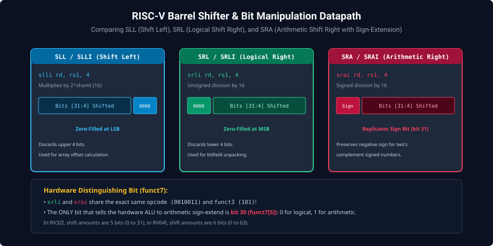
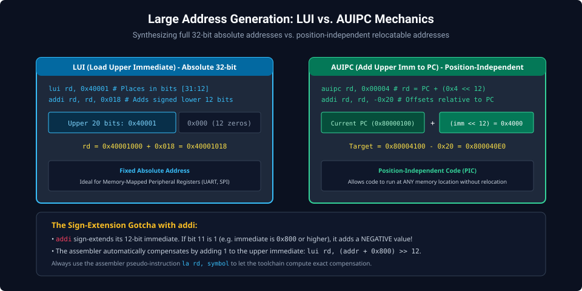
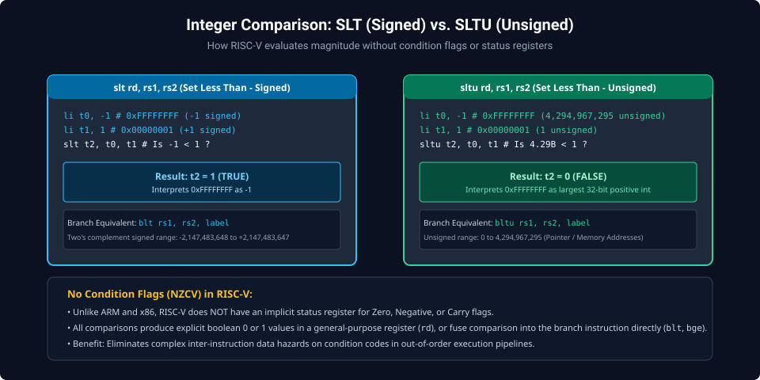

# Chapter 3: Arithmetic, Logic, Shifts & Bit Manipulation (RV32I / RV32B)

Computing data in RISC-V occurs exclusively within the 32 general-purpose registers. The RV32I base instruction set provides a streamlined set of arithmetic, logical, comparison, and shift instructions that synthesize all computational primitives without requiring specialized condition flags.

---

## 3.1 Integer Arithmetic & Overflow Detection

RV32I provides addition and subtraction:

- `add rd, rs1, rs2`: Computes $\text{rd} = \text{rs1} + \text{rs2}$ (modulo $2^{32}$).
- `sub rd, rs1, rs2`: Computes $\text{rd} = \text{rs1} - \text{rs2}$.
- `addi rd, rs1, imm`: Adds a 12-bit sign-extended immediate ($\text{rd} = \text{rs1} + \text{SignExt}(\text{imm})$).

```assembly
# Basic Arithmetic Operations
    li   t0, 100
    li   t1, 45
    add  t2, t0, t1      # t2 = 145
    sub  t3, t0, t1      # t3 = 55
    addi t4, t0, -20     # t4 = 80
```

### Detecting Arithmetic Overflow Without Condition Codes

Unlike x86 or ARM, RISC-V does not set Overflow or Carry flags in a status register. Overflows are detected using small software branch idioms:

```assembly
# Unsigned Addition Overflow: rd < rs1 indicates overflow wrapped around
    add  t0, a0, a1
    bltu t0, a0, overflow_detected

# Signed Addition Overflow: Signs of operands match, but result sign differs
    add  t0, a0, a1
    xor  t1, a0, a1      # t1 < 0 if operands have opposite signs
    bltz t1, no_overflow # Opposite signs can NEVER overflow
    xor  t2, t0, a0      # t2 < 0 if sum has different sign than a0
    bltz t2, overflow_detected
no_overflow:
```

---

## 3.2 Barrel Shifter Operations: SLL, SRL & SRA

RISC-V provides three distinct bit-shift operations, each available in register-register and register-immediate forms:



### Shift Instruction Mechanics

1. **SLL / SLLI (Shift Left Logical)**:
   - Shifts bits left, zero-filling the LSBs ($x \ll n \equiv x \times 2^n$). Discards shifted-out MSBs.
2. **SRL / SRLI (Shift Right Logical)**:
   - Shifts bits right, zero-filling the MSBs. Implements unsigned integer division by $2^n$.
3. **SRA / SRAI (Shift Right Arithmetic)**:
   - Shifts bits right while **replicating the original sign bit (bit 31)** across newly vacated MSBs. Preserves negative sign for two's complement numbers ($x \gg n \equiv \lfloor x / 2^n \rfloor$).

```assembly
    li   t0, -16         # 0xFFFFFFF0 (-16 in two's complement)
    srli t1, t0, 2       # t1 = 0x3FFFFFFC (1,073,741,820 unsigned)
    srai t2, t0, 2       # t2 = 0xFFFFFFFC (-4 signed)
    slli t3, t0, 1       # t3 = 0xFFFFFFE0 (-32)
```

---

## 3.3 Large Constants & Addresses: `lui` vs. `auipc`

A single RISC-V instruction is 32 bits wide, meaning it cannot contain a 32-bit immediate constant. Loading a full 32-bit address or value requires a two-instruction pair.



### 1. `lui` (Load Upper Immediate)

Places a 20-bit constant into bits `[31:12]` of `rd` and zeroes bits `[11:0]`. Paired with `addi` to synthesize absolute addresses:

```assembly
# Synthesize absolute address 0x40001018
    lui  a0, 0x40001     # a0 = 0x40001000
    addi a0, a0, 0x018   # a0 = 0x40001018
```

### 2. `auipc` (Add Upper Immediate to PC)

Computes $\text{rd} = \text{PC} + (\text{imm} \ll 12)$. This enables **Position-Independent Code (PIC)**:

```assembly
# Form relocatable PC-relative address
    auipc a0, 0x00004    # a0 = PC + 0x4000
    addi  a0, a0, -0x20  # Fine-tune lower offset
```

---

## 3.4 Comparison: Signed (`slt`) vs. Unsigned (`sltu`)

RISC-V evaluates magnitude explicitly using the Set Less Than instructions:



- **`slt rd, rs1, rs2`**: Treats operands as signed two's complement numbers. Sets $\text{rd} = 1$ if $\text{rs1} < \text{rs2}$, else $0$.
- **`sltu rd, rs1, rs2`**: Treats operands as unsigned integers. Sets $\text{rd} = 1$ if $\text{rs1} < \text{rs2}$, else $0$.

```assembly
    li   t0, -1          # 0xFFFFFFFF (-1 signed / 4.29B unsigned)
    li   t1, 1           # 0x00000001 (+1 signed / 1 unsigned)

    slt  t2, t0, t1      # t2 = 1 (TRUE:  -1 < 1 in signed space)
    sltu t3, t0, t1      # t3 = 0 (FALSE: 4.29B < 1 is FALSE in unsigned)
```

---

##### Copyright (c) 2026 squared-studio
