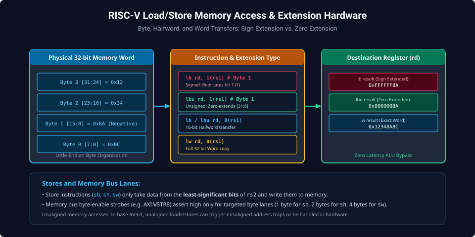
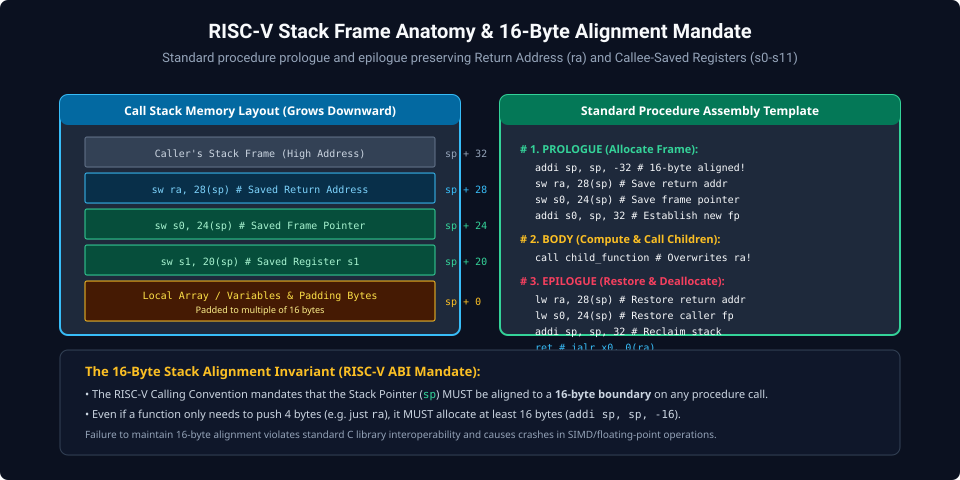
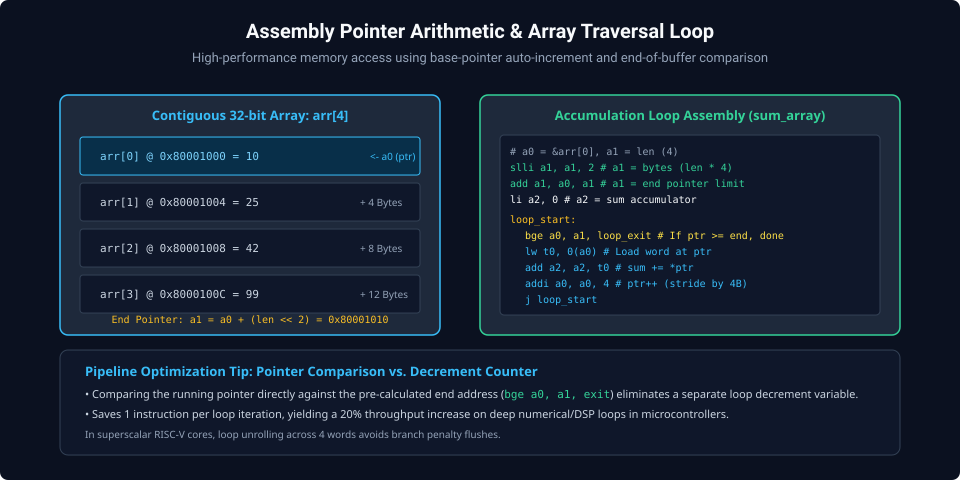

# Chapter 4: Memory Access, Addressing Modes & Stack Frame Operations

RISC-V is a strict **Load/Store Architecture**. Arithmetic and logic operations can never directly address memory operands; data must be explicitly loaded from memory into general-purpose registers, processed, and stored back. This separation ensures uniform instruction latencies and predictable memory bus interactions.

---

## 4.1 Memory Addressing Modes & Bus Alignment

In RV32I, the effective memory address for all loads and stores is computed using a single addressing mode:
$$\text{Effective Address} = \text{rs1} + \text{SignExt}(\text{offset}[11:0])$$



### Load Instructions

- **`lw rd, offset(rs1)`**: Loads full 32-bit word ($4\text{ bytes}$).
- **`lh rd, offset(rs1)`**: Loads 16-bit halfword and sign-extends bit 15 across bits `[31:16]`.
- **`lhu rd, offset(rs1)`**: Loads 16-bit halfword and zero-extends bits `[31:16]`.
- **`lb rd, offset(rs1)`**: Loads 8-bit byte and sign-extends bit 7 across bits `[31:8]`.
- **`lbu rd, offset(rs1)`**: Loads 8-bit byte and zero-extends bits `[31:8]`.

### Store Instructions

- **`sw rs2, offset(rs1)`**: Stores 32-bit word from `rs2` to memory.
- **`sh rs2, offset(rs1)`**: Stores lower 16 bits `rs2[15:0]` to memory.
- **`sb rs2, offset(rs1)`**: Stores lower 8 bits `rs2[7:0]` to memory.

---

## 4.2 The 16-Byte Stack Frame Architecture

The RISC-V ABI mandates that the Stack Pointer (`sp` / `x2`) grows downwards toward lower memory addresses and **MUST remain aligned to a 16-byte boundary** whenever a procedure call is executed:
$$\text{sp} \pmod{16} = 0$$



### Standard Subroutine Frame Template

```assembly
# Subroutine: process_data
    .globl process_data
process_data:
    # 1. PROLOGUE: Allocate 32 bytes (16-byte aligned)
    addi sp, sp, -32
    sw   ra, 28(sp)      # Save return address
    sw   s0, 24(sp)      # Save frame pointer
    sw   s1, 20(sp)      # Save callee-saved register s1
    addi s0, sp, 32      # Set new frame pointer base

    # 2. BODY: Perform computation
    mv   s1, a0          # Store input parameter safely in s1
    call external_helper # May freely clobber t0-t6, a0-a7, ra
    add  a0, a0, s1      # a0 = return value + s1

    # 3. EPILOGUE: Restore registers & deallocate frame
    lw   ra, 28(sp)      # Restore return address
    lw   s0, 24(sp)      # Restore caller's frame pointer
    lw   s1, 20(sp)      # Restore caller's s1
    addi sp, sp, 32      # Reclaim stack frame space
    ret                  # jalr x0, 0(ra)
```

---

## 4.3 High-Throughput Array Traversal Loops

Processing contiguous memory buffers (e.g. DMA descriptors, digital audio samples, or hardware register blocks) is optimized using pointer auto-increment loops:



```assembly
# Function: sum_int_array(const int *arr, int len)
# Inputs:  a0 = pointer to array, a1 = number of elements
# Outputs: a0 = integer sum
    .globl sum_int_array
sum_int_array:
    # Check for empty array
    blez a1, empty_array

    # Calculate end pointer: end = a0 + (len * 4)
    slli t0, a1, 2       # t0 = len * 4 bytes
    add  t1, a0, t0      # t1 = end pointer limit
    li   t2, 0           # t2 = accumulator (sum)

loop_body:
    lw   t3, 0(a0)       # Load word: t3 = *a0
    add  t2, t2, t3      # sum += t3
    addi a0, a0, 4       # Advance pointer: a0++
    bltu a0, t1, loop_body # Loop while a0 < end

    mv   a0, t2          # Return sum in a0
    ret

empty_array:
    li   a0, 0
    ret
```

---

##### Copyright (c) 2026 squared-studio
