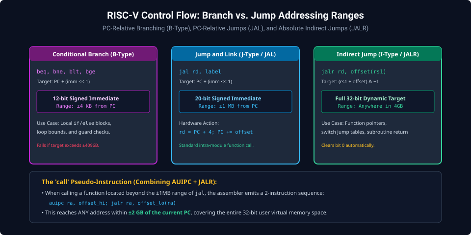
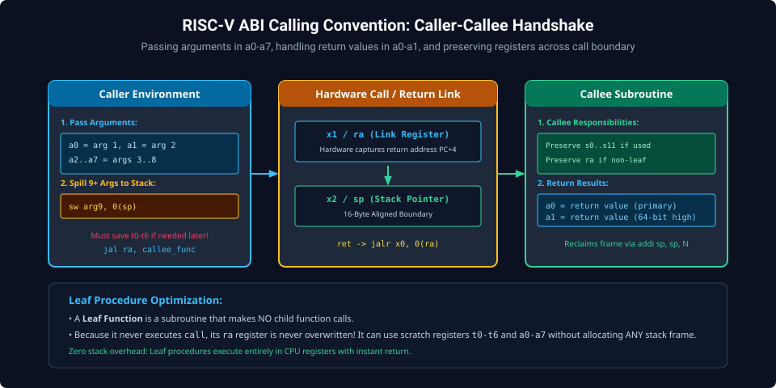
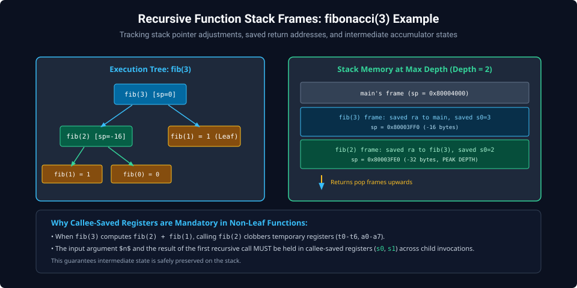

# Chapter 5: Control Flow, Branching, Subroutines & ABI Calling Conventions

Complex program logic requires conditional decisions, loop repetitions, and modular procedure execution. RISC-V eliminates complex hardware condition code registers, implementing comparison-and-branch instructions directly in the decode and execution stages.

---

## 5.1 Conditional Branching (B-Type)

RISC-V conditional branches compare two registers and branch if the condition evaluates to true:

- `beq rs1, rs2, offset`: Branch if Equal ($\text{rs1} == \text{rs2}$).
- `bne rs1, rs2, offset`: Branch if Not Equal ($\text{rs1} \neq \text{rs2}$).
- `blt rs1, rs2, offset`: Branch if Less Than Signed ($\text{rs1} < \text{rs2}$).
- `bge rs1, rs2, offset`: Branch if Greater/Equal Signed ($\text{rs1} \ge \text{rs2}$).
- `bltu rs1, rs2, offset`: Branch if Less Than Unsigned ($\text{rs1} < \text{rs2}$).
- `bgeu rs1, rs2, offset`: Branch if Greater/Equal Unsigned ($\text{rs1} \ge \text{rs2}$).



---

## 5.2 Unconditional Jumps: `jal` and `jalr`

- **`jal rd, label` (Jump and Link)**:
  - Stores $\text{PC} + 4$ into destination register `rd` (usually `ra` / `x1`).
  - Jumps to $\text{PC} + (\text{imm} \ll 1)$ with a signed $\pm 1\text{MB}$ range.
- **`jalr rd, offset(rs1)` (Jump and Link Register)**:
  - Stores $\text{PC} + 4$ into `rd`.
  - Sets $\text{PC} = (\text{rs1} + \text{offset}) \ \& \ \sim 1$.
  - Enables indirect procedure calls, dynamic function dispatch tables, and subroutine returns (`ret` $\equiv$ `jalr x0, 0(ra)`).

---

## 5.3 Procedure Linkage & ABI Handshake

The RISC-V calling convention defines a structured contract between caller and callee:



### Procedure Protocol Rules

1. **Argument Passing**: The first 8 integer arguments are passed in registers `a0` through `a7`. Additional arguments (9+) are pushed onto the caller's stack frame.
2. **Return Values**: Scalar return values are returned in `a0` (and `a1` for 64-bit results on RV32).
3. **Register Preservation**: Callee subroutines must preserve `s0`–`s11` and `sp`. Temporary registers `t0`–`t6` may be freely overwritten.

---

## 5.4 Recursive Procedures & Stack Frames

Recursive algorithms demonstrate nested frame allocation and the necessity of callee-saved registers:



```assembly
# Function: int fib(int n)
# Inputs:  a0 = n
# Outputs: a0 = fibonacci(n)
    .globl fib
fib:
    # Base cases: fib(0) = 0, fib(1) = 1
    li   t0, 1
    bgt  a0, t0, fib_recursive
    ret                  # Return a0 directly (0 or 1)

fib_recursive:
    # Allocate 16-byte stack frame
    addi sp, sp, -16
    sw   ra, 12(sp)      # Preserve return address
    sw   s0, 8(sp)       # Preserve s0 (holds n)
    sw   s1, 4(sp)       # Preserve s1 (holds fib(n-1))

    mv   s0, a0          # s0 = n

    # Compute fib(n - 1)
    addi a0, s0, -1
    call fib
    mv   s1, a0          # s1 = fib(n - 1)

    # Compute fib(n - 2)
    addi a0, s0, -2
    call fib             # a0 = fib(n - 2)

    # Compute sum: fib(n) = fib(n - 1) + fib(n - 2)
    add  a0, s1, a0

    # Epilogue: Restore frame
    lw   ra, 12(sp)
    lw   s0, 8(sp)
    lw   s1, 4(sp)
    addi sp, sp, 16
    ret
```

---

##### Copyright (c) 2026 squared-studio
